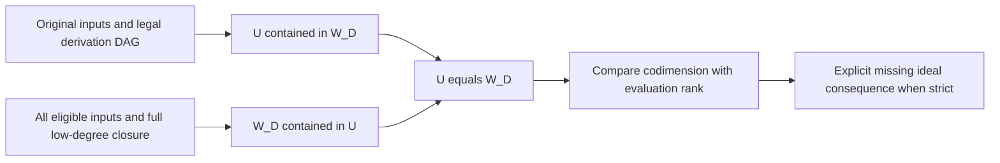

# Independent technical review: Boolean closure certificates

2026-11-04. Handoff `TASK-20261104-1a19d6`; archive owner
`TASK-20261104-df29f3`. Reviewed producer snapshot
`9e9e3054aa7e29bc5d79751d46bf15e1a4dd6f42` on
`codex/boolean-fall-bounds-20261104`.

**Finding: no correctness defect found in the inspected tranche.** The written
coefficient-generic bridge, two-sided finite checker, SAT witness extraction,
ordinary-polynomial repair checker, and nine scoped Lean statements agree at
their stated boundaries. This is a software and generic-lemma fidelity review;
it grants no official scientific status or family bound.

## Inputs and independence

All five handoff inputs were read and byte-compared with the committed
snapshot. SHA-256 values were:

| Input | SHA-256 |
| --- | --- |
| `THEORY.md` | `dfa40b7fab5eeaa1e0757bf40dae36eab83f48ccb8b06abd0a97541961b5e8a1` |
| `certificate.py` | `f3b249fb715402fff2ed3a76c2958a75022e4a499fa828f3b125dcc3ffc0a877` |
| `fixture_builder.py` | `d081663b490597a40c99530603bea2762a64200ebe24ed4a71b185fddf807d0b` |
| `normalization.py` | `78ae165f5e07d38a500d7a6a18205c381ec8577c4e998cb2b2ca9436423e2f20` |
| `formal/CryptoResearch/FallDegree/ClosureCertificates.lean` | `1fc342e21de26a5254ea81c4e797174703ee060e6b13569585b9008ae9fd3aa1` |

The first four paths are relative to this report's directory. I reconstructed
the bridge, low-degree intersection test, and evaluation-kernel criterion from
the definitions before opening `fixture_builder.py`. I then inspected the
producer, tests and source-bound historical fixture. This was blind to the
fixture implementation, not blind to `THEORY.md` or the Lean proof text; no
stronger blindness is claimed. No producer private reasoning or sibling review
was provided. Later coordinator messages reported producer checks, a CI
wrapper change, and addition of the handwritten SAT control to the producer
test file; the findings here use my own checks. Those test/wrapper changes are
outside the five reviewed inputs and the nine-test replay reported below.

Runtime provenance: this session is identified to the assistant as Codex based
on GPT-6. The handoff requests `review-adversarial` / `xhigh`; no externally
authenticated serving-model identity or effective-effort attestation was
available. No model override, model/API dispatch or subagent dispatch occurred.

## Sources checked

Provenance `internal`, read: repository `AGENTS.md`; relevant literature and
review sections of `docs/agent-contract-extended.md`; `docs/skill-routing.md`;
`.claude/skills/route/SKILL.md`, `review-evidence/SKILL.md`,
`review-evidence/references/lean-review.md`, `formal/SKILL.md`, and
`solver/SKILL.md`; the five inputs; `test_certificate.py`, `README.md`,
`proof-map.json`, `validation/scoped-checks.json`, archived axiom-audit and
fresh-kernel logs; the imported `LastFall.lean`; target YAML, toolchain and
Lake dependency/configuration pins; and CryptoLean's `tools/AuditAxioms.lean`.
Relevant prior definitions were checked in Proposition 1.1 of
`analysis/semaev-m2-last-fall-degree/theorem-dossier.md`, its
`results/verification-correction-20261019.md`, and
`experiments/EXP-PFDR-cbdefb/stage1-closure-convention.md`. These distinguish
strict closure from ordinary Macaulay span and a certified superspace from
exact closure.

Provenance `retrieved`, read by this reviewer: Huang–Kosters–Yang–Yeo,
[arXiv:1505.02532](https://arxiv.org/html/1505.02532), Definitions 2.1 and 2.5
and Proposition 2.6's finiteness statement; Caminata–Gorla,
[arXiv:2112.05579v2](https://arxiv.org/html/2112.05579v2), Definition 1.5.
Both primary HTML texts were fetched during this review with Python
`urllib.request`. They confirm the ordinary-polynomial bounded closure and
last-fall definitions being implemented. No novelty, trace-relation, or
first-fall literature assessment was needed or performed. A knowledge-search
connector was not available in the active tools; the prior-source search scope
was the named repository records and these primary definitions.

## Re-derivation and implementation findings

| Joint and locations | Result |
| --- | --- |
| Written bridge, `THEORY.md:10–54` | Holds for a field, explicit bit equations, multilinear input lifts, and the stated strict multiplication budget. The raw-input cap qualification is necessary and correctly retained. |
| Primal side, `certificate.py:97–133` | Every accepted row follows from an eligible original input, scalar-addition, or a strict-budget variable product. No arbitrary polynomial or kernel seed can enter. This gives candidate span contained in the genuine closure. |
| Reverse side, `certificate.py:134–145` | Descending-degree RREF exposes the full intersection with degree below the cap, including cancellations among high-degree input rows. Eligible-input containment and all variable products of this intersection give the reverse inclusion. |
| SAT witness, `certificate.py:146–178` | Boolean enumeration uses all original generators. The rank comparison and RREF nullspace reconstruction return an actual missing ideal consequence, not an inference from failure to derive one. |
| Formal repair, `normalization.py:9–63` | Repeated exponent reduction constructs the displayed cofactors. The separate checker expands the ordinary-polynomial identity, checks multilinearity, and checks each cofactor product's degree. It does not substitute evaluation equality for formal identity. |
| Producer, `fixture_builder.py:9–66` | Its descending pivots and work list multiply every newly discovered low-degree pivot; accepted certificates are checked again independently of that pivot construction. Arithmetic helpers are shared with the checker, so the supplied producer-based tests alone are not an independent arithmetic implementation. |

For the bridge, reduce a repeated exponent by
`m*b_i^a - m*b_i^(a-1) = m*b_i^(a-2)*(b_i^2-b_i)`.
Every summand has degree at most the original monomial. Thus a bounded
polynomial and its multilinear lift differ by bit-equation consequences at the
same cap. Projecting an ordinary derivation into the quotient is legal:
nonzero ordinary factor degrees add, and the degree of each intermediate
normal form is no larger than its ordinary degree. Conversely, a permitted
quotient variable product lifts to `b_i*w`, followed by subtraction of its
bounded repair. Linear combinations commute with normal form. At caps zero
and one, affine polynomials already are multilinear. This gives both
inclusions and the preimage equality. It does not permit raw high-degree
inputs to appear before their degree cap.

For reverse closure, a reduced row whose pivot has degree D cannot have that
pivot canceled using any other reduced row. Consequently any combination of
rows with degree at most D-1 has zero coefficient on every degree-D pivot
row. The lower-pivot rows therefore span the whole low-degree intersection;
checking their products suffices by linearity.

For the SAT criterion, let `E` evaluate squarefree monomials of degree at most
D at all Boolean solutions. Boolean assignment indicators satisfy
`delta_a*f = f(a)*delta_a`. Outside the zero set, some input value is
invertible, putting `delta_a` in the generated ideal; the indicators prove
that ideal equals the vanishing ideal. Hence its degree-D piece is `ker E`.
With `U=W_D`, `codim U > rank E` means `ker E` strictly contains U.
The nullspace vectors constructed from every free evaluation column form a
basis, so at least one lies outside U. Lifting that vector gives an ordinary
ideal consequence missing at D, and therefore last fall greater than D.
Finite-system finiteness is available mathematically; the Lean lower lemma
keeps its finiteness hypothesis explicit.



No finding has a severity or counterexample because no defect was identified.
This does not assert exhaustive parser robustness or machine verification of
the Python implementation. In particular, `normalization.check_repair` is a
Python helper taking an already specified modulus, variable count and cap;
it is not a field-admission API like `certificate.read_system`.

## Fresh checks and controls

All checks below are fixed software or theorem regressions, not scientific
trials, parameter sweeps or benchmarks. No source or frozen evidence was
edited. Python was run with `-B` and `PYTHONDONTWRITEBYTECODE=1`.

1. `python3 -B -m unittest discover -s analysis/boolean-fall-certificates-20261104 -v`
   returned exit 0: **9 tests, all passing**. The historical source-bound
   eight-variable fixture returned ranks `1,11,79`. Its test reproduces input
   derivation and equation digest; this is one fixture, not a large-packet audit.
2. A direct handwritten certificate, without importing the fixture producer,
   used F5, two variables, `F={xy-1}`, D=2, one input step, basis `[0]`.
   Exact result:

   ```json
   {"rank":1,"codimension":3,"solutions":1,"evaluation_rank":1,"contains_one":false,"lfd_lower_bound":3,"lfd_upper_bound":null,"missing_consequence":[[2,1],[3,4]],"kernel_premises":0}
   ```

   The returned polynomial is `y-xy`. It vanishes at the sole Boolean
   solution `(1,1)` and is outside `span{xy-1}` by its y coefficient. Its
   ordinary ideal-membership identity is
   `y-xy = -y*(xy-1) + x*(y^2-y)`. Thus the positive SAT path checks by hand,
   including the signs in odd characteristic.
3. Another direct one-input certificate for `F={x+y}`, D=1, has two Boolean
   solutions and evaluation rank 2 over F2, giving no lower bound. Over F5 it
   has one Boolean solution and evaluation rank 1, giving lower bound 2 and
   missing polynomial y. This checks coefficient-sensitive behavior.
4. A degree-zero empty-span certificate with one zero generator over F2
   returned rank 0, two solutions and no spurious lower bound.
5. For each of p=2,5,65537, the raw ordinary polynomial
   `(p-1)*x^3*y^2 + x*y^2` normalized to zero and its generated repairs were
   accepted at cap 5. Replacing all cofactors by zero was rejected with
   `ordinary polynomial repair identity failed`, despite equality on every
   Boolean assignment.
6. The existing proves-too-much controls passed: a closed evaluation kernel
   for `F={xy+1}` cannot enter through an unsupported kernel rule; and the
   nonclosed span of `{x+xy,1+xy}` is rejected because its low-degree
   combination has an escaping variable product. Changed input digests,
   forward references, composite coefficient moduli and multiplication
   beyond the strict cap were rejected by the supplied tests.

## Lean statement fidelity and machine scope

The installed Lean reports version 4.35.0, commit
`eb6cafb7290e8bd5f2937522d8d804f58f02bafc`. Mathlib's installed revision is
`cfc55fc58714a59dc06e6e79edc6d1d95140d3c2`; CryptoLean's is
`60952c696ded7f3da4f4517006d9af6482662487`, matching the manifest and Lake
configuration. Both package checkouts had clean `git status --short`.

Fresh elaboration used the exact target source as stdin to `lean --stdin`,
with `#check` and `#print axioms` appended for every one of its nine theorems.
`LEAN_PATH` was set to the current formal project's `.lake/build/lib/lean`
and each installed package's corresponding path. No `.olean` was written.
Result: **exit 0**, with every theorem reporting only
`propext`, `Classical.choice`, and `Quot.sound`. A separate invocation of
`lean --run .lake/packages/CryptoLean/tools/AuditAxioms.lean CryptoResearch.FallDegree.ClosureCertificates`
under the same search path returned **exit 0**:

```text
audited 9 theorems in [CryptoResearch.FallDegree.ClosureCertificates]; 0 failing, 0 trusted (native_decide)
```

The source was also searched for holes, added axioms and compiler-trust
constructs; none were found. My separate
`leanchecker --fresh CryptoResearch.FallDegree.ClosureCertificates` replay
under the same search path completed with **exit 0** and empty stdout/stderr.
That command rechecks the installed module artifact; the independent stdin
elaboration above checks the reviewed source. These checks rely on installed
dependency artifacts and the local Lean toolchain; this is not independently
authenticated binary provenance or a complete-workspace verification.

| Declaration and line in `ClosureCertificates.lean` | Exact checked scope |
| --- | --- |
| `V_le_closed_space`, 14 | Ordinary bounded closure lies in any eligible-input-containing, budget-multiplication-closed submodule. |
| `V_le_ideal_span`, 22 | Every ordinary bounded consequence is in the generated ideal. |
| `exact_closure_of_two_sides`, 31 | Equality additionally requires primal inclusion `U <= V`; the theorem does not obtain it from dual closure. |
| `not_mem_V_of_closed_separator`, 39 | A closed superspace separator proves nonmembership; equality of spaces is unnecessary here. |
| `lastFallSet_of_refutation`, 48 | A derivation of one at D supplies a full last-fall upper bound. |
| `exact_lastFallDegree_of_refutation`, 56 | Adjacent upper/lower derivability of one gives exact D; the unit-ideal fact is derived from the upper proof. D=0 has incompatible premises and yields no false instance. |
| `lastFallDegree_gt_of_missing_consequence`, 71 | A specified ideal member of degree at most D, absent from `V F D`, gives strict lower bound, assuming last-fall finiteness. |
| `assignmentIndicator_partition`, 86 | Exact polynomial partition using x and 1-x over a field; no characteristic-two restriction. |
| `refutation_of_localized_fibres`, 99 | Final linear assembly from already-derivable localized products, fibre contradictions and a partition. It constructs neither those products nor their degree bound. |

Hypothesis delta against these scoped source claims: **no unjustified added
hypothesis found**. The following binders need explicit attention when applying
the generic declarations to a concrete system; none is silently discharged by
this module:

| Binder or instance | Classification and justification |
| --- | --- |
| `Field k`; arbitrary polynomial variable type | Implied by the bridge's field setting; finite Boolean variable types instantiate the more general ordinary-ring declarations. No coefficient identification with F2 is made. |
| `hinput`, `hmul` in containment/exactness/separator lemmas | Implied by the respective stated closure obligations. Full polynomial `hmul` remains a hypothesis in Lean; the Python variable-product check is related to it by the written bridge, not a formal refinement theorem. |
| `hprimal` in exactness | Implied by the explicitly required primal obligation; it is not claimed to follow from a kernel check. |
| `hupper`, `hlower` in exact refutation | Implied by the adjacent-certificate premise; the upper derivation supplies ideal membership and finiteness. |
| `hfin` in the missing-consequence lemma | Implied mathematically for the finite input/finite-variable polynomial setting by last-fall finiteness; explicitly assumed for the theorem's arbitrary variable/input types. The module does not formalize that general finiteness bridge. |
| `hq`, `hdeg`, `hmiss` in the lower lemma | Implied by the stated missing-consequence premise; no claim that missing one is sufficient for SAT. |
| `DecidableEq` and finite set in the partition lemma | Implied for a finite Boolean support; this permits enumerating the subsets used in the source partition. |
| `Fintype` fibre/row indices; `hrows`, `hcontradiction`, `hpartition` | Implied by the explicitly finite final-assembly claim and its stated prerequisites. `hrows` is exactly the support-localization obligation left open, not a proved S3 fact. |

Machine status is passed for fresh source elaboration, all-nine-theorem axiom
checks, and the fresh kernel replay; fidelity is **faithful_scoped** for the nine conditional statements.
No Lean verification of the generic Boolean normal-form bridge, Python parser,
finite-field arithmetic or serialized certificates follows from them.

## Remaining scope and procedure limits

The generic Lean normal-form bridge, support-aware S3 localization/descent,
large-instance primitive provenance and certificate replay, and parameter-uniform
growing lower-bound construction remain open. The prime digit growth law and
historical large-instance conclusions were not reviewed or promoted. No later
fall cutoff is obtained from a stabilized finite profile.

Only this Markdown report is written, as the handoff requires. No commit,
status transition, additional receipt, graph artifact or PDF is created by this
reviewer. The embedded dependency diagram records the reviewed proof chain;
canonical research/performance graphs are unaffected by this scoped technical
review. This narrow write scope takes precedence over broader skill guidance
for official review packets.

Reviewer attestation: joints owned are the written bridge, both certificate
inclusions, SAT witness criterion/extraction, formal repair correctness and exact
Lean statement scope; all five inputs inspected; fixture blindness as described
above; no sibling verdicts read; no scientific trial launched. Verdict:
**holds at the inspected scope, with the enumerated unproved transfers retained**.
