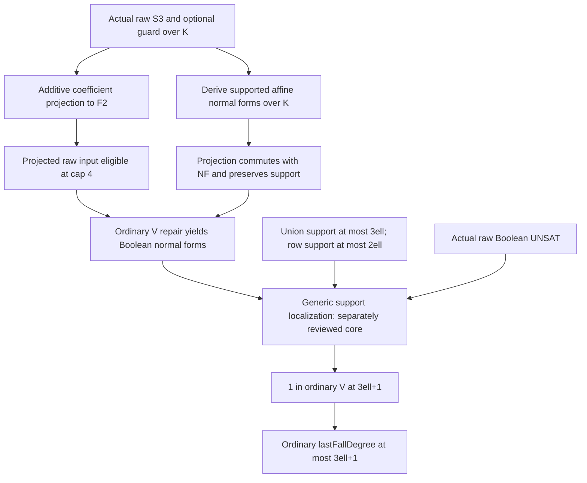

# Independent raw binary coefficient-descent review

Task: `TASK-20261105-72286d`; archival owner: `TASK-20261105-c2c68c`.
Input commit: `98a188b4ee3b2d0134856251ce02043e42128119`.
Date: 2026-11-05 (UTC). This is a technical review, not a scientific state transition.

## Statement-first independent derivation

This section was written before opening `BinaryCoefficientDescent.lean`, producer
attempt logs/status, or any sibling review. `coefficient-descent/CLAIM.md` was the
first task artifact read. The calculation below was derived before opening
`BOUNDS.md`; that later source was checked for context only.

Write `x^[2] = sum c_i^2 B_i` for a zero-constant base linear form `x`, and
similarly for the other linear forms. In characteristic two,

```
S3(x,y,u) = x²y² + x²u² + y²u² + xyu + a6,
S3(u,z,r) = u²z² + u²r² + z²r² + uzr + a6.
```

The raw total degrees are at most four. Boolean normalization replaces squares
of the linear forms by their coefficient-squared linear forms. Hence normal
forms are affine in the entire auxiliary tuple: every monomial has at most
one auxiliary variable. Their base supports are contained in `Sx ∪ Sy`, `Sz`,
and `Sx ∪ Sy` for the first S3, second S3, and optional guard respectively.
The guard `v(x+y)+1` is already of raw degree at most two and affine in all
auxiliaries. Overlapping base supports only decrease their union sizes.

An additive coefficient map sends each coefficient to F2 while retaining its
monomial exponent. It preserves zero coefficients and sums and cannot enlarge
monomial support or degree. Boolean normalization also only adds coefficients
when exponents with the same Boolean support coalesce, so it commutes with an
additive coefficient map. No product identity or image-of-one identity is
needed or generally true. Mapping the already expanded polynomial therefore
preserves the required shape even when the images do not factor as mapped
linear forms.

There are at most `s = 3ell` base bits and at most `L = 2ell` base bits in any
row. The support-aware localization argument requires `max(2,s+1,L+2)`:
staged indicator multiplication of a row affine in auxiliaries stays within
`L+2`; complement indicators cost at most `s+1`. For each base assignment an
inconsistent affine system over F2 has a constant linear combination equal to
one. Summing the full Boolean indicators yields one. The raw normalization
repair additionally requires cap four, so the final sufficient cap is

```
D = max(4, 3ell+1, 2ell+2) = 3ell+1    (ell >= 1).
```

From `1 ∈ V(F,D)`, every polynomial `q` lies in
`V(F,max(D,deg q))` by permitted multiplication of the degree-zero constant;
this proves the ordinary last-fall upper bound, not just a bounded-degree
refutation. The argument imposes no bound on the finite auxiliary count.
The affine inconsistency step specifically requires actual F2 outputs: a
characteristic-two extension field need not have every element Boolean.

## Review evidence

## Verdict and exact scope

**Machine status: passed (scoped). Fidelity: faithful_scoped. Review outcome: validated_scoped for the assigned projection/raw-S3/final-instantiation joint. Verdict: holds.**

The elaborated declaration CryptoResearch.FallDegree.lastFallDegree_binary_two_S3_chain_le is the requested ordinary last-fall upper theorem for the actual raw coefficient equations. It does not merely assume the normalized presentation or a bounded refutation. No unjustified hypothesis was found in this review's assigned joint. Conditional on the separately owned generic localization core, the new module completes the raw binary syntactic upper theorem stated in CLAIM.md.

This report does not duplicate the generic localization review or rely on its verdict. No sibling report was opened. After this review's own verdict and narrative were written, the coordinator sent a core-review completion/verdict notification without proof content; it supplies no evidence for this review's conclusion. The coordinator must compose the two assigned reviews before declaring combined review closure. The theorem and this review exclude curve relation semantics, rational lifts, nonsingularity, reconstruction of curve points, concrete production coordinate encodings, proof-size or runtime bounds, and a full formalization of solving degree. In particular no Lean equality between solving degree and last fall degree is asserted here. No scientific or signed-PCC status is changed.

## Exact declaration and mathematical correspondence

The theorem is at [BinaryCoefficientDescent.lean:315](../../../formal/CryptoResearch/FallDegree/BinaryCoefficientDescent.lean#L315). Its quantified data are: any field K of exponential characteristic 2; arbitrary base and auxiliary index types β and τ; finite supports Sx, Sy, Sz, Tu, Tv; ell ≥ 1; |Sx|, |Sy|, |Sz| ≤ ell; arbitrary K-valued coefficient functions; arbitrary r and a; a finite row index type ι; a selector which : ι → Fin 3; and row-dependent additive maps φ i : K →+ ZMod 2. The hypothesis is the absence of a Boolean assignment satisfying the projected **raw** rows. The conclusion concerns precisely their range union all explicit equations X_i²−X_i over ZMod 2, in the ordinary polynomial ring on β ⊕ τ.

Neither β nor τ has a finiteness assumption, and no support-size restriction is placed on Tu or Tv. In the claimed finite-variable setting this is a specialization; allowing unused variables or overlapping base supports is a strengthening. The disjoint base/auxiliary namespaces come from the sum type. The same auxiliary bit can occur in both u and v without damaging the proof.

| Joint checked | Source and result | Fidelity finding |
| --- | --- | --- |
| Actual coefficient extraction | coefficientProjection, lines 10–18, is coefficientwise Finsupp.mapRange by an AddMonoidHom and preserves each monomial exponent. | It has neither a multiplication law nor a unitality requirement. An image coefficient can vanish. |
| Projection and normalization | coefficientProjection_booleanNF, lines 20–24, uses monomial/add induction; coefficientProjection_degree, lines 26–34, uses the source support. | Additivity suffices for collisions under Boolean exponent reduction; degree cannot increase. |
| Supported affine shape after projection | coefficientProjection_localAffine, lines 38–58. | The strengthened induction tracks φ(c·p) for every K scalar c. In the scalar case it uses φ((c*a)·p), not the false identity φ(c*a)=φ(c)φ(a). On a basis monomial only c*1=c is used. |
| Raw-to-normalized ordinary V | lastFallDegree_raw_projected_supported_affine_le, lines 75–126. | Each projected raw input is eligible by its proved degree. mem_V_iff_booleanNF_mem_V derives its normal form at the same cap over F2. This does not project a multiplicative derivation over K. |
| Raw evaluation versus Boolean normalization | booleanNF_eval_of_bits, lines 61–71; raw helper, lines 108–123. | The bit ideal vanishes at the actual Boolean assignment, so raw UNSAT implies normalized UNSAT without changing the input generator set. |
| First S3 | binaryS3_normal_support, lines 222–261; final lines 339–342. | The actual zero-constant x,y,u forms are used. Frobenius twists of linear forms remain linear, normalized base multiplication preserves localAffine, and a6 is a constant. |
| Cyclic second S3 | binaryChainRaw, lines 300–304; binaryS3_cycle, lines 307–310; final lines 343–347. | The source contains S3(z,r,u). The proved cycle gives S3(z,r,u)=S3(u,z,r) directly. The constant r is represented by an empty-support base form with constant r, leaving base support Sz. |
| Optional guard | binaryGuard_normal_support, lines 280–296; final lines 348–349. | The actual v*(x+y)+1 is used. Its constant becomes φ(1), possibly zero. No proof silently replaces it by 1. Omitting all selector value-2 rows removes the guard. |
| Cap and supports | binaryS3_degree, lines 264–278; final lines 350–385. | Raw degree ≤4 is proved; row supports are at most 2ell, their union at most 3ell. The last inequality uses ell≥1 for both 4≤3ell+1 and 2ell+2≤3ell+1. |
| Ordinary LFD and finiteness | LastFall.lean, definitions V/lastFallSet/lastFallDegree at lines 48,115,119; ClosureCertificates.lean:48. | The helper constructs 1∈V at the cap and then an actual member of lastFallSet before taking Nat.sInf_le. Empty-infimum conventions cannot manufacture this upper bound. Finite last fall degree is derived, not assumed. |

The generic-core interface used at raw-helper lines 124–125 is refutation_of_supported_affine_boolean_unsat. The new module supplies all its normalized-row membership, supported-affine, support-inclusion and cap premises; it supplies zmod_two_is_bit for the **output field ZMod 2**, not for K. This review inspected the definition of localAffine and the cited generic interface/helper contracts as needed for this joint. Its staged localization, interpolation and affine refutation implementation remains owned by the separate core reviewer.

## Hypothesis-delta audit

All mathematical hypotheses of the final theorem appear in CLAIM.md or are derived from its stated raw presentation. The only administrative final binder absent from the prose is DecidableEq β; classical decidable equality supplies it. There are no scoping or unjustified entries.

| Declaration/interface | Binder or condition requiring reconciliation | Classification and discharge |
| --- | --- | --- |
| Final theorem | Field K; ExpChar K 2 | Implied: characteristic-two field as stated. The F4 control specializes this exact instance successfully. |
| Final theorem | DecidableEq β | Implied administratively by classical decidable equality; no mathematical restriction. |
| Final theorem | Fintype ι; finite supports; which : ι → Fin 3; φ : ι → K →+ ZMod 2 | Implied: finite selected equation families with row-dependent additive coefficient maps. No requirement that every selector occur or that φ be injective/surjective. |
| Final theorem | ell≥1; three cardinality bounds; zero constants for all five forms | Explicit in CLAIM.md and the theorem. No extra disjointness, auxiliary-size or finite-extension-degree requirement. |
| coefficientProjection_localAffine | p∈localAffine A | Implied for the final rows by binaryS3_normal_support / binaryGuard_normal_support, not a final hypothesis. The codomain Field instance is ZMod 2. |
| binaryS3_normal_support | Sx,Sy⊆A; degree-one base/auxiliary forms; constant a | Implied by displayed forms; first A=Sx∪Sy, second A=Sz with the other base support empty. |
| Raw projected helper | haff, hsupport, hsize, hdegree | Implied by final haff/hsupport/hsize/hdeg at lines 337–377, with r=2ell and d=4. |
| booleanNF_eval_of_bits | every evaluation value equals 0 or 1 | Implied by the Boolean assignment; the caller additionally uses the proved exhaustive ZMod-2 bit lemma. |
| Generic refutation interface | hrows, haff, hsupport, hlocal, hfull, hbinary | Implied by the raw helper's construction and exact F2 output. None is exposed as an additional assumption of the final theorem. |
| lastFallSet_of_refutation | 1∈V(F,D) | Implied by the just-derived localization refutation; multiplying that constant proves the definition for every ideal consequence. |

## Controls and exceptional cases

These are Lean proof checks, not scientific trials. The full stdin harness and its revisions/results are retained below.

- **Nonunital/nonmultiplicative actual map:** take F4=GaloisField 2 2 and tr4=(Algebra.trace (ZMod 2) F4).toAddMonoidHom. The harness proves tr4(1)=0, that tr4 is nonzero, and therefore that tr4(xy)≠tr4(x)tr4(y) for some x,y. It also proves coefficientProjection tr4(1)=0. These are allowed instances of the reviewed API.
- **No false field-to-bits inference:** the harness proves ¬∀x:F4, x=0∨x=1 by the cardinality-four versus cardinality-two contradiction. Thus the characteristic-two assumption on K cannot replace zmod_two_is_bit for the output field. Over F4, a row T+α with α∉{0,1} is Boolean-UNSAT but has a field solution, so the missing all-elements-are-bits premise would be mathematically load-bearing.
- **Basis coordinates:** a Module.Basis ι (ZMod 2) K supplies the actual additive coordinate x↦b.repr x i. Its projection of monomial d c is proved to be monomial d (b.repr c i). No ring-homomorphism bridge is needed.
- **Cyclic second equation and smallest ell:** the exact equality S3(z,r,u)=S3(u,z,r) and the arithmetic cap at ell=1 are checked.
- **Nonvacuity with arbitrary auxiliary count:** for every m, the final theorem accepts a constant-one guard instance with τ=Fin m. It separately accepts a guard-free first-S3 instance over F4 using the nonunital trace and a coefficient a with tr4(a)=1. Both yield the claimed cap four with empty base supports and ell=1. Thus neither guard inclusion nor unital maps are hidden requirements.
- **Finite/empty families:** ι may be empty, but its UNSAT hypothesis is then false since Boolean assignments exist. Empty individual supports and zero coefficients are explicitly allowed and exercised. No conclusion for ell=0 is inferred from this theorem.

All 12 named control theorems passed a fail-closed transitive standard-axiom audit. The first control attempt failed only while simplifying the numeral 2 in ZMod 2; the corrected proof supplies the checked identity (2:ZMod 2)=0. A later audit-harness attempt had a Lean list/vector parsing error; changing the allowed-axiom list to a typed local binding fixed it. Those unsuccessful attempts and the initial unknown-name API probe are preserved below and are not counted as passing evidence.

## Machine checks and trust boundary

Working directory for all Lean commands: /workspace/crypto-autoresearcher/formal. Lake executable: /home/agent/.elan/bin/lake. Toolchain observed: Lean 4.35.0, x86_64-unknown-linux-gnu, commit eb6cafb7290e8bd5f2937522d8d804f58f02bafc, Release. Pinned toolchain: leanprover/lean4:v4.35.0.

| Fresh check performed by this reviewer | Exit/result |
| --- | --- |
| lake build +CryptoResearch.FallDegree.BinaryCoefficientDescent +CryptoResearch.FallDegree.BinarySemaevShape +CryptoResearch.FallDegree.BinaryLocalization | 0; Build completed successfully (1771 jobs), with replay/linter/module-system warnings. These are explicit scoped targets, not a workspace-root build. |
| lake env lean CryptoResearch/FallDegree/BinaryCoefficientDescent.lean | 0; fresh source elaboration/type checking, four printed axiom lists standard only. |
| lake env lean --stdin, exact 27-theorem audit below | 0; 27/27 named theorem checks, each required to be thmInfo and to have no transitive axioms outside propext, Classical.choice, Quot.sound. Includes every theorem in the projection and S3-shape modules. Exact final elaborated type was printed. |
| Repository scan_forbidden_text on all eight local transitive source modules | 0; no sorry, admit, custom axiom or unsafe construct found after comment/string masking. |
| tools.check_lean_dependency_pins.audit(Path('formal')) | Passed; all ten installed dependency checkouts at the manifest revisions, clean source trees. |
| Byte comparisons with frozen input commit before and after source/audit/control checks | Passed for all eight local transitive source modules, all three toolchain/configuration files, claim and handoff/dispatch inputs. Full hashes below. |
| Final stdin control harness plus fail-closed audit | 0; 12/12 control theorem audits passed, standard axioms only. |

The full workspace verifier was not rerun, as explicitly forbidden by the task because of the previously reported old rank-certificate OOM/exit137. This reviewer did not reproduce or read that producer resource log. No full-source-inventory workspace gate or official receipt is claimed. The eight-module local import closure was explicitly enumerated and scanned; source/configuration equality was checked against the frozen commit. Checks ran in the shared workspace, so pre/post equality is not proof that a transient concurrent edit was impossible. Other workers changed analysis/report files during this session; none of those changes is attributed to this review.

lean4checker was not found on PATH (command -v returned 1). No independent imported-binary/kernel rechecker or Lean --trust=0 check was performed by this reviewer. Fresh direct source checking of the target and the transitive axiom checks retain the pinned Lean/Lake and installed dependency binary trust boundary. The dependency custody checker explicitly reports binary_or_independent_kernel_recheck=false.

## Literature, source provenance and procedure

Provenance is internal/source-read unless stated otherwise. CLAIM.md was the independent derivation input. BOUNDS.md at the input snapshot supplied the ordinary-closure, raw-degree and support-localization conventions after that derivation. The exact ordinary invariant and repair bridge were checked in LastFall.lean, ClosureCertificates.lean, BooleanNormalization.lean and FirstFallBounded.lean. The original raw S3 definition and cap-four repair were checked in BinarySemaevShape.lean. The installed pinned Mathlib primary sources for additive maps, finite fields, bases and trace were used for the explicit controls. No claim of a new literature result, prior-art completeness or a literature proof of the full new theorem is made. External papers were not reread for this syntactic formal review; solving-degree and curve-semantic bridges remain outside it.

The review followed the repository's review-evidence formal-review route. Accepted inference contract: review-breakthrough, max effort, fallback_allowed=false, degraded_allowed=false. No model API, experiment, delegation, official transition, source edit or archival commit was performed. The coordinator owns publication, combined review composition and any later state decision. The independently assigned generic review was not opened.

Procedure deviations/limits: the explicit task permits writing only this review.md, so the proof diagram is embedded here and machine stdout/stderr and harness sources are retained as appendices, without extra PDF/log files. No pre-existing report/PDF is represented as this review's rendered artifact. This is a direct scoped review rather than the resource-blocked complete-workspace verification workflow. The composition-wide independence checker is left to the coordinator; this reviewer does not claim a pass on a plan/report composition or read another review to manufacture one.

No canonical scientific graph or official research status is changed by this file. The diagram describes the reviewed proof boundary only.



## Review attestation

```yaml
review_attestation:
  task_id: TASK-20261105-72286d
  archived_by: TASK-20261105-c2c68c
  input_commit: 98a188b4ee3b2d0134856251ce02043e42128119
  policy: review-breakthrough
  effort: max
  fallback_used: false
  degraded_used: false
  joints_owned:
    - coefficient projection/raw-S3/final-instantiation fidelity
  verdicts:
    coefficient projection/raw-S3/final-instantiation fidelity: holds
  machine_status: passed
  verification_scope: scoped_sources_and_named_transitive_axiom_audit
  fidelity: faithful_scoped
  review_outcome: validated_scoped
  sibling_reports_read: []
  coordinator_core_status_notification_after_own_written_verdict: true
  producer_logs_or_status_read: []
  blind_rederivation_compliant: true
  blind_rederivation_input:
    - analysis/rigorous-lfd-solving-20261105/coefficient-descent/CLAIM.md
  blind_derivation_completed_before:
    - formal/CryptoResearch/FallDegree/BinaryCoefficientDescent.lean
    - analysis/rigorous-lfd-solving-20261105/BOUNDS.md
    - producer proof/log/status
    - sibling reviewer reports
  sources_read:
    - analysis/rigorous-lfd-solving-20261105/coefficient-descent/CLAIM.md
    - analysis/rigorous-lfd-solving-20261105/binary-dispatch.json
    - analysis/rigorous-lfd-solving-20261105/coefficient-descent-review-handoff.json
    - analysis/rigorous-lfd-solving-20261105/BOUNDS.md
    - AGENTS.md
    - docs/agent-contract-extended.md
    - docs/skill-routing.md
    - docs/skill-catalog.json
    - .claude/skills/route/SKILL.md
    - .claude/skills/review-evidence/SKILL.md
    - .claude/skills/review-evidence/references/lean-review.md
    - .claude/skills/research-visuals/SKILL.md
    - formal/README.md
    - formal/lean-toolchain
    - formal/lakefile.toml
    - formal/lake-manifest.json
    - formal/CryptoResearch/FallDegree/BinaryCoefficientDescent.lean
    - formal/CryptoResearch/FallDegree/BinarySemaevShape.lean
    - formal/CryptoResearch/FallDegree/BinaryLocalization.lean
    - formal/CryptoResearch/FallDegree/BooleanNormalization.lean
    - formal/CryptoResearch/FallDegree/ClosureCertificates.lean
    - formal/CryptoResearch/FallDegree/LastFall.lean
    - formal/CryptoResearch/FallDegree/FirstFallBounded.lean
    - formal/CryptoResearch/FallDegree/AffineFibreRefutation.lean
    - formal/AxiomAudit.lean
    - orchestration/formal/lean_worker.py
    - orchestration/formal/cli.py
    - tools/check_lean_dependency_pins.py
    - tools/check_review_independence.py
    - tools/verify_formal_targets.py
    - formal/.lake/packages/mathlib/Mathlib/FieldTheory/Finite/GaloisField.lean
    - formal/.lake/packages/mathlib/Mathlib/FieldTheory/Finite/Trace.lean
    - formal/.lake/packages/mathlib/Mathlib/FieldTheory/Finite/Basic.lean
    - formal/.lake/packages/mathlib/Mathlib/RingTheory/Trace/Defs.lean
    - formal/.lake/packages/mathlib/Mathlib/RingTheory/Trace/Basic.lean
    - formal/.lake/packages/mathlib/Mathlib/RingTheory/NormTrace.lean
    - formal/.lake/packages/mathlib/Mathlib/LinearAlgebra/Trace.lean
    - formal/.lake/packages/mathlib/Mathlib/LinearAlgebra/Basis/Defs.lean
    - formal/.lake/packages/mathlib/Mathlib/SetTheory/Cardinal/Finite.lean
    - formal/.lake/packages/mathlib/Mathlib/Data/Fintype/Card.lean
    - formal/.lake/packages/mathlib/Mathlib/Algebra/CharP/Defs.lean
    - formal/.lake/packages/mathlib/Mathlib/Algebra/CharP/Basic.lean
    - skill://plugin_connector_1p_c5b7d5df5d7081918f2c4be5a633ed5d/cloud-environment-runtime/SKILL.md
  sources_read_note: Source entries include targeted searches and partial reads, not claims that every listed file was read in full. Import/forbidden scans covered all eight local transitive source modules.
  mathematical_scope_excluded:
    - independent re-review of generic support localization core
    - relation semantics and curve-point bridges
    - full solving-degree formalization
    - concrete production coordinate encoding/completeness bridge
    - proof-size/runtime bounds
    - signed PCC or official scientific status
```

## Immutable inputs and executable evidence

All checks below were executed by this reviewer. For stdin commands, use /home/agent/.elan/bin/lake env lean --stdin with the indicated exact source. A successful result does not authenticate another session's receipt. The frozen hashes, tool outputs and unsuccessful attempts are preserved below.

### Input hashes and source custody

<details>
<summary>Post-check hashes after every control passed (exit 0)</summary>

```json
{
  "postchecks_after_controls_passed": true,
  "source_inputs": [
    {
      "path": "formal/CryptoResearch/FallDegree/BinaryCoefficientDescent.lean",
      "sha256": "07e997fd1c6528d676db336b1df0f244652d47ad016b2969524505e021188758",
      "matches_input_commit": true
    },
    {
      "path": "formal/CryptoResearch/FallDegree/BinarySemaevShape.lean",
      "sha256": "49988ca63423b469677c5255e37f1deeff8efbacb471905c01757361ffbf8c31",
      "matches_input_commit": true
    },
    {
      "path": "formal/CryptoResearch/FallDegree/BinaryLocalization.lean",
      "sha256": "12ca51188d9042591a8835c92552eae3ea44670141476cce16e5fa0641125470",
      "matches_input_commit": true
    },
    {
      "path": "formal/CryptoResearch/FallDegree/BooleanNormalization.lean",
      "sha256": "a7fde065840c9ad19c11932fb65f5747cc95eb75d799ae9de6ae059ca8d0ab8d",
      "matches_input_commit": true
    },
    {
      "path": "formal/CryptoResearch/FallDegree/FirstFallBounded.lean",
      "sha256": "e2ec161641d4b93a4bf0b584882046e455cab6e3a34694ed59a2f792b8c1ee2f",
      "matches_input_commit": true
    },
    {
      "path": "formal/CryptoResearch/FallDegree/AffineFibreRefutation.lean",
      "sha256": "a36a2d5b4977fb2a60a93804535daacfa27946d060d7f16de43da708f4dc3cc2",
      "matches_input_commit": true
    },
    {
      "path": "formal/CryptoResearch/FallDegree/ClosureCertificates.lean",
      "sha256": "1fc342e21de26a5254ea81c4e797174703ee060e6b13569585b9008ae9fd3aa1",
      "matches_input_commit": true
    },
    {
      "path": "formal/CryptoResearch/FallDegree/LastFall.lean",
      "sha256": "1e7f005567847e46e4dc23a5649d29453a9d8b87b1a7fed1889f633c3d8b841b",
      "matches_input_commit": true
    },
    {
      "path": "formal/lakefile.toml",
      "sha256": "104369773c0926608c11ccfdc5e10178041269371566ea11a46baf816f4a9b4d",
      "matches_input_commit": true
    },
    {
      "path": "formal/lake-manifest.json",
      "sha256": "b46170db7f5631f573ff808cf1bc53655f3bd5385aeecc717c009a42dc01cec7",
      "matches_input_commit": true
    },
    {
      "path": "formal/lean-toolchain",
      "sha256": "ca5f1f601d34c49079e38d7e7041eb0f2a9c227fbc1df0f404820069a052330c",
      "matches_input_commit": true
    },
    {
      "path": "analysis/rigorous-lfd-solving-20261105/coefficient-descent/CLAIM.md",
      "sha256": "e5e85f9b71b020c887fc63cec5539fb364737525f7a5fa7263e519f4989d93ad",
      "matches_input_commit": true
    },
    {
      "path": "analysis/rigorous-lfd-solving-20261105/binary-dispatch.json",
      "sha256": "67f3017de048729c9cfa839c7b0a21fe6d6f47d7ce24933a45e036ce100a9552",
      "matches_input_commit": true
    },
    {
      "path": "analysis/rigorous-lfd-solving-20261105/coefficient-descent-review-handoff.json",
      "sha256": "4b168dea2ec5f8c34ee2e90fa3d34ead4802787bd10b12b6d56661c7bd26ead6",
      "matches_input_commit": true
    }
  ]
}
```

</details>

<details>
<summary>Installed dependency custody check (exit 0)</summary>

```json
{
  "schema": "lean-dependency-pins/v1",
  "passed": true,
  "manifest_sha256": "b46170db7f5631f573ff808cf1bc53655f3bd5385aeecc717c009a42dc01cec7",
  "dependencies": [
    {
      "name": "CryptoLean",
      "expected_revision": "60952c696ded7f3da4f4517006d9af6482662487",
      "installed_revision": "60952c696ded7f3da4f4517006d9af6482662487",
      "clean_sources": true
    },
    {
      "name": "mathlib",
      "expected_revision": "cfc55fc58714a59dc06e6e79edc6d1d95140d3c2",
      "installed_revision": "cfc55fc58714a59dc06e6e79edc6d1d95140d3c2",
      "clean_sources": true
    },
    {
      "name": "plausible",
      "expected_revision": "dfa4f38190d07c37e315953e08b90fe2d95b3c24",
      "installed_revision": "dfa4f38190d07c37e315953e08b90fe2d95b3c24",
      "clean_sources": true
    },
    {
      "name": "LeanSearchClient",
      "expected_revision": "d6b4c7be5be75ec4917c873ac50c756dc1436372",
      "installed_revision": "d6b4c7be5be75ec4917c873ac50c756dc1436372",
      "clean_sources": true
    },
    {
      "name": "importGraph",
      "expected_revision": "a41f0e9a4dea23188ea9cc1c41ac9f8bbafe0b93",
      "installed_revision": "a41f0e9a4dea23188ea9cc1c41ac9f8bbafe0b93",
      "clean_sources": true
    },
    {
      "name": "proofwidgets",
      "expected_revision": "df72b022e558978a1c50264cfc4d7fec86fa8e04",
      "installed_revision": "df72b022e558978a1c50264cfc4d7fec86fa8e04",
      "clean_sources": true
    },
    {
      "name": "aesop",
      "expected_revision": "4a174c490d8707121c4a9290800489f105d85e07",
      "installed_revision": "4a174c490d8707121c4a9290800489f105d85e07",
      "clean_sources": true
    },
    {
      "name": "Qq",
      "expected_revision": "dce0ad79c486cb1fb504af04f953c3466b0c6db8",
      "installed_revision": "dce0ad79c486cb1fb504af04f953c3466b0c6db8",
      "clean_sources": true
    },
    {
      "name": "batteries",
      "expected_revision": "66e469188fe07963e5cf666c7d4433f45b8131c5",
      "installed_revision": "66e469188fe07963e5cf666c7d4433f45b8131c5",
      "clean_sources": true
    },
    {
      "name": "Cli",
      "expected_revision": "c24fe6078c630e89b489bffe59b3e20ac30d12c8",
      "installed_revision": "c24fe6078c630e89b489bffe59b3e20ac30d12c8",
      "clean_sources": true
    }
  ],
  "binary_or_independent_kernel_recheck": false,
  "trust_limit": "Git source custody only; ignored build outputs retain Lean/Lake binary trust.",
  "checker_sha256": "0bcb377242cede9cdbf393e966022adb6303ac8c2b9b64a93a3c37d123f301b7"
}
```

</details>

The pre/post committed-byte checks also matched orchestration/formal/lean_worker.py (SHA-256 f1c583ad7a92c4bba9472129581eab18a48aa32ad86de9d4b44d7c71d4de796c) and tools/check_lean_dependency_pins.py (SHA-256 0bcb377242cede9cdbf393e966022adb6303ac8c2b9b64a93a3c37d123f301b7). The forbidden-construct scan used the former module's scan_forbidden_text function on the exact eight local import-closure sources listed above; every returned forbidden list was empty.

<details>
<summary>Exact stdin harness SHA-256 values</summary>

```json
{
  "audit27": "8051bbacf63f780454e5651038e509ed895cd6829cb3393982a36cd76363aa21",
  "controls_attempt1": "a78ddcfd17f6f82bdfa9f15640eb94d5f7956ada71017073955bf05064648ea7",
  "controls_attempt2": "bd9dce5891a725692bebdfe394ce2b2b957d8f20a418294038df13ed6469b977",
  "controls_attempt3": "73ef10289889b369d1c607c5d598d80b94bf07d87a25f9458e2e36780826b0ea",
  "controls_attempt4": "faf0451ad12093a3dbec772e169dd3ebb9cc4fcf438b984f7c8974425566074d"
}
```

</details>

### Scoped build and fresh direct source check

Command, cwd formal:

```sh
/home/agent/.elan/bin/lake build +CryptoResearch.FallDegree.BinaryCoefficientDescent +CryptoResearch.FallDegree.BinarySemaevShape +CryptoResearch.FallDegree.BinaryLocalization
```

<details>
<summary>Complete scoped build stdout/stderr (exit 0)</summary>

```text
⚠ [1473/1679] Replayed CryptoResearch.FallDegree.LastFall
warning: CryptoResearch/FallDegree/LastFall.lean: imports `Mathlib.RingTheory.MvPolynomial.Basic` from package `mathlib`, which is designed for use with the module system; consider adding `module` to the start of this file
warning: CryptoResearch/FallDegree/LastFall.lean: imports `Mathlib.RingTheory.Ideal.Span` from package `mathlib`, which is designed for use with the module system; consider adding `module` to the start of this file
⚠ [1555/1679] Replayed CryptoResearch.FallDegree.FirstFallBounded
warning: CryptoResearch/FallDegree/FirstFallBounded.lean: imports `Mathlib.Algebra.MvPolynomial.CommRing` from package `mathlib`, which is designed for use with the module system; consider adding `module` to the start of this file
warning: CryptoResearch/FallDegree/FirstFallBounded.lean: imports `Mathlib.Algebra.CharP.Frobenius` from package `mathlib`, which is designed for use with the module system; consider adding `module` to the start of this file
warning: CryptoResearch/FallDegree/FirstFallBounded.lean: imports `Mathlib.Algebra.CharP.Reduced` from package `mathlib`, which is designed for use with the module system; consider adding `module` to the start of this file
⚠ [1556/1679] Replayed CryptoResearch.FallDegree.ClosureCertificates
warning: CryptoResearch/FallDegree/ClosureCertificates.lean: imports `Mathlib.Algebra.BigOperators.Ring.Finset` from package `mathlib`, which is designed for use with the module system; consider adding `module` to the start of this file
info: CryptoResearch/FallDegree/ClosureCertificates.lean:118:0: 'CryptoResearch.FallDegree.exact_closure_of_two_sides' depends on axioms: [propext, Classical.choice, Quot.sound]
info: CryptoResearch/FallDegree/ClosureCertificates.lean:119:0: 'CryptoResearch.FallDegree.exact_lastFallDegree_of_refutation' depends on axioms: [propext,
 Classical.choice,
 Quot.sound]
info: CryptoResearch/FallDegree/ClosureCertificates.lean:120:0: 'CryptoResearch.FallDegree.lastFallDegree_gt_of_missing_consequence' depends on axioms: [propext,
 Classical.choice,
 Quot.sound]
info: CryptoResearch/FallDegree/ClosureCertificates.lean:121:0: 'CryptoResearch.FallDegree.assignmentIndicator_partition' depends on axioms: [propext, Classical.choice, Quot.sound]
info: CryptoResearch/FallDegree/ClosureCertificates.lean:122:0: 'CryptoResearch.FallDegree.refutation_of_localized_fibres' depends on axioms: [propext, Classical.choice, Quot.sound]
⚠ [1557/1679] Replayed CryptoResearch.FallDegree.BooleanNormalization
warning: CryptoResearch/FallDegree/BooleanNormalization.lean: imports `Mathlib.LinearAlgebra.Finsupp.LSum` from package `mathlib`, which is designed for use with the module system; consider adding `module` to the start of this file
⚠ [1745/1771] Replayed CryptoResearch.FallDegree.AffineFibreRefutation
warning: CryptoResearch/FallDegree/AffineFibreRefutation.lean: imports `Mathlib.LinearAlgebra.Dual.Lemmas` from package `mathlib`, which is designed for use with the module system; consider adding `module` to the start of this file
warning: CryptoResearch/FallDegree/AffineFibreRefutation.lean: imports `Mathlib.LinearAlgebra.Pi` from package `mathlib`, which is designed for use with the module system; consider adding `module` to the start of this file
warning: CryptoResearch/FallDegree/AffineFibreRefutation.lean: imports `Mathlib.Algebra.MvPolynomial.Basic` from package `mathlib`, which is designed for use with the module system; consider adding `module` to the start of this file
info: CryptoResearch/FallDegree/AffineFibreRefutation.lean:118:0: 'CryptoResearch.FallDegree.affine_inconsistency_certificate' depends on axioms: [propext, Classical.choice, Quot.sound]
info: CryptoResearch/FallDegree/AffineFibreRefutation.lean:119:0: 'CryptoResearch.FallDegree.affine_polynomial_refutation' depends on axioms: [propext, Classical.choice, Quot.sound]
info: CryptoResearch/FallDegree/AffineFibreRefutation.lean:120:0: 'CryptoResearch.FallDegree.affine_span_refutation' depends on axioms: [propext, Classical.choice, Quot.sound]
⚠ [1769/1771] Replayed CryptoResearch.FallDegree.BinaryLocalization
warning: CryptoResearch/FallDegree/BinaryLocalization.lean: imports `Mathlib.Algebra.Field.ZMod` from package `mathlib`, which is designed for use with the module system; consider adding `module` to the start of this file
warning: CryptoResearch/FallDegree/BinaryLocalization.lean:46:8: automatically included section variable(s) unused in theorem `CryptoResearch.FallDegree.BinaryLocalization.baseExponent_inr`:
  [DecidableEq β]
  [DecidableEq τ]
consider restructuring your `variable` declarations so that the variables are not in scope or explicitly omit them:
  omit [DecidableEq β] [DecidableEq τ] in theorem ...

Note: This linter can be disabled with `set_option linter.unusedSectionVars false`
warning: CryptoResearch/FallDegree/BinaryLocalization.lean:49:47: This simp argument is unused:
  Finsupp.single_apply

Hint: Omit it from the simp argument list.
  [apply] simp [baseExponent, Finsupp.finsetSum_apply]

Note: This linter can be disabled with `set_option linter.unusedSimpArgs false`
warning: CryptoResearch/FallDegree/BinaryLocalization.lean:63:0: automatically included section variable(s) unused in theorem `CryptoResearch.FallDegree.BinaryLocalization.wt_baseExponent`:
  [DecidableEq τ]
consider restructuring your `variable` declarations so that the variables are not in scope or explicitly omit them:
  omit [DecidableEq τ] in theorem ...

Note: This linter can be disabled with `set_option linter.unusedSectionVars false`
warning: CryptoResearch/FallDegree/BinaryLocalization.lean:106:0: automatically included section variable(s) unused in theorem `CryptoResearch.FallDegree.BinaryLocalization.basis_mem_localAffine`:
  [DecidableEq β]
  [DecidableEq τ]
consider restructuring your `variable` declarations so that the variables are not in scope or explicitly omit them:
  omit [DecidableEq β] [DecidableEq τ] in theorem ...

Note: This linter can be disabled with `set_option linter.unusedSectionVars false`
warning: CryptoResearch/FallDegree/BinaryLocalization.lean:133:0: automatically included section variable(s) unused in theorem `CryptoResearch.FallDegree.BinaryLocalization.bitFactor_degree`:
  [DecidableEq β]
  [DecidableEq τ]
consider restructuring your `variable` declarations so that the variables are not in scope or explicitly omit them:
  omit [DecidableEq β] [DecidableEq τ] in theorem ...

Note: This linter can be disabled with `set_option linter.unusedSectionVars false`
warning: CryptoResearch/FallDegree/BinaryLocalization.lean:201:0: automatically included section variable(s) unused in theorem `CryptoResearch.FallDegree.BinaryLocalization.basis_eq_prod`:
  [DecidableEq β]
  [DecidableEq τ]
consider restructuring your `variable` declarations so that the variables are not in scope or explicitly omit them:
  omit [DecidableEq β] [DecidableEq τ] in theorem ...

Note: This linter can be disabled with `set_option linter.unusedSectionVars false`
warning: CryptoResearch/FallDegree/BinaryLocalization.lean:242:38: This simp argument is unused:
  eq_comm

Hint: Omit it from the simp argument list.
  [apply] simp [hi]

Note: This linter can be disabled with `set_option linter.unusedSimpArgs false`
warning: CryptoResearch/FallDegree/BinaryLocalization.lean:260:38: This simp argument is unused:
  eq_comm

Hint: Omit it from the simp argument list.
  [apply] simp [hm]

Note: This linter can be disabled with `set_option linter.unusedSimpArgs false`
warning: CryptoResearch/FallDegree/BinaryLocalization.lean:286:24: This simp argument is unused:
  hai

Hint: Omit it from the simp argument list.
  [apply] simp [hz, bitValue]

Note: This linter can be disabled with `set_option linter.unusedSimpArgs false`
warning: CryptoResearch/FallDegree/BinaryLocalization.lean:296:20: This simp argument is unused:
  hai

Hint: Omit it from the simp argument list.
  [apply] simp [bitValue]

Note: This linter can be disabled with `set_option linter.unusedSimpArgs false`
warning: CryptoResearch/FallDegree/BinaryLocalization.lean:305:8: automatically included section variable(s) unused in theorem `CryptoResearch.FallDegree.BinaryLocalization.specializeBase_base`:
  [DecidableEq β]
  [DecidableEq τ]
consider restructuring your `variable` declarations so that the variables are not in scope or explicitly omit them:
  omit [DecidableEq β] [DecidableEq τ] in theorem ...

Note: This linter can be disabled with `set_option linter.unusedSectionVars false`
warning: CryptoResearch/FallDegree/BinaryLocalization.lean:309:8: automatically included section variable(s) unused in theorem `CryptoResearch.FallDegree.BinaryLocalization.specializeBase_aux`:
  [DecidableEq β]
  [DecidableEq τ]
consider restructuring your `variable` declarations so that the variables are not in scope or explicitly omit them:
  omit [DecidableEq β] [DecidableEq τ] in theorem ...

Note: This linter can be disabled with `set_option linter.unusedSectionVars false`
warning: CryptoResearch/FallDegree/BinaryLocalization.lean:394:14: `simp` already closes the goal

Hint: Use `simp` instead of `simpa`:
  [apply] simp

Note: This linter can be disabled with `set_option linter.unnecessarySimpa false`
warning: CryptoResearch/FallDegree/BinaryLocalization.lean:403:0: automatically included section variable(s) unused in theorem `CryptoResearch.FallDegree.BinaryLocalization.indicator_partition`:
  [DecidableEq τ]
consider restructuring your `variable` declarations so that the variables are not in scope or explicitly omit them:
  omit [DecidableEq τ] in theorem ...

Note: This linter can be disabled with `set_option linter.unusedSectionVars false`
ℹ [1770/1771] Replayed CryptoResearch.FallDegree.BinarySemaevShape
info: CryptoResearch/FallDegree/BinarySemaevShape.lean:88:0: 'CryptoResearch.FallDegree.binaryS3_repair' depends on axioms: [propext, Classical.choice, Quot.sound]
info: CryptoResearch/FallDegree/BinarySemaevShape.lean:89:0: 'CryptoResearch.FallDegree.binaryS3Reduced_degree' depends on axioms: [propext, Classical.choice, Quot.sound]
info: CryptoResearch/FallDegree/BinarySemaevShape.lean:90:0: 'CryptoResearch.FallDegree.binaryS3Reduced_fixed_degree' depends on axioms: [propext, Classical.choice, Quot.sound]
ℹ [1771/1771] Replayed CryptoResearch.FallDegree.BinaryCoefficientDescent
info: CryptoResearch/FallDegree/BinaryCoefficientDescent.lean:388:0: 'CryptoResearch.FallDegree.coefficientProjection_localAffine' depends on axioms: [propext, Classical.choice, Quot.sound]
info: CryptoResearch/FallDegree/BinaryCoefficientDescent.lean:389:0: 'CryptoResearch.FallDegree.booleanNF_eval_of_bits' depends on axioms: [propext, Classical.choice, Quot.sound]
info: CryptoResearch/FallDegree/BinaryCoefficientDescent.lean:390:0: 'CryptoResearch.FallDegree.lastFallDegree_raw_projected_supported_affine_le' depends on axioms: [propext,
 Classical.choice,
 Quot.sound]
info: CryptoResearch/FallDegree/BinaryCoefficientDescent.lean:391:0: 'CryptoResearch.FallDegree.lastFallDegree_binary_two_S3_chain_le' depends on axioms: [propext,
 Classical.choice,
 Quot.sound]
Build completed successfully (1771 jobs).
```

</details>

Command, cwd formal:

```sh
/home/agent/.elan/bin/lake env lean CryptoResearch/FallDegree/BinaryCoefficientDescent.lean
```

<details>
<summary>Complete fresh direct source-check stdout/stderr (exit 0)</summary>

```text
'CryptoResearch.FallDegree.coefficientProjection_localAffine' depends on axioms: [propext, Classical.choice, Quot.sound]
'CryptoResearch.FallDegree.booleanNF_eval_of_bits' depends on axioms: [propext, Classical.choice, Quot.sound]
'CryptoResearch.FallDegree.lastFallDegree_raw_projected_supported_affine_le' depends on axioms: [propext,
 Classical.choice,
 Quot.sound]
'CryptoResearch.FallDegree.lastFallDegree_binary_two_S3_chain_le' depends on axioms: [propext,
 Classical.choice,
 Quot.sound]
```

</details>

### Exact named transitive theorem audit

Command, cwd formal: /home/agent/.elan/bin/lake env lean --stdin. Exact stdin follows. Its SHA-256 is listed as audit27 above.

<details>
<summary>27-theorem fail-closed audit stdin</summary>

```lean
import CryptoResearch.FallDegree.BinaryCoefficientDescent
import Lean
open Lean Elab Command
run_cmd do
  let targets : List Name := [
    `CryptoResearch.FallDegree.coefficientProjection_monomial,
    `CryptoResearch.FallDegree.coefficientProjection_booleanNF,
    `CryptoResearch.FallDegree.coefficientProjection_degree,
    `CryptoResearch.FallDegree.coefficientProjection_localAffine,
    `CryptoResearch.FallDegree.booleanNF_eval_of_bits,
    `CryptoResearch.FallDegree.lastFallDegree_raw_projected_supported_affine_le,
    `CryptoResearch.FallDegree.one_mem_localAffine,
    `CryptoResearch.FallDegree.C_mem_localAffine,
    `CryptoResearch.FallDegree.aux_X_mem_localAffine,
    `CryptoResearch.FallDegree.binaryAuxForm_mem_localAffine,
    `CryptoResearch.FallDegree.binaryBaseForm_nf_mul_mem_localAffine,
    `CryptoResearch.FallDegree.binaryBaseForm_degree,
    `CryptoResearch.FallDegree.binaryAuxForm_degree,
    `CryptoResearch.FallDegree.binaryTwist_baseForm,
    `CryptoResearch.FallDegree.binaryTwist_auxForm,
    `CryptoResearch.FallDegree.booleanNF_C',
    `CryptoResearch.FallDegree.base_X_mem_localAffine,
    `CryptoResearch.FallDegree.binaryBaseForm_mem_localAffine,
    `CryptoResearch.FallDegree.binaryS3_normal_support,
    `CryptoResearch.FallDegree.binaryS3_degree,
    `CryptoResearch.FallDegree.binaryGuard_normal_support,
    `CryptoResearch.FallDegree.binaryS3_cycle,
    `CryptoResearch.FallDegree.lastFallDegree_binary_two_S3_chain_le,
    `CryptoResearch.FallDegree.binaryTwist_totalDegree,
    `CryptoResearch.FallDegree.binaryS3_repair,
    `CryptoResearch.FallDegree.binaryS3Reduced_degree,
    `CryptoResearch.FallDegree.binaryS3Reduced_fixed_degree]
  unless targets.length = 27 do throwError "expected 27 named theorems"
  let allowed := [``propext, ``Classical.choice, ``Quot.sound]
  for target in targets do
    match (← getEnv).find? target with
    | some (.thmInfo _) => pure ()
    | _ => throwError "not a theorem: {target}"
    let axs ← liftCoreM <| Lean.collectAxioms target
    let bad := axs.filter (fun a => !allowed.contains a)
    unless bad.isEmpty do throwError "unexpected axioms for {target}: {bad.toList}"
    logInfo m!"passed: {target}; axioms={axs.toList}"
  logInfo "27/27 named theorem transitive axiom audit passed"
set_option pp.universes true in
#check @CryptoResearch.FallDegree.lastFallDegree_binary_two_S3_chain_le
#print axioms CryptoResearch.FallDegree.lastFallDegree_binary_two_S3_chain_le
```

</details>

<details>
<summary>Complete audit stdout/stderr and elaborated final type (exit 0)</summary>

```text
passed: CryptoResearch.FallDegree.coefficientProjection_monomial; axioms=[propext, Classical.choice, Quot.sound]
passed: CryptoResearch.FallDegree.coefficientProjection_booleanNF; axioms=[propext, Classical.choice, Quot.sound]
passed: CryptoResearch.FallDegree.coefficientProjection_degree; axioms=[propext, Classical.choice, Quot.sound]
passed: CryptoResearch.FallDegree.coefficientProjection_localAffine; axioms=[propext, Classical.choice, Quot.sound]
passed: CryptoResearch.FallDegree.booleanNF_eval_of_bits; axioms=[propext, Classical.choice, Quot.sound]
passed: CryptoResearch.FallDegree.lastFallDegree_raw_projected_supported_affine_le; axioms=[propext,
 Classical.choice,
 Quot.sound]
passed: CryptoResearch.FallDegree.one_mem_localAffine; axioms=[propext, Classical.choice, Quot.sound]
passed: CryptoResearch.FallDegree.C_mem_localAffine; axioms=[propext, Classical.choice, Quot.sound]
passed: CryptoResearch.FallDegree.aux_X_mem_localAffine; axioms=[propext, Classical.choice, Quot.sound]
passed: CryptoResearch.FallDegree.binaryAuxForm_mem_localAffine; axioms=[propext, Classical.choice, Quot.sound]
passed: CryptoResearch.FallDegree.binaryBaseForm_nf_mul_mem_localAffine; axioms=[propext, Classical.choice, Quot.sound]
passed: CryptoResearch.FallDegree.binaryBaseForm_degree; axioms=[propext, Classical.choice, Quot.sound]
passed: CryptoResearch.FallDegree.binaryAuxForm_degree; axioms=[propext, Classical.choice, Quot.sound]
passed: CryptoResearch.FallDegree.binaryTwist_baseForm; axioms=[propext, Classical.choice, Quot.sound]
passed: CryptoResearch.FallDegree.binaryTwist_auxForm; axioms=[propext, Classical.choice, Quot.sound]
passed: CryptoResearch.FallDegree.booleanNF_C'; axioms=[propext, Classical.choice, Quot.sound]
passed: CryptoResearch.FallDegree.base_X_mem_localAffine; axioms=[propext, Classical.choice, Quot.sound]
passed: CryptoResearch.FallDegree.binaryBaseForm_mem_localAffine; axioms=[propext, Classical.choice, Quot.sound]
passed: CryptoResearch.FallDegree.binaryS3_normal_support; axioms=[propext, Classical.choice, Quot.sound]
passed: CryptoResearch.FallDegree.binaryS3_degree; axioms=[propext, Classical.choice, Quot.sound]
passed: CryptoResearch.FallDegree.binaryGuard_normal_support; axioms=[propext, Classical.choice, Quot.sound]
passed: CryptoResearch.FallDegree.binaryS3_cycle; axioms=[propext, Classical.choice, Quot.sound]
passed: CryptoResearch.FallDegree.lastFallDegree_binary_two_S3_chain_le; axioms=[propext, Classical.choice, Quot.sound]
passed: CryptoResearch.FallDegree.binaryTwist_totalDegree; axioms=[propext, Classical.choice, Quot.sound]
passed: CryptoResearch.FallDegree.binaryS3_repair; axioms=[propext, Classical.choice, Quot.sound]
passed: CryptoResearch.FallDegree.binaryS3Reduced_degree; axioms=[propext, Classical.choice, Quot.sound]
passed: CryptoResearch.FallDegree.binaryS3Reduced_fixed_degree; axioms=[propext, Classical.choice, Quot.sound]
27/27 named theorem transitive axiom audit passed
@CryptoResearch.FallDegree.lastFallDegree_binary_two_S3_chain_le.{u_1, u_2, u_3,
    u_4} : ∀ {β : Type u_1} {τ : Type u_2} {K : Type u_3} [inst : Field.{u_3} K] [DecidableEq.{u_1 + 1} β]
  [ExpChar.{u_3} K 2] {ι : Type u_4} [Fintype.{u_4} ι] (ell : ℕ),
  LE.le.{0} 1 ell →
    ∀ (Sx Sy Sz : Finset.{u_1} β) (Tu Tv : Finset.{u_2} τ),
      LE.le.{0} (Finset.card.{u_1} Sx) ell →
        LE.le.{0} (Finset.card.{u_1} Sy) ell →
          LE.le.{0} (Finset.card.{u_1} Sz) ell →
            ∀ (cx cy cz : β → K) (cu cv : τ → K) (r a : K) (which : ι → Fin 3)
              (φ : ι → AddMonoidHom.{u_3, 0} K (ZMod 2)),
              (¬∃ b t,
                    ∀ (i : ι),
                      Eq.{1}
                        ((MvPolynomial.eval.{0, max u_2 u_1}
                            (Sum.elim.{u_1, u_2, 1}
                              (fun j => CryptoResearch.FallDegree.BinaryLocalization.bitValue.{0} (b j)) fun j =>
                              CryptoResearch.FallDegree.BinaryLocalization.bitValue.{0} (t j)))
                          ((CryptoResearch.FallDegree.coefficientProjection.{max u_1 u_2, u_3, 0} (φ i))
                            (CryptoResearch.FallDegree.binaryChainRaw.{max u_1 u_2, u_3} (which i)
                              (CryptoResearch.FallDegree.binaryBaseForm.{u_1, u_2, u_3} Sx 0 cx)
                              (CryptoResearch.FallDegree.binaryBaseForm.{u_1, u_2, u_3} Sy 0 cy)
                              (CryptoResearch.FallDegree.binaryBaseForm.{u_1, u_2, u_3} Sz 0 cz)
                              (CryptoResearch.FallDegree.binaryAuxForm.{u_1, u_2, u_3} Tu 0 cu)
                              (CryptoResearch.FallDegree.binaryAuxForm.{u_1, u_2, u_3} Tv 0 cv) r a)))
                        0) →
                LE.le.{0}
                  (CryptoResearch.FallDegree.lastFallDegree.{max u_2 u_1, 0}
                    (Union.union.{max u_2 u_1}
                      (Set.range.{max u_2 u_1, u_4 + 1} fun i =>
                        (CryptoResearch.FallDegree.coefficientProjection.{max u_2 u_1, u_3, 0} (φ i))
                          (CryptoResearch.FallDegree.binaryChainRaw.{max u_2 u_1, u_3} (which i)
                            (CryptoResearch.FallDegree.binaryBaseForm.{u_1, u_2, u_3} Sx 0 cx)
                            (CryptoResearch.FallDegree.binaryBaseForm.{u_1, u_2, u_3} Sy 0 cy)
                            (CryptoResearch.FallDegree.binaryBaseForm.{u_1, u_2, u_3} Sz 0 cz)
                            (CryptoResearch.FallDegree.binaryAuxForm.{u_1, u_2, u_3} Tu 0 cu)
                            (CryptoResearch.FallDegree.binaryAuxForm.{u_1, u_2, u_3} Tv 0 cv) r a))
                      (CryptoResearch.FallDegree.fieldEqGens.{max u_2 u_1, 0} (Sum.{u_1, u_2} β τ) (ZMod 2) 2)))
                  (HAdd.hAdd.{0, 0, 0} (HMul.hMul.{0, 0, 0} 3 ell) 1)
'CryptoResearch.FallDegree.lastFallDegree_binary_two_S3_chain_le' depends on axioms: [propext,
 Classical.choice,
 Quot.sound]
```

</details>

### Retained control attempts

Every command in this subsection was /home/agent/.elan/bin/lake env lean --stdin from formal, with the exact source in its paired block. No attempt wrote a Lean source or log file. Only attempt 4 is the final 12-control audit. Attempt 2 is a successful earlier control subset; attempts 1 and 3 failed and are retained without being counted as successful checks.

<details>
<summary>Attempt 1 exact stdin (failed numeral simplification)</summary>

```lean
import CryptoResearch.FallDegree.BinaryCoefficientDescent
import Mathlib.FieldTheory.Finite.GaloisField
import Mathlib.FieldTheory.Finite.Trace
open MvPolynomial CryptoResearch.FallDegree
namespace RawReviewControls
abbrev F4 := GaloisField 2 2
noncomputable def tr4 : F4 →+ ZMod 2 :=
  (Algebra.trace (ZMod 2) F4).toAddMonoidHom

theorem trace_one_is_zero : tr4 1 = 0 := by
  have h := Algebra.trace_algebraMap (R := ZMod 2) (S := F4) (1 : ZMod 2)
  simpa [tr4, F4, GaloisField.finrank 2 (by decide : 2 ≠ 0)] using h

theorem trace_nonzero : ∃ b : F4, tr4 b ≠ 0 := by
  have hn := (traceForm_nondegenerate (ZMod 2) F4).1 (1 : F4)
  simp only [Algebra.traceForm_apply, one_mul] at hn
  by_contra! h
  exact one_ne_zero (hn h)

theorem trace_not_multiplicative :
    ∃ x y : F4, tr4 (x*y) ≠ tr4 x * tr4 y := by
  obtain ⟨b,hb⟩ := trace_nonzero
  refine ⟨1,b,?_⟩
  simpa [trace_one_is_zero] using hb

theorem projection_drops_constant_one :
    coefficientProjection tr4 (1 : MvPolynomial (Fin 1) F4) = 0 := by
  change coefficientProjection tr4 (monomial 0 1) = 0
  rw [coefficientProjection_monomial, trace_one_is_zero]
  simp

theorem larger_char_two_field_is_not_all_bits :
    ¬ ∀ x : F4, x = 0 ∨ x = 1 := by
  classical
  intro hb
  let f : F4 → Bool := fun x => decide (x = 1)
  have hf : Function.Injective f := by
    intro x y h
    rcases hb x with hx | hx <;> rcases hb y with hy | hy <;>
      simp_all [f]
  have hc := Nat.card_le_card_of_injective f hf
  have h4 := GaloisField.card 2 2 (by decide)
  have h2 : Nat.card Bool = 2 := by simp
  change Nat.card F4 ≤ Nat.card Bool at hc
  change Nat.card F4 = 4 at h4
  omega

theorem cyclic_second_is_exact
    {σ K : Type*} [Field K] (u z : MvPolynomial σ K) (r a : K) :
    binaryS3 z (C r) u (C a) = binaryS3 u z (C r) (C a) := by
  exact binaryS3_cycle z (C r) u (C a)

theorem cap_at_ell_one : max 4 (max (3*1+1) (2*1+2)) = 3*1+1 := by decide
end RawReviewControls
#print axioms RawReviewControls.trace_not_multiplicative
#print axioms RawReviewControls.projection_drops_constant_one
#print axioms RawReviewControls.larger_char_two_field_is_not_all_bits
```

</details>

<details>
<summary>Attempt 1 complete stdout/stderr (exit 1)</summary>

```text
<stdin>:12:2: error: Type mismatch: After simplification, term
  h
 has type
  @Eq (ZMod 2) ((Algebra.trace (ZMod 2) (GaloisField 2 2)) 1) 2
but is expected to have type
  @Eq (ZMod 2) ((Algebra.trace (ZMod 2) (GaloisField 2 2)) 1) 0
'RawReviewControls.trace_not_multiplicative' depends on axioms: [propext, sorryAx, Classical.choice, Quot.sound]
'RawReviewControls.projection_drops_constant_one' depends on axioms: [propext, sorryAx, Classical.choice, Quot.sound]
'RawReviewControls.larger_char_two_field_is_not_all_bits' depends on axioms: [propext, Classical.choice, Quot.sound]
```

</details>

<details>
<summary>Attempt 2 exact stdin (successful corrected control subset)</summary>

```lean
import CryptoResearch.FallDegree.BinaryCoefficientDescent
import Mathlib.FieldTheory.Finite.GaloisField
import Mathlib.FieldTheory.Finite.Trace
open MvPolynomial CryptoResearch.FallDegree
namespace RawReviewControls
abbrev F4 := GaloisField 2 2
noncomputable def tr4 : F4 →+ ZMod 2 :=
  (Algebra.trace (ZMod 2) F4).toAddMonoidHom

theorem trace_one_is_zero : tr4 1 = 0 := by
  have h := Algebra.trace_algebraMap (R := ZMod 2) (S := F4) (1 : ZMod 2)
  have htwo : (2 : ZMod 2) = 0 := by decide
  simpa [tr4, F4, GaloisField.finrank 2 (by decide : 2 ≠ 0), htwo] using h

theorem trace_nonzero : ∃ b : F4, tr4 b ≠ 0 := by
  have hn := (traceForm_nondegenerate (ZMod 2) F4).1 (1 : F4)
  simp only [Algebra.traceForm_apply, one_mul] at hn
  by_contra! h
  exact one_ne_zero (hn h)

theorem trace_not_multiplicative :
    ∃ x y : F4, tr4 (x*y) ≠ tr4 x * tr4 y := by
  obtain ⟨b,hb⟩ := trace_nonzero
  refine ⟨1,b,?_⟩
  simpa [trace_one_is_zero] using hb

theorem projection_drops_constant_one :
    coefficientProjection tr4 (1 : MvPolynomial (Fin 1) F4) = 0 := by
  change coefficientProjection tr4 (monomial 0 1) = 0
  rw [coefficientProjection_monomial, trace_one_is_zero]
  simp

theorem larger_char_two_field_is_not_all_bits :
    ¬ ∀ x : F4, x = 0 ∨ x = 1 := by
  classical
  intro hb
  let f : F4 → Bool := fun x => decide (x = 1)
  have hf : Function.Injective f := by
    intro x y h
    rcases hb x with hx | hx <;> rcases hb y with hy | hy <;>
      simp_all [f]
  have hc := Nat.card_le_card_of_injective f hf
  have h4 := GaloisField.card 2 2 (by decide)
  have h2 : Nat.card Bool = 2 := by simp
  change Nat.card F4 ≤ Nat.card Bool at hc
  change Nat.card F4 = 4 at h4
  omega

theorem cyclic_second_is_exact
    {σ K : Type*} [Field K] (u z : MvPolynomial σ K) (r a : K) :
    binaryS3 z (C r) u (C a) = binaryS3 u z (C r) (C a) := by
  exact binaryS3_cycle z (C r) u (C a)

theorem cap_at_ell_one : max 4 (max (3*1+1) (2*1+2)) = 3*1+1 := by decide

noncomputable def basisCoordinate {K ι : Type*} [Field K] [Algebra (ZMod 2) K]
    (b : Module.Basis ι (ZMod 2) K) (i : ι) : K →+ ZMod 2 where
  toFun x := b.repr x i
  map_zero' := by simp
  map_add' x y := by simp

theorem basis_coordinate_is_actual_coefficient_map
    {K ι σ : Type*} [Field K] [Algebra (ZMod 2) K]
    (b : Module.Basis ι (ZMod 2) K) (i : ι) (d : σ →₀ ℕ) (c : K) :
    coefficientProjection (basisCoordinate b i) (monomial d c) =
      monomial d (b.repr c i) := by
  exact coefficientProjection_monomial _ _ _

theorem identity_projection (σ : Type*) (p : MvPolynomial σ (ZMod 2)) :
    coefficientProjection (AddMonoidHom.id (ZMod 2)) p = p := by
  induction p using MvPolynomial.induction_on' with
  | monomial d c => simp
  | add p q hp hq => simp only [map_add, hp, hq]

theorem nonvacuous_guard_with_arbitrary_aux_count (m : ℕ) :
    lastFallDegree (({1} : Set (MvPolynomial (Fin 0 ⊕ Fin m) (ZMod 2))) ∪
      fieldEqGens (Fin 0 ⊕ Fin m) (ZMod 2) 2) ≤ 4 := by
  have h := lastFallDegree_binary_two_S3_chain_le
    (β := Fin 0) (τ := Fin m) (K := ZMod 2) (ι := Unit)
    1 (by decide) ∅ ∅ ∅ ∅ ∅ (by simp) (by simp) (by simp)
    (fun _ => 0) (fun _ => 0) (fun _ => 0) (fun _ => 0) (fun _ => 0)
    0 0 (fun _ => 2) (fun _ => AddMonoidHom.id (ZMod 2)) ?_
  · simpa [binaryChainRaw, binaryBaseForm, binaryAuxForm, identity_projection] using h
  · rintro ⟨b,t,ht⟩
    have he := ht ()
    simpa [binaryChainRaw, binaryBaseForm, binaryAuxForm, identity_projection] using he
end RawReviewControls
#print axioms RawReviewControls.trace_not_multiplicative
#print axioms RawReviewControls.projection_drops_constant_one
#print axioms RawReviewControls.larger_char_two_field_is_not_all_bits
```

</details>

<details>
<summary>Attempt 2 complete stdout/stderr (exit 0)</summary>

```text
<stdin>:86:4: warning: `simp` already closes the goal

Hint: Use `simp` instead of `simpa`:
  [apply] simp [binaryChainRaw, binaryBaseForm, binaryAuxForm, identity_projection] at he

Note: This linter can be disabled with `set_option linter.unnecessarySimpa false`
'RawReviewControls.trace_not_multiplicative' depends on axioms: [propext, Classical.choice, Quot.sound]
'RawReviewControls.projection_drops_constant_one' depends on axioms: [propext, Classical.choice, Quot.sound]
'RawReviewControls.larger_char_two_field_is_not_all_bits' depends on axioms: [propext, Classical.choice, Quot.sound]
```

</details>

<details>
<summary>Attempt 3 exact stdin (audit parser error after control proofs)</summary>

```lean
import CryptoResearch.FallDegree.BinaryCoefficientDescent
import Mathlib.FieldTheory.Finite.GaloisField
import Mathlib.FieldTheory.Finite.Trace
import Lean
open MvPolynomial CryptoResearch.FallDegree
namespace RawReviewControls
abbrev F4 := GaloisField 2 2
noncomputable def tr4 : F4 →+ ZMod 2 :=
  (Algebra.trace (ZMod 2) F4).toAddMonoidHom

theorem trace_one_is_zero : tr4 1 = 0 := by
  have h := Algebra.trace_algebraMap (R := ZMod 2) (S := F4) (1 : ZMod 2)
  have htwo : (2 : ZMod 2) = 0 := by decide
  simpa [tr4, F4, GaloisField.finrank 2 (by decide : 2 ≠ 0), htwo] using h

theorem trace_nonzero : ∃ b : F4, tr4 b ≠ 0 := by
  have hn := (traceForm_nondegenerate (ZMod 2) F4).1 (1 : F4)
  simp only [Algebra.traceForm_apply, one_mul] at hn
  by_contra! h
  exact one_ne_zero (hn h)

theorem trace_not_multiplicative :
    ∃ x y : F4, tr4 (x*y) ≠ tr4 x * tr4 y := by
  obtain ⟨b,hb⟩ := trace_nonzero
  refine ⟨1,b,?_⟩
  simpa [trace_one_is_zero] using hb

theorem projection_drops_constant_one :
    coefficientProjection tr4 (1 : MvPolynomial (Fin 1) F4) = 0 := by
  change coefficientProjection tr4 (monomial 0 1) = 0
  rw [coefficientProjection_monomial, trace_one_is_zero]
  simp

theorem larger_char_two_field_is_not_all_bits :
    ¬ ∀ x : F4, x = 0 ∨ x = 1 := by
  classical
  intro hb
  let f : F4 → Bool := fun x => decide (x = 1)
  have hf : Function.Injective f := by
    intro x y h
    rcases hb x with hx | hx <;> rcases hb y with hy | hy <;>
      simp_all [f]
  have hc := Nat.card_le_card_of_injective f hf
  have h4 := GaloisField.card 2 2 (by decide)
  have h2 : Nat.card Bool = 2 := by simp
  change Nat.card F4 ≤ Nat.card Bool at hc
  change Nat.card F4 = 4 at h4
  omega

theorem cyclic_second_is_exact
    {σ K : Type*} [Field K] (u z : MvPolynomial σ K) (r a : K) :
    binaryS3 z (C r) u (C a) = binaryS3 u z (C r) (C a) := by
  exact binaryS3_cycle z (C r) u (C a)

theorem cap_at_ell_one : max 4 (max (3*1+1) (2*1+2)) = 3*1+1 := by decide

noncomputable def basisCoordinate {K ι : Type*} [Field K] [Algebra (ZMod 2) K]
    (b : Module.Basis ι (ZMod 2) K) (i : ι) : K →+ ZMod 2 where
  toFun x := b.repr x i
  map_zero' := by simp
  map_add' x y := by simp

theorem basis_coordinate_is_actual_coefficient_map
    {K ι σ : Type*} [Field K] [Algebra (ZMod 2) K]
    (b : Module.Basis ι (ZMod 2) K) (i : ι) (d : σ →₀ ℕ) (c : K) :
    coefficientProjection (basisCoordinate b i) (monomial d c) =
      monomial d (b.repr c i) := by
  exact coefficientProjection_monomial _ _ _

theorem identity_projection (σ : Type*) (p : MvPolynomial σ (ZMod 2)) :
    coefficientProjection (AddMonoidHom.id (ZMod 2)) p = p := by
  induction p using MvPolynomial.induction_on' with
  | monomial d c => simp
  | add p q hp hq => simp only [map_add, hp, hq]

theorem nonvacuous_guard_with_arbitrary_aux_count (m : ℕ) :
    lastFallDegree (({1} : Set (MvPolynomial (Fin 0 ⊕ Fin m) (ZMod 2))) ∪
      fieldEqGens (Fin 0 ⊕ Fin m) (ZMod 2) 2) ≤ 4 := by
  have h := lastFallDegree_binary_two_S3_chain_le
    (β := Fin 0) (τ := Fin m) (K := ZMod 2) (ι := Unit)
    1 (by decide) ∅ ∅ ∅ ∅ ∅ (by simp) (by simp) (by simp)
    (fun _ => 0) (fun _ => 0) (fun _ => 0) (fun _ => 0) (fun _ => 0)
    0 0 (fun _ => 2) (fun _ => AddMonoidHom.id (ZMod 2)) ?_
  · simpa [binaryChainRaw, binaryBaseForm, binaryAuxForm, identity_projection] using h
  · rintro ⟨b,t,ht⟩
    have he := ht ()
    simpa [binaryChainRaw, binaryBaseForm, binaryAuxForm, identity_projection] using he

@[simp] theorem trace_projection_constant {σ : Type*} (c : F4) :
    coefficientProjection tr4 (C c : MvPolynomial σ F4) = C (tr4 c) := by
  exact coefficientProjection_monomial tr4 0 c

theorem nonvacuous_no_guard_with_nonunital_trace (m : ℕ) :
    lastFallDegree (({1} : Set (MvPolynomial (Fin 0 ⊕ Fin m) (ZMod 2))) ∪
      fieldEqGens (Fin 0 ⊕ Fin m) (ZMod 2) 2) ≤ 4 := by
  obtain ⟨a,ha⟩ := trace_nonzero
  have htrace : tr4 a = 1 := by
    rcases BinaryLocalization.zmod_two_is_bit (tr4 a) with h | h
    · exact (ha h).elim
    · exact h
  have h := lastFallDegree_binary_two_S3_chain_le
    (β := Fin 0) (τ := Fin m) (K := F4) (ι := Unit)
    1 (by decide) ∅ ∅ ∅ ∅ ∅ (by simp) (by simp) (by simp)
    (fun _ => 0) (fun _ => 0) (fun _ => 0) (fun _ => 0) (fun _ => 0)
    0 a (fun _ => 0) (fun _ => tr4) ?_
  · simpa [binaryChainRaw, binaryBaseForm, binaryAuxForm, binaryS3, htrace] using h
  · rintro ⟨b,t,ht⟩
    have he := ht ()
    simp [binaryChainRaw, binaryBaseForm, binaryAuxForm, binaryS3, htrace] at he
end RawReviewControls
#print axioms RawReviewControls.trace_not_multiplicative
#print axioms RawReviewControls.projection_drops_constant_one
#print axioms RawReviewControls.larger_char_two_field_is_not_all_bits

open Lean Elab Command in
run_cmd do
  let targets : List Name := [
    `RawReviewControls.trace_one_is_zero,
    `RawReviewControls.trace_nonzero,
    `RawReviewControls.trace_not_multiplicative,
    `RawReviewControls.projection_drops_constant_one,
    `RawReviewControls.larger_char_two_field_is_not_all_bits,
    `RawReviewControls.cyclic_second_is_exact,
    `RawReviewControls.cap_at_ell_one,
    `RawReviewControls.basis_coordinate_is_actual_coefficient_map,
    `RawReviewControls.identity_projection,
    `RawReviewControls.nonvacuous_guard_with_arbitrary_aux_count,
    `RawReviewControls.trace_projection_constant,
    `RawReviewControls.nonvacuous_no_guard_with_nonunital_trace]
  for target in targets do
    match (← getEnv).find? target with
    | some (.thmInfo _) => pure ()
    | _ => throwError "control is not a theorem: {target}"
    let axs ← liftCoreM <| Lean.collectAxioms target
    let bad := axs.filter (fun a => ![``propext,``Classical.choice,``Quot.sound].contains a)
    unless bad.isEmpty do throwError "bad control axioms: {target}: {bad.toList}"
  logInfo m!"{targets.length}/12 control theorems passed transitive axiom audit"
```

</details>

<details>
<summary>Attempt 3 complete stdout/stderr (exit 1)</summary>

```text
<stdin>:87:4: warning: `simp` already closes the goal

Hint: Use `simp` instead of `simpa`:
  [apply] simp [binaryChainRaw, binaryBaseForm, binaryAuxForm, identity_projection] at he

Note: This linter can be disabled with `set_option linter.unnecessarySimpa false`
'RawReviewControls.trace_not_multiplicative' depends on axioms: [propext, Classical.choice, Quot.sound]
'RawReviewControls.projection_drops_constant_one' depends on axioms: [propext, Classical.choice, Quot.sound]
'RawReviewControls.larger_char_two_field_is_not_all_bits' depends on axioms: [propext, Classical.choice, Quot.sound]
<stdin>:135:81: error(lean.invalidField): Invalid field `contains`: The environment does not contain `Function.contains`, so it is not possible to project the field `contains` from an expression
  ![`propext, `Classical.choice, `Quot.sound]
of type
  Fin (Nat.succ 0).succ.succ → Name
```

</details>

<details>
<summary>Attempt 4 exact stdin (final 12-control audit)</summary>

```lean
import CryptoResearch.FallDegree.BinaryCoefficientDescent
import Mathlib.FieldTheory.Finite.GaloisField
import Mathlib.FieldTheory.Finite.Trace
import Lean
open MvPolynomial CryptoResearch.FallDegree
namespace RawReviewControls
abbrev F4 := GaloisField 2 2
noncomputable def tr4 : F4 →+ ZMod 2 :=
  (Algebra.trace (ZMod 2) F4).toAddMonoidHom

theorem trace_one_is_zero : tr4 1 = 0 := by
  have h := Algebra.trace_algebraMap (R := ZMod 2) (S := F4) (1 : ZMod 2)
  have htwo : (2 : ZMod 2) = 0 := by decide
  simpa [tr4, F4, GaloisField.finrank 2 (by decide : 2 ≠ 0), htwo] using h

theorem trace_nonzero : ∃ b : F4, tr4 b ≠ 0 := by
  have hn := (traceForm_nondegenerate (ZMod 2) F4).1 (1 : F4)
  simp only [Algebra.traceForm_apply, one_mul] at hn
  by_contra! h
  exact one_ne_zero (hn h)

theorem trace_not_multiplicative :
    ∃ x y : F4, tr4 (x*y) ≠ tr4 x * tr4 y := by
  obtain ⟨b,hb⟩ := trace_nonzero
  refine ⟨1,b,?_⟩
  simpa [trace_one_is_zero] using hb

theorem projection_drops_constant_one :
    coefficientProjection tr4 (1 : MvPolynomial (Fin 1) F4) = 0 := by
  change coefficientProjection tr4 (monomial 0 1) = 0
  rw [coefficientProjection_monomial, trace_one_is_zero]
  simp

theorem larger_char_two_field_is_not_all_bits :
    ¬ ∀ x : F4, x = 0 ∨ x = 1 := by
  classical
  intro hb
  let f : F4 → Bool := fun x => decide (x = 1)
  have hf : Function.Injective f := by
    intro x y h
    rcases hb x with hx | hx <;> rcases hb y with hy | hy <;>
      simp_all [f]
  have hc := Nat.card_le_card_of_injective f hf
  have h4 := GaloisField.card 2 2 (by decide)
  have h2 : Nat.card Bool = 2 := by simp
  change Nat.card F4 ≤ Nat.card Bool at hc
  change Nat.card F4 = 4 at h4
  omega

theorem cyclic_second_is_exact
    {σ K : Type*} [Field K] (u z : MvPolynomial σ K) (r a : K) :
    binaryS3 z (C r) u (C a) = binaryS3 u z (C r) (C a) := by
  exact binaryS3_cycle z (C r) u (C a)

theorem cap_at_ell_one : max 4 (max (3*1+1) (2*1+2)) = 3*1+1 := by decide

noncomputable def basisCoordinate {K ι : Type*} [Field K] [Algebra (ZMod 2) K]
    (b : Module.Basis ι (ZMod 2) K) (i : ι) : K →+ ZMod 2 where
  toFun x := b.repr x i
  map_zero' := by simp
  map_add' x y := by simp

theorem basis_coordinate_is_actual_coefficient_map
    {K ι σ : Type*} [Field K] [Algebra (ZMod 2) K]
    (b : Module.Basis ι (ZMod 2) K) (i : ι) (d : σ →₀ ℕ) (c : K) :
    coefficientProjection (basisCoordinate b i) (monomial d c) =
      monomial d (b.repr c i) := by
  exact coefficientProjection_monomial _ _ _

theorem identity_projection (σ : Type*) (p : MvPolynomial σ (ZMod 2)) :
    coefficientProjection (AddMonoidHom.id (ZMod 2)) p = p := by
  induction p using MvPolynomial.induction_on' with
  | monomial d c => simp
  | add p q hp hq => simp only [map_add, hp, hq]

theorem nonvacuous_guard_with_arbitrary_aux_count (m : ℕ) :
    lastFallDegree (({1} : Set (MvPolynomial (Fin 0 ⊕ Fin m) (ZMod 2))) ∪
      fieldEqGens (Fin 0 ⊕ Fin m) (ZMod 2) 2) ≤ 4 := by
  have h := lastFallDegree_binary_two_S3_chain_le
    (β := Fin 0) (τ := Fin m) (K := ZMod 2) (ι := Unit)
    1 (by decide) ∅ ∅ ∅ ∅ ∅ (by simp) (by simp) (by simp)
    (fun _ => 0) (fun _ => 0) (fun _ => 0) (fun _ => 0) (fun _ => 0)
    0 0 (fun _ => 2) (fun _ => AddMonoidHom.id (ZMod 2)) ?_
  · simpa [binaryChainRaw, binaryBaseForm, binaryAuxForm, identity_projection] using h
  · rintro ⟨b,t,ht⟩
    have he := ht ()
    simpa [binaryChainRaw, binaryBaseForm, binaryAuxForm, identity_projection] using he

@[simp] theorem trace_projection_constant {σ : Type*} (c : F4) :
    coefficientProjection tr4 (C c : MvPolynomial σ F4) = C (tr4 c) := by
  exact coefficientProjection_monomial tr4 0 c

theorem nonvacuous_no_guard_with_nonunital_trace (m : ℕ) :
    lastFallDegree (({1} : Set (MvPolynomial (Fin 0 ⊕ Fin m) (ZMod 2))) ∪
      fieldEqGens (Fin 0 ⊕ Fin m) (ZMod 2) 2) ≤ 4 := by
  obtain ⟨a,ha⟩ := trace_nonzero
  have htrace : tr4 a = 1 := by
    rcases BinaryLocalization.zmod_two_is_bit (tr4 a) with h | h
    · exact (ha h).elim
    · exact h
  have h := lastFallDegree_binary_two_S3_chain_le
    (β := Fin 0) (τ := Fin m) (K := F4) (ι := Unit)
    1 (by decide) ∅ ∅ ∅ ∅ ∅ (by simp) (by simp) (by simp)
    (fun _ => 0) (fun _ => 0) (fun _ => 0) (fun _ => 0) (fun _ => 0)
    0 a (fun _ => 0) (fun _ => tr4) ?_
  · simpa [binaryChainRaw, binaryBaseForm, binaryAuxForm, binaryS3, htrace] using h
  · rintro ⟨b,t,ht⟩
    have he := ht ()
    simp [binaryChainRaw, binaryBaseForm, binaryAuxForm, binaryS3, htrace] at he
end RawReviewControls
#print axioms RawReviewControls.trace_not_multiplicative
#print axioms RawReviewControls.projection_drops_constant_one
#print axioms RawReviewControls.larger_char_two_field_is_not_all_bits

open Lean Elab Command in
run_cmd do
  let targets : List Name := [
    `RawReviewControls.trace_one_is_zero,
    `RawReviewControls.trace_nonzero,
    `RawReviewControls.trace_not_multiplicative,
    `RawReviewControls.projection_drops_constant_one,
    `RawReviewControls.larger_char_two_field_is_not_all_bits,
    `RawReviewControls.cyclic_second_is_exact,
    `RawReviewControls.cap_at_ell_one,
    `RawReviewControls.basis_coordinate_is_actual_coefficient_map,
    `RawReviewControls.identity_projection,
    `RawReviewControls.nonvacuous_guard_with_arbitrary_aux_count,
    `RawReviewControls.trace_projection_constant,
    `RawReviewControls.nonvacuous_no_guard_with_nonunital_trace]
  let allowed : List Name := [``propext, ``Classical.choice, ``Quot.sound]
  for target in targets do
    match (← getEnv).find? target with
    | some (.thmInfo _) => pure ()
    | _ => throwError "control is not a theorem: {target}"
    let axs ← liftCoreM <| Lean.collectAxioms target
    let bad := axs.filter (fun a => !allowed.contains a)
    unless bad.isEmpty do throwError "bad control axioms: {target}: {bad.toList}"
  logInfo m!"{targets.length}/12 control theorems passed transitive axiom audit"
```

</details>

<details>
<summary>Attempt 4 complete stdout/stderr (exit 0)</summary>

```text
<stdin>:87:4: warning: `simp` already closes the goal

Hint: Use `simp` instead of `simpa`:
  [apply] simp [binaryChainRaw, binaryBaseForm, binaryAuxForm, identity_projection] at he

Note: This linter can be disabled with `set_option linter.unnecessarySimpa false`
'RawReviewControls.trace_not_multiplicative' depends on axioms: [propext, Classical.choice, Quot.sound]
'RawReviewControls.projection_drops_constant_one' depends on axioms: [propext, Classical.choice, Quot.sound]
'RawReviewControls.larger_char_two_field_is_not_all_bits' depends on axioms: [propext, Classical.choice, Quot.sound]
12/12 control theorems passed transitive axiom audit
```

</details>

### Retained API-name probe

This exploratory #check-only stdin command exited 1 for unknown API names. It did not attempt the reviewed theorem and is not a failed mathematical control. Correct installed names were used in the later checked harness.

<details>
<summary>API probe exact stdin</summary>

```lean
import CryptoResearch.FallDegree.BinaryCoefficientDescent
import Mathlib.FieldTheory.Finite.GaloisField
import Mathlib.FieldTheory.Finite.Trace
#check Algebra.trace_one
#check Algebra.traceAlgebraMap
#check Algebra.trace_algebraMap
#check Algebra.traceForm_nondegenerate
#check Algebra.traceForm_apply
#check GaloisField.finrank
#check GaloisField.card
#check CharP.ringChar
#check Nat.card_le_card_of_injective
#check AddMonoidHom.toNatLinearMap
#check LinearMap.toAddMonoidHom
#check RingHom.injective
#check MvPolynomial.coeff_monomial
#check MvPolynomial.coeff_C
#check FiniteField.trace_to_zmod_nondegenerate
```

</details>

<details>
<summary>API probe complete stdout/stderr (exit 1)</summary>

```text
<stdin>:4:7: error(lean.unknownIdentifier): Unknown constant `Algebra.trace_one`
<stdin>:5:7: error(lean.unknownIdentifier): Unknown constant `Algebra.traceAlgebraMap`
Algebra.trace_algebraMap.{u_1, u_2} {R : Type u_1} {S : Type u_2} [CommRing R] [CommRing S] [Algebra R S]
  [StrongRankCondition R] [Module.Free R S] (x : R) : (Algebra.trace R S) ((algebraMap R S) x) = Module.finrank R S • x
<stdin>:7:7: error(lean.unknownIdentifier): Unknown constant `Algebra.traceForm_nondegenerate`
Algebra.traceForm_apply.{u_1, u_2} (R : Type u_1) {S : Type u_2} [CommRing R] [CommRing S] [Algebra R S] (x y : S) :
  ((Algebra.traceForm R S) x) y = (Algebra.trace R S) (x * y)
GaloisField.finrank (p : ℕ) [h_prime : Fact (Nat.Prime p)] {n : ℕ} (h : n ≠ 0) :
  Module.finrank (ZMod p) (GaloisField p n) = n
GaloisField.card (p : ℕ) [h_prime : Fact (Nat.Prime p)] (n : ℕ) (h : n ≠ 0) : Nat.card (GaloisField p n) = p ^ n
<stdin>:11:7: error(lean.unknownIdentifier): Unknown constant `CharP.ringChar`
Nat.card_le_card_of_injective.{u, v} {α : Type u} {β : Type v} [Finite β] (f : α → β) (hf : Function.Injective f) :
  Nat.card α ≤ Nat.card β
AddMonoidHom.toNatLinearMap.{u_8, u_10} {M : Type u_8} {M₂ : Type u_10} [AddCommMonoid M] [AddCommMonoid M₂]
  (f : M →+ M₂) : M →ₗ[ℕ] M₂
LinearMap.toAddMonoidHom.{u_1, u_5, u_9, u_10} {R : Type u_1} {S : Type u_5} {M₁ : Type u_9} {M₂ : Type u_10}
  [Semiring R] [Semiring S] [AddCommMonoid M₁] [AddCommMonoid M₂] {modM₁ : Module R M₁} {modM₂ : Module S M₂}
  {σ : R →+* S} (f : M₁ →ₛₗ[σ] M₂) : M₁ →+ M₂
RingHom.injective.{u_2, u_3} {R : Type u_2} {S : Type u_3} [NonAssocRing R] [IsSimpleRing R] [NonAssocSemiring S]
  [Nontrivial S] (f : R →+* S) : Function.Injective ⇑f
MvPolynomial.coeff_monomial.{u, u_1} {R : Type u} {σ : Type u_1} [CommSemiring R] [DecidableEq σ] (m n : σ →₀ ℕ)
  (a : R) : ((MvPolynomial.monomial n) a).coeff m = if n = m then a else 0
MvPolynomial.coeff_C.{u, u_1} {R : Type u} {σ : Type u_1} [CommSemiring R] [DecidableEq σ] (m : σ →₀ ℕ) (a : R) :
  (MvPolynomial.C a).coeff m = if 0 = m then a else 0
FiniteField.trace_to_zmod_nondegenerate.{u_1} (F : Type u_1) [Field F] [Finite F] [Algebra (ZMod (ringChar F)) F]
  {a : F} (ha : a ≠ 0) : ∃ b, (Algebra.trace (ZMod (ringChar F)) F) (a * b) ≠ 0
```

</details>

### Reproduction commands for custody and source scan

These read-only Python checks returned exit 0. They did not write receipt sidecars because this task permits only this Markdown file.

```sh
PYTHONDONTWRITEBYTECODE=1 python3 - <<'PY'
from pathlib import Path
from tools.check_lean_dependency_pins import audit
import json
print(json.dumps(audit(Path('formal')), indent=2))
PY
```

```sh
PYTHONDONTWRITEBYTECODE=1 python3 - <<'PY'
from pathlib import Path
from orchestration.formal.lean_worker import scan_forbidden_text
import hashlib,json,re,subprocess
root=Path('formal')
todo=['CryptoResearch.FallDegree.BinaryCoefficientDescent']
seen=set()
while todo:
    module=todo.pop()
    if module in seen: continue
    seen.add(module)
    p=root/(module.replace('.','/')+'.lean')
    raw=p.read_bytes()
    assert raw == subprocess.check_output(['git','show','98a188b4ee3b2d0134856251ce02043e42128119:'+str(p)])
    forbidden=scan_forbidden_text(raw.decode())
    print(json.dumps({'path':str(p),'sha256':hashlib.sha256(raw).hexdigest(),'forbidden':list(forbidden)}))
    assert not forbidden
    todo.extend(re.findall(r'^import\s+(CryptoResearch\.[A-Za-z0-9_.]+)',raw.decode(),re.M))
assert len(seen)==8
PY
```

The command above is a compact reproduction of the separately executed import-closure scan, forbidden-construct check and pre/post frozen-byte comparisons. The original check outputs were the same eight hashes and eight empty forbidden lists; the complete post-check records and installed-pin output are preserved above.

### Final source-scan output and report-integrity check

The compact import-closure scan reproduced above was executed exactly after the control checks and returned exit 0:

```text
{"path": "formal/CryptoResearch/FallDegree/BinaryCoefficientDescent.lean", "sha256": "07e997fd1c6528d676db336b1df0f244652d47ad016b2969524505e021188758", "forbidden": []}
{"path": "formal/CryptoResearch/FallDegree/BinarySemaevShape.lean", "sha256": "49988ca63423b469677c5255e37f1deeff8efbacb471905c01757361ffbf8c31", "forbidden": []}
{"path": "formal/CryptoResearch/FallDegree/FirstFallBounded.lean", "sha256": "e2ec161641d4b93a4bf0b584882046e455cab6e3a34694ed59a2f792b8c1ee2f", "forbidden": []}
{"path": "formal/CryptoResearch/FallDegree/LastFall.lean", "sha256": "1e7f005567847e46e4dc23a5649d29453a9d8b87b1a7fed1889f633c3d8b841b", "forbidden": []}
{"path": "formal/CryptoResearch/FallDegree/BinaryLocalization.lean", "sha256": "12ca51188d9042591a8835c92552eae3ea44670141476cce16e5fa0641125470", "forbidden": []}
{"path": "formal/CryptoResearch/FallDegree/AffineFibreRefutation.lean", "sha256": "a36a2d5b4977fb2a60a93804535daacfa27946d060d7f16de43da708f4dc3cc2", "forbidden": []}
{"path": "formal/CryptoResearch/FallDegree/BooleanNormalization.lean", "sha256": "a7fde065840c9ad19c11932fb65f5747cc95eb75d799ae9de6ae059ca8d0ab8d", "forbidden": []}
{"path": "formal/CryptoResearch/FallDegree/ClosureCertificates.lean", "sha256": "1fc342e21de26a5254ea81c4e797174703ee060e6b13569585b9008ae9fd3aa1", "forbidden": []}
```

A separate read-only report-integrity check parsed the YAML attestation, verified the SHA-256 of all five retained Lean stdin harnesses against their recorded values, and checked that no in-progress marker remained; exit 0. The report's final content digest is returned to the archival owner outside this file to avoid a self-referential hash.


