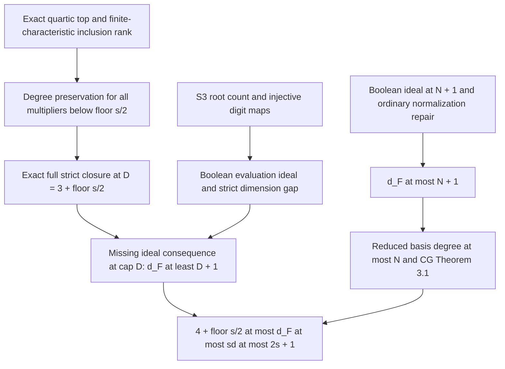

# Independent review of the prime-digit degree sandwich

2026-11-05. Task `TASK-20261105-52b792`; archival owner
`TASK-20261104-df29f3`. Reviewer: independent interactive Codex session
`/root/prime_growth_review`. This is a written mathematical review, not a
scientific-state transition, machine-checked theorem, or signed PCC verdict.
All mathematical conclusions below have standing **[pcc:unverified]**.

## Binding and independence

The reviewed snapshot is commit
`047002010983c6deba923743bba110e45ef137dd`, branch
`codex/rigorous-lfd-solving-20261105`. The working-tree HEAD matched that
commit and was clean on entry. The dispatcher reported verified remote
publication; this reviewer did not independently fetch or authenticate the
remote branch. The local tracking ref for that branch was unavailable.

Read first: `AGENTS.md`, then `CLAIM.md`; task controls and the relevant
contract, prior normalization note, invariant definitions, and primary
Caminata--Gorla text were then read. **Sections "Blind derivation" and
"Controls derived before opening the producer proof" were written before
opening `PRIME-PROOF.md`.** No producer proof, sibling review, experiment
result tables, or normalization-task output was used in that derivation.
The later proof audit is explicitly separated below.

The committed handoff requests `review-breakthrough`, effort `max`,
`fallback_allowed: false`, `degraded_allowed: false`. The dispatcher states
that the session launch accepted explicit `reasoning_effort=max` with
`fork_turns=none`. No serving-model/effort probe was run, so that statement is
dispatch provenance, not independently authenticated backend metadata.
No fallback, degraded policy, external model/API dispatch, experiment,
benchmark, symbolic computation trial, or delegation was used. Commands were
limited to instruction/source retrieval, text/hash inspection, and writing
this report. Network calls retrieved literature only.

Input SHA-256 values read before the proof audit:

| Input | SHA-256 |
|---|---|
| `CLAIM.md` | `4de97e516126db542d0a1056ef7e3e6b807fd4ed1dd75b2b64021e8f6bfde466` |
| `dispatch_queue.json` | `02d920cbc5033b5b8030fb0ce4394add612d450757c5a5baee8af969ba3bb8e9` |
| `prime-review-handoff.json` | `ea310c71870c9528b1303853814d7da029ada7b25ff7877587b5c283bae81da9` |

## Exact statement and convention

Let `s >= 2`, `p > 3` prime, `2^s <= p`, and
`E: y^2 = x^3 + a*x + b` be nonsingular over `K = F_p`. Let `z in K`.
Set `N = 2s`,

```text
X = sum_(i=0)^(s-1) 2^i A_i,   Y = sum_(i=0)^(s-1) 2^i B_i,
g = S3(X,Y,z),   f = NF(g),
F = {f} union {T_i^2-T_i : 1 <= i <= N}.
```

There are no other equations. The conclusion under review is

```text
deg(f) = 4,
4 + floor(s/2) <= d_F <= sd_sigma(F) <= 2s+1
```

for every degree-compatible monomial order, including SAT and UNSAT systems,
and the same sandwich for the raw presentation with `g` in place of `f`.
Here `d_F` is the ordinary polynomial last fall degree of
Caminata--Gorla Definition 1.5, and `sd_sigma` is their Definition 1.1:
the least cap whose Macaulay rowspace **after iterating multiplication of
fallen rows and elimination to a fixed point** contains a Gröbner basis.
It is not an arbitrary implementation's reported maximum degree and not the
uncompleted Macaulay rowspace.

## Blind derivation

### 1. Ordinary closure and strict Boolean closure

Put `P=K[T_1,...,T_N]`, `J=(T_i^2-T_i)`, and `B=P/J`, with squarefree
degree and the multilinear representative `NF`. For each polynomial `h`,
successively replace a repeated variable power in a monomial using

```text
m*T_i^e - m*T_i^(e-1) = m*T_i^(e-2)*(T_i^2-T_i),  e >= 2.
```

At every step the repair has degree at most the degree of the original
monomial. Summing proves

```text
h-NF(h) = sum_i q_i*(T_i^2-T_i),
deg(q_i*(T_i^2-T_i)) <= deg(h).
```

In particular, for `D>=2`, `J intersect P_<=D` is in the ordinary
bit-equation closure at cap `D`.

Let `W_D` be the least subspace of `B_<=D` containing the eligible normalized
inputs and satisfying `T_i*w in W_D` whenever `w in W_D` and
`deg(w)+1<=D`. This is the strict, nominal-budget quotient closure.
Then, for the normalized presentation and every `D>=2`,

```text
NF(V_(F,D)) = W_D,
V_(F,D) = {h in P_<=D : NF(h) in W_D}.                         (1)
```

For the first containment, the preimage on the right is an admissible
ordinary-closure space: an allowed monomial multiplier can be performed
one variable at a time in the quotient, because normalization only lowers
degree. For the converse, if a quotient row of degree at most `D-1` is the
image of a row in `V_(F,D)`, subtract the repair to obtain its actual
multilinear lift in `V_(F,D)`. Its variable product fits cap `D`; subtracting
that product's repair lifts the next quotient row. This proves that the
image is strictly closed. The preimage equality follows from the kernel
repair. Both directions are necessary: this is a statement about the full
closure, not just its initial Macaulay rows.

### 2. The top form and a self-contained finite-characteristic rank lemma

The exact polynomial convention is

```text
S3(x,y,z) = (x-y)^2*z^2
           - 2*((x+y)*(x*y+a)+2*b)*z
           + (x*y-a)^2 - 4*b*(x+y).
```

Only `X^2*Y^2` contributes degree four after substitution. In the associated
graded algebra of `B`, which is
`C=K[A,B]/(A_i^2,B_i^2)`, its top form is

```text
f_4 = 4 * (sum_(i<j) 2^(i+j) A_i*A_j)
          * (sum_(k<l) 2^(k+l) B_k*B_l).                     (2)
```

All displayed weights and `4` are nonzero. Since each block has at least
two variables, (2) is nonzero and `deg(f)=4`. Scaling each variable by its
nonzero weight is an automorphism of the **square-zero graded algebra**;
no assertion that this scaling preserves the Boolean relations is needed.

Here is a complete replacement for the needed Frankl/Wilson rank input.
Let `0<=r<=ell<=n-r` and `char(K)=0` or a prime greater than `ell`.
The matrix with columns indexed by `r`-subsets `R`, rows by `ell`-subsets
`L`, and entry `1_(R subset L)` has independent columns.

Proof by induction on `r`. For `r=0` there is one nonzero column.
Suppose numbers `c_R` have `sum_(R subset L) c_R=0` for every `ell`-set `L`.
For distinct `i,j`, subtract the equations on `S union {i}` and
`S union {j}`, where `S` is any `(ell-1)`-set avoiding `i,j`. The result is

```text
sum_(Q subset S, |Q|=r-1) (c_(Q union {i})-c_(Q union {j})) = 0.
```

The induction hypothesis applies with parameters
`(n-2,r-1,ell-1)`: the inequality
`(r-1)+(ell-1)<=n-2` is exactly `r+ell<=n`, and the characteristic
condition remains valid. Hence each parenthesized difference vanishes.
Any two `r`-sets are joined by successive one-element exchanges, so all
`c_R` equal a common `c`. Each original equation is
`binom(ell,r)*c=0`. This binomial coefficient is nonzero under the stated
characteristic hypothesis; thus `c=0`. This completes the proof.

In the square-zero algebra on `s` variables, multiplication by the unweighted
`e_2` from degree `r` to degree `r+2` is exactly this matrix with
`n=s`, `ell=r+2`. Put `k=floor(s/2)`. It is injective for
`0<=r<=k-1`, because `2r+2<=s` and `p>r+2`. The latter follows from
`p>=2^s>s` (equality `p=2^s` is impossible here).

Decompose a homogeneous multiplier by its degrees in the two blocks.
For each bidegree `(u,v)` with `u+v<=k-1`, both block maps are injective;
their tensor product is injective, and different bidegrees have different
image bidegrees. Thus multiplication by (2) is injective on total degree
at most `k-1`. Consequently, for each nonzero multilinear `q` with
`deg(q)<=k-1`,

```text
deg(NF(q*f)) = deg(q)+4.                                    (3)
```

Lower components of `f` cannot cancel the degree `deg(q)+4` component.

### 3. A genuinely full closure calculation at the lower-bound cap

Take `D=k+3` and define

```text
M_D = { NF(q*f) : q in B_<=k-1 }.
```

Sequential variable multiplication derives every such row within cap `D`,
so `M_D subset W_D`. Conversely, (3) shows that a nonzero
`h=NF(q*f) in M_D` of degree at most `D-1` has `deg(q)<=k-2`.
Then `T_i*h=NF(NF(T_i*q)*f)` is again in `M_D`, since
`deg(NF(T_i*q))<=k-1`. Thus `M_D` includes `f` and is closed under
**every allowed multiplication of every low-degree linear combination**.
Minimality gives

```text
W_D=M_D,   dim(W_D)=sum_(j=0)^(k-1) binom(2s,j).             (4)
```

At `k=1` the low-degree subspace of `M_D=span(f)` is zero, so the same
argument applies without a negative-degree multiplier space. This handles
the small cases `s=2,3` explicitly.

### 4. SAT and UNSAT both have a missing ideal consequence

Each digit block maps bijectively to the integers `0,...,2^s-1` inside
`F_p`, since that interval is below `p`. For fixed `y`, the polynomial
`S3(U,y,z)` has leading coefficient `(y-z)^2`. If `y!=z`, there are at
most two roots. If `y=z`, its linear coefficient is
`-4*(z^3+a*z+b)`. This is nonzero unless `z` is a root of the curve cubic.
In that remaining case its constant coefficient is
`(3z^2+a)^2`, which is nonzero because the cubic is squarefree by
nonsingularity. Thus this univariate polynomial is **never identically
zero**, even in the exceptional row `y=z`. There are at most two roots per
digit row, and the Boolean zero set `Z` satisfies

```text
|Z| <= 2^(s+1).                                            (5)
```

This argument is purely polynomial and does not assume rational lifts or
sign choices for any root.

Evaluation identifies `B` with the product of `2^N` copies of `K`.
Therefore `(f) in B` is exactly the space `I_B` of functions vanishing on
`Z`: on each assignment where `f!=0`, divide its assignment indicator by
that nonzero value of `f`. Restricting evaluation to `B_<=D` gives

```text
dim(I_B intersect B_<=D) >= dim(B_<=D)-|Z|.                  (6)
```

The gap between `dim(B_<=D)` and (4) is

```text
H_s = sum_(j=k)^(k+3) binom(2s,j) > 2^(s+1),               (7)
```

with the convention that out-of-range binomial coefficients are zero.
For completeness, `H_2=15>8` and `H_3=56>16`. On replacing `s` by `s+2`,
Vandermonde's identity, keeping terms that choose exactly one of four
new elements, gives `H_(s+2)>=4*H_s`; the comparison threshold is also
multiplied by four. This proves (7) for all `s>=2`.

Equations (4)--(7) imply
`W_D` is a proper subspace of `I_B intersect B_<=D`. Hence there exists
a multilinear ideal consequence `h` with `deg(h)<=D` and `h notin W_D`.
Its ordinary lift belongs to `(F)` and is not in `V_(F,D)` by (1).
Definition 1.5 then gives `d_F>D`, or

```text
d_F >= 4+floor(s/2).                                       (8)
```

This is a SAT-valid dimension separator, not an assertion that `1` is in a
proper ideal. For UNSAT, the shorter witness is `1`: it is in `I_B` and
is outside (4) because (3) makes every nonzero row have degree at least four.
The proof does not establish equality with a first-fall degree or with (8).

### 5. The ordinary polynomial upper bound and solving degree

At cap `N+1`, every element of `B` has degree at most `N`, so the entire
`W_(N+1)` is eligible for variable multiplication. It is an ideal containing
`f`, hence `W_(N+1)=I_B`. To obtain the **ordinary global** last-fall bound,
take any `h in (F)` of arbitrary degree `t`. Its multilinear normal form
is in `I_B`, so by (1) it is in `V_(F,N+1)`. The normalization repair for
`h` fits cap `t`. Both terms are therefore in
`V_(F,max(N+1,t))`. This proves

```text
d_F <= N+1.                                               (9)
```

The argument proves the defining assertion for every ideal polynomial,
including degrees above the squarefree degree ceiling; merely declaring
the quotient closure to be an ideal would not by itself do this.

For a degree-compatible order, `T_i^2` is in the initial ideal of `(F)`.
Any minimal monomial generator of that initial ideal is therefore either
a square `T_i^2` or squarefree: a monomial containing a square and properly
divisible by it is not minimal. The reduced Gröbner basis has leading
monomials among these minimal generators. Degree compatibility then gives
`max.GB.deg <= max(2,N)=N`, with the unit ideal case immediate.
Caminata--Gorla Theorem 3.1 is applicable over any field, with no additional
genericity or radicality hypothesis, and says

```text
sd_sigma(F) = max(d_F, max.GB.deg_sigma(F)).                 (10)
```

Together (8)--(10) give the stated sandwich.

### 6. Raw presentation, uniformity, and nonvacuity

The raw polynomial `g` has degree four: its `A_0^2*B_0^2` coefficient is
one. Its normalized degree is also four by (2). The repair between them
fits degree four. With explicit bit equations, each presentation derives
the other's non-bit generator at cap four, and therefore their ordinary
closure spaces are equal at **every cap at least four**. Their ideals are
equal. The missing consequence above occurs at `D=k+3>=4`; the lower and
upper bounds therefore transfer to the raw presentation. In fact, once
both last fall degrees are at least five, their equality also follows from
equality of these higher-cap filtrations. The two input degrees need to be
checked; a general raw/NF equivalence at all caps is false.

For every `s>=2`, take a prime `p>=2^s`, the curve
`y^2=x^3+1`, and `z=0`. This curve is nonsingular for `p>3`, and
`(0,1)` is a rational target. The all-zero digits satisfy `f=0`.
Unbounded primes give infinitely many admissible presentations with
unbounded `s`, fixed non-bit degree four, and rational targets.

Even UNSAT instances with rational targets are nonvacuous for every width:
put `b=1`, `z=0`, and choose a prime `p>2*(2^s)^2+3`. For each digit pair
`(x,y)`, the forbidden equation in `a` is
`(x*y-a)^2=4*(x+y)`, excluding at most two `a` values. All pairs exclude
at most `2*(2^s)^2` values; singularity excludes at most three more, from
`4*a^3+27=0`. Some `a in F_p` remains. The resulting curve is nonsingular,
has rational target `(0,1)`, and the digit system is UNSAT. This is a
finite counting derivation, not an experiment.

## Controls derived before opening the producer proof

1. **Top rank alone does not force last-fall growth.** Replace the S3
   generator by `m=A_0*A_1*B_0*B_1`, retaining all bit equations.
   This list is a Gröbner basis for every degree-compatible order:
   reducing a monomial either removes a square or a multiple of `m`.
   Division never increases degree, so every ideal consequence is derivable
   at its own degree and `d_F=0`. At `s=2`, the needed constant-multiplier
   top map is injective, but the zero set has size 15, exactly `H_2`, so
   the strict dimension separation fails. This is a known-false control for
   a first-fall/top-rank-only shortcut.

2. **Plain Macaulay is not full closure.** In a Boolean ring on `x,y,z`,
   the degree-two inputs `xy+x` and `xy` span `xy,x` at cap two.
   Their difference is `x`, whose allowed variable product `xz` lies in
   the full closure but outside that initial span. Our proof of (4)
   explicitly checks these products for arbitrary low-degree combinations.

3. **Finite-characteristic rank needs its hypothesis.** In the square-zero
   algebra on eight variables over `F_5`,
   `e_2*e_3=binom(5,2)*e_5=0` although `e_3!=0` and
   `2*3+2<=8`. A characteristic-zero injectivity assertion would be false
   here. The characteristic bound in the elementary induction excludes it.

4. **Characteristic two cannot inherit this derivation.** The factor `4`
   in (2) vanishes and the digit weights `2^i` vanish for `i>=1`.
   The degree-four input/rank premise fails before any LFD inference.
   Moreover, the displayed short Weierstrass model is not the ordinary
   nonsingular characteristic-two model. No binary-field transfer is made.

5. **Raw/NF equality without a cap qualification is false.** At `s=1`,
   `p=5`, `a=b=1`, `z=0`, the curve is nonsingular and
   `f=1+A+B-A*B`. Its four Boolean values are `1,2,2,2`, all nonzero.
   The normalized closure at cap two is `span(f)`, while cap three is the
   full Boolean ideal, so its ordinary last fall degree is three.
   The raw input is quartic, hence absent at cap three; at cap four its
   repair gives the normalized generator and a refutation. Its last fall
   degree is four. This exact hand calculation explains why the two degree
   checks and the restriction `s>=2` matter.

## Source provenance before the proof audit

`verified_by` in this list means the session that actually read the source;
it is not a PCC or scientific-status assertion.

- **Retrieved, read; verified_by `/root/prime_growth_review`:** Caminata and
  Gorla, *Solving degree, last fall degree, and related invariants*,
  arXiv:2112.05579v2, 2022-06-01,
  <https://arxiv.org/html/2112.05579v2>. Retrieved 2026-11-05;
  SHA-256 of the returned HTML:
  `b5597f8c4ebb199cf744dbeb4208c7228a1b02d2003896f6587a7c857535a091`.
  Read Section 1's fixed-point algorithm and Definitions 1.1/1.2/1.5,
  Section 2's eventual-equality characterization and warning about temporary
  stabilization, and Section 3/Theorem 3.1. These fix the invariant and the
  exact solving-degree convention used in (1), (8)--(10).
- **Attempted retrieval, not read:** Frankl 1990, source pointer supplied by
  `CLAIM.md`, <https://www.renyi.hu/~pfrankl/j62.pdf>, and its non-`www`
  equivalent. Both GET attempts returned HTTP 403; an additional header
  request confirmed 403. No PDF hash or citation verification is claimed.
  Proposition 1.2/Theorem 4.1 numbering is producer-supplied context only.
  The elementary inclusion-rank proof above removes this dependency from
  the mathematical conclusion.
- **Internal, read; verified_by `/root/prime_growth_review`:**
  `src/crypto_autoresearcher/index_calculus/semaev.py`, polynomial docstring
  and `s3_coefficients`, for the exact S3 convention. No claim about the
  implementation's rational-lift semantics is used.
- **Internal, read; verified_by `/root/prime_growth_review`:**
  `experiments/EXP-PFDR-cbdefb/stage1-closure-convention.md`, Sections 1--3,
  and the definition docstring of `closure.py`; these were used to check
  strict nominal-budget multiplication and the need to exclude later falls,
  not as measured evidence for the new bounds.
- **Internal, read; verified_by `/root/prime_growth_review`:**
  `analysis/boolean-fall-certificates-20261104/THEORY.md`, especially the
  normalization cap, full-closure objection, and SAT separator requirement;
  `formal/CryptoResearch/FallDegree/LastFall.lean` definitions and scope
  comments; and `FirstFallBounded.lean` scope comments. No Lean build or
  claim that these modules formalize the new growth theorem is made.

The repository's knowledge-retrieval tool was not present in `ALL_TOOLS`.
The working checkout lacked `knowledge/` and `agents/`; the relevant prior
ledger and knowledge records were subsequently available through `git show`
and inspected after the blind derivation, as recorded below. No search
absence was treated as evidence of novelty or absence of earlier work.
No priority claim is made.

## Producer-proof audit and final verdict

**Verdict on the frozen candidate: the stated prime-field sandwich holds
at the scope of a written mathematical derivation. No fatal mathematical
gap was found. [pcc:unverified]** The preceding derivation supplies all
load-bearing steps without assuming the unread Frankl theorem. Machine
status is `not_verified`: this review does not assert a Lean proof, a signed
PCC standing, or an official scientific promotion.

The proof was opened only after the blind derivation and controls had been
saved. Its SHA-256 was
`1b4068c4e67eb26efde0b8b1f20ad5fe453bba5359f8423be9d247361acf5724`,
matching `git show` of `PRIME-PROOF.md` at the frozen input commit.

| Joint owned by this reviewer | Audit result |
|---|---|
| Degree-four top form | Holds. Only `X^2*Y^2` contributes, and its weighted squarefree quartic is nonzero for `s>=2`, `p>3`. |
| Finite-characteristic top rank | Holds by the independent inclusion-matrix induction. The producer's stated diagonal factors are consistent with that result; Frankl's text/numbering was not authenticated. |
| Exact full closure at `D=k+3` | Holds. The degree identity controls every low-degree linear combination, so the proposed space is closed under all permitted variable products. The zero case and `k=1` cause no exception. |
| S3 exceptional root row | Holds. At equal fixed coordinates, the polynomial is `-4*c(t)*U+c'(t)^2-8*t*c(t)`. If its linear coefficient vanishes, nonsingularity makes its constant nonzero. |
| SAT dimension separator | Holds. The independent `H_s` induction proves the strict gap. The producer's even/odd estimates are also valid, including `s=2,3`. This supplies a missing ideal consequence, rather than inferring one from a first-fall kernel. |
| Ordinary `N+1` LFD bound | Holds. The necessary arbitrary-degree step is present: normalize every higher-degree ideal consequence and repair it at its own degree. |
| Solving-degree comparison | Holds for the precise iterated-rowspace convention and degree-compatible orders of the retrieved Caminata--Gorla theorem. The reduced-basis degree bound follows from the square leading monomials. |
| Raw/NF transfer | Holds. Both degrees are four and all relevant caps are at least four; no equality of the low-cap filtrations is assumed. |
| Nonvacuity | Holds. In the producer's example, `P=(0,1)` on `y^2=x^3+x+1` has doubling slope `1/2`, so `x(2P)=1/4`, `2P` is affine, and `S3(0,0,1/4)=0`. Primes at least 37 avoid the discriminant factor 31. |

For the producer's explicit dimension estimates, the even case uses
`binom(4k,k)>=4^k` and next-binomial ratio `3k/(k+1)>=3/2`.
The odd case uses
`binom(4k+2,k)>=(4+2/k)^k>=3*4^k/2` and next ratio
`(3k+2)/(k+1)>=5/2`. The product bounds follow factor by factor in the
binomial coefficient; Bernoulli proves the odd-case bound. Their sums
strictly exceed, respectively, `2*4^k` and `4*4^k`, as required.

There is no added hypothesis that narrows the mathematical claim:

| Potential additional condition | Discharge from the statement |
|---|---|
| Nonzero weights and factor four | Implied by `p>3`. |
| `p>j+2` and `2j+2<=s` for inclusion rank | Implied by `2^s<=p` and `0<=j<floor(s/2)`. |
| The top product uses square-zero variables | Follows from the associated graded algebra of the stated Boolean quotient; it is not an added idempotent-algebra identity. |
| Digit-map injectivity | Implied by `2^s<=p`, since every digit sum is in `0,...,2^s-1`. |
| No identically zero exceptional S3 row | Implied by nonsingularity and `p>3`. |
| SAT ideal equals the Boolean vanishing ideal | Follows from the full product-of-fields evaluation algebra; no radicality assumption is added. |
| Normalization available at the original cap | Proved by the explicit repair; the raw non-bit degree and normalized degree are both four. |
| Degree-compatible order and the CG solving-degree convention | Explicitly stated, and essential; no extension to other conventions is inferred. |

After the frozen-proof audit, selected relevant passages of
`ledger/hypotheses/H-PFDR-4148b8.yaml` and
`knowledge/findings/KN-FIND-0618ab.md` were read from the original snapshot's
Git objects. Their preexisting top-form/first-fall discussion and finite
measurements were not premises of this review. In particular, no existing
identification of a graded annihilator with a first fall, and no finite
equality `d_lf=4+floor(s/2)`, was used to infer last-fall growth.
`problems/growing-boolean-semaev-lower-bound.md` was also read after the
audit: its full-closure and SAT missing-consequence obligations are exactly
the ones discharged here for this prime presentation. Its binary obligations
are outside this review, and its status was not changed.



The diagram records written implications, not machine-verified edges or
measured performance. It does not change a canonical graph or a research
status. No performance chart is applicable to this zero-trial proof review.

## Review attestation and limits

- **Joints owned:** all nine prime-field joints in the audit table, as assigned
  by the committed handoff. Their written-proof verdict is `holds`.
- **Blindness:** the complete derivation and five analytical controls were
  saved before the first read of `PRIME-PROOF.md`. The permitted claim,
  definitions, prior general normalization note, and primary CG text were
  used. No sibling report or sibling proof output was read.
- **Independent recomputation:** top coefficients, inclusion rank,
  full-closure stability, root degeneracy, SAT dimension separation,
  ordinary upper-bound transfer, basis-degree bound, raw degree/cap
  transfer, and nonvacuity were all derived in this session. There was no
  computational or certificate-checker execution presented as a proof.
- **Source limit:** the direct Frankl PDF retrieval failed. The new elementary
  proof replaces its only mathematical use; no claim about having read or
  verified that source is made. CG was retrieved and its hypotheses checked.
- **Formal limit:** no complete Lean formalization or signed verifier standing
  for the prime theorem was supplied or checked. The sibling normalization
  implementation and all binary results were excluded from this review.
- **Scope limit:** no equality with the lower bound, no exact first-fall
  assertion, no solver timing or attack-cost conclusion, no other encoding,
  and no characteristic-two growing lower bound is established here.

### Procedure deviations and custody

The handoff fixes the sole write path to this Markdown report. Therefore no
separate PDF, vector rendering, PCC claim record, problem-record edit,
scientific-status edit, receipt, or archive was written. The explanatory
diagram's editable Mermaid source is embedded here. Any derived publication
artifacts and archival action belong to `TASK-20261104-df29f3`; their absence
here is an output-scope limitation, not a missing mathematical implication.

No machine independence-checker pass is claimed: the supplied review plan
is prose in the committed handoff rather than a structured joint/attestation
packet. The source order and ownership are reported explicitly above for
the archival owner to preserve. There was no independent backend probe;
requested/accepted `max` dispatch metadata and that limitation remain
separate from the mathematical assessment.

The shared checkout acquired other workers' files during this session; they
were not read or changed. This reviewer has written only this report.
The repository inbox was checked under role `reviewer` and had no unread
messages. The review changes no `GOAL-*`, hypothesis, finding, problem, or
scientific standing. This ad hoc task is not attached to a shared goal lane.

## Additive presentation consistency check

After the frozen-input audit, the dispatcher requested a separate sanity
check of the committed supplement `THEOREM.md` at
`2ede864c11b9da0f46504d77422deb1b3738ec46`. This is an explicitly declared
post-blindness input expansion, not a replacement for the original reviewed
snapshot or a retroactive expansion of the blind source set. The complete
supplement was read from that Git object. Its SHA-256 is
`de7575521f919126b833d991db9663a16f675f9acf15589597f69845145dbc9b`.

**Supplemental mathematical verdict: holds at written-proof scope.
[pcc:unverified]** Its elementary `j`-subset to `(j+2)`-subset induction is
the specialization of the rank induction above and satisfies every induction
hypothesis. Its top-form, full-closure, root-count, dimension-gap, upper-bound,
raw-input, and infinite SAT-family arguments agree with this review.
More explicitly, if `w_S=prod_(i in S)w_i`, its weighted inclusion matrix is
`diag(w_T)*W*diag(w_S)^(-1)`, so the required diagonal equivalence is valid.

The Section 7 UNSAT construction also agrees with the independent counting
construction already saved above. There are `B^2` digit pairs, at most two
excluded `a` values per pair, and at most three excluded by singularity.
The strict inequality `p>2B^2+3` leaves at least one choice. The target
`(0,1)` is rational and affine, but no Boolean pair satisfies S3. In the
ordinary polynomial ring, the bit equations and this UNSAT polynomial
generate the unit ideal, since the Boolean quotient is a product of fields.
Its reduced Gröbner basis is `{1}`, of maximum degree zero. Equation (10)
therefore yields the supplement's additional equality

```text
4+floor(s/2) <= d_F = sd_sigma(F) <= 2s+1
```

for these UNSAT instances. Choosing the least admissible residue defines a
deterministic family, without supplying or requiring an efficient selection
algorithm. No experimental observation is involved.

Two presentation/verification limits remain separate from the mathematics:

- The supplement refers to `BOUNDS.md` for the strict definition of `W_D`
  and invokes the ordinary/Boolean closure bridge rather than proving it
  there. In that literal sense it is not entirely standalone. This report's
  Section 1 supplies the exact definition and both directions of the bridge,
  and no mathematical gap remains when that stated convention is used.
- Its sentence asserting a generic upper-bound formalization in
  `BooleanNormalization.lean` is outside this review's verification scope.
  I derived that upper bound directly; I did not inspect or build the
  sibling module, its declaration types, or its receipts. This report does
  not authenticate that formal-status claim.

`BOUNDS.md`, its binary joints, `formal-status.md`, and the sibling's new
normalization artifacts were not read. The original frozen-candidate verdict
and its input hash binding remain unchanged by this additive check.
