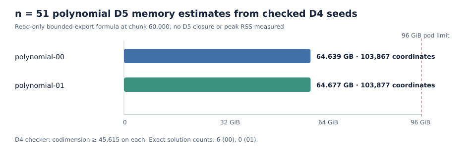

# Certified n51 polynomial-01 D4 bound and D5 capacity profile

The unchanged n51 polynomial-01 input from the [frozen n50/n51 panel](../../n50n51-bounded-d4-concurrent-plan-001.json) produced a 1,680,493,280-byte degree-four certificate with SHA-256 `c160792a7530b20dd17affcdabafb8d95494eed51c8ee6d818af3212f3e304f6`. The [original independent checker](evidence/check4.stdout.txt) accepted all 52 variable-multiplication conditions and verified `1 ∉ W_4(F)` with codimension at least **45,615**. Fresh exact enumeration found **zero** Boolean solutions. Their strict inequality establishes **last fall degree at least 5 for this named Boolean presentation**. The [producer result](evidence/result.json) and [small-file manifest](evidence/manifest.json) bind the raw records. The full certificate and evidence bundle have [public and canonical-store readback receipts](../../bounded-d4-archive-001/fresh-n51-poly-01-D5-cascade01-bounded-D4-001.publication.json).

The producer recorded 3,191.971 seconds and the checker 1,282.693 seconds on the shared host. These are L0 execution records, not comparative performance measurements. The result has one fresh exact count and one checked D4 certificate; its D3 seed was separately checked by the retained continuation.

The [read-only D5 profile](evidence/d5-profile.json), bound to its [hash-pinned plan](evidence/d5-plan.json), gives **103,877** working coordinates, **58,262** border coordinates, and a **64,677,063,002-byte** bounded-export allocation estimate at chunk size 60,000. The earlier polynomial-00 seed gives 103,867 working coordinates and 64,638,795,838 bytes by the same formula. The [capacity figure](capacity.svg) compares these two estimates with the 96 GiB cloud pod memory limit from a [durable capacity probe](evidence/cloud-capacity.json). The profile is source-derived allocation arithmetic, not measured peak RSS, D5 admission, a D5 certificate, or an LFD ≥ 6 result.

