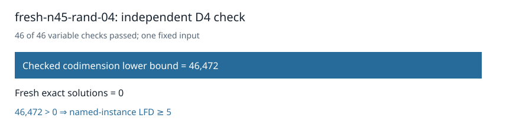

# Certified n45 random04: LFD at least five

The original independent checker accepted the D4 certificate for the unchanged `fresh-n45-rand-04` Boolean presentation. All 46 variable multiplication checks passed. It proved `1 ∉ W_4(F)` with codimension at least **46,472**. Fresh exhaustive enumeration found **0** solutions, so the strict inequality certifies **last fall degree ≥ 5** for this named instance.

The certificate is **1,045,099,360 bytes**, SHA-256 `e51f0a18c958179bbb15cb1b18e413f6db7a253c7119c010f6200530fa0686d5`. The [terminal collector](../../validation/panel-local-n45-rand04-final-001/manifest.json) checked all 47 worker artifacts, the frozen request and protocol, and successful return. Three per-worker controls passed. The certificate and evidence have [public readback receipts](../../panel-local-archive-001/fresh-n45-rand-04-rref-local01.publication.json); [download the certificate](https://github.com/isogeny-labs/crypto-autoresearcher/releases/download/semaev-closure-certificates-20261029/fresh-n45-rand-04-rref-local01.D4.cert.gz).

Admission passed on sample 0 after 0.007 seconds with 47,642,947,584 bytes available against a 40 GiB child cap plus 2 GiB reserve. Producer and checker took 2084.614 and 573.432 seconds on a shared host. These are execution records for this input.

The original 32-input D4 panel now has **32 terminal inputs**, **25 certified lower bounds of at least 5**, and **no remaining original n45 random-subspace inputs**. No new input was drawn. The separate n47 random00 independent W4 rank replay is frozen and queued.

The frozen input uses n=45, k=23, seed 9620025718748421855, and degree 4. The command was `python3 analysis/semaev-degree-five-quotient-lift/launch_local_panel.py --plan analysis/semaev-degree-five-quotient-lift/panel-local-n45-rand04-plan-001.json --protocol analysis/semaev-degree-five-quotient-lift/panel-local-n45-rand04-protocol-001.json`; the plan pins the runtime Python and worker paths. CPU time was not recorded.

Frozen source commit: `608be655740605d96d97157006c29894332a72db`. Frozen protocol SHA-256: `88dfb67ca54f3397a329b89ceaa4a60adc2a325ea8d24f996ffc3f7e996dc9e2`.

