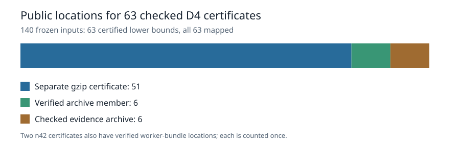

# Public certificate coverage for the completed D4 panel

The [final panel audit](../../validation/panel-coverage-20261101-final-001/coverage.json) lists 63 named n=33–45 inputs with checked LFD lower bounds of at least five. This [publication audit](../../validation/publication-coverage-20261101-final-001/publication-coverage.json) maps all **63 certificates** to checked public locations: 51 separate gzip certificate assets, six evidence archives with a verified certificate member, and six evidence archives with a previously checked certificate. Two n=42 certificates also occur in the original worker bundle; both locations were checked and each input is counted once.

The audit rechecks the retained archive content, worker bundle, result hashes, and committed publication receipts. The receipts record earlier anonymous HTTPS download and hash checks; this audit did not repeat those downloads. Publication coverage establishes custody and availability of the finite-instance certificates. The mathematical bounds rest on their separate checker acceptances and exact solution counts in the panel records.

