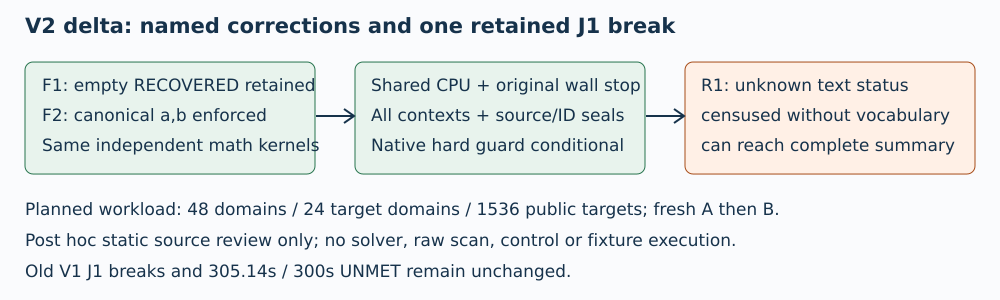

# Independent V2 source delta — J1 breaks

## V2 static source-delta review

J1 breaks · TASK-20261106-a2cc4a · 2026-11-06

V2 closes the exact F1/F2 counterexamples and adds the named operational/custody checks. A residual unknown-status acceptance path breaks the externally pinned false-object requirement. This is a static source-fit finding; no empirical failure or raw-prefix occurrence is asserted.

## Residual R1: unknown status can pass

verify.py:373-374 simply records status as a census key. Lines476-478 require word status to be text but accept every text value except that only RECOVERED triggers auditing. Cell status has no vocabulary/type gate. An otherwise valid joined cell with status="__UNREGISTERED_STATUS__", words=[], scalar=null and recovered_scalars=[] remains in contexts but can reach line513 status complete.

The pinned proves_too_much object explicitly requires unknownstatuses mustnotpassfullcoverage/custody. Census retention alone does not satisfy that rejection condition. No authoritative allowed-status vocabulary is defined in these sources. Define it prospectively and add an explicit invalid/incomplete gate before a new source snapshot/review.

## F1 / F2: exact counterexamples closed

verify.py:461-470,490-499,509 — Every joined cell context is appended. RECOVERED with empty words, null scalar and empty recovered_scalars gets a cell.status undefined event and is included in claimed_cells. This does not assert any such raw row exists.

verify.py:414-425,433-435 — Exact integer coefficients must satisfy1<=a,b<r before normalization. F17r19,a20,b1,k=x2 raises ValueError and is retained undefined; it cannot be valid after reduction. Original/transformed equations and normalization remain checked.

## G1: cumulative CPU and stop

driver.py:104-137,145-197,223-241; verify.py:161-196,242-262,521-525 — Driver aggregates self/reaped/live CPU, samples at0.2s, decreases each child OS allowance and writes prior charge with2s finalization reserve. Checker rejects missing/negative/nonfinite/inconsistent/stale ledger and carries prior charge into its guard and remaining OS allowance. Same run/stop/pid/launch/source are checked. This closes fresh1800-per-phase reset in ordinary source flow. Sampling, fixed finalization reserve and native hard-guard dependency are retained; no hard instantaneous/cgroup enforcement was independently reviewed.

## G2: census, provenance and joins

verify.py:353-395,438-510 — Top-level trace/cell statuses, word statuses, line/byte offset/length/SHA, all trace/cell contexts, arm and provided optional ID joins are retained. Missing optional IDs are recorded absent, and a separately labelled digest uses trace/curve/target/a/b/G/Q/arm rather than inventing a source ID. Dependent event multiplicities are retained. However arbitrary text statuses are accepted/censused without any admissible vocabulary check, and unknown-status cells/words can reach complete summary. Trace scan373 and context389-392 do not traverse original/incremental nested statuses; any full nested-status census remains unestablished. Their schema was mentioned by Coordinator but not independently read here.

## G3: process and final-write guards

driver.py:70-96,125-137,170-192,234-261; verify.py:161-195,349,512,525 — Driver requires native process group and monitors worker membership, waits/reaps direct children, and guards successful writes. Checker reuses original stop, guards before/after final serialization/write calls and does not reset stop. Current worker has no child spawning. Cleanup grace and cooperative checks remain; unchanged native process-group/claim/watchdog behavior was not independently inspected in this scoped review.

## G4: seals, source and original order

driver.py:204-213; verify.py:234-287,291-302,329-349 — Checker binds native launch/environment/runtime guard, current manifest and all source hashes; compares source bytes to authority Git blobs (code inspected, not executed). Public and certificate hashes/bytes, exact original curve/control/target order, duplicate IDs, canonical scalars and every equation are checked before reference seal and candidate open. Actual published-commit/native-environment runtime evidence remains a future execution dependency.

## Mathematical fit and false objects

solver.py is byte-identical to V1. Static AST comparisons show prime/inverse/Curve/BabyGiant and independent is_prime/Projective unchanged. The affine SEC1 law and separate Jacobian arithmetic retain unreduced rG/rQ checks. HAC BSGS uses m=ceil(sqrt(r)), covering every x=im+j with 0<=x<r and i,j<m, and directly verifies every returned scalar.

Frozen false-object branches: missing/negative/inconsistent/stale ledger rejects at161-190/242-262; altered source/manifest/native seals at234-262; certificate omissions/duplicates/order at274-302; arm/optional ID mismatch at449-455; stream omissions at377-378; modified point at217-225/293-294/445-446. Absent optional IDs are recorded absent and derived bindings are explicitly labelled. All are analytical assessments, not control outcomes. Unknown statuses are the retained exception R1.

## Pins, independence and limits

Plan sorted compact JSON SHA256: 08a3003f7196d897707b9c213c76629f892f1bdc1265ab5a19b53ab0d19d3d9d
Source commit supplied:59fdb82778ffaf1b134f3b8bd1e1a4f71b5920ee. Actual local source hashes match published-source materialization:
solver.py: d462b17ffb10772852d6024a92be71eb768b27d3d4b619cd582c868f88953031
driver.py: 99a6a535dda612a762d4b56c3fed8749321ddc849f2200b19474ba1d79010849
verify.py: a1cf6bdcb243caf5f4564f47b1dc86e2e7ea9dd3b368ab0da14dc019f8a5c667

Same reviewer as V1, independent of implementer; this is post hoc delta review, not an independent replication of own prior. No sibling review read; no source import, scientific/fixture/control/unit execution or raw scan. No Git query/mutation. No native environment or runtime enforcement was empirically validated. Source-fit review grants no experiment approval.

HAC Chapter3 §3.6.2 Algorithm3.56/Fact3.57 (local primary text1000-1040) and SEC1v2 §2.2.1 (local442-494) were reread before delta source analysis; retrieved, verified by this session. Full absolute paths and source-read accounting are in checks.json.

## Budget and preserved history

New claim acquired2026-11-06T17:03:20Z (epoch1793984600), fixed stop17:13:20Z (1793985200). Whole review600s including artifacts/render/inspection; no extension/reset/review retry. Reviewer memory4GiB not instrumented, compliance unverified.

Old TASK-20261106-2ff273 remains J1 breaks,305.135592s against300s UNMET, memory unverified; no waiver or relabelled pass. Final actual completion and render/inspection logs are appended in report.md/checks.json. Canonical scientific graphs are outside scope and unchanged.



## Exact editable Typst PDF source

```typst
#set page(paper: "a4", margin: 16mm)
#set text(font: "DejaVu Sans", size: 9pt)
#set par(leading: 0.65em)

#text(size: 13pt, weight: "bold", "V2 static source-delta review")

#text("J1 breaks · TASK-20261106-a2cc4a · 2026-11-06\n\nV2 closes the exact F1/F2 counterexamples and adds the named operational/custody checks. A residual unknown-status acceptance path breaks the externally pinned false-object requirement. This is a static source-fit finding; no empirical failure or raw-prefix occurrence is asserted.")

#image("/tmp/independent-reference-source-review-v2-20261106/diagram.svg", width: 100%)


#text(size: 13pt, weight: "bold", "Residual R1: unknown status can pass")

#text("verify.py:373-374 simply records status as a census key. Lines476-478 require word status to be text but accept every text value except that only RECOVERED triggers auditing. Cell status has no vocabulary/type gate. An otherwise valid joined cell with status=\"__UNREGISTERED_STATUS__\", words=[], scalar=null and recovered_scalars=[] remains in contexts but can reach line513 status complete.\n\nThe pinned proves_too_much object explicitly requires unknownstatuses mustnotpassfullcoverage/custody. Census retention alone does not satisfy that rejection condition. No authoritative allowed-status vocabulary is defined in these sources. Define it prospectively and add an explicit invalid/incomplete gate before a new source snapshot/review.")


#text(size: 13pt, weight: "bold", "F1 / F2: exact counterexamples closed")

#text("verify.py:461-470,490-499,509 — Every joined cell context is appended. RECOVERED with empty words, null scalar and empty recovered_scalars gets a cell.status undefined event and is included in claimed_cells. This does not assert any such raw row exists.\n\nverify.py:414-425,433-435 — Exact integer coefficients must satisfy1<=a,b<r before normalization. F17r19,a20,b1,k=x2 raises ValueError and is retained undefined; it cannot be valid after reduction. Original/transformed equations and normalization remain checked.")


#pagebreak()

#text(size: 13pt, weight: "bold", "G1: cumulative CPU and stop")

#text("driver.py:104-137,145-197,223-241; verify.py:161-196,242-262,521-525 — Driver aggregates self/reaped/live CPU, samples at0.2s, decreases each child OS allowance and writes prior charge with2s finalization reserve. Checker rejects missing/negative/nonfinite/inconsistent/stale ledger and carries prior charge into its guard and remaining OS allowance. Same run/stop/pid/launch/source are checked. This closes fresh1800-per-phase reset in ordinary source flow. Sampling, fixed finalization reserve and native hard-guard dependency are retained; no hard instantaneous/cgroup enforcement was independently reviewed.")


#text(size: 13pt, weight: "bold", "G2: census, provenance and joins")

#text("verify.py:353-395,438-510 — Top-level trace/cell statuses, word statuses, line/byte offset/length/SHA, all trace/cell contexts, arm and provided optional ID joins are retained. Missing optional IDs are recorded absent, and a separately labelled digest uses trace/curve/target/a/b/G/Q/arm rather than inventing a source ID. Dependent event multiplicities are retained. However arbitrary text statuses are accepted/censused without any admissible vocabulary check, and unknown-status cells/words can reach complete summary. Trace scan373 and context389-392 do not traverse original/incremental nested statuses; any full nested-status census remains unestablished. Their schema was mentioned by Coordinator but not independently read here.")


#text(size: 13pt, weight: "bold", "G3: process and final-write guards")

#text("driver.py:70-96,125-137,170-192,234-261; verify.py:161-195,349,512,525 — Driver requires native process group and monitors worker membership, waits/reaps direct children, and guards successful writes. Checker reuses original stop, guards before/after final serialization/write calls and does not reset stop. Current worker has no child spawning. Cleanup grace and cooperative checks remain; unchanged native process-group/claim/watchdog behavior was not independently inspected in this scoped review.")


#text(size: 13pt, weight: "bold", "G4: seals, source and original order")

#text("driver.py:204-213; verify.py:234-287,291-302,329-349 — Checker binds native launch/environment/runtime guard, current manifest and all source hashes; compares source bytes to authority Git blobs (code inspected, not executed). Public and certificate hashes/bytes, exact original curve/control/target order, duplicate IDs, canonical scalars and every equation are checked before reference seal and candidate open. Actual published-commit/native-environment runtime evidence remains a future execution dependency.")


#pagebreak()

#text(size: 13pt, weight: "bold", "Mathematical fit and false objects")

#text("solver.py is byte-identical to V1. Static AST comparisons show prime/inverse/Curve/BabyGiant and independent is_prime/Projective unchanged. The affine SEC1 law and separate Jacobian arithmetic retain unreduced rG/rQ checks. HAC BSGS uses m=ceil(sqrt(r)), covering every x=im+j with 0<=x<r and i,j<m, and directly verifies every returned scalar.\n\nFrozen false-object branches: missing/negative/inconsistent/stale ledger rejects at161-190/242-262; altered source/manifest/native seals at234-262; certificate omissions/duplicates/order at274-302; arm/optional ID mismatch at449-455; stream omissions at377-378; modified point at217-225/293-294/445-446. Absent optional IDs are recorded absent and derived bindings are explicitly labelled. All are analytical assessments, not control outcomes. Unknown statuses are the retained exception R1.")


#text(size: 13pt, weight: "bold", "Pins, independence and limits")

#text("Plan sorted compact JSON SHA256: 08a3003f7196d897707b9c213c76629f892f1bdc1265ab5a19b53ab0d19d3d9d\nSource commit supplied:59fdb82778ffaf1b134f3b8bd1e1a4f71b5920ee. Actual local source hashes match published-source materialization:\nsolver.py: d462b17ffb10772852d6024a92be71eb768b27d3d4b619cd582c868f88953031\ndriver.py: 99a6a535dda612a762d4b56c3fed8749321ddc849f2200b19474ba1d79010849\nverify.py: a1cf6bdcb243caf5f4564f47b1dc86e2e7ea9dd3b368ab0da14dc019f8a5c667\n\nSame reviewer as V1, independent of implementer; this is post hoc delta review, not an independent replication of own prior. No sibling review read; no source import, scientific/fixture/control/unit execution or raw scan. No Git query/mutation. No native environment or runtime enforcement was empirically validated. Source-fit review grants no experiment approval.\n\nHAC Chapter3 §3.6.2 Algorithm3.56/Fact3.57 (local primary text1000-1040) and SEC1v2 §2.2.1 (local442-494) were reread before delta source analysis; retrieved, verified by this session. Full absolute paths and source-read accounting are in checks.json.")


#text(size: 13pt, weight: "bold", "Budget and preserved history")

#text("New claim acquired2026-11-06T17:03:20Z (epoch1793984600), fixed stop17:13:20Z (1793985200). Whole review600s including artifacts/render/inspection; no extension/reset/review retry. Reviewer memory4GiB not instrumented, compliance unverified.\n\nOld TASK-20261106-2ff273 remains J1 breaks,305.135592s against300s UNMET, memory unverified; no waiver or relabelled pass. Final actual completion and render/inspection logs are appended in report.md/checks.json. Canonical scientific graphs are outside scope and unchanged.")


```

## Actual render, inspection and final accounting

Both administrative PDF compilations succeeded; the second added the explicit nested-trace-status coverage qualification. All three FINAL PDF pages were rasterized and actually viewed, with legible diagram, citations, pins and findings and no observed clipping. No scientific/control/source execution occurred.

```json
{
  "render": {
    "compile_command": "/workspace/classical-ecdlp-endpoint-reuse/runtime-20261028/bin/python -c \"import typst; typst.compile('/tmp/independent-reference-source-review-v2-render-20261106/report.typ',output='/tmp/independent-reference-source-review-v2-20261106/report.pdf',root='/'); print('Typst updated-report compile succeeded')\"",
    "compile_attempts": 2,
    "compile_results": [
      "success; initial report",
      "success; added explicit nested-trace status scope qualification"
    ],
    "final_compile_stdout": "Typst updated-report compile succeeded",
    "final_compile_exit_code": 0,
    "pdfinfo_command": "pdfinfo /tmp/independent-reference-source-review-v2-20261106/report.pdf",
    "pdfinfo_result": "Typst0.15.0; PDF1.7; A4;3pages;50223bytes; unencrypted",
    "raster_command": "pdftoppm -r 80 -png /tmp/independent-reference-source-review-v2-20261106/report.pdf /tmp/independent-reference-source-review-v2-render-20261106/final-page",
    "raster_exit_code": 0,
    "view_tool": "tools.view_image via functions.exec",
    "final_pages_actually_viewed": [
      1,
      2,
      3
    ]
  },
  "budget": {
    "claim_acquired_epoch_seconds": 1793984600,
    "fixed_stop_epoch_seconds": 1793985200,
    "maximum_wall_seconds": 600,
    "maximum_memory_gib": 4,
    "extensions": 0,
    "resets": 0,
    "review_retries": 0,
    "reviewer_memory_enforcement_or_measurement": "not instrumented; compliance unverified",
    "final_artifact_accounting_epoch_seconds": 1793984964.4131238,
    "elapsed_seconds_at_final_accounting": 364.4131238460541,
    "whole_wall_cap_met": true
  }
}
```
