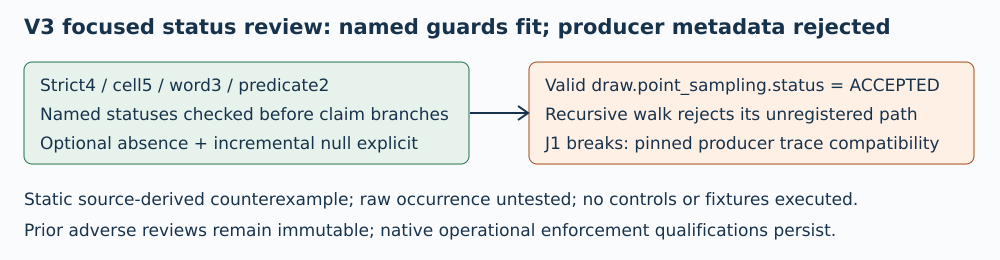

# Focused V3 status review — J1 breaks

TASK-20261106-025191 · 2026-11-06

The named enum, nested census and optional absence/null guards address the V2 status omissions. The recursive path whitelist can nevertheless reject valid trace metadata emitted by the same pinned producer. This is a static compatibility counterexample, not a claim that the frozen raw prefix contains such a row.

# R3: legitimate sampler status rejected

verify.py:92-109 registers only top status, original/incremental status and predicate answer status paths, then recursively rejects any other status path.

Pinned engine.py:423-425 samples calibration-trace points; line434 puts that sampling record in draw.point_sampling; line442 emits draw in the trace. The sampler at356-359 legitimately emits ACCEPTED, proposal ACCEPTED/REJECTED and a failure CAPPED_PROPOSALS status. A valid calibration trace with draw.point_sampling.status="ACCEPTED" therefore raises "unregistered trace status path" at verify104. A valid strict UNDEFINED attempt and predicate statuses do not prevent this rejection. Proposal status paths are likewise unregistered.

No raw scan or fixture execution occurred. The exact retained prefix may or may not contain the shape. The source-level producer-schema fit cannot be accepted while this rejection remains. Correct schema handling prospectively, then publish and review a new source snapshot.

# Named status fixes and frozen false objects

verify56-59 requires exact str and set membership; scan488-493 checks every cell before census, including no-recovery rows; word599 checks every word before branching. Unknown/nontext/missing required statuses fail.

Present original/incremental attempts require strict status, predicate list, answer object and answer status at69-90. Original null rejects; incremental null is allowed. Top absence and provided/null markers remain explicit. Walk92-114 and aggregation508-518 record named nested statuses; the overbroad rejection exception is R3.

Engine124/236 defines strict4;312 defines word3;314-317 adds CAPPED_ERASURES and permits inherited UNDEFINED for t0.e0. These match V3 sets50-53. Pure guard controls117-160 schedule all registered positives and unknown/nontext/shape negatives; they are called only in the eventual checker at461 before the reference seal. They were not executed by this review.

# Nonregression and remaining limits

Solver and driver are byte-identical to V2. Static AST comparison finds is_prime, Projective, canonical_scalar and write_new unchanged. The source diff adds status validation/census/control plumbing only. F1 empty RECOVERED handling remains at615-624; F2 canonical blinding check remains541-542. Shared CPU, original stop, source/manifest seals and original order logic remain unchanged.

Prior qualifications remain: CPU uses sampled self/reaped/live accounting and a fixed finalization reserve; wall checks are cooperative; hard process-group/claim/watchdog enforcement belongs to the native supervisor and was not reviewed empirically. G4 checks need actual future runtime custody evidence. No experiment approval, performance quantity or scientific status change follows.

# Pins, independence and budget

Whole handoff SHA256 independently matches:
c4ea84a4065b1d8be8692b5c58024ec55629e8e9542c2eb2ed2d9af4894c36f7
Pinned producer engine SHA256 matches:
22da83d6494ea66c520b0e58eaa4b54e621c822d8f0275deda8822c7179915fb
V3 verify SHA256 matches:
84cb0cbebba0338fef0c78ba5f91d6e3608d3bd4d8c4d5cbe8c3f1415bb4f5f0
Source commit supplied:1effc78f6842107898db9b0bd50863d50182dd4d. Local byte hashes checked; no Git or remote query.

Independent of implementer; same prior reviewer, openly post hoc focused delta, not independent replication of own prior. No sibling review, import, raw scan, scientific/control/fixture/unit execution. Primary schema source: pinned engine.py, statically read and verified by this session; full read accounting and all SHA bindings are in checks.json.

Claim acquired17:20:36Z (1793985636), fixed stop17:25:36Z (1793985936),300s including artifacts/render/inspection; no extension/reset. Memory4GiB compliance unverified. Old V1 J1 breaks and305.14s/300s UNMET, and V2 J1 breaks, remain unchanged. Actual final accounting and render/view logs are in checks.json/report.md. Canonical scientific graphs are outside scope and unchanged.



## Exact editable Typst source

```typst
#set page(paper: "a4", margin: 16mm)
#set text(font: "DejaVu Sans", size: 9pt)
#set par(leading: 0.6em)

#text(size: 13pt, weight: "bold", "Focused V3 status review — J1 breaks")

#text("TASK-20261106-025191 · 2026-11-06\n\nThe named enum, nested census and optional absence/null guards address the V2 status omissions. The recursive path whitelist can nevertheless reject valid trace metadata emitted by the same pinned producer. This is a static compatibility counterexample, not a claim that the frozen raw prefix contains such a row.")

#image("/tmp/independent-reference-source-review-v3-20261106/diagram.svg",width:100%)


#text(size: 13pt, weight: "bold", "R3: legitimate sampler status rejected")

#text("verify.py:92-109 registers only top status, original/incremental status and predicate answer status paths, then recursively rejects any other status path.\n\nPinned engine.py:423-425 samples calibration-trace points; line434 puts that sampling record in draw.point_sampling; line442 emits draw in the trace. The sampler at356-359 legitimately emits ACCEPTED, proposal ACCEPTED/REJECTED and a failure CAPPED_PROPOSALS status. A valid calibration trace with draw.point_sampling.status=\"ACCEPTED\" therefore raises \"unregistered trace status path\" at verify104. A valid strict UNDEFINED attempt and predicate statuses do not prevent this rejection. Proposal status paths are likewise unregistered.\n\nNo raw scan or fixture execution occurred. The exact retained prefix may or may not contain the shape. The source-level producer-schema fit cannot be accepted while this rejection remains. Correct schema handling prospectively, then publish and review a new source snapshot.")


#text(size: 13pt, weight: "bold", "Named status fixes and frozen false objects")

#text("verify56-59 requires exact str and set membership; scan488-493 checks every cell before census, including no-recovery rows; word599 checks every word before branching. Unknown/nontext/missing required statuses fail.\n\nPresent original/incremental attempts require strict status, predicate list, answer object and answer status at69-90. Original null rejects; incremental null is allowed. Top absence and provided/null markers remain explicit. Walk92-114 and aggregation508-518 record named nested statuses; the overbroad rejection exception is R3.\n\nEngine124/236 defines strict4;312 defines word3;314-317 adds CAPPED_ERASURES and permits inherited UNDEFINED for t0.e0. These match V3 sets50-53. Pure guard controls117-160 schedule all registered positives and unknown/nontext/shape negatives; they are called only in the eventual checker at461 before the reference seal. They were not executed by this review.")


#pagebreak()

#text(size: 13pt, weight: "bold", "Nonregression and remaining limits")

#text("Solver and driver are byte-identical to V2. Static AST comparison finds is_prime, Projective, canonical_scalar and write_new unchanged. The source diff adds status validation/census/control plumbing only. F1 empty RECOVERED handling remains at615-624; F2 canonical blinding check remains541-542. Shared CPU, original stop, source/manifest seals and original order logic remain unchanged.\n\nPrior qualifications remain: CPU uses sampled self/reaped/live accounting and a fixed finalization reserve; wall checks are cooperative; hard process-group/claim/watchdog enforcement belongs to the native supervisor and was not reviewed empirically. G4 checks need actual future runtime custody evidence. No experiment approval, performance quantity or scientific status change follows.")


#text(size: 13pt, weight: "bold", "Pins, independence and budget")

#text("Whole handoff SHA256 independently matches:\nc4ea84a4065b1d8be8692b5c58024ec55629e8e9542c2eb2ed2d9af4894c36f7\nPinned producer engine SHA256 matches:\n22da83d6494ea66c520b0e58eaa4b54e621c822d8f0275deda8822c7179915fb\nV3 verify SHA256 matches:\n84cb0cbebba0338fef0c78ba5f91d6e3608d3bd4d8c4d5cbe8c3f1415bb4f5f0\nSource commit supplied:1effc78f6842107898db9b0bd50863d50182dd4d. Local byte hashes checked; no Git or remote query.\n\nIndependent of implementer; same prior reviewer, openly post hoc focused delta, not independent replication of own prior. No sibling review, import, raw scan, scientific/control/fixture/unit execution. Primary schema source: pinned engine.py, statically read and verified by this session; full read accounting and all SHA bindings are in checks.json.\n\nClaim acquired17:20:36Z (1793985636), fixed stop17:25:36Z (1793985936),300s including artifacts/render/inspection; no extension/reset. Memory4GiB compliance unverified. Old V1 J1 breaks and305.14s/300s UNMET, and V2 J1 breaks, remain unchanged. Actual final accounting and render/view logs are in checks.json/report.md. Canonical scientific graphs are outside scope and unchanged.")


```

## Actual rendering, inspection and final accounting

The single Typst compile succeeded. Both PDF pages were rasterized and actually viewed; diagram, citations, pins and findings are legible with no observed clipping. No scientific/control/fixture execution occurred.

```json
{
  "render": {
    "compile_command": "/workspace/classical-ecdlp-endpoint-reuse/runtime-20261028/bin/python -c \"import typst; typst.compile('/tmp/independent-reference-source-review-v3-render-20261106/report.typ',output='/tmp/independent-reference-source-review-v3-20261106/report.pdf',root='/'); print('Typst compile succeeded')\"",
    "compile_exit_code": 0,
    "compile_stdout": "Typst compile succeeded",
    "compile_attempts": 1,
    "pdfinfo_command": "pdfinfo /tmp/independent-reference-source-review-v3-20261106/report.pdf",
    "pdfinfo_result": "Creator Typst0.15.0; PDF1.7; A4;2pages;43310bytes; unencrypted",
    "raster_command": "pdftoppm -r 80 -png /tmp/independent-reference-source-review-v3-20261106/report.pdf /tmp/independent-reference-source-review-v3-render-20261106/page",
    "raster_exit_code": 0,
    "view_tool": "tools.view_image via functions.exec",
    "pages_actually_viewed": [
      1,
      2
    ]
  },
  "budget": {
    "claim_acquired_epoch_seconds": 1793985636,
    "fixed_stop_epoch_seconds": 1793985936,
    "maximum_wall_seconds": 300,
    "memory_gib": 4,
    "extensions": 0,
    "resets": 0,
    "review_retries": 0,
    "memory_compliance": "unverified; reviewer memory measurement/enforcement not instrumented",
    "final_artifact_accounting_epoch_seconds": 1793985849.7253351,
    "elapsed_seconds_at_final_accounting": 213.72533512115479,
    "whole_wall_cap_met": true
  }
}
```
