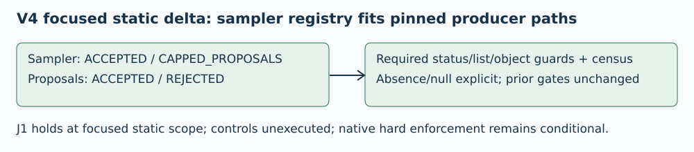

# V4 focused sampler review — J1 holds

TASK-20261106-907bb5 · 2026-11-06

The V4 registry admits the pinned producer sampler/proposal statuses and rejects unknown, nontext or missing required fields. The V3 false rejection is closed on static inspection. No new material defect was found in this focused delta. This is source-fit review; controls and raw data were not executed or scanned.

# Producer fit and false-object checks

Pinned engine.py:356-359 emits sampler ACCEPTED/CAPPED_PROPOSALS and proposal ACCEPTED/REJECTED. Lines434-442 embed sampling in draw.point_sampling. V4 verify54-55 and123-128 register both exact status paths; recursive list notation matches proposals.[].status. The valid ACCEPTED chain with REJECTED then ACCEPTED proposals passes these guards and is counted; the registered capped report is accepted as a schema object, without claiming normal trace emission after a sampler failure.

verify99-122 requires provided nonnull draw/sampler objects, sampler status, proposals list and every proposal object/status. require_status58-61 requires exact str plus membership. Unknown/nontext/missing status, absent/nonlist proposals, and missing/bad proposal status fail before any successful audit. Extra unregistered status paths still fail130-146.

verify94-106 records draw and point_sampling provided/null markers. Absent draw, draw=null, absent point_sampling and point_sampling=null remain distinct valid cases. No missing state is invented as a source status.

# Controls and nonregression

Future checker controls150-209 include all seven enum groups, scalar-free accepted/capped sampler records, null sampling, unknown/nontext and missing-shape negatives. They are called only inside the eventual admitted checker before reference seal. None ran in this review.

Solver and driver are byte-identical to V3. Static AST comparison verifies main, require_status, is_prime, Projective, canonical_scalar and write_new unchanged. Thus prior cell/word/strict/predicate gates, F1 incomplete RECOVERED retention, F2 canonical blindings, cumulative CPU/original stop, complete contexts and source/manifest/order checks remain intact. The focused source diff changes sampler registry/shape/census and planned controls only.

# Qualifications, pins and budget

J1 holds only on this focused static delta. CPU accounting remains sampled with a fixed finalization reserve; wall checks cooperative; native hard group/claim/watchdog enforcement remains an unverified external dependency. Actual source/manifest/runtime custody and empirical certificates await a properly admitted run. No experiment approval or performance/scaling claim follows. V1/V2/V3 adverse reviews remain immutable; V1 305.14s/300s UNMET and all memory qualifications remain unchanged.

Whole handoff SHA256 independently matches:
15259d819a51bbd44f63bf8e0aa0482bc673aa7c189c6c5a2d0daeb366364d0f
Pinned engine SHA256 matches:
22da83d6494ea66c520b0e58eaa4b54e621c822d8f0275deda8822c7179915fb
V4 verify SHA256 matches:
2340d748a3e3af4e99c07e87d971aa46de0e38aa866faaf082c0112cc1bb2537
Source commit supplied:fe720d01b9ded5cd8325b08afa80a4d444ccbf76. All source hashes/read accounting are in checks.json. No Git/remote query was made.

Independent of implementer; same prior reviewer, openly post hoc delta, not independent replication of own review. Primary schema source: pinned local producer engine, statically read/hash-verified by this session. Source status inventory was searched; uniform draw metadata has no status. No sibling review or raw payload read; no source import or scientific/control/fixture/unit execution.

New claim acquired17:28:14Z (1793986094); fixed stop17:33:14Z (1793986394). Whole review300s including report/render/view; no extension/reset. Memory4GiB compliance unverified. Actual final timing and render/inspection logs are in checks.json/report.md. Canonical scientific graphs remain unchanged and outside scope.



## Exact editable Typst source

```typst
#set page(paper: "a4", margin: 16mm)
#set text(font: "DejaVu Sans", size: 9pt)
#set par(leading: 0.6em)

#text(size: 13pt, weight: "bold", "V4 focused sampler review — J1 holds")

#text("TASK-20261106-907bb5 · 2026-11-06\n\nThe V4 registry admits the pinned producer sampler/proposal statuses and rejects unknown, nontext or missing required fields. The V3 false rejection is closed on static inspection. No new material defect was found in this focused delta. This is source-fit review; controls and raw data were not executed or scanned.")

#image("/tmp/independent-reference-source-review-v4-20261106/diagram.svg",width:100%)


#text(size: 13pt, weight: "bold", "Producer fit and false-object checks")

#text("Pinned engine.py:356-359 emits sampler ACCEPTED/CAPPED_PROPOSALS and proposal ACCEPTED/REJECTED. Lines434-442 embed sampling in draw.point_sampling. V4 verify54-55 and123-128 register both exact status paths; recursive list notation matches proposals.[].status. The valid ACCEPTED chain with REJECTED then ACCEPTED proposals passes these guards and is counted; the registered capped report is accepted as a schema object, without claiming normal trace emission after a sampler failure.\n\nverify99-122 requires provided nonnull draw/sampler objects, sampler status, proposals list and every proposal object/status. require_status58-61 requires exact str plus membership. Unknown/nontext/missing status, absent/nonlist proposals, and missing/bad proposal status fail before any successful audit. Extra unregistered status paths still fail130-146.\n\nverify94-106 records draw and point_sampling provided/null markers. Absent draw, draw=null, absent point_sampling and point_sampling=null remain distinct valid cases. No missing state is invented as a source status.")


#text(size: 13pt, weight: "bold", "Controls and nonregression")

#text("Future checker controls150-209 include all seven enum groups, scalar-free accepted/capped sampler records, null sampling, unknown/nontext and missing-shape negatives. They are called only inside the eventual admitted checker before reference seal. None ran in this review.\n\nSolver and driver are byte-identical to V3. Static AST comparison verifies main, require_status, is_prime, Projective, canonical_scalar and write_new unchanged. Thus prior cell/word/strict/predicate gates, F1 incomplete RECOVERED retention, F2 canonical blindings, cumulative CPU/original stop, complete contexts and source/manifest/order checks remain intact. The focused source diff changes sampler registry/shape/census and planned controls only.")


#pagebreak()

#text(size: 13pt, weight: "bold", "Qualifications, pins and budget")

#text("J1 holds only on this focused static delta. CPU accounting remains sampled with a fixed finalization reserve; wall checks cooperative; native hard group/claim/watchdog enforcement remains an unverified external dependency. Actual source/manifest/runtime custody and empirical certificates await a properly admitted run. No experiment approval or performance/scaling claim follows. V1/V2/V3 adverse reviews remain immutable; V1 305.14s/300s UNMET and all memory qualifications remain unchanged.\n\nWhole handoff SHA256 independently matches:\n15259d819a51bbd44f63bf8e0aa0482bc673aa7c189c6c5a2d0daeb366364d0f\nPinned engine SHA256 matches:\n22da83d6494ea66c520b0e58eaa4b54e621c822d8f0275deda8822c7179915fb\nV4 verify SHA256 matches:\n2340d748a3e3af4e99c07e87d971aa46de0e38aa866faaf082c0112cc1bb2537\nSource commit supplied:fe720d01b9ded5cd8325b08afa80a4d444ccbf76. All source hashes/read accounting are in checks.json. No Git/remote query was made.\n\nIndependent of implementer; same prior reviewer, openly post hoc delta, not independent replication of own review. Primary schema source: pinned local producer engine, statically read/hash-verified by this session. Source status inventory was searched; uniform draw metadata has no status. No sibling review or raw payload read; no source import or scientific/control/fixture/unit execution.\n\nNew claim acquired17:28:14Z (1793986094); fixed stop17:33:14Z (1793986394). Whole review300s including report/render/view; no extension/reset. Memory4GiB compliance unverified. Actual final timing and render/inspection logs are in checks.json/report.md. Canonical scientific graphs remain unchanged and outside scope.")


```

## Actual rendering, inspection and final accounting

The single Typst compile succeeded. Both PDF pages were rasterized and actually viewed; text, diagram, findings and pins are legible, with no observed clipping. No controls, scientific code or fixtures were executed.

```json
{
  "render": {
    "compile_command": "/workspace/classical-ecdlp-endpoint-reuse/runtime-20261028/bin/python -c \"import typst; typst.compile('/tmp/independent-reference-source-review-v4-render-20261106/report.typ',output='/tmp/independent-reference-source-review-v4-20261106/report.pdf',root='/'); print('Typst compile succeeded')\"",
    "compile_exit_code": 0,
    "compile_stdout": "Typst compile succeeded",
    "compile_attempts": 1,
    "pdfinfo_command": "pdfinfo /tmp/independent-reference-source-review-v4-20261106/report.pdf",
    "pdfinfo_result": "Typst0.15.0; PDF1.7; A4;2pages;40554bytes; unencrypted",
    "raster_command": "pdftoppm -r 80 -png /tmp/independent-reference-source-review-v4-20261106/report.pdf /tmp/independent-reference-source-review-v4-render-20261106/page",
    "raster_exit_code": 0,
    "view_tool": "tools.view_image via functions.exec",
    "pages_actually_viewed": [
      1,
      2
    ]
  },
  "budget": {
    "claim_acquired_epoch_seconds": 1793986094,
    "fixed_stop_epoch_seconds": 1793986394,
    "maximum_wall_seconds": 300,
    "memory_gib": 4,
    "extensions": 0,
    "resets": 0,
    "review_retries": 0,
    "memory_compliance": "unverified; reviewer measurement/enforcement not instrumented",
    "final_artifact_accounting_epoch_seconds": 1793986277.078966,
    "elapsed_seconds_at_final_accounting": 183.0789659023285,
    "whole_wall_cap_met": true
  }
}
```
