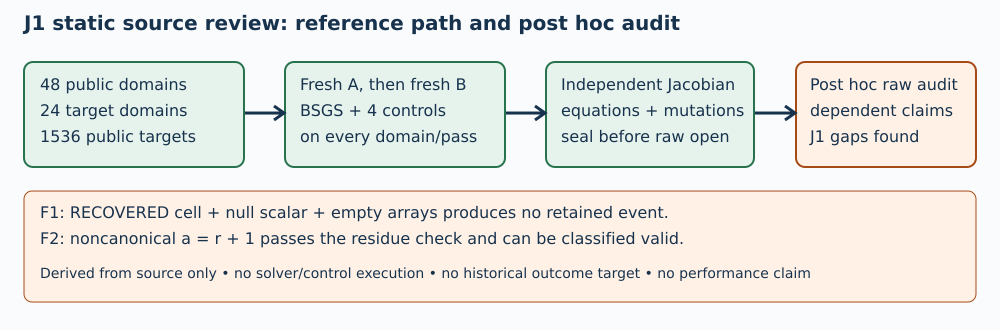

# Independent source review — J1 breaks

TASK-20261106-2ff273 • 2026-11-06 • independent session `/root/independent_reference_source_review_20261106`

The public-reference arithmetic, complete BSGS search, fresh A/B process path and separate Jacobian checker fit their stated mathematical roles on static inspection. **J1 breaks** because the candidate audit can omit an explicit incomplete `RECOVERED` claim and accepts noncanonical blinding multipliers as valid. These are source-level counterexamples, not observations about the frozen raw data. No source changes or scientific execution occurred.

## Scope and immutable bindings

The externally pinned frozen plan was read from `archives/TASK-20261106-924f2e/receipt.json`, SHA256 `382af9469b4711867c77e22d4cb1eb79d0d9713848b5ddd2fcf5abb468a2da86`; independently recomputed bytes match. Source snapshot is `da0c590a872102f5c91d37d37a96753054065954`; the three source hashes match the dispatched pins (full hashes in checks.json). Published HEAD was supplied by the dispatcher, not independently Git-inspected. Review owns exactly J1. The known-false static objects in the pinned plan were reasoned through without execution. DESIGN is context, including its declared post hoc history; historical counts were not targets or thresholds.



## Material source findings

**F1 — incomplete RECOVERED cells disappear.** `verify.py:369-388` copies status into a local context, but adds events only for RECOVERED words, nonnull scalar, or recovered_scalars elements. An otherwise valid, uniquely identified, correctly trace-joined cell with `status="RECOVERED", words=[], scalar=null, recovered_scalars=[]` produces no event. The `if events` guard omits it from claimed_cells, outcomes and disagreements; the code can reach complete summary at lines400-408. It is counted only as an undifferentiated cell. This fails DESIGN34-36's retention and incomplete-claim inventory. No claim that this shape exists in the fixed raw prefix is made.

**F2 — noncanonical blinding multipliers can pass.** `verify.py:338` requires integer a,b with nonzero residues, then reduces them at lines340-342. DESIGN34 requires canonical nonzero a,b. On the frozen F17 toy curve, r=19, G=(5,1), Q=2G=(6,3), take normalized scalar x=2, transformed k=2, a=20, b=1. Since a mod19=1, the normalization yields 2 and both transformed sides equal 2G. The event can be classified valid although a=20 is outside [1,18]. This is an algebraic source counterexample, not an executed fixture. Normalization x=a*k/b mod r itself is correct.

## What static inspection supports

- `solver.py:33-103`: bounded deterministic prime checks; p>3; canonical coefficients/coordinates; nonsingularity; nonidentity G; unreduced rG. SEC1 identity and inverse rules handle y=0 before inversion; Euclidean inverse and affine formulas match the primary source.
- `solver.py:106-131,164-205`: m=isqrt(r-1)+1=ceil(sqrt(r)); babies j=0..m-1 and giants i=0..m-1 cover x=im+j for every 0<=x<r. The direct equation and scalar<r guard certify any returned scalar. All48 domains build a table and four same-path controls;24 target-bearing domains reuse tables for1536 total public targets. These are planned inventory numbers, not observed successful solves. rQ=O is only subgroup sanity; a successful complete search/direct equation establishes membership in G's cyclic subgroup.
- `verify.py:55-138,180-279`: separate Jacobian double/mixed-add, unreduced rG/rQ, canonical scalar check and original equations; no solver/candidate arithmetic import. The checker independently recalculates controls and does not merely accept producer flags.
- Frozen known-false objects: F17 k=1 for Q=2G fails line225; k=r+2 fails lines223/412-415; offcurve/noncanonical/identity base fails constructors. A changed scalar or point cannot satisfy the checked original equation unless it is its correct canonical logarithm. Omitted/duplicate/changed-ID certificate vectors fail lines216-234; A/B byte changes fail261-262. Mutation acceptance raises fatal errors at227-228 and333-334, rather than becoming an undefined candidate event.
- `driver.py:95-149,171-178`: sequential fresh processes are waited; fixed worker constructs tables afresh; identical certificate bytes are sealed. Worker direct equations precede producer verified:true. `verify.py:279` writes independent reference verification before candidate opens at288.
- `verify.py:318-398`: RECOVERED words, nonnull scalar including zero, and every recovered_scalars element create retained events. Invalid/undefined events survive and dependent fields are not treated as independent samples. F1/F2 limit complete contract fit.

## Additional gaps and limits

G1: Per-process CPU limits at driver44-46 and verify155-156 do not enforce DESIGN40's cumulative1800 CPU seconds for A/B/check/audit/export. Native parent enforcement is outside scope. G2: verify283-315/358-398 lacks complete status census and byte offsets, and trace context discards arm/transformation identifiers rather than explicitly validating those joins (DESIGN34-36). No raw schema scan was authorized; exact prefix applicability remains untested. G3: driver termination addresses direct children only (current solver spawns none), grace waits may exceed stop, and checker wall polling is cooperative with no guard during final serialization/writes. Hard whole-pipeline guarantees need native parent controls. G4: checker validates certificate content, public identity and ID sets but does not compare seal source/input-manifest metadata against current bytes or enforce original row order; native publication/custody remains necessary. No cap overrun, tampering or empirical failure is asserted.

The next technical action is a prospectively owned source correction for F1/F2 and explicit inventory/cap/custody resolution, then a new immutable snapshot and independent review. This report grants no experiment approval, native admission or scientific state change. Canonical scientific graph files were outside read scope and remain unchanged; the diagram documents source flow only.

## Primary sources and procedure

HAC Chapter3 §3.6.2 Algorithm3.56/Fact3.57, local `host-reference-cost-audit-20261030/root-literature/hac-chapter3.txt` lines1000-1040 (primary local text, retrieved and verified by this session), supports the decomposition and complete search. SEC1v2 §2.2.1, local `fresh48-20261105-witness-primary-sources/sec1-v2.txt` lines442-494 (same provenance), supports nonsingularity and prime-field group laws. Full absolute paths and all actual source reads are in checks.json. Literature is mathematical reference, not an empirical performance claim.

Procedure deviation: initial source display preceded display of primary passages; those passages were read before report writing, recommendations and final analysis. No solver, control, unit, fixture, benchmark or scientific run, source import, Git mutation, AWS call, raw target/trace/cell scan, producer scalar report or sibling report was performed. Syntax compilation was not repeated. The initial combined displays were truncated; relevant sections were then displayed separately.

Fixed budget start epoch1793982438, stop1793982738, whole review300 seconds including rendering and inspection; no extension/reset/retry. Final actual accounting, render commands/logs and visual inspection are appended below and in checks.json. The4GiB reviewer memory ceiling was not instrumented; no measured RSS compliance is claimed.

## Review attestation

```json
{
  "task_id": "TASK-20261106-2ff273",
  "joints_owned": [
    "J1"
  ],
  "sources_read": [
    "AGENTS.md",
    "agents/validator.md",
    ".claude/skills/research-visuals/SKILL.md",
    "docs/agent-contract-extended.md",
    "ledger/handoffs/TASK-20261106-2ff273.yaml",
    "coordination/goals/GOAL-ECDLP-e70832/batches/BATCH-876fd5/DESIGN.md",
    "coordination/goals/GOAL-ECDLP-e70832/batches/BATCH-876fd5/input-manifest.json",
    "coordination/goals/GOAL-ECDLP-e70832/batches/BATCH-876fd5/source-contract.json",
    "coordination/goals/GOAL-ECDLP-e70832/batches/BATCH-876fd5/source-materialization.json",
    "coordination/goals/GOAL-ECDLP-e70832/batches/BATCH-876fd5/archives/TASK-20261106-924f2e/receipt.json",
    "harness/classical_ecdlp_public_reference_audit/solver.py",
    "harness/classical_ecdlp_public_reference_audit/driver.py",
    "harness/classical_ecdlp_public_reference_audit/verify.py",
    "/workspace/classical-ecdlp-endpoint-reuse/host-reference-cost-audit-20261030/root-literature/hac-chapter3.txt",
    "/workspace/classical-ecdlp-endpoint-reuse/fresh48-20261105-witness-primary-sources/sec1-v2.txt"
  ],
  "read_sibling_reports": false,
  "blind_from_respected": true,
  "verdicts": {
    "J1": "breaks"
  },
  "independent_session": "/root/independent_reference_source_review_20261106",
  "independence_statement": "Independent of producer and Coordinator; no inherited producer session. Source-fit review is explicitly post hoc; no outcome-blind empirical assertion."
}
```

## Editable PDF source (Typst)

The following exact source is compiled in scratch with the declared diagram.svg; the five deliverables directory has no sixth source file.

```typst
#set page(paper: "a4", margin: 16mm)
#set text(font: "DejaVu Sans", size: 9pt)
#set par(justify: false, leading: 0.6em)
#set heading(numbering: none)
#align(center)[#text(size: 16pt, weight: "bold")[Independent static source review]]
#align(center)[J1: breaks · TASK-20261106-2ff273 · 2026-11-06]

The arithmetic, complete BSGS search and independent checker fit their mathematical roles on static inspection. Two candidate-audit branches break the complete declared source contract. No solver, control, fixture, unit or scientific execution occurred. No raw candidate payload or sibling review was read.

#image("/tmp/independent-reference-source-review-20261106/diagram.svg", width: 100%)

== F1 — incomplete RECOVERED claim omitted
At verify.py:369–388, a correctly joined cell with status RECOVERED, words=[], scalar=null, recovered_scalars=[] creates no event. The status is only copied locally; the if-events branch omits this row from claimed cells, outcomes and disagreements. The verifier can reach its complete summary (400–408). DESIGN34–36 requires retention of every explicit claim and incomplete-claim inventory. This is a static input-shape counterexample, not an observation about the fixed raw prefix.

== F2 — noncanonical multiplier can be valid
At verify.py:338–342, a,b need only be integers with nonzero residues. On E/F17: y²=x³+2x+2, G=(5,1), r=19, Q=2G=(6,3), use x=2, transformed k=2, a=20, b=1. Since 20 mod19=1, normalization gives 2 and both transformed sides equal 2G. The event can be valid even though DESIGN34 requires canonical nonzero a,b. The normalization algebra is correct; the missing canonical range check is the defect. No fixture was executed.

== Scope and next action
Own joint J1 only. Correct these source branches and resolve the inventory/resource dependencies through a new owned source revision, immutable snapshot and independent review. No experiment admission, empirical correctness or scientific status change follows from this review.

#pagebreak()
== Static checks and frozen false objects
*Domain and affine law:* solver.py:33–103 deterministically checks bounded primes, p>3, canonical coefficients/coordinates, nonsingularity, nonidentity G and unreduced rG. Identity/inverse/y=0 branches precede inversion; extended Euclid and add/double agree with SEC1 §2.2.1.

*Complete BSGS:* solver.py:106–131 has m=isqrt(r−1)+1=ceil(sqrt(r)). For every 0≤x\<r, x=im+j with i,j\<m. Babies j=0…m−1 and giants i=0…m−1 cover the search. Returns require x\<r and the direct original equation. Lines164–205 build controls on all48 domains, reusing tables on24 target-bearing domains for1536 planned targets. These counts describe intended inventory, not observed successful solves. The rQ check alone is subgroup sanity, not a general proof that Q lies in the subgroup generated by G.

*Independent equation checker:* verify.py:55–138 implements Jacobian doubling/mixed addition, converting by Fermat inversion, and never reduces order-check scalars. It imports neither solver nor candidate arithmetic. Lines180–279 recheck all certificate vectors, canonical scalars, equations and mutations, plus controls.

*Known-false objects from the pinned plan:* F17 k=1 for Q=2G fails line225; k=r+2 fails223/412–415. Offcurve, noncanonical and identity bases fail constructors. Omitted/duplicate/changed-ID vectors fail216–234. A changed incorrect scalar fails its original equation. A/B changes fail261–262. A successful mutation is fatal at227–228 or333–334. These are analytical branch assessments, not recorded control outcomes.

*Freshness and seal:* driver.py:95–149 launches A then B as fresh Popen processes, waits, compares exact bytes and seals. Direct equations precede producer verified:true at171–178. Independent verification is written at verify279 before candidate opens at288. The current worker spawns no descendants.

*Claims retained where events exist:* verify318–398 audits RECOVERED words, nonnull scalar (including zero), and every recovered_scalars array element. Invalid and undefined events are retained. The transformation x=a·k/b mod r is correct for the stated canonical multipliers. F1/F2 remain material exceptions.

== Additional scoped gaps
G1: driver44–46 and verify155–156 set CPU1800 independently per process, not cumulatively across the pipeline as DESIGN40 requires. Native parent enforcement was not reviewed.

G2: verify283–315/358–398 lacks all-status census and byte offsets; trace context omits arm/transformation IDs instead of explicitly checking these joins. Exact applicability to the fixed prefix was not tested.

G3: direct-child termination and grace waits do not establish hard whole-pipeline descendant/deadline guarantees; checker polling is cooperative and absent during final output serialization. G4: checker does not compare current manifest/source hashes with seal metadata or enforce original row order. Native custody checks remain necessary. None is a claim of observed overrun or tampering.

#pagebreak()
== Immutable pins and references
Pinned plan: archives/TASK-20261106-924f2e/receipt.json. Independently recomputed SHA256:
#text(size: 7.5pt)[382af9469b4711867c77e22d4cb1eb79d0d9713848b5ddd2fcf5abb468a2da86]

Source snapshot: da0c590a872102f5c91d37d37a96753054065954. Source hashes independently match:

solver.py: #text(size: 7pt)[d462b17ffb10772852d6024a92be71eb768b27d3d4b619cd582c868f88953031]

driver.py: #text(size: 7pt)[e0d7e4c2690f707a26edf0552e25c59327fe9b5637ee7d512c6dafdc06438124]

verify.py: #text(size: 7pt)[a19cfc02c5f95726466eb6fdef9506eb569b04e6a0ffdeb1d322bf9ff4049c8d]

HAC Chapter3 §3.6.2 Algorithm3.56/Fact3.57, local primary text lines1000–1040, supports decomposition and complete coverage. Absolute source: /workspace/classical-ecdlp-endpoint-reuse/host-reference-cost-audit-20261030/root-literature/hac-chapter3.txt.

SEC1v2 §2.2.1, local primary text lines442–494, supports nonsingularity and identity/inverse/add/double. Absolute source: /workspace/classical-ecdlp-endpoint-reuse/fresh48-20261105-witness-primary-sources/sec1-v2.txt.

Both sources: provenance retrieved local primary text; verified by /root/independent_reference_source_review_20261106. All other source reads are listed completely in checks.json. Initial combined displays were truncated and relevant portions were redisplayed individually.

== Independence and limits
Attestation: task_id TASK-20261106-2ff273; joints_owned [J1]; verdicts J1=breaks; read_sibling_reports=false; blind_from_respected=true. Independent source-fit session. Historical counts within DESIGN were context only, never expected outcomes or thresholds. This is explicitly post hoc source-fit review, not an outcome-blind empirical validation. Published HEAD was supplied by the dispatcher and not independently Git-inspected.

Procedure deviation: initial source display preceded display of primary passages. Primary passages were read before report writing, recommendations and final analysis. No source edit, import or scientific execution occurred. No syntax compile was repeated. Canonical graph files were outside read scope and remain unchanged. The included diagram documents source flow; it is not a performance chart.

== Budget and render record
Fixed start epoch1793982438; fixed stop1793982738; maximum whole review300 seconds including report, render and inspection. No extension, reset or retry. Reviewer memory ceiling4GiB was not instrumented; no measured RSS compliance is claimed. Final actual completion and render/inspection logs are in checks.json and report.md.

Editable source is embedded in report.md. Actual renderer: installed Python Typst module. PDF is rasterized with pdftoppm and every generated page is viewed before final delivery. The final visual-inspection.json records actual inspected pages; no unperformed inspection is asserted here.

```

## Actual rendering and final accounting

All three PDF pages were rasterized and actually viewed. Text, source pins, citations and diagram are legible; no clipping observed. Typst compilation needed two administrative corrections (literal < escaping and root path); the third compile succeeded. These are rendering attempts, not scientific runs or review-budget resets.

```json
{
  "render": {
    "compile_command": "/workspace/classical-ecdlp-endpoint-reuse/runtime-20261028/bin/python -c \"import typst; typst.compile('/tmp/independent-reference-source-review-render-20261106/report.typ', output='/tmp/independent-reference-source-review-20261106/report.pdf', root='/')\"",
    "raster_command": "pdftoppm -r 65 -png /tmp/independent-reference-source-review-20261106/report.pdf /tmp/independent-reference-source-review-render-20261106/page",
    "pdfinfo_command": "pdfinfo /tmp/independent-reference-source-review-20261106/report.pdf",
    "attempts": [
      {
        "result": "TypstError: unclosed label",
        "exit_code": 1
      },
      {
        "result": "TypstError: file not found (searched at /tmp/tmp/independent-reference-source-review-20261106/diagram.svg)",
        "exit_code": 1
      },
      {
        "result": "success; Creator Typst0.15.0; PDF1.7; A4;3pages;55833bytes",
        "exit_code": 0
      }
    ],
    "corrections": "Escaped literal < signs in editable Typst source and used filesystem root=/ for the embedded absolute SVG path. No scientific retry occurred.",
    "page_view_tool": "tools.view_image via functions.exec",
    "pages_viewed": [
      1,
      2,
      3
    ]
  },
  "final_accounting": {
    "start_epoch_seconds": 1793982438,
    "fixed_stop_epoch_seconds": 1793982738,
    "maximum_wall_seconds": 300,
    "maximum_memory_gib": 4,
    "extensions": 0,
    "resets": 0,
    "retries": 0,
    "memory_cap_instrumented_for_reviewer": false,
    "memory_compliance": "No RSS measurement collected; no claim of measured memory compliance.",
    "completed_artifact_accounting_at_epoch_seconds": 1793982743.1355922,
    "elapsed_seconds_at_accounting": 305.13559222221375,
    "whole_wall_cap_met_at_accounting": false,
    "memory_cap_met": "unverified; not instrumented"
  }
}
```
