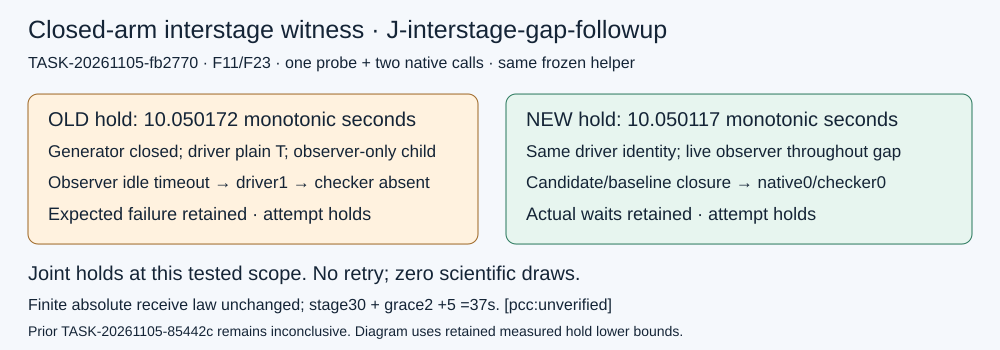

# Independent interstage follow-up

TASK-20261105-fb2770; joint J-interstage-gap-followup: **holds at the tested disclosed fixed-fixture scope**. OLD and NEW both established isolated closed-generator gaps exceeding 10 monotonic seconds with the same frozen helper. OLD retained the expected observer idle failure; NEW completed ordinary candidate/baseline native closure and checker. Prior TASK-20261105-85442c remains inconclusive and unwaived. [pcc:unverified]

Observation: OLD held the identity-bound direct driver in plain kernel T for a measured lower bound of 10.050172389 seconds; NEW held it for 10.050116758 seconds. Before inventory, each actual raw T/stat/status/cmdline record was persisted. A complete numeric /proc PPid scan then found only the observer as the driver child; generator-only observation inventory, generator seal and original wait acknowledgment established no open arm. Unrelated racing ENOENT rows are logged. Hold timing began only after these checks. Driver PID/start/PPid/argv/TracerPid0 remained bound, native parent stayed alive, and end snapshots were captured while still T before CONT. NEW observer remained alive and identity-continuous throughout. [pcc:unverified]

OLD observer showed raw TimeoutError from its frozen5-second idle receive. First observed zombie state was 5.053478801 seconds after seal close, an upper bound at approximately0.25-second sample spacing, not an exact timeout timestamp. After CONT the native receipt is infrastructure_error with driver1 and checker absent, the expected refusal. NEW native receipt is output_validated, driver0/checker0; custody observations and closures contain generator, candidate and baseline. Complete result members, source snapshots, seals and actual OS wait acknowledgments were independently checked from retained bytes. Original nativecontroller Popen.wait returned in both attempts, and final known native/driver/observer PIDs were absent. No deadline cleanup termination was used. [pcc:unverified]

Comparison/inference: the matched disclosed F11/F23 pair distinguishes old closed-arm5-second refusal from new bounded-stage interstage completion for this genuine measured gap. This verdict belongs only to J-interstage-gap-followup; it does not infer production fitness, a mathematical result or an advantage. No broader suite or scientific run was executed. [pcc:unverified]

Source review: OLD af8a54211bcd6f0503c3d58d159289bff6a023ce and NEW 964579a78b488fcfe8040837f5af138b5cd0be3c differ within59 keys only in observer.py server receive choice and its matching manifest entry. Other57 and load_custody AST remain exact; all source mirrors and embedded process source snapshots match their external pins before/after. The framed receive uses one finite absolute monotonic deadline across the entire message, bounded1MiB framing and remaining-time checks before send/receive and after decode. Frozen stage30/grace2 yields37 seconds. The generator seal close event follows CUSTODY.closed reply in unchanged driver source. [pcc:unverified]

Instrument/procedure: exactly one fixed tiny non-EC probe burst-created nested existing directories; the same helper recursive algorithm discovered/watched them before the seal-like file burst and captured its real inotify close event. /proc/self stat/status/cmdline parser checks passed. This probe tests existing-directory discovery and close detection; it does not by itself prove discovery of arbitrarily fast closes in unwatched directories. Both actual controls supply their own seal events and raw discovery records. One helper file was frozen before the probe/native calls and remained byte-identical across OLD/NEW. Controls differed only in explicit source/case paths. No /proc/PID/task/PID/children dependency, source/time mock, ptrace/debugger or detached parent was used. [pcc:unverified]

Budget/custody: original follow-up dispatch monotonic43942.861707589; all setup, helper authoring, probe and both controls ended by elapsed271.507730738 seconds within shared420. Each nativeouter120 deadline was fixed at original launch; finally CONT and original-remaining-deadline Popen.wait are retained. Whole600-second final packaging time is in checks.json. Exactly2 fixture calls, one instrument probe, zero scientific/entropy/nonce/cohort draws and no retries. Original05:53UTC global cap remains intact. [pcc:unverified]

Reading: AGENTS.md, validator, literature-first, research-visuals, PCC rule, committed literal plan, original obstruction and previous854work were read; prior helper/report exposure is explicitly permitted, and no current sibling report was read. Python runtime API documentation and unchanged native fixture source informed measurement. External Linux manuals were unavailable locally and network prohibited, an explicit evidence gap. No new mathematical literature/novelty claim or canonical graph finding arises; the affected task/obstruction graph pointers were checked and no canonical graph edit is warranted. [pcc:unverified]

Evidence: checks.json embeds every closed new-task raw/helper/probe/source/editable/supervision file in a lossless gzip-tar/base64 capsule with physical/logical member SHA-256 and byte mapping and every-member roundtrip check. Report.typ and diagram source are embedded; final PDF pages were actually viewed. Final native independence command uses literal plan SHA25654da6b02e0443fcb23b023d551a2cdaff13c0e74e9828d7cdb1100185711868d. Its declaration check and this review are not signed PCC standing. Root handles publication, PCC, archive and any subsequent decision. [pcc:unverified]

Final review_attestation: read-attestation.yaml; joint J-interstage-gap-followup; verdict holds; reviewer /root/independent_interstage_gap_20261105; current sibling reports not read.
