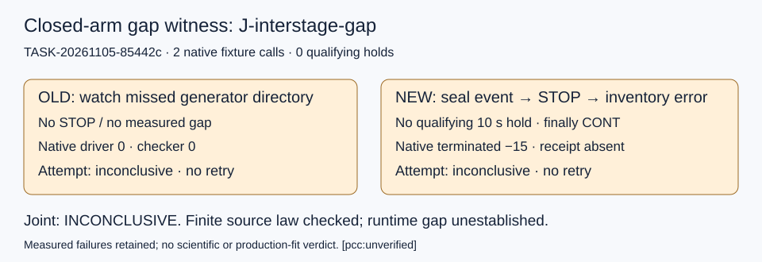

# Independent closed-arm interstage review

TASK-20261105-85442c; joint J-interstage-gap: **inconclusive**. Neither of the two authorized native fixture attempts established the required isolated monotonic hold of at least 10 seconds. No retry was performed. [pcc:unverified]

Observation: OLD completed with native status output_validated, driver 0 and checker 0, but the ancestor inotify watch missed generator directory creation; no seal event, STOP or hold was obtained. NEW used a separately retained helper revision that discovers already-created subdirectories. It caught generator seal close, bound the post-exec driver argv/PID/start ticks/native parent, sent STOP and reached the code after the plain-T/TracerPid0 loop; the stopped-status raw bytes were not persisted before failure. Generator-only observations and the closed generator seal were read. The subsequent /proc/PID/task/PID/children read failed. No outstanding-arm conclusion or qualifying hold was recorded. Finally CONT resumed the same identity; the original native Popen was waited for 5 seconds, then its process group was terminated and actual wait returned -15. NEW native execution-receipt is absent. Later inspection found all five known NEW native/driver/observer/worker PIDs absent. This does not replace missing native finalization. [pcc:unverified]

Comparison: OLD failed to impose the treatment, and NEW stopped before the treatment measurement. Their ordinary/partial outputs cannot test the specified old5-second refusal versus new bounded-gap completion. The originally failed scientific run is declared prior material only and was not re-executed. [pcc:unverified]

Source review: committed OLD af8a54211bcd6f0503c3d58d159289bff6a023ce and NEW 964579a78b488fcfe8040837f5af138b5cd0be3c differ within source59 only in observer.py server receive timeout choice and its source-manifest entry. Other57 and load_custody AST are exact; both isolated mirrors remained byte-identical before/after. NEW uses a finite stage-derived timeout (30+2+5=37 seconds here), with one monotonic deadline across the complete framed message and send, each receive and final decode check; allowance is not reset per byte. Source law alone does not establish the runtime joint. [pcc:unverified]

Limits and deviations: maximum2 native fixture calls used; zero science, entropy, nonce or cohort generation. Both use disclosed F11/F23 fixed_input and unchanged source/native fixture APIs. No source, time, fixture or native gate edits. NEW watcher directory discovery changed only witness boilerplate after OLD miss; both helper versions and every failure are retained. The NEW cleanup terminated the native parent before its final native receipt; full native closure/waits requirement is unmet. No tracer/ptrace was used. [pcc:unverified]

Budget: original dispatch monotonic41436.978451904, shared focused420 seconds and whole600 seconds were never reset. Pair setup/helper authoring and native attempts ended at elapsed343.141596361 seconds; post-pair process inspection occurred by elapsed407.443850654 seconds. No further controls were run. Final package time is recorded in checks.json. [pcc:unverified]

Literature/assumptions: read repository AGENTS.md, validator contract, literature-first rule, research-visuals, literal committed plan, obstruction and failed-run-preservation; inspected local Python runtime API documentation for monotonic clock, kill, socket timeout and Popen.wait. External Linux manuals were unavailable locally and network was prohibited. Prior-round TASK-591a0a helper boilerplate was read; no current-round sibling report was read. No mathematical novelty assertion or canonical graph finding arises. Canonical graph scope was checked through the task/obstruction pointers; no shared graph edit was warranted. [pcc:unverified]

Evidence: checks.json embeds a lossless gzip-tar/base64 capsule with physical/logical member size and SHA-256 mapping, all raw partials, source mirrors, helper versions, report.typ, diagram source, PDF-page rendering and native independence logs. Seven proposed card artifacts are returned for root archive; raw physical files remain in place. The literal external plan SHA256 is 0e0064440b785e2be8bc9c869f4917557b88471e70d0e4e370499edb7e8ae31f.

Next step belongs to the Coordinator: preserve this inconclusive result and decide whether a new separately authorized review can establish the missed witness. This review supplies no whole-claim, production-fit, mathematical or advantage verdict. [pcc:unverified]

Review attestation is the final read-attestation.yaml; joint owned J-interstage-gap, verdict inconclusive, read_sibling_reports false, reviewer /root/independent_interstage_gap_20261105.
