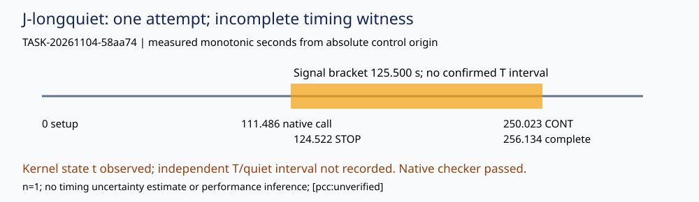

# Independent long-quiet control

TASK-20261104-58aa74 · 2026-11-05 · J-longquiet

**Question and result.** J-longquiet is inconclusive. The one permitted native fixture completed as output_validated; driver and unchanged checker both returned 0. The reviewer did not obtain the required confirmed 125-second STOP interval and full independent quiet/liveness witness. [pcc:unverified]

**Observation.** Fixed zero-entropy F11 (r=13) and F23 (r=17), ordinary candidate and baseline fixture_fault=hang; stage200 s, grace2 s, native outer260 s. The marker was retained in the complete sealed baseline output. Distinct candidate PID82847, baseline PID82850, observer PID82841, driver PID82839 and persistent native parent PID82836 were recorded. [pcc:unverified]

**Failed condition.** The reviewer added strace to preserve genuine OS wait syscalls. After SIGSTOP, /proc showed t (tracing stop), while control.py required T before starting its 125.5 s interval. That branch never started. Cleanup rechecked PID82850/start3081255/parent82839/post-exec argv, sent SIGCONT, then retained the monitor disappearance error. No tracing stop or signal-to-CONT duration is accepted as the missing witness. [pcc:unverified]

**Comparison.** SIGSTOP-send to cleanup-CONT was 125.500236 s; this is a measured signal-bracket only. The confirmed T-stop interval and independent complete >120 s event-free/liveness interval are absent. Native source checks passed closed bytes, source/input identity and custody; these checks cannot fill the absent independent timing witness. [pcc:unverified]

**Timing and waits.** The single absolute control clock began at monotonic 30691.203660922 before mirror/setup/helper authoring, ended at 30947.337384575, and spanned 256.133724 s within300 s. Native driver/checker, candidate/baseline and observer waits are retained in OS wait4 traces, native receipt and custody files; final helper waitpid returned ECHILD. No retry or second native call occurred. [pcc:unverified]

**Limits and provenance.** Exact59 source bytes matched before and after; native internal Git metadata only used the read-only .git link. Parent RLIMIT_AS=4 GiB and child2 GiB limits were applied; full aggregate RSS coverage was not obtained because the liveness loop did not start, so no peak RSS/fit claim is made. Whole task limit900 s, newraw128 MiB, capsule32 MiB, logs16 MiB and free reserve256 MiB remain explicit. [pcc:unverified]

**Source interpretation.** lifecycle.os.execv explains the distinct pre-exec wrapper and post-exec baseline command. Observer quiet timeout is stage200+grace2+5=207 s. The marker precedes baseline sleep60 and does not prove entered sleep. Declared Python monotonic/sleep and Linux nanosleep/PDEATHSIG/subreaper primary references were read; copied source and all new evidence are retained losslessly in checks.json. [pcc:unverified]

**Deviation and next action.** The necessary immutable native-closure.json keyset dependency was absent from the card input list; the coordinator clarified this existing transitive dependency, with no change to exact59. Unplanned ptrace interference and same-attempt cleanup are preserved as deviations. Any future witness requires a separately authorized new task; this task stops after delivery. No canonical graph was changed because this is a single incomplete software witness and graph read scope excludes canonical graphs. [pcc:unverified]



Evidence: checks.json lossless capsule; control-summary.json, cleanup-result.json, events.jsonl, os-waits.*, native execution-receipt.json, check.stdout.log and complete closed output/custody. References and exact before/after source hashes: source-review.json. All empirical statements [pcc:unverified].

```yaml
{
  "review_attestation": {
    "task_id": "TASK-20261104-58aa74",
    "reviewer": "/root/independent_longquiet_followup_20261105",
    "joints_owned": [
      "J-longquiet"
    ],
    "verdict": "inconclusive",
    "sources_read": [
      "harness/classical_ecdlp_controlled_followup/cohort.py",
      "harness/classical_ecdlp_controlled_followup/constructor.py",
      "harness/classical_ecdlp_controlled_followup/curve.py",
      "harness/classical_ecdlp_controlled_followup/engine.py",
      "harness/classical_ecdlp_controlled_followup/host/reference.py",
      "harness/classical_ecdlp_controlled_followup/host/verify.py",
      "harness/classical_ecdlp_controlled_followup_v5/baseline.py",
      "harness/classical_ecdlp_controlled_followup_v5/candidate.py",
      "harness/classical_ecdlp_controlled_followup_v5/check.py",
      "harness/classical_ecdlp_controlled_followup_v5/cohort_adapter.py",
      "harness/classical_ecdlp_controlled_followup_v5/driver.py",
      "harness/classical_ecdlp_controlled_followup_v5/export.py",
      "harness/classical_ecdlp_controlled_followup_v5/fixtures.json",
      "harness/classical_ecdlp_controlled_followup_v5/format-contract.json",
      "harness/classical_ecdlp_controlled_followup_v5/interface.json",
      "harness/classical_ecdlp_controlled_followup_v5/lifecycle.py",
      "harness/classical_ecdlp_controlled_followup_v5/observer.py",
      "harness/classical_ecdlp_controlled_followup_v5/public_verify.py",
      "harness/classical_ecdlp_controlled_followup_v5/resource-envelope.json",
      "harness/classical_ecdlp_controlled_followup_v5/source-manifest.json",
      "harness/classical_ecdlp_controlled_followup_v5/source_closure.py",
      "harness/classical_ecdlp_controlled_followup_v5/test_contracts.py",
      "orchestration/__init__.py",
      "orchestration/adapter/__init__.py",
      "orchestration/adapter/batch.py",
      "orchestration/adapter/config.py",
      "orchestration/adapter/manifest.py",
      "orchestration/adapter/prompt_cache.py",
      "orchestration/adapter/resolver.py",
      "orchestration/adapter/transport.py",
      "orchestration/fast_yaml.py",
      "orchestration/model-bindings.yaml",
      "orchestration/model-policies.yaml",
      "orchestration/research-priority.yaml",
      "orchestration/research_budget.py",
      "orchestration/roles.yaml",
      "schemas/experiment-export.v1.json",
      "schemas/experiment-protocol.v1.json",
      "schemas/experiment-review.v1.json",
      "tools/allocate_id.py",
      "tools/artifact_store.py",
      "tools/build_frontier_map.py",
      "tools/check_review_independence.py",
      "tools/ecc_priority.py",
      "tools/experiment_execution.py",
      "tools/experiment_preapproval.py",
      "tools/experiment_protocol.py",
      "tools/fast_yaml.py",
      "tools/goal_lanes.py",
      "tools/newest_experiments.py",
      "tools/research_dispatch.py",
      "tools/review_phase_seals.py",
      "tools/run_supersession_registry.yaml",
      "tools/schema_supersession_registry.yaml",
      "tools/sparse_checkout.py",
      "tools/task_recovery.py",
      "tools/validate_dispatch_reference.py",
      "tools/validate_ledger.py",
      "tools/validate_ledger_baseline.txt",
      "AGENTS.md",
      "agents/validator.md",
      ".claude/skills/research-visuals/SKILL.md",
      "docs/artifact-storage.md",
      "docs/artifacts.md",
      "coordination/goals/GOAL-ECDLP-e70832/batches/BATCH-da4dc5/long-control-followup-9cf514/review-plan.json",
      "ledger/handoffs/TASK-20261104-58aa74.yaml",
      "coordination/goals/GOAL-ECDLP-e70832/batches/BATCH-da4dc5/plans/TASK-20261104-58aa74.json",
      "coordination/goals/GOAL-ECDLP-e70832/batches/BATCH-da4dc5/archives/TASK-20261104-6161de/receipt.json",
      "coordination/goals/GOAL-ECDLP-e70832/batches/BATCH-27c9d5/final-control-clarification/linux-nanosleep-primary.html",
      "coordination/goals/GOAL-ECDLP-e70832/batches/BATCH-27c9d5/final-control-clarification/python-time-primary.html",
      "coordination/goals/GOAL-ECDLP-e70832/batches/BATCH-e9f035/lifecycle-references.json",
      "coordination/goals/GOAL-ECDLP-e70832/batches/BATCH-e9f035/native-closure.json"
    ],
    "read_sibling_reports": false,
    "blind_from_respected": true,
    "exclusions": [
      "coordination/goals/GOAL-ECDLP-e70832/batches/BATCH-da4dc5/reviews/TASK-20261104-996070",
      "coordination/goals/GOAL-ECDLP-e70832/batches/BATCH-da4dc5/implementation/observations.json",
      "coordination/goals/GOAL-ECDLP-e70832/batches/BATCH-da4dc5/implementation/report.md",
      "coordination/goals/GOAL-ECDLP-e70832/batches/BATCH-da4dc5/implementation/report.pdf",
      "coordination/goals/GOAL-ECDLP-e70832/batches/BATCH-da4dc5/implementation/diagram.svg",
      "coordination/goals/GOAL-ECDLP-e70832/batches/BATCH-da4dc5/implementation/visual-inspection.json",
      ".resume/RESUME.md",
      "other workers outside roots"
    ],
    "read_scope_notes": [
      "All copied inputs were read as bytes for their immutable hashes. Semantic deep reads cover native execute_trial/run_process/manifest handling; driver/native fixture/launch/termination; observer IPC, native ancestry, closures and quiet timeout; lifecycle execv/PDEATHSIG; baseline fixed fault and closed member checks; export/check; declared Python/Linux primary API sections. No imported source execution was a standalone mathematical replay.",
      "Exact59 source and necessary native-closure.json transitive keyset dependency were captured; explicit card input-list omission clarified by coordinator.",
      "Own raw/process/wait/cleanup/report artifacts were read after creation. Native internal read-only Git metadata HEAD collection used the permitted .git link. No worker Git mutation, network, credentials or canonical write."
    ],
    "plan_sha256": "ea07ac6ce046681d054e63f7c7de7e4bd3ece62f15e51372bf07aa5a3269e55c",
    "observed_result": "Native output_validated and checker rc0; required confirmed T-stop and independent full quiet/liveness witness missing. [pcc:unverified]"
  }
}
```
