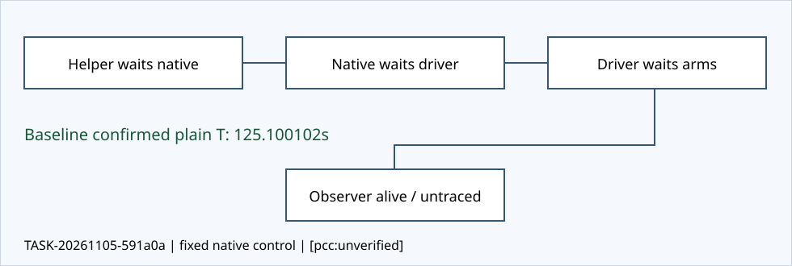

# Independent untraced long-quiet control

TASK-20261105-591a0a · external plan SHA-256 `02b881f12647d76f4c136d4c82d139250bd50bad8a8019bb695cfe96faa97639`

## One untraced long-quiet control

J-untraced-longquiet: holds. One actual native fixed-toy control measured a conservative plain-T interval of 125.100102 monotonic seconds. Native closure and checker completion are assessed from the actual retained receipt. [pcc:unverified]

## Observed interval

The helper confirmed baseline PID/start/parent and actual post-exec argv, then sent SIGSTOP. It confirmed kernel T and TracerPid=0 before recording hold start 32168.879704715. It recorded end 32293.979806343 before taking the complete final stopped snapshot, and only then sent SIGCONT. The observer remained alive with unchanged PID/start/parent at all retained samples. [pcc:unverified]

## Measured and causal quantities

The measured quantity is the baseline plain-T interval, supported by raw /proc stat/status/cmdline samples. Observer quiet exceeds 120 seconds causally: while this baseline is stopped it cannot finish; the direct driver is in its arm poll/wait loop and cannot call CUSTODY.closed until the actual arm wait returns; the sequential execute path cannot call finish. The helper sends no observer IPC. Observer source waits for a complete message on one absolute configured quiet budget of 207 seconds. No observer-internal monotonic timestamp was measured or invented. [pcc:unverified]

## Closed output and actual waits

The persistent helper directly waited for the native supervisor. The unchanged supervisor run_process obtained its driver result and finally cleanup; the native receipt records driver returncode 0, checker returncode 0 and output_validated. The unchanged direct driver obtained candidate and baseline returncode 0 and actual termination acknowledgments, then waited for observer returncode 0. Finalized custody binds those waits, launch identities and closed outputs. The baseline full seal retains partial-marker.json; the unfaulted candidate has exactly seven sealed result files. [pcc:unverified]

## Limits and resources

One native fixture execution, zero scientific runs and zero fresh entropy draws. Fixed disclosed F11/F23 groups, r<=29; baseline fault hang; candidate unfaulted; stage 200s, grace 2s, native outer 260s. One absolute control origin 32068.283962673; control span 228.900092s includes imports, mirror/setup, helper authoring and gaps. Read-only /proc and disk guards retained raw/log/free/RSS measurements. The conservative whole-task origin is root claim UTC 2026-11-05T00:27:17.699618Z, earlier than dispatch; exact dispatch monotonic was not recorded. [pcc:unverified]

## Source, blindness and scope

All 59 source files match the external plan map before and after; the native-closure data input is separately pinned and is not a 60th source key. Source publication af8a54211bcd6f0503c3d58d159289bff6a023ce; existing completed archive reused. Only source definitions and declared references were read. No protected implementation control/result, prior review/helper/outcome or sibling outside root was read. No tracer, source/time mocking or extra fixture was used. The marker establishes neither sleep entry nor stopped duration. Post-CONT process disappearance is handled as expected after exit. [pcc:unverified]

## Interpretation and evidence

This verdict is solely the assigned software witness joint. Sparse /proc samples are actual observations linked by one explicit STOP/CONT sequence and stable identities, rather than a continuous kernel trace. The causal quiet lower bound depends on the reviewed unchanged sequential no-traffic source path. The capsule in checks.json retains the complete new raw bytes, editable helper/render sources, source snapshots, primary excerpts, argv/environment, failures/partials and actual wait records. Final read-attestation and independence output are retained separately. No mathematical, performance, production-fit or PCC acceptance verdict is made. [pcc:unverified]

The final actual review attestation is [read-attestation.yaml](read-attestation.yaml). [pcc:unverified]
