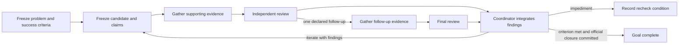

# Default research loop: challenge, candidate, evidence, review, next attempt

Every research goal uses the Curvesmash approach by default (owner, 2026-11-08).
The loop maps the frontier boundary: supported results under fixed conditions,
challenged points, unresolved gaps, and the next discriminating test.
The approach is an executable scheduling loop, applicable to any domain:



The existing campaign autopilot now selects the next phase from these artifacts
for repositories containing goals. It does not fall back to an unrelated global
experiment queue when a goal needs review, has a custody error, or is waiting
for a recorded recheck. ECC priority still comes from `research-priority.yaml`;
operational WIP, budgets, role policies and runner admission still apply.
Repositories without goal records retain their legacy experiment worklist.
Explicit `/run EXP-*`, `/run GOAL-*` and existing launch commands remain direct
execution of prepared work; this loop adds no agent-led launch preflight.

## Inspect and prepare

```sh
# These commands are read-only and make no model calls.
autoresearch campaign next --goal GOAL-AREA-abcdef
autoresearch campaign frontier --goal GOAL-AREA-abcdef
autoresearch campaign problem-template --goal GOAL-AREA-abcdef > /tmp/problem.json
# Fill scope and evidence_requirements; retain the actual goal criteria.
# Coordinator archives the completed record at:
# coordination/goals/GOAL-AREA-abcdef/challenge/problem.json

autoresearch campaign candidate-template --goal GOAL-AREA-abcdef > /tmp/candidate.json
# Fill the claims, evidence plan, producer session and artifact hashes.
# Bind existing experiments, or design them through the existing lifecycle.
# Archive under challenge/attempts/ATTEMPT-<random-six-hex>/candidate.json.
```

The supervisor remains opt-in to **execution**: starting `campaign autopilot`
runs the default loop through existing role workers. Merely installing this
change, inspecting a plan, or generating a template starts no research or paid
review. Templates are intentionally incomplete. A goal adopted into this loop
first freezes its question, scope, acceptance criteria and evidence requirements.
Existing goals, approved protocols, evidence and decisions are reused; no mass
rewrite or retrospective approval occurs.

## Records that drive each phase

All records are UTF-8 JSON with exactly the documented fields. Paths below are
relative to `coordination/goals/<GOAL>/challenge/`. Hashes are lowercase SHA-256
of exact file bytes. Records and every referenced artifact must be regular files
inside the repository and match committed HEAD bytes. Artifact-store pointer
files can be referenced by their own hashes; normal evidence checks still
verify/materialize their data. The planner executes no candidate-supplied code.

| Record | Fields in addition to `schema` | Scheduling consequence |
| --- | --- | --- |
| `problem.json` | `goal_id`, `question`, `scope`, `acceptance_criteria` (nonempty list), `evidence_requirements` (nonempty list), `max_followups` (0 or 1), `frontier` | Missing: define the problem. Valid and frozen: propose a candidate. |
| `attempts/<id>/candidate.json` | `problem_sha256`, `parent_review_sha256` (null initially), `response_to_findings` (null initially, nonempty for a successor), `producer_session`, `claims` (nonempty list), `frontier_target`, `evidence_plan`, `experiments` (initial EXP ids), `followup_experiments` (fresh optional EXP ids), `artifacts` | Prepare admitted declared experiments, run ready ones, then snapshot evidence. Proof/literature work may declare no experiments. |
| `attempts/<id>/evidence.json` | `candidate_sha256`, `experiment_ids`, `execution_outcome`, `boundary_observation`, `artifacts` | Complete evidence schedules independent initial review. |
| `attempts/<id>/review.json` | `candidate_sha256`, `evidence_sha256`, `reviewer_session`, `decision`, `reason`, `findings`, `boundary_assessment` | A follow-up schedules only declared follow-up experiments. A judgment schedules Coordinator integration. |
| `attempts/<id>/followup.json` | Same fields as evidence | Schedules final review after the one follow-up batch. |
| `attempts/<id>/final-review.json` | Same fields as review | Schedules Coordinator integration; another follow-up is refused. |
| `attempts/<id>/decision.json` | `review_sha256`, `supersedes_sha256` (null initially), `coordinator_decision` (artifact reference), `next_step`, `next_action`, `frontier_update` | `iterate`: prepare a changed candidate using the findings. `recheck`: no new dispatch until a committed update changes the condition. `complete`: reconcile official goal closure; the loop alone cannot close a goal. |

Schemas are `autoresearch.challenge-<kind>/v1`, where kind is `problem`,
`candidate`, `evidence`, `review` or `decision`. Follow-up uses the evidence
schema; final review uses the review schema. An artifact reference is exactly
`{"path":"repository/relative/path","sha256":"<64 hex>"}`. `artifacts` is a
nonempty list. `coordinator_decision` is one reference to a committed
`ledger/decisions/DEC-*.yaml` record naming the goal and `decided_by: coordinator`.
This binding supplies custody, not a substitute for archival or decision validation.

`execution_outcome` is `complete` or `infrastructure_failure`. Complete execution
requires the runner's validated measurement-complete state for every declared
experiment, and each specification must name this goal. Unapproved, held,
incomplete, already executed off-main and missing work is prepared/reconciled
rather than blindly launched. Failed attempts retain their artifacts and can
enter an infrastructure-failure review without pretending they measured a result.

Review `decision` is `accept`, `reject`, `followup` or `infrastructure_failure`.
A failed-infrastructure evidence package cannot accept or reject a scientific
claim. Review checks every original claim against the frozen problem; partial
success must not silently drop an unsupported claim. `reviewer_session` differs
from `producer_session`. Those labels do not prove independence: the ordinary
review-plan, independent-session and policy checks still establish it.

Initial `evidence_sha256` is the evidence record's digest. Final review binds
both stages: SHA-256 of the UTF-8 concatenation of the initial review digest and
the follow-up evidence digest (128 lowercase hex characters). A decision binds
the final review if a follow-up happened, otherwise the initial review.
A successor candidate must bind that same terminal review digest and state
which finding it addresses. The planner refuses orphan/forked successor chains,
changed evidence bindings, repeated follow-ups, self-review and uncommitted inputs.

Frozen problems and attempt stage JSON files are write-once. The existing merge
hygiene gate now refuses their mutation/deletion, including on merges. Corrections
are new attempt artifacts/decisions; a changed scientific problem is a new
challenge, rather than an in-place relaxation of prior success criteria. This
initial implementation uses one frozen problem and one explicit attempt chain
per goal; parallel research branches remain in the existing goal/lane machinery.

## Mapping the frontier boundary

The frozen problem's `frontier` has exactly `domain`, `axes`, `incumbents` and
`open_boundary`. Domain and open boundary are nonempty statements of the fixed
conditions and remaining uncertainty. Each axis has exactly `name`, `direction`
(`minimize`, `maximize` or qualitative `satisfy`) and `unit`. Incumbents are
hash-bound artifact references to the actual published/validated baseline records;
an empty list explicitly starts without an established incumbent. Do not invent
one. Work, memory, success probability, target distribution, assumptions and
claim tier remain part of the problem's comparison conditions.

Each candidate states its `frontier_target`: which point, tradeoff or open region
it tests. Each evidence package states its `boundary_observation`, distinguishing
measured values, modeled bounds, censored attempts and limitations. Review gives
a `boundary_assessment` of exactly what those observations support.

Coordinator integration records `frontier_update` with exactly `relation`,
`evidence`, `remaining_gap` and `next_test`. Relations are `advances`, `trade`,
`matches`, `regresses`, `inadmissible` or `unresolved`. Every relation other than
`unresolved` needs actual evidence references; gaps and next tests are always
explicit. Failed infrastructure cannot yield scientific advancement/regression,
and a rejected candidate cannot advance the frontier. A rejection at one point
is not proof that the surrounding region is impossible.

For attack-cost boundaries, reuse the sealed bound, paired challenge/verdict,
claim tier, intervals and units required by [bounds and frontiers](bounds-and-frontiers.md).
The known-results map and measuring repository remain the canonical frontier;
this loop carries their receipts, without minting competing numerical bounds.
Other domains use their stated evidence and acceptance rules. An accepted
exploratory claim is not a proven lower bound or a newly measured result.

`campaign frontier` reports the frozen axes/incumbents and the complete reviewed
attempt history, including unresolved, rejected and inadmissible points. It is
a derived record view; it does not silently promote reviews into canonical
frontier points. `campaign next` carries the same boundary context, and the
archived remaining gap and next boundary test determine the next attempt.

A `recheck` leaves the goal active with no new dispatch. When its condition
changes, the Coordinator archives a new decision and appends
`attempts/<id>/resolutions/RESUME-<random-six-hex>.json`, using the decision schema
and `supersedes_sha256` set to the exact prior decision-record hash. The planner
follows this additive chain, refuses forks/orphans, and can resume iteration
without modifying the original decision. Each resolution is write-once too.

## How the skills use the loop

- `coordinate` consumes `campaign next` and arranges the bounded action under
  existing role authority. It integrates actual review findings before a new
  attempt and records one actionable successor or a recheck condition.
- `propose-ideas`, `deep-research` and `design-experiment` supply candidates that
  answer the frozen question, retain their original claims and address the
  predecessor's specific findings. They reuse the literature, lead atlas,
  hypotheses and frozen protocol machinery.
- Subject profiles implement the candidate; `run` executes only its existing
  admitted experiment programs and retains every outcome.
- `review-run` and `review-evidence` inspect evidence and challenge the original
  claims; `formal` applies proof obligations where relevant. The Coordinator
  records how the findings determine the next attempt.
- Status, knowledge, synthesis, visualization, messaging, infrastructure and
  delivery skills preserve problem/attempt/evidence pointers within their normal
  scope. They do not infer success from a worker's final message.

The default is useful across theory, empirical research, literature, engineering
and synthesis. There is no compulsory numerical score or cryptographic success
threshold for unrelated work. A challenge can define quantitative objectives;
those retain their own units and verification requirements. Acceptance here does
not itself change a hypothesis, frontier or official goal status. Goal completion
comes only from its existing committed Coordinator decision and goal record.

## Sources checked for this implementation

Provenance `retrieved`: the registered Curvesmash contracts under
`config/curvesmash/` and the pinned
[shared verifier README](https://github.com/Layr-Labs/llm-verifier/blob/8c1f098875fae0750c29ecfd641f7c9fc53a0f41/README.md),
read in the implementation session. These establish immutable original claims,
bounded evidence, separate execution/review, one optional follow-up and a final
judgment. This change adopts that approach for goal scheduling; it does not
require all research to use the Curvesmash cryptographic tracks or fixed native
provider. The existing optional verifier remains available for challenge review.

Provenance `internal`: `docs/research-loop-v2.md`, `docs/research-loop-v2-implementation-plan.md`,
`orchestration/campaign/autopilot.py`, `orchestration/campaign/projection.py`,
`orchestration/task_context.py`, `tools/newest_experiments.py`,
`tools/research_wip.py`, `docs/bounds-and-frontiers.md`,
`knowledge/frontiers/ecdlp/README.md`, `AGENTS.md`, `lab-contract.md` and the
canonical lifecycle skills were read. They establish that worker completion is
not campaign completion, evidence must precede transitions, failures are typed,
and the existing role/archival/runner infrastructure owns authority. This is
software orchestration, not evidence of judge accuracy or a research result.

## Persistent iteration and stopping

Apply [Persistent scientific research loop](../AGENTS.md#persistent-scientific-research-loop)
at every stage. An infrastructure failure or rejected candidate requires diagnosis
and an informed successor when useful authorized work remains. Before selecting
`recheck`, investigate reasonable recovery paths and record the concrete blocker,
evidence, alternatives tried, exact next action and condition that would resume it.
A candidate rejection does not close the goal. Continue tractable work within
the assigned goal and existing WIP/role rules while another dependency is blocked.

Use the established checkpoint and append-only decision mechanisms. Keep the
one-follow-up-per-attempt limit: a further scientific attempt is a new candidate
addressing the terminal review, never an in-place rewrite or extra hidden batch.
Resource ceilings, runner admission, explicit stage boundaries and official goal
closure remain binding. These are agent behavior rules; this documentation change
does not alter the planner's JSON schemas or scheduler implementation.
