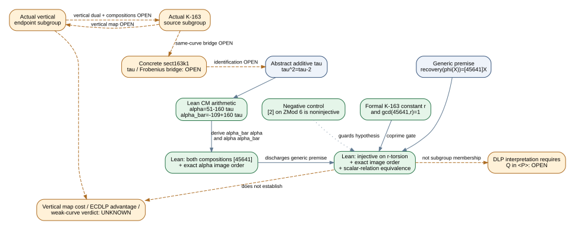

# K-163 recovery transfer and horizontal control: formal gates, not a weakness result

Date: 2026-10-31

Claims: `THM-K163-COPRIME-TRANSFER1`, `THM-K163-HORIZONTAL-RECOVERY1`

Formal targets:

- `formal/targets/k163-coprime-recovery-transfer-20261031.yaml`
- `formal/targets/k163-horizontal-recovery-control-20261031.yaml`

## Outcome

The compiled Lean module now contains two related results.

First, it isolates a generic implication needed by the proposed degree-45,641
K-163 conductor transfer. For additive homomorphisms

```text
phi : E ->+ E'
recovery : E' ->+ E
```

if `recovery(phi(X)) = [45641]X` for every source point, then the checked
coprimality

```text
gcd(45641,
  5846006549323611672814741753598448348329118574063) = 1
```

makes `phi` injective on the `r`-torsion. It preserves the exact order of an
order-`r` point and preserves and reflects every scalar relation:

```text
phi(Q) = [k]phi(P)  <->  Q = [k]P.
```

Here `[r]Q=0` means only that `Q` is `r`-torsion. It does **not** say that
`Q` belongs to the cyclic subgroup generated by `P`. Calling the displayed
equivalence a discrete-log preservation statement therefore requires a
separate membership bridge `Q in <P>`; without it, both sides may simply be
false for every `k`.

Second, the stronger same-curve horizontal control derives the recovery
identity instead of assuming it. For an additive endomorphism `tau` satisfying

```text
tau(tau(X)) = tau(X) - [2]X,
```

Lean defines

```text
alpha     =  51 - 160 tau,
alpha_bar = -109 + 160 tau
```

and proves both point-action compositions equal `[45641]`. It then proves that
`alpha` preserves the exact order of an order-`r` point and preserves and
reflects scalar relations on `r`-torsion.

These are formal transfer gates and controls, not a cryptanalytic
breakthrough. They prove no vertical K-163 point map, vertical dual, concrete
Frobenius identification, cost advantage, attack, or weak curve.

Both named targets compile under the pinned toolchain and pass the verifier's
requested-theorem axiom audit; the
[`targeted verification record`](verification-targeted.md) binds the exact
hashes and commands. The full repository receipt attempt is retained as
[`verification-attempt-oom.json`](verification-attempt-oom.json): it stopped
when an unrelated pre-existing Semaev certificate exceeded the 17 GiB local
environment, before the project-wide audit. Independent semantic review and a
passing repository-wide receipt therefore remain pending. The infrastructure
failure is not evidence against either theorem.



## What the module establishes

| Layer | Exact result | Evidence state |
| --- | --- | --- |
| Reused K-163 constant | `r = 5846006549323611672814741753598448348329118574063` | closed Lean arithmetic |
| Numeric gate | `Nat.Coprime 45641 r` | closed Lean arithmetic |
| Generic recovery | `recovery o phi = [45641]` implies injectivity on `r`-torsion | conditional Lean theorem |
| Image order | an exact order-`r` point maps to another exact order-`r` point | conditional Lean theorem |
| Scalar relation | `phi(Q)=[k]phi(P) <-> Q=[k]P` for `r`-torsion `P,Q` | conditional Lean theorem; not a subgroup-membership theorem |
| CM coefficient control | `conj(51-160 tau)=-109+160 tau` and their product is `45641` | closed Lean pair arithmetic |
| Archived scalar consistency | the two published-eigenvalue residues match the retained control and multiply to `45641 mod r`; both are coprime to `r` | closed Lean integer arithmetic; the Frobenius-eigenvalue bridge remains external |
| Horizontal point control | both `alpha_bar o alpha` and `alpha o alpha_bar` equal `[45641]` if `tau^2=tau-2` | derived Lean theorem |
| Horizontal image order | `alpha` preserves exact generator order | derived Lean theorem |
| Negative control | multiplication by 2 on `ZMod 6` has the recovery form but is noninjective | closed Lean finite check |

For the generic proof, apply the recovery map to a collision and put
`Z=P-Q`. Then `[45641]Z=0`; the `r`-torsion hypotheses independently give
`[r]Z=0`. Bezout coefficients for the coprime integers express `Z=[1]Z` as a
sum of those zero multiples, so `Z=0`.

The `ZMod 6` control is load-bearing: multiplication by 2 maps both 0 and 3 to
0. A recovery composition of the form `[d]` is insufficient when `d` and the
relevant torsion order are not coprime.

## Horizontal coefficient and point-action control

The quadratic relation `tau^2=tau-2` has conjugation `tau -> 1-tau`. Hence

```text
conj(51 - 160 tau)
  = 51 - 160(1 - tau)
  = -109 + 160 tau.
```

Multiplication in `Z[tau]` gives

```text
(51 - 160 tau)(-109 + 160 tau)
  = (-5559 + 51200) + (8160 + 17440 - 25600) tau
  = 45641.
```

The Lean point model uses

```text
horizontalAlpha(X)    = [51]X - [160]tau(X),
horizontalRecovery(X) = [160]tau(X) - [109]X.
```

From the abstract quadratic relation it derives both compositions as
`[45641]`. This is stronger than the generic premise because the compositions
are algebraic consequences of the supplied `tau` relation. It is still an
abstract additive-group theorem: Lean does not identify `tau` with Frobenius
on the concrete sect163k1 curve, prove the curve equation, or connect this
same-curve action to a vertical conductor descent.

Closed arithmetic also reproduces the retained subgroup-scalar receipt:

```text
alpha(lambda)     = 4305110247233098359902032639579138367335695064214
alpha_bar(lambda) = 1540896302090513312912709114019309980993423509791
alpha(lambda) * alpha_bar(lambda) mod r = 45641
```

Both residues are coprime to `r`. This checks consistency of the published
integer constants; it does not prove in Lean that concrete Frobenius acts as
`[lambda]` on the sect163k1 generator.

## Transfer assessment

| Obligation | State | Reason |
| --- | --- | --- |
| Abstract generic implication | targeted Lean build and theorem audit pass; full receipt pending | recovery plus coprimality gives injectivity, exact image order, and scalar-relation equivalence |
| Abstract horizontal control | targeted Lean build and theorem audit pass; full receipt pending | the coefficient identity and both point compositions are derived from `tau^2=tau-2` |
| Concrete `tau`/Frobenius bridge | open | the abstract additive endomorphism is not identified with sect163k1 Frobenius in Lean |
| DLP subgroup membership | open in the theorem | `[r]Q=0` is not a proof that `Q in <P>` |
| Concrete vertical-isogeny existence | not established here | conductor-lattice and kernel-line evidence do not supply a point map |
| Explicit vertical forward construction | open | no retained degree-45,641 vertical map artifact |
| Explicit vertical dual or recovery | open | no retained algebraic dual for that vertical map |
| Vertical map correctness and exceptional points | open | no complete formulas to audit |
| Vertical source and endpoint compositions | open | the horizontal identities do not certify the vertical maps |
| Evaluation and preprocessing cost | unknown | no executable vertical transfer exists to benchmark |
| ECDLP advantage | unknown | exact order and relation preservation are not a faster solver |
| Weak-curve assertion | unsupported | no attack or lower work factor is established |

The weakest vertical obligation remains an explicit, independently checkable
point map together with its recovery/dual and at least the source composition
identity. The separate horizontal bridge obligation is a concrete formal
identification of the abstract `tau` action with sect163k1 Frobenius; even
discharging it would validate a same-curve control, not establish a vertical
speedup.

After explicit vertical maps exist, the next falsifiable test is a planted
scalar round trip on the actual prime subgroup, followed by complete
preprocessing and per-target cost accounting against native K-163 arithmetic.

## Direction and scope

The generic assumption `recovery(phi(X))=[45641]X` proves the forward map is
injective on source `r`-torsion. An instance that begins on the endpoint and is
moved through `recovery` needs the opposite composition on endpoint
`r`-torsion or a separate argument. The horizontal control proves both
compositions for its explicit abstract same-group actions, but that does not
supply either missing vertical composition.

The scalar `45641` becomes a geometric degree only after a concrete isogeny
certificate supplies that interpretation. The closed CM factorization is
consistent with the retained horizontal endomorphism control; it is not a
construction of the vertical isogeny of the same norm.

## Evidence and sources

- Human claim and hypothesis delta:
  [`research/THM_K163_COPRIME_TRANSFER1.md`](../../../research/THM_K163_COPRIME_TRANSFER1.md).
- Lean module:
  [`formal/CryptoResearch/Isogeny/CoprimeTransfer.lean`](../../../formal/CryptoResearch/Isogeny/CoprimeTransfer.lean).
- Generic target:
  [`formal/targets/k163-coprime-recovery-transfer-20261031.yaml`](../../../formal/targets/k163-coprime-recovery-transfer-20261031.yaml).
- Horizontal-control target:
  [`formal/targets/k163-horizontal-recovery-control-20261031.yaml`](../../../formal/targets/k163-horizontal-recovery-control-20261031.yaml).
- Open concrete-map record:
  [`problems/koblitz-vertical-isogeny-maps-not-persisted.md`](../../../problems/koblitz-vertical-isogeny-maps-not-persisted.md).
- Andrew V. Sutherland, *18.783 Elliptic Curves, Lecture 6* (2023),
  Theorem 6.7 and Lemma 6.10. Retrieved PDF SHA-256:
  `fd7397d3cdb4e5fb95ba35e1ea4c4a652e01a11931e3ed2d76e26912fd3d6281`.
- Pinned formal dependencies: Lean `v4.35.0-rc1`; Mathlib commit
  `7fa22735254ddf7e11f119250a9f2d0352bc7c3a`.

The source note's producer-authored hypothesis table is not an independent
semantic review. Any later “breakthrough” classification requires a
prewritten review plan and independent adversarial review of the theorem
meaning, the concrete curve bridges, and the complete cost claim.
