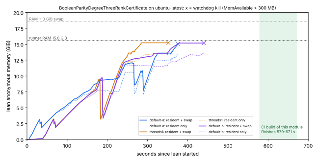

# Degree-three module peak memory on the hosted runner (frozen protocol) — 2026-11-06

This answers [problems/formal-workspace-build-exceeds-16gb.md](../../../problems/formal-workspace-build-exceeds-16gb.md)
and the PR #2677 review thread. It replaces the unfrozen 2026-10-29 container
measurement ([its report](../2026-10-29-degree-three-module-rss/README.md)).

## v3 result (run 42161794163): all three arms valid

These are the frozen v3 verdicts ([data-v3/analysis.json](data-v3/analysis.json);
re-running `analysis.py` on `data-v3/` gives the same JSON):

| claim | verdict | value |
| --- | --- | --- |
| C1: peak lean RssAnon + VmSwap, default threads | **supported_within_scope** | **15,973,664 kB** (default-a) and **15,974,696 kB** (default-b), i.e. 15.23 GiB; A/A spread 1,032 kB |
| C2: `LEAN_NUM_THREADS=1` lowers it by more than max(A/A, 256 MiB) | **within_control_distribution** | threads1 peak 15,971,572 kB, only 2,092 kB below default-a |
| C3: margin = MemTotal + SwapTotal − peak | **not fragile** (protocol threshold 1 GiB) | 3,537,668 kB (3.37 GiB); lowest MemAvailable + SwapFree seen in a default arm: 1,117,936 kB (1.07 GiB) |

- Every arm exited 0. The swap-aware watchdog never fired, nothing was
  killed externally, and the kernel OOM log ([data-v3/dmesg-oom.txt](data-v3/dmesg-oom.txt))
  is empty. Elaboration took 485 / 524 / 525 s.
- Host ([data-v3/host.json](data-v3/host.json)): `ubuntu-latest`, image
  ubuntu26 20261101.186.1, 4 CPUs, MemTotal 16,366,640 kB (15.61 GiB), 3 GiB
  `/swapfile`, cgroup `memory.max` = `max`, Lean 4.35.0, module sha256
  `e9db5830…0751e9`.
- The footprint has **two plateaus at about 15.2 GiB** (above 14.5e6 kB
  from 166–289 s and 365–470 s in default-a), each followed by a drop. On both plateaus 1.25–1.99 GB
  of it sits in swap. The peak is reproducible to within 1 MB across the A/A
  pair and the threads1 arm.

**What this means for the gate (heuristic, C3):** this one module needs about
15.2 GiB of anonymous memory. The runner has 15.6 GiB of RAM, so the gate
passes only with its 3 GiB swapfile. By the protocol's formula it has 3.4 GiB
to spare. In practice the closest moment left about 1.1 GiB of RAM and swap
free, because the OS, page cache and runner take their share. Either way the
margin is about one gigabyte, not many. The 13.36 GiB cloud containers
(no swap) cannot build this module at all. Lowering Lean's thread count does
not help.

## v2 run (42137803829): no valid arm

### Verdict (the frozen v2 analysis, verbatim)

**All three arms are invalid**, so the frozen verdicts are: **C1 inconclusive,
C2 invalid_measurement, C3 inconclusive**
([data/analysis.json](data/analysis.json); re-running [analysis-v2.py](analysis-v2.py) on
`data/` reproduces the same JSON).

Every arm ended because **this measurement's own watchdog** killed Lean, not
because the run finished or the runner ran out of memory. The watchdog fired
when `MemAvailable` fell below 300 MB. `MemAvailable` does not count swap, and
this runner has a 3 GiB swapfile that was still in use. So the guard stopped
runs that the CI build itself completes: the hosted gate finishes this module
in 579–671 s, and these arms were killed at 352–440 s. The protocol does not
allow re-running a job that reached its arms, so this run gets no do-over.

### What v2 observed (descriptive; not decided by the protocol)

| arm | killed at | max RssAnon | max VmSwap | max RssAnon + VmSwap (same sample) | min SwapFree |
| --- | ---: | ---: | ---: | ---: | ---: |
| default-a | 376.6 s | 14,054,488 kB | 2,240,000 kB | 15,789,592 kB (15.06 GiB) | 570,352 kB |
| threads1 (`LEAN_NUM_THREADS=1`) | 352.4 s | 14,463,800 kB | 2,234,948 kB | 15,966,500 kB (15.23 GiB) | 571,312 kB |
| default-b (A/A) | 440.4 s | 14,282,576 kB | 2,793,964 kB | 15,927,392 kB (15.19 GiB) | 324 kB |

Host ([data/host.json](data/host.json)): `ubuntu-latest`, image ubuntu26
20261101.186.1, 4 CPUs, MemTotal 16,365,628 kB (15.6 GiB), SwapTotal
3,145,724 kB (3 GiB `/swapfile`), cgroup `memory.max` = `max`, Lean 4.35.0,
module sha256 `e9db5830…0751e9`.

Read as lower bounds, since no arm finished:

- **The module needs more than about 15.2 GiB of anonymous memory** (resident
  plus swapped) on the current pins, and it was still running when killed.
  *(v3: the full peak is 15.23 GiB, so v2's kills came at the peak plateau,
  not on the way up.)*
  That is already near the runner's whole 15.6 GiB of RAM, so the hosted
  gate only gets through by **swapping**. Its headroom is the 3 GiB swapfile
  minus whatever the module needs beyond 15.2 GiB, which is unmeasured. In
  `default-b`, SwapFree reached 324 kB once, which suggests the gate's margin
  is thin.
- **`LEAN_NUM_THREADS=1` does not lower the footprint.** threads1 reached the
  highest combined value (15.23 GiB) and kept 8 OS threads. This agrees with
  the 2026-10-29 container run, but under the frozen rule C2 is
  invalid_measurement, not a supported "no effect".
- The 2026-10-29 container (no swap, 13.36 GiB memcg) died at 13.52 GB
  resident. That fits: the module's footprint is above that cap.

### Instrument defect (fixed in v3)

`measure.py` should have watched `MemAvailable + SwapFree`, or the cgroup
OOM, not `MemAvailable` alone. A v3 run would need that fixed, plus a floor
low enough for the module to finish (or no watchdog, if a runner OOM is
acceptable), filed as a new amendment before any data. **No v3 was run.**
Whether one is worth it is the owner's call: the gate already passes, and
what is still unknown is how much margin it has.

### Protocol history

- v1 (frozen 00:04:54Z, `08392f8a…`) produced no data. Run 42134422799 was
  cancelled during setup by a push. Run 42134558504 crashed in the pre-arm
  check because `jsonschema` was missing.
- v2 = amendment A1 (frozen 00:33:59Z at `fb78bec2`, `d3e6b677…`): fixed the
  workflow and reset the pre-arm rerun allowance. This report is v2's single
  run, 42137803829 (head `ad3ae7b9`).

## Files

- [protocol.json](protocol.json) is protocol **v3** (amendments A1, A2), and
  [analysis.py](analysis.py) and [measure.py](measure.py) are its frozen
  analysis and sampler. The v2 versions are kept as
  [protocol-v2.json](protocol-v2.json), [analysis-v2.py](analysis-v2.py) and
  [measure-v2.py](measure-v2.py); they are byte-identical to `ad3ae7b9`. The frozen `protocol-v2.json` still names
  its script `analysis.py`, the file's name at freeze time. So
  `validate protocol-v2.json` in this tree reports a hash mismatch against
  the v3 `analysis.py`. Validate it at `ad3ae7b9`, or note that its pinned
  sha256 `4bfd334a…` equals `analysis-v2.py`'s.
- v3 data: [data-v3/](data-v3/) holds the artifact `formal-module-rss`
  (id 13478781155; zip sha256 in [data-v3/ARTIFACT.txt](data-v3/ARTIFACT.txt))
  and the kernel OOM log. With it come [rows-v3.jsonl](rows-v3.jsonl) and
  [export-v3.json](export-v3.json). `check-export --verify-files` against
  `protocol.json` reports 0 findings.
- v2 data: [data/](data/) (artifact 13467322317), with
  [rows-v2.jsonl](rows-v2.jsonl) and [export-v2.json](export-v2.json).
  `check-export --verify-files` against `protocol-v2.json` reports 0
  findings.
- [plot.py](plot.py) draws [memory-v3.svg](memory-v3.svg)
  (`plot.py <dir> data-v3 memory-v3.svg`) and [memory.svg](memory.svg) (v2).
  The workflow is `.github/workflows/formal-module-rss.yml`, now manual-only
  (`workflow_dispatch`).
