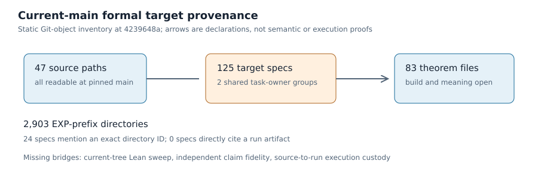

# Current-main formal target static audit — 2026-11-08

**Result:** The 125 target specs at crypto-autoresearcher main
`4239648a889fe97d976a99862d178ba50324dc6e` have distinct claim IDs
and theorem names, and every declared source and theorem file was readable.
Two task IDs each own two targets; archived handoffs and target receipts show
that this is many-to-one producer provenance, not an established identity
failure. This audit does not run Lean or validate a scientific claim.

## Sources and method

The repository's [formal target contract](../../../formal/targets/README.md)
formerly said one file per task; this PR clarifies that one producing task can
own multiple frozen targets. The earlier [87-target inventory](../2026-10-25-formal-target-provenance/report.md)
required unique task IDs on its pinned tree, an assumption the later corpus
does not preserve. The
current [semantic-fidelity problem](../../../problems/formal-target-semantic-fidelity-unreviewed.md)
separates kernel acceptance from claim fidelity and execution provenance.
These primary repository sources set the scope of this audit; no new
mathematical or novelty claim is made.

The [replay script](audit.py) reads exact Git objects at the named main commit,
parses each target YAML, requires its schema, reads its declared source and
theorem file, hashes all three files, and records literal identifier
claim/theorem identity collisions and shared producing tasks separately. It
counts an exact `EXP-*` directory token in a spec or its
declared source as a **syntactic pointer only**. It does not use the dirty
working tree, run Lean, replay experiment rows, inspect theorem types or
decide whether a claim is faithful. [The inventory](inventory.json) is
108 KiB and has SHA-256
`4c0d760ebf96caf06442091bfb3a63e27b3c65e591e97531ed3de6ffbb9577a5`.

| Current-main static quantity | Count | Interpretation |
| --- | ---: | --- |
| Target YAML specs | 125 | 38 more than the earlier pinned 87-target snapshot; no transfer of that build receipt |
| Distinct theorem files | 83 | Multiple declarations can share one module |
| Distinct declared source paths | 47 | All readable at this commit |
| `EXP-*` top-level directories | 2,903 | Directory names only, not valid-run count |
| Specs mentioning an exact existing `EXP-*` directory ID | 24 | Syntactic link, not proof suitability |
| Specs with explicit run reference | 0 | Does not rule out provenance in source documents |
| Declared sources under `/runs/` | 0 | No spec directly takes a sealed run artifact as source |

Source labels are 67 `COMPUTED`, 29 `PROVED`, 19 `STATED`, seven
`DERIVATION`, one `MEASURED_WITH_ALGEBRAIC_EXPLANATION`, one
`EXTERNAL_CLAIM_WITH_PRINTED_PROOF`, and one `not_verified`. These labels
come from the target specs and are not independent review outcomes.

## Shared task ownership

| Reused task ID | Target files |
| --- | --- |
| `TASK-20261104-df29f3` | `binary-semaev-repair-20261105.yaml`; `closure-two-sided-certificates-20261104.yaml` |
| `TASK-20261105-9e5cbb` | `boolean-lastfall-upper-20261105.yaml`; `boolean-normalization-repair-20261105.yaml` |

The first pair was introduced in separate commits (`9e9e3054aa` on
November 4 and `2ede864c11` on November 5); the second pair arrived together
in `2ede864c11`. The [proof-task archive](../../../analysis/rigorous-lfd-solving-20261105/archive.md)
names `TASK-20261104-df29f3` as the archival owner and identifies its root
binary Semaev module. The [dispatch queue](../../../analysis/rigorous-lfd-solving-20261105/dispatch_queue.json)
and [normalization handoff](../../../analysis/rigorous-lfd-solving-20261105/normalization-handoff.json)
assign `TASK-20261105-9e5cbb` the Boolean module containing both its target
theorems. The two Boolean [CI target receipts](../2026-11-05-lfd-publication-readiness/ci-receipts/)
name the same producer task separately. No task identity is fabricated.

The archived 87-target builder stops on the current tree because it assumes
one task per target. That assertion is not a valid current-corpus defect
test. The corrected script reports the shared task IDs, while
`--require-clean` exits 0 because claim and theorem identities are unique.
A repeat run produced byte-identical JSON. The same strict mode also passed
on the earlier `0b38ac1157f777cb4a77d35e53d7ed583c541eb4` tree with
87 specs and no shared task IDs.

Replay from a checkout containing the named Git commit with Python and
PyYAML installed:

```sh
python3 docs/reports/2026-11-08-formal-target-inventory/audit.py \
  --commit 4239648a889fe97d976a99862d178ba50324dc6e \
  --out /tmp/current-formal-inventory.json --require-clean
sha256sum /tmp/current-formal-inventory.json
```

The report and `report.pdf` were rendered from `report.typ`; the single PDF
page was visually inspected.



## Boundaries and next action

No frozen spec or receipt was changed. Independently review theorem meaning
and source/run linkage claim by claim. A full pinned Lean build and
axiom audit are still needed for the 125-target current tree; the older
87-target machine receipts cannot establish them.

The public performance dashboard and scientific graphs are unchanged because
this is a formal-target provenance audit, not a new measurement or decision.
