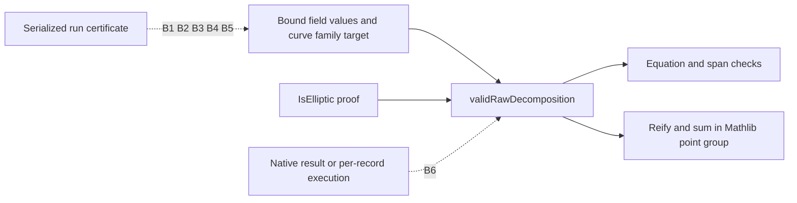

# J2 source and type fidelity review

Task `TASK-20261108-f75797`; Conductor `T-1936`; reviewer `/root/semaev_source`; 2026-11-08 UTC. Owned joint: **J2 producer claim to elaborated theorem and data-model fidelity**. This is an independent source review of the published packet. No J1 or J3 report was read. No source was changed and no Lean build or scientific experiment was run.

**Finding.** The typed predicate faithfully decides finite decompositions in Mathlib's group of nonsingular Weierstrass points, using the declared finite family to define its span. The supplemental raw-coordinate predicate correctly extends checking to pairs of field elements on an elliptic curve. The stronger operational reading that this already independently verifies a producer's serialized run certificate is unsupported: no parser, concrete field interpretation, record-to-parameter binding, or native checker correspondence is in the reviewed module. **J2 verdict: `breaks` for that operational extension; `holds` for the explicitly scoped mathematical predicate.** This is a bridge finding, not a counterexample to the named theorem.

## Exact inputs and review method

The producer source is commit `6a0eb9665191e35690b4ff5ebd91c63561e09ec4`. The published review checkout was at `e5569428e5e53145f123f3aeb36de00591ad72b6` when inspected. Every one of the six files in `input-bindings.json` matched its SHA-256, byte count, and bytes obtained by `git show` from the producer commit. The review-plan hash read was `e6f2c44b8959fdbbd9cfa34d17d5007e3f7a031bb9aed30f262454340c8b439f`.

Mathlib source was read from `/var/tmp/crypto-auto-binstd-bridge-20261107/formal/.lake/packages/mathlib`, whose HEAD is the required `cfc55fc58714a59dc06e6e79edc6d1d95140d3c2`. The five inspected Mathlib files had no difference from that commit. `sources-read.json` records full source hashes, provenance, and relevant line ranges. Hash abbreviations below are only display abbreviations; the manifest carries the complete hashes.

| Source label | Source | SHA-256 |
| --- | --- | --- |
| CLAIM | `research/THM_SEMAEV_FALL1.md` | `11b61f4f4bdaed0c323ec852f19fc4c0a7ff3972715bfe637604fb675db7fee4` |
| SPEC | `formal/targets/semaev-decomposition-certificate.yaml` | `3a8dc16449c2615c85c93bc92a3137435f1a367fb97a18729e6da6304554d7e6` |
| CERT | `formal/CryptoResearch/Semaev/Certificate.lean` | `aa022e4829eefc2cbe9ac05cbeb39f81e9e3eaa8147e2e41e9d718f11976bd89` |
| POINT | Mathlib `AlgebraicGeometry/EllipticCurve/Affine/Point.lean` | `3b25622c2a7bcf74ccc7e139d340953d53e484b0a717c37659937e97dc3e00f9` |
| BASIC | Mathlib `AlgebraicGeometry/EllipticCurve/Affine/Basic.lean` | `4dbb956e0e26b9469c0605f6ba9ff837f3bbe71c5f748b84ce667cfe14abe55f` |
| WEIERSTRASS | Mathlib `AlgebraicGeometry/EllipticCurve/Weierstrass.lean` | `c9c35902baf81e470c99e1acdc27f00b0c29f7d41b807c531ce1c0527dca6742` |
| SPAN | Mathlib `LinearAlgebra/Finsupp/LinearCombination.lean` | `0097ed68f824af66ce0446fecab8f694a09b5f4802fd66bdc4f2d70e8d351b29` |

The primary mathematical sources used here are the pinned Mathlib definitions and proofs, the original Lemma 3, and its target specification. The historical producer report and its statement/axiom printout were read as historical context. Their existence does not authenticate current execution. No sibling review, hosted sweep result, or J3 machine verdict was used. Generic prior-work memory supplied only the instruction to compare semantic fidelity separately from kernel acceptance; all substantive findings below were checked against current pinned source.

## Claim and elaborated type

CLAIM lines 105–117 state decidability for a tuple of affine points of `E(K)`, membership of each x-coordinate in a declared `F_q`-subspace with a fixed basis, and equality of their group sum with `R`. SPEC lines 35–54 make finite `K`, decidable equality, arbitrary natural `m`, and the same three conjuncts explicit. SPEC lines 12–24 and CLAIM line 117 also motivate removing a shared implementation failure by independent proof-assistant checking.

The historical `statement-and-axioms.log`, lines 1–10, prints the named theorem with the following parameters, matching CERT lines 113–126:

```lean
{F : Type u} {K : Type v}
[Field F] [Fintype F] [Field K] [DecidableEq K] [Algebra F K]
{b m : Nat}
(W : WeierstrassCurve.Affine K)
(basis : Fin b → K) (P : Fin m → W.Point) (R : W.Point)
```

Its conclusion is `decide (validDecomposition W basis P R) = true` iff each `P i` is a `.some x y h` satisfying `W.Equation x y` and `x ∈ Submodule.span F (Set.range basis)`, and `∑ i, P i = R`. A `.zero` summand gives `False`. There is no `Fintype K`, no `W.IsElliptic`, no linear-independence hypothesis, and no nonzero-target hypothesis in this named type. The historical elaboration is an exact archived printout, not a fresh current-toolchain elaboration by this reviewer. Fresh machine verification belongs to J3.

| Claim component | Actual construction and source | Assessment |
| --- | --- | --- |
| Arbitrary field and family, uniform in tuple length | CERT 16–18, 71–80, 118–126 use type/instance parameters and arbitrary `b,m`; no fixture values appear | Holds; no hard-coded certificate |
| Finite base field | CERT 21–27 searches `Fin b → F`, requiring `Fintype F`; the named theorem does not require `DecidableEq F` | Holds; this is explicit finite coefficient enumeration |
| Finite extension field | `K` is a field with decidable equality and an `F`-algebra; no enumeration of `K` is needed | Generalization includes the source's finite fields |
| Declared basis and subspace | CERT 21–32 and SPAN 379–385 identify finite coefficient sums with `Submodule.span F (Set.range basis)` | Holds for the subspace defined by that family; independence and a separately supplied V are unnecessary |
| Curve equation | CERT 37–49 uses the full general Weierstrass formula; BASIC 149–158 proves equivalence to `W.Equation` | Holds in all field characteristics allowed by the type |
| Mathematical point model | POINT 473–480 requires `W.Nonsingular x y`; BASIC 211–220 includes both the equation and a nonvanishing partial derivative | Explicit smooth-point scope is required for arbitrary Weierstrass curves |
| Actual group operation | POINT 653–665 defines point addition; 801–812 proves the abelian-group structure. Formula 175–178 and 355–358 handle slopes and closure | Holds in Mathlib's nonsingular-point group; no invented abstract sum operation |
| Full iff and decidability | CERT 99–111 proves both directions; 76–80 supplies the decision instance; 118–126 connects its Boolean result | Holds; the theorem does not assume Valid or an accepted result |
| Raw-coordinate checking | CERT 131–177 checks equation and span for `Fin m → K × K`, requiring `W.IsElliptic` | Holds at the field-element boundary; does not parse bytes |

The iff theorem is not circular merely because its final group-sum condition is unchanged. The equation and span predicates are independently connected to Mathlib semantics at CERT 47–49 and 30–32. The unchanged sum is already Mathlib's actual group operation. The named theorem uses `decide_eq_true_eq` to connect the independently declared decision instance to that proposition.

## Smooth points, infinity, and exceptional cases

The main theorem works on the nonsingular-point group even when `W` itself is singular. Its typed affine inputs have already supplied nonsingularity proofs. Consequently the explicit curve check on a typed `.some` point repeats a property already available through its constructor; this is consistent with the source's tuple of curve points, but it is not an off-curve input parser.

For the usual elliptic interpretation of `E(K)`, this gives the intended group. For a literal reading covering every equation solution on every Weierstrass curve, the source wording needs qualification. A concrete semantic witness is the cusp `y² = x³` over `F_5`: `(0,0)` satisfies the equation, but both partial derivatives vanish, so POINT 479 cannot construct it as an affine `W.Point`. This is a direct source-level arithmetic derivation from BASIC 214–220, not a newly kernel-checked counterexample. It demonstrates the domain distinction, without refuting the typed theorem. Stating that `E` is elliptic, or explicitly writing `E_ns(K)`, removes the ambiguity.

The raw checker makes the relevant extra assumption explicit: CERT 131 and 147 require `[W.IsElliptic]`. WEIERSTRASS 362–367 defines that as the discriminant being a unit; over the assumed field this excludes zero discriminant. BASIC 249–251 and POINT 542–546 then permit construction of a point from an equation proof. The raw predicate does not dynamically test a serialized discriminant or manufacture the ellipticity assumption.

At CERT 133–136, invalid coordinates map to `.zero`, but CERT 149–151 also requires the original equation for every input. Thus an invalid pair cannot be accepted by merely cancelling or matching the identity after reification. `pointOfRaw` alone is not a validator; acceptance uses `validRawDecomposition`.

The quantified exceptional cases follow directly from the definitions:

- `m = 0`: every member condition is vacuous and the empty sum is zero, so acceptance is exactly `R = 0`.
- `b = 0`: the only coefficient sum is zero, so span membership is exactly `x = 0`.
- A typed `.zero` summand is rejected by CERT 55–57, independently of the total sum.
- `R = 0` is allowed. In particular, finite inverse pairs whose x-coordinate is in the span can be valid certificates. Only a mismatched target is rejected; “identity target” alone is not a negative condition.
- The raw checker includes no infinity representation for a summand, because its input type is `K × K`; the target is still a typed `W.Point` and can be infinity.
- Empty, dependent, repeated, or zero spanning families remain meaningful and the search stays finite. A family named `basis` is not a Lean `Basis` object and does not certify a claimed dimension.

These are source deductions, not reports of executed controls. J1 owns independent worked controls and J3 owns machine checks.

## Missing bridges, individually

The inspected module ends at CERT 179. None of the obligations below is a parameter or conclusion of its named theorem or raw iff theorem. These are missing bridges to the broader operational rationale, not prerequisites for the scoped abstract decidability claim.

| ID | Missing bridge and exact boundary | Evidence and consequence | Checkable completion criterion |
| --- | --- | --- | --- |
| B1 | Serialized bytes or JSON to `K × K` | CERT 147–151 accepts already typed field elements. The historical report's “untrusted-input path” at lines 32–36 must mean untrusted field-valued coordinates; no parser is present | Specify the accepted wire format and prove decoding soundness, with rejection of malformed, ambiguous, truncated, and out-of-range encodings |
| B2 | Concrete field representation and base-field embedding to Lean `F`, `K`, and `Algebra F K` | CERT 16–17 assumes mathematical fields and the scalar action; it does not bind a native modulus, extension polynomial, byte order, basis encoding, or runtime arithmetic implementation | Provide a concrete instantiated field model and a checked interpretation from the producer representation that preserves the used operations and scalar embedding |
| B3 | The intended curve to the supplied `W`, including ellipticity for raw inputs | CERT 37–39 checks the coefficients it receives; CERT 131/147 assumes `W.IsElliptic`; SPEC 36–38 supplies no serialization identity | Bind the exact curve parameters to the record and establish the raw checker's ellipticity instance for those parameters |
| B4 | The intended factor-base subspace to the supplied finite family | CERT 21–32 validates the span of whatever family was passed. It does not compare that family with a run manifest's V or certify a stated dimension | Bind/decode the declared family and prove it spans the intended V; prove independence only if the record claims a dimension/basis property |
| B5 | The intended certificate tuple and challenge target to `xy/P` and `R` | CERT 118–124 and 147–151 quantify over arbitrary supplied inputs. `R` remains a trusted typed point even in the raw path | Bind every tuple entry and its length, and decode/bind the target including any infinity tag; preserve the exact run/challenge association |
| B6 | Actual execution on the bound certificate, or native verifier result to the Lean predicate | SPEC 14–19 and CLAIM 117 motivate replacing shared implementation. CERT provides generic decision data and correctness, but no theorem about a native verifier and no per-record execution receipt | Either execute the instantiated Lean checker on the bound record and retain authenticated evidence, or supply a checked refinement of the native checker; state the evaluation/compiler trust model |

A separate useful integration lemma would state the equivalence between `validRawDecomposition W basis xy R` and `validDecomposition W basis (fun i => pointOfRaw W (xy i)) R`. The current raw iff already specifies equation, span, and the actual group sum; the absent convenience lemma is not an independent correctness failure. It also cannot supply any of B1–B6.

The search is total under the stated finite-coefficient assumptions; a naive enumeration has `|F|^b` coefficient choices for each x-coordinate. This cardinality observation is not a measured runtime or an efficiency theorem. No new measurement or performance comparison was made.

## Separate verdicts and next obligation

| Reviewed claim | Machine status in this J2 session | Fidelity | J2 assessment |
| --- | --- | --- | --- |
| Typed finite decomposition decision in `W.Point`, V equal to declared span | `not_verified` locally; exact source and historical elaborated type inspected | `faithful_scoped` | `holds` at the stated source/type scope |
| Raw field-coordinate predicate on an elliptic curve | `not_verified` locally | `faithful_scoped` with `[W.IsElliptic]`, typed target, and `K × K` input boundary | `holds` at that boundary |
| Every equation point on an arbitrary potentially singular Weierstrass curve | No such type demonstrated | `mismatch` if the prose is read literally this broadly | Requires the explicit smooth-point/elliptic qualification |
| Already independent verification of serialized producer records or a native verifier | No record or code refinement supplied | `partial` | `breaks`; B1–B6 are not established |

The review outcome for J2's combined mathematical-and-operational wording is **`needs_revision`**, with the mathematical component retained at its verified source scope. This report changes no official hypothesis status. It does not supply J3's fresh machine verification or J1's blind rederivation.

The next concrete construction is an input interpretation contract that binds the serialized field/curve/family/target/tuple to the arguments of `validRawDecomposition`, followed by a checked decoding theorem and a source-bound execution on an example record. The coordinator should link B1–B6 from a scoped problem record before handing that operational work onward; this reviewer cannot write the shared `problems/` index within its assigned directory scope.



This diagram records the reviewed proof boundary. It changes no canonical performance graph. The final composite packet's diagram/PDF rendering and inspection remain the archival coordinator's responsibility.

## Process and limitations

The Conductor claim succeeded at epoch 1, attempt `8e83b63b-6104-4896-a7bb-b34ba781d12e`, with lease `6a027f57-e781-4ca8-9452-44be738b66e6`. A later `conductor check` reported a scope conflict whose holder was this exact task UUID `c4ff3091-a812-492b-b8c1-fd282afbc6b4`; this was the existing claimed reservation, not a competing owner or an additional reservation. No other task's scope was written.

The sparse checkout lacked some linked governance files and the initially guessed `ledger/tasks/` handoff path. Governance was read with `git show` and the published handoff was located under the packet's `handoffs/` directory. No missing tracked files were reconstructed into shared source. The historical type printout retains its old toolchain context. There was no fresh elaboration, kernel run, parser execution, or native verifier test in this session. These bounds are explicit so source-level conclusions cannot be mistaken for runtime authentication.
