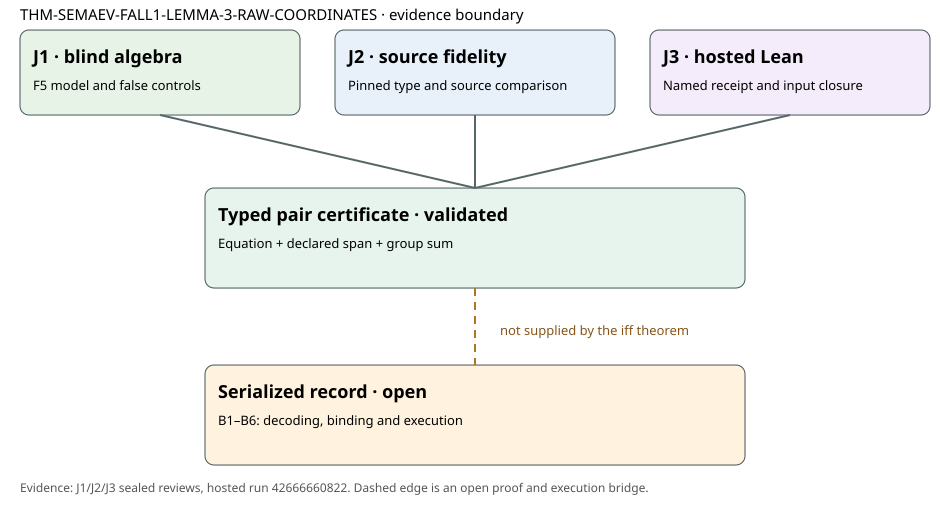

# Raw-coordinate decomposition certificate: independent Lean fidelity review

**Claim:** `THM-SEMAEV-FALL1-LEMMA-3-RAW-COORDINATES`, current-main source `3f7e3e4d0d049256e0ae23571553e806aab230ab`. **Named declaration:** `CryptoResearch.Semaev.validRawDecomposition_iff_curve_span_sum`. **Prospective plan SHA-256:** `0cbbc5e36a720afa830e67211da86062bbf62fc501b8da31e13e79e96e7fc16a`.

The raw-coordinate iff holds for already typed field-element pairs and a typed curve-group target. An independent blind derivation, pinned source-to-Lean comparison, and authenticated hosted named audit support that exact scope. The three selected attestations pass `tools/check_review_independence.py` after an additive J3 YAML correction. The raw predicate is not yet bound to a producer's serialized certificate; that requires the six recorded wire-to-Lean bridges.

## Claim-level judgments

| Object | Machine status | Source fidelity | Review outcome and evidence |
| --- | --- | --- | --- |
| Named typed raw-pair iff for equation, declared `F`-span, and reified point sum | **passed** on hosted run [42666660822](https://github.com/isogeny-labs/crypto-autoresearcher/actions/runs/42666660822), artifact 13699530877 | **faithful_scoped** to the raw target and source Lemma 3's three mathematical checks | **validated_scoped** for typed `K × K` pairs and `R : W.Point`, under `[W.IsElliptic]`. J1, J2, J3 all hold; independence gate passes. |
| Decidability of the raw predicate | Named module and instance built in the same hosted workspace; J3 target audit focuses on the iff declaration | J2 inspected `decidable_validRawDecomposition`, finite coefficient search, and decidable equality | **supported at source/type scope**; this review's named machine verdict is for the iff theorem, not a separate named instance audit. |
| Rejection of invalid curve coordinates | J1 finite F5 controls; J2 source/type inspection; J3 named theorem | The first conjunct checks `W.Equation`; `pointOfRaw` maps invalid pairs to identity only after that independent check | **holds** as a negative control. In F5, `(0,0)` maps to identity and can make a sum equality hold, yet the full predicate rejects it. |
| Serialized producer certificate or specific experiment result | **not_verified** by this theorem or hosted run | B1–B6 decoder, concrete field/curve/family/tuple/target binding, and authenticated execution remain open | **needs_revision** before any record-level acceptance. No byte record was parsed or replayed in this review. |
| Decomposition probability or runtime bound | No machine or measurement evidence in this packet | No such statement appears in the named theorem | **not reviewed**; no performance graph changes follow from this proof. |

## Hosted provenance and controls

J3 authenticated GitHub's successful `lean-verification` run at PR head `6670f72b65a405206702abc394efb2b0f0e82394`. Actions checked out synthetic merge commit `6c84716cd2fae8a022482faf0727969a8d61e1dc`, whose relevant source and theorem hashes match both the plan and head. GitHub published artifact `13699530877` (1,923,813 bytes, SHA-256 `5759faf4faf1d2bd295cfe95e7f9674cce512be48546ed0bb84f74c56f337b01`); J3's download matched that digest. The named receipt reports successful build and exact declaration audit with only `propext`, `Classical.choice`, and `Quot.sound`. J3 matched 106 workspace and 10 verifier inputs, plus 10 clean before/after dependency pins. The same run's 455 controls passed. Focused mutations rejected wrong declarations, changed input hashes and missing audit evidence; fabricated but internally consistent success logs still pass the consistency checker, so the hosted run and artifact identity remain load-bearing execution evidence.

J1's blind F5 model used the nonsingular curve `y²=x³+x+1`, valid and off-curve pairs, zero and nonzero declared spans, wrong target, and `b=0`/`m=0` cases. J2 found the target's `Fintype F` and `DecidableEq K` conditions sufficient for its finite coefficient search and field equality, and the theorem more general than the source in allowing an arbitrary finite spanning family. That generality does not establish that a producer's recorded family is the intended subspace.

## Review procedure and next obligation

The plan and isolated blind card were committed and pushed before dispatch. All reviewers attested to their separate joints and no sibling-report access. The first composed check failed because J3's sealed `sources_read` YAML parsed one colon-bearing item as a mapping. J3 issued an additive correction without changing its verdict or reads; the original attestation remains in the branch history, and the correction note is archived. The next check found a duplicate attestation because a second corrected YAML copy had been placed under `correction-1`; that copy was removed while the selected corrected attestation was retained. The final independence check passes for exactly three reports. These failures and repairs are part of the record, not erased evidence.

The next constructive step is a versioned wire-to-Lean contract for one immutable producer record: B1 bytes-to-coordinate decoding, B2 concrete fields and embedding, B3 curve and ellipticity, B4 factor-base span, B5 tuple/challenge/target identity, and B6 authenticated checker execution or verified native refinement. Positive and negative controls should mutate those bindings independently. The present technical packet makes no ledger or official scientific status change.

## Source records

- [Prospective plan](../review-plan.yaml), [blind card](../blind-card.md), and [current-main 126-target static inventory](../formal-inventory-current.json).
- Sealed [J1 algebra](../reviews/TASK-20261109-e30670/report.md), [J2 source/type](../reviews/TASK-20261109-35be7f/report.md), and [J3 machine](../reviews/TASK-20261109-0c1322/report.md) packets, each with an attestation and checksums.
- [Serialized-record bridge problem](../../../../problems/semaev-certificate-serialized-record-bridge.md) and [October 21 producer report](../../2026-10-21-semaev-certificate/report.md).
