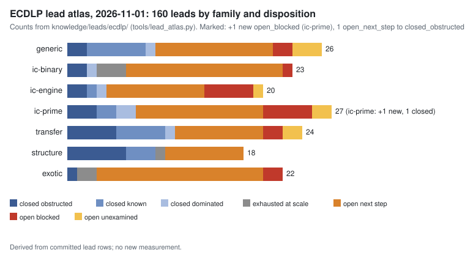

# ECDLP lead atlas: EcGFp5 quotient-solve update, 2026-11-01

**Question.** The crypto quotient-solve experiment is now complete. What does it decide for `LEAD-ICP-gfp5-symmetrized-gaudry`?

**Scope.** This is a single-lead fold, not a full atlas review. `--delta` was not run and `REVIEW_STATE.json` is not stamped; the next full review picks up the other changes since the 2026-10-30 pins. The fold cites one experiment:

- `crypto:research/ecgfp5_quotient_solve_20261101/` (crypto PR #3267). Its protocol was frozen before the first run and amended five times (A1–A5, each recorded in `PROTOCOL.md`).
- That experiment was designed in `crypto:research/ecgfp5_lead_evaluation_20261031/`.

**Status of each statement.** The disposition is *derived* from the cited evidence. Numbers are *measured* values copied from that report. The fold changes no hypothesis, experiment or goal status.

## Result

- **`LEAD-ICP-gfp5-symmetrized-gaudry`: open_next_step → closed_dominated** (obstruction kind `measured`).
  - The F_p-rational (Z/2)^4 x| S_5 quotient of KN-OPEN-9b4a2b was solved completely at m = 5 with msolve 0.6.5. The three toy primes were p' = 4111, 262231 and 33554371.
  - D = 2^16 in every cell, which confirms D = 2^{(m−1)^2}. The planted point was recovered every time. Peak RSS was 4.7–6.5 GiB.
  - Whole-solve per-system cost was c_cyc = 2^46.30, 2^46.56 and 2^46.63. That meets the frozen G1 CLOSE threshold (≥ 2^46) at every prime.
  - The margin is small: 0.30–0.63 bits. F4 alone cost 2^44.7–2^45.3, which would sit in G1's not_measured band. About two-thirds of c is msolve's rational parametrisation.
  - Five solver probes at p' = 4111 each failed the improvement bar of 6,900 CPU-s (W0 F4 / 1.5):
    - weighted F4 (2,2,2,2,2,1) finished at 1.16× W0 CPU, with D = 2^21;
    - weighted (1,1,1,1,1,2) and (1,2,3,4,5,5) hit the wall cap;
    - Singular sba F5a hit its cap;
    - Singular sba F5b was stopped by the owner past the bar.
- **Why closed_dominated and not closed_obstructed.** A finite toy-prime cost measurement is not a disproof. The lead stays in the pursuit queue (README, "Pursuit invariant"). It reopens on any of these:
  - a finish cheaper than the rational parametrisation (FGLM to a lex eliminant, or the eliminant only) brings c_cyc to ≤ 2^38 on ≥ 3 primes;
  - a matrix-F5/GVW-style F4 lowers F4 CPU below W0 / 1.5;
  - a construction gives D < 2^16 at m = 5.
  - Separately, H-GFPN-6cc6aa (degree-4 Macaulay rank) is still untested.
- **Tallies after the fold.** 160 leads:
  - closed: 21 obstructed, 17 known, 6 dominated, 6 exhausted at scale;
  - open: 85 next step, 17 blocked, 8 unexamined.

## What this does not say

- It does not say the EcGFp5 symmetrized decomposition is impossible.
- It does not compare the quotient solve with rho end to end. c is a per-system stage cost.
- The larger primes on EKS were not run.

## Files

- `dispositions.svg` and `dispositions.json`: drawn by `figures.py` from the committed rows.
- `report.pdf`: rendered from this README by `build_pdf.py`.
