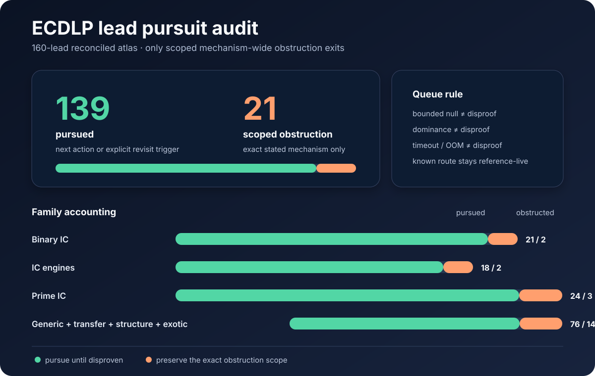

# ECDLP lead pursuit audit

Date: 2026-11-01

Atlas snapshot: `crypto-autoresearcher@7072741f712c`

Crypto evidence snapshot: `crypto@b6ffdca53494`

## Decision

The existing 159-row ECDLP atlas was reviewed family by family. That review also identified and
added one missing live split-graph/secant successor, so the reconciled atlas has **160 leads**.
Exactly **21 narrowly scoped mechanisms have mechanism-wide obstruction evidence under their
stated assumptions** and may leave
the pursuit queue. The other **139 leads remain pursued** through either their next action or
their explicit revisit trigger.

This is a scope decision, not a claim that 21 broad research areas are impossible. Each stopped
row is stopped only for the mechanism stated in its obstruction. A non-generic oracle, different
presentation, different locus, non-homomorphic statistic, or other stated escape remains a
separate live lead.

## Policy applied

Only `closed_obstructed` suppresses a row from the generated pursuit queue. The following states
remain pursued:

- `closed_known`: the mechanism works or is established; retain its stated extension trigger.
- `closed_dominated`: the measured implementation lost in a declared regime; retain the route
  outside that regime or under its stated crossover trigger.
- `exhausted_at_scale`: a bounded search was exhausted; retain its wider-scale or structurally
  different revisit condition.
- timeouts, OOMs, missing infrastructure, unavailable sources, finite null results, and finite
  measured cost disadvantages: these are evidence or blockers, never mechanism-wide disproof by
  themselves. A complete lower bound inside an explicitly named model can obstruct only that model.

When a row mixed a proved negative subcase with an untested escape, the audit retained the
obstruction as historical evidence and restored the row to `open_next_step`, driven by its
existing `revisit_when`. This avoids erasing negative knowledge while keeping the unrefuted
mechanism in the queue.

## Complete family accounting

| Family scope | Reviewed | Scoped obstruction | Pursued |
| --- | ---: | ---: | ---: |
| Binary-field index calculus | 23 | 2 | 21 |
| Index-calculus engines | 20 | 2 | 18 |
| Prime-field index calculus | 27 | 3 | 24 |
| Generic, transfer, structure, and exotic | 90 | 14 | 76 |
| **Total** | **160** | **21** | **139** |

The 21 suppressed mechanisms are:

| Family | Lead | Exact stopped scope |
| --- | --- | --- |
| Binary IC | `LEAD-ICB-generic-table-oracle` | Generic group-operation/table/membership oracle |
| Binary IC | `LEAD-ICB-frobenius-orbit-factor-base` | Linear/subspace Frobenius orbit-column claim beyond exact orbit savings |
| IC engine | `LEAD-ICE-generic-oracle-arity-cost-floor` | Coordinate-blind enumeration and MITM oracle floor |
| IC engine | `LEAD-ICE-semaev-cover-monodromy` | Generic-fibre cycle-type census on the stated rational locus |
| Prime IC | `LEAD-ICP-generic-table-decomposition` | Generic enumeration/table decomposition |
| Prime IC | `LEAD-ICP-representation-subset-sum` | Generic group-operation/equality subset filter |
| Prime IC | `LEAD-ICP-self-pairing-prime-order` | Bilinear self-pairing on the stated prime-order line |
| Generic | `LEAD-RHO-generic-sqrt-lower-bound` | Generic group algorithms |
| Generic | `LEAD-RHO-cheon-aux-acquisition` | Generic acquisition of the required auxiliary powers |
| Transfer | `LEAD-TRF-cm-canonical-lift-heights` | Ordinary prime-field canonical/CM lift under its complete dichotomy |
| Transfer | `LEAD-TRF-one-point-self-pairing` | One-point bilinear self-pairing/distortion-map route |
| Transfer | `LEAD-TRF-padic-canonical-section` | Homomorphic prime-to-characteristic torsion section/formal-log route |
| Transfer | `LEAD-TRF-prime-field-isogeny-to-weak` | Weaknesses determined only by field and group order |
| Transfer | `LEAD-TRF-second-torsion-direction` | Homomorphic second-torsion/graph-kernel route |
| Structure | `LEAD-STR-endo-scalar-action-generic` | Group-element-returning endomorphism oracle |
| Structure | `LEAD-STR-isogeny-class-generic-invariance` | Generic-algorithm variation across an isogeny class |
| Structure | `LEAD-STR-isogeny-transport-preprocessing` | Preprocessing transported exactly through point/scalar maps |
| Structure | `LEAD-STR-isogeny-walk-weak-neighbour` | MOV, anomalous, order, and CM class-invariant weak neighbour |
| Structure | `LEAD-STR-p192-class-cm-relations` | CM relations used only as subgroup scalars/generic aids |
| Structure | `LEAD-STR-secp256k1-cm-class-audit` | Generic class-neighbour route; special-presentation IC is separate |
| Exotic | `LEAD-EXO-augmented-oracle-ggm` | The specifically named GGM-simulable augmented oracles |

## Corrections produced by the audit

Twenty-six rows previously labelled `closed_obstructed` were broader than their evidence. They
are restored to `open_next_step` without deleting the earlier obstruction. Representative
corrections are:

- the binary SAT/enumeration results do not test symmetric Groebner systems at `ell=6..8`,
  high-arity closure, or the GG14 `m=4` presentation;
- the Semaev chain cost identity assumes, rather than measures, topology-independent closure
  degree;
- finite volcano, endomorphism, factor-base, and residual-relation panels do not prove absence
  outside their tested regimes;
- proofs for homomorphic, bounded-degree, generically Galois, or full-Jacobian routes do not
  close their explicitly non-homomorphic, growing-degree, non-Galois, or projected successors.

The crypto review explicitly identifies the first two scope errors and the next native
high-arity discriminator in
`crypto:research/factor_base_arity_review_20261024/README.md`. The split-graph result in
`crypto:research/prime_factor_base_degree_20261031/parallel_20261031/RESULTS.md` lowers handled
degree but leaves total work, yield, rank, and operational root discovery unresolved; it is
therefore a live successor, not closure evidence.

## Evidence and reproducibility

The canonical row evidence is stored beside each lead under `knowledge/leads/ecdlp/`. The policy
and generated-queue semantics are documented in `knowledge/leads/ecdlp/README.md` and implemented
by `tools/lead_atlas.py --pursuit`. `tools/test_lead_atlas.py` verifies that only
`closed_obstructed` is excluded and that known, dominated, and scale-exhausted rows remain queued
through their revisit triggers.

The audit used the following repository evidence as load-bearing cross-checks:

- `crypto:research/factor_base_arity_review_20261024/README.md`
- `crypto:research/prime_factor_base_degree_20261031/parallel_20261031/RESULTS.md`
- `crypto:problems/ghs-higher-magic-descent-not-executable.md`
- `crypto:problems/factor-base-shape-to-successful-work.md`
- the `obstruction`, `forecloses`, `revisit_when`, `evidence`, and `related` fields of all 160
  atlas rows.

No performance result is introduced by this report. It records a disposition audit and the
queue invariant.

## Review boundary

The repository's Conductor command was unavailable and no `.conductor/WORKFLOW.md` was present;
the audit records that tooling limitation rather than implying approval from it.

The global atlas review stamp is intentionally unchanged. The cryptanalysis base ref was
unreachable and the configured `ecc-challenges` checkout was absent during delta coverage, so a
whole-universe freshness claim would be unsupported. This scoped audit is complete for the 159
pre-existing rows, the new live successor, and the cited crypto snapshot; the missing repositories must be reconciled before advancing
the canonical review stamp.
