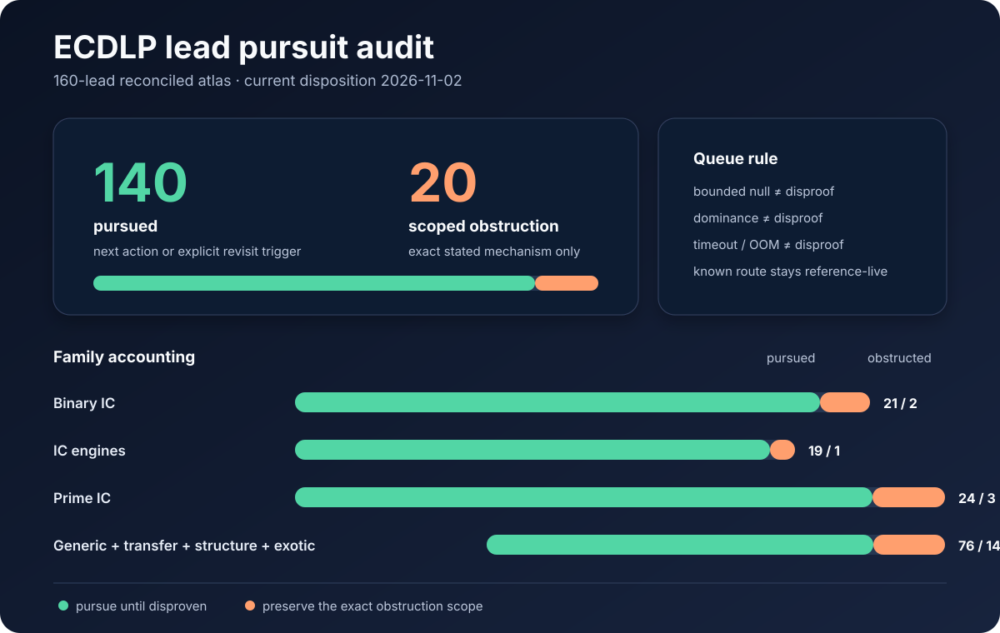

# ECDLP lead pursuit audit

Date: 2026-11-01

Current disposition update: 2026-11-02

Atlas snapshot: `crypto-autoresearcher@7072741f712c`

Crypto evidence snapshot: `crypto@b6ffdca53494`

Xedni correction evidence: `crypto@34caae22581045ec59fe779d86f8bf2d495cc14a`

Latest scoped filter evidence: `crypto@b825c0c0d535215a6b01571350fa5b54a05ea0fd`

## Decision

The existing 159-row ECDLP atlas was reviewed family by family. That review also identified and
added one missing live split-graph/secant successor, so the reconciled atlas has **160 leads**.
The 2026-11-01 audit recorded **21 narrowly scoped mechanisms** outside the pursuit queue and
**139 pursued leads**. The confirmed 2026-11-02 arity/oracle correction narrows one of those
rows: the current accounting is **20 `closed_obstructed` rows** and **140 pursued leads**.

This is a scope decision, not a claim that 20 broad research areas are impossible. Each stopped
row is stopped only for the mechanism stated in its obstruction. A non-generic oracle, different
presentation, different locus, non-homomorphic statistic, or other stated escape remains a
separate live lead.

## Policy applied

Only `closed_obstructed` suppresses a row from the generated pursuit queue. The following states
remain pursued:

- `closed_known`: the mechanism works or is established; retain its stated extension trigger.
- `closed_dominated`: the measured implementation lost in a declared regime; retain the route
  outside that regime or under its stated crossover trigger.
- `exhausted_at_scale`: a bounded search was exhausted; retain its wider-scale or structurally
  different revisit condition.
- timeouts, OOMs, missing infrastructure, unavailable sources, finite null results, and finite
  measured cost disadvantages: these are evidence or blockers, never mechanism-wide disproof by
  themselves. A complete lower bound inside an explicitly named model can obstruct only that model.

When a row mixed a proved negative subcase with an untested escape, the audit retained the
obstruction as historical evidence and restored the row to `open_next_step`, driven by its
existing `revisit_when`. This avoids erasing negative knowledge while keeping the unrefuted
mechanism in the queue.

## Complete family accounting

| Family scope | Reviewed | Scoped obstruction | Pursued |
| --- | ---: | ---: | ---: |
| Binary-field index calculus | 23 | 2 | 21 |
| Index-calculus engines | 20 | 1 | 19 |
| Prime-field index calculus | 27 | 3 | 24 |
| Generic, transfer, structure, and exotic | 90 | 14 | 76 |
| **Total** | **160** | **20** | **140** |

The 20 currently suppressed mechanisms are:

| Family | Lead | Exact stopped scope |
| --- | --- | --- |
| Binary IC | `LEAD-ICB-generic-table-oracle` | Generic group-operation/table/membership oracle |
| Binary IC | `LEAD-ICB-frobenius-orbit-factor-base` | Linear/subspace Frobenius orbit-column claim beyond exact orbit savings |
| IC engine | `LEAD-ICE-semaev-cover-monodromy` | Generic-fibre cycle-type census on the stated rational locus |
| Prime IC | `LEAD-ICP-generic-table-decomposition` | Generic enumeration/table decomposition |
| Prime IC | `LEAD-ICP-representation-subset-sum` | Generic group-operation/equality subset filter |
| Prime IC | `LEAD-ICP-self-pairing-prime-order` | Bilinear self-pairing on the stated prime-order line |
| Generic | `LEAD-RHO-generic-sqrt-lower-bound` | Generic group algorithms |
| Generic | `LEAD-RHO-cheon-aux-acquisition` | Generic acquisition of the required auxiliary powers |
| Transfer | `LEAD-TRF-cm-canonical-lift-heights` | Twelve audited ordinary prime-field canonical/CM mechanisms at fixed arity and absolute coefficient bound |
| Transfer | `LEAD-TRF-one-point-self-pairing` | One-point bilinear self-pairing/distortion-map route |
| Transfer | `LEAD-TRF-padic-canonical-section` | Homomorphic prime-to-characteristic torsion section/formal-log route |
| Transfer | `LEAD-TRF-prime-field-isogeny-to-weak` | Weaknesses determined only by field and group order |
| Transfer | `LEAD-TRF-second-torsion-direction` | Homomorphic second-torsion/graph-kernel route |
| Structure | `LEAD-STR-endo-scalar-action-generic` | Group-element-returning endomorphism oracle |
| Structure | `LEAD-STR-isogeny-class-generic-invariance` | Generic-algorithm variation across an isogeny class |
| Structure | `LEAD-STR-isogeny-transport-preprocessing` | Preprocessing transported exactly through point/scalar maps |
| Structure | `LEAD-STR-isogeny-walk-weak-neighbour` | MOV, anomalous, order, and CM class-invariant weak neighbour |
| Structure | `LEAD-STR-p192-class-cm-relations` | CM relations used only as subgroup scalars/generic aids |
| Structure | `LEAD-STR-secp256k1-cm-class-audit` | Generic class-neighbour route; special-presentation IC is separate |
| Exotic | `LEAD-EXO-augmented-oracle-ggm` | The specifically named GGM-simulable augmented oracles |

## Corrections produced by the audit

Twenty-six rows previously labelled `closed_obstructed` were broader than their evidence. They
are restored to `open_next_step` without deleting the earlier obstruction. Representative
corrections are:

- the binary SAT/enumeration results do not test symmetric Groebner systems at `ell=6..8`,
  high-arity closure, or the GG14 `m=4` presentation;
- the Semaev chain cost identity assumes, rather than measures, topology-independent closure
  degree;
- finite volcano, endomorphism, factor-base, and residual-relation panels do not prove absence
  outside their tested regimes;
- proofs for homomorphic, bounded-degree, generically Galois, or full-Jacobian routes do not
  close their explicitly non-homomorphic, growing-degree, non-Galois, or projected successors.

The crypto review explicitly identifies the first two scope errors and the next native
high-arity discriminator in
`crypto:research/factor_base_arity_review_20261024/README.md`. The split-graph result in
`crypto:research/prime_factor_base_degree_20261031/parallel_20261031/RESULTS.md` lowers handled
degree but leaves total work, yield, rank, and operational root discovery unresolved; it is
therefore a live successor, not closure evidence.

## Xedni correction after the family audit

The later primary-source and kernel-checked review at
`crypto:research/jksst_xedni_audit_20261101/` found that the broad xedni wording inherited by
two atlas rows exceeded the theorem it cited. JKSST Theorem 4.1 explicitly begins "under certain
plausible assumptions". Lemma 4.1 assumes a uniform selected-lift height/discriminant comparison
and Lang's conjecture; the displayed `C0/p` step uses an approximate random-image model. An
end-to-end repeated-trial obstruction additionally needs good-reduction/subgroup correspondence,
a useful relation with nonzero denominator, bounded cofactor, and a history-uniform adaptive
hazard.

Accordingly, `LEAD-TRF-global-lift-small-height` and
`LEAD-ICP-char0-lifting-xedni-smoothness` are now `open_next_step`. Their historical
obstructions and finite negative measurements remain in place, but the uncovered selected-lift
and relation-preserving-statistic mechanisms stay in the pursuit queue. `KR-IC-cd159a` now records
the conditional theorem instead of the broader sentence that characteristic-zero lifting fails.
`LEAD-EXO-global-lift-height` carries both the function-field timing action and the
characteristic-zero bridge-composition action.

The CM row remains `closed_obstructed` only within the corrected L9 boundary from
`CORR-20260810-930c42`: ordinary prime-field Serre--Tate/global CM models, fixed arity `2..9`,
absolute `C0`, and the twelve enumerated mechanisms. Its support is the target-independent-output
bound plus constant-size coefficient enlargement, with the generic class-polynomial construction
as a separate setup gate. Target-dependent arbitrary sections, growing arity or `C0`, and
unenumerated CM lift families are explicitly outside that closure.

At that stage, this correction changed two rows from `closed_known` to `open_next_step`; it did
not change the then-current audit totals of **21 scoped obstructions** and **139 pursued leads**,
because `closed_known` was already retained in the pursuit queue. The primary PDF checked was the
author-hosted JKSST copy,
SHA-256 `981bf955f7aecc5df4f271837f6653bd7666e5026f59df44196609d4a1dd6bc7`, especially
Section 4, Lemma 4.1, Theorem 4.1, Sections 5--6, and notes 7--8. Silverman's proposal remains a
metadata/first-page evidence gap; no inaccessible text was treated as read.

## Arity/oracle correction after the family and Xedni audits

On 2026-11-02, `LEAD-ICE-generic-oracle-arity-cost-floor` moved from
`closed_obstructed` to `open_next_step`. The exact fixed-arity negative evidence is preserved:
`EV-SEMBIN-b6d042` has zero in-domain sub-rho cells for `ENUM`, `MITM`, and `MITM_CAPPED` in
the frozen model, and the reviewed Lean declaration `mitm_never_sub_generic` proves
`costAll(m,beta,k) > 1/2` when `m >= 2`, `beta > 0`, and `k >= m/2`. Those are exact
in-model obstructions, not discarded results.

The independent semantic review rejected the bundled blanket-attainment and literal
pointwise-threshold wording. The fixed model does not supply an executable algorithm, actual
oracle output and useful-rank semantics, the required yield hypotheses, or a uniform
model-to-algorithm theorem. Its `FREE` control has 7,850 sub-VOW model cells, and free oracles,
growing arity, and coordinate-reading constructions remain outside the exact negative theorem.
Those unrefuted branches therefore remain pursued while the fixed-arity `ENUM`/`MITM` result
stays recorded in the row's obstruction and `forecloses` fields.

This additive correction changes the IC-engine family from **2 obstructed / 18 pursued** to
**1 obstructed / 19 pursued**, and the full atlas from **21 / 139** to **20 / 140**. It leaves
the original dated 26-row statement and the subsequent Xedni reconciliation narrative intact;
neither historical account is rewritten by this disposition update.

## Coordinate-visible Wagner-filter evidence after the disposition audit

The exact ECCp-131 study at
`crypto:research/eccp131_representation_filter_20261102/REPORT.md` evaluated 3,450 frozen
simple 1--8-bit coordinate configurations in each of six small-x/random-base cells at
`B=64,128,256`. Every recorded held-out Wilson lower enrichment ratio was below one
(`0.6093--0.7783`). The
two positive small-x point estimates were post-add predicates that first require all
`Theta(B^2)` pair sums. Planted four-sum, modular-solver, A/A, and bounded relation-oracle
controls passed; the exact arity-2/3 probes still returned zero natural rows and rank. Exact-width
F4/F5 was unavailable and unmeasured. Local clocks are invalid; the retained export-shape and
interval-label deviations support no performance claim.

This result rejects only the frozen source/combiner/bit-slice family. It does not obstruct
learned multibit hashes, algebraic bucket generators, larger bases, other curves, or another
coordinate-visible filter with a proved subquadratic qualifying-pair enumerator. The existing
`LEAD-EXO-four-list-ktree-join` row therefore remains the pursued carrier. Its next action now
includes that explicit successor alongside the unresolved O2 bucket-variance branch.

The generic theorem in `LEAD-ICP-representation-subset-sum` is unchanged, but its scope is now
stated exactly: it covers filters that see only generic group operations and encoding equality.
Coordinate-reading predicates are outside that theorem. No disposition or family total changes:
the atlas remains **160 total / 140 pursued / 20 scoped obstructions**.

## Evidence and reproducibility

The canonical row evidence is stored beside each lead under `knowledge/leads/ecdlp/`. The policy
and generated-queue semantics are documented in `knowledge/leads/ecdlp/README.md` and implemented
by `tools/lead_atlas.py --pursuit`. `tools/test_lead_atlas.py` verifies that only
`closed_obstructed` is excluded and that known, dominated, and scale-exhausted rows remain queued
through their revisit triggers.

The audit used the following repository evidence as load-bearing cross-checks:

- `crypto:research/factor_base_arity_review_20261024/README.md`
- `crypto:research/prime_factor_base_degree_20261031/parallel_20261031/RESULTS.md`
- `crypto:research/jksst_xedni_audit_20261101/README.md`
- `crypto:research/jksst_xedni_audit_20261101/PROOF_MAP.md`
- `crypto:research/eccp131_representation_filter_20261102/REPORT.md`
- `crypto:problems/eccp131-full-parameter-index-calculus.md`
- `crypto:docs/ecdlp-hardness-corpus/REPORT.md`
- `docs/reports/2026-11-01-ic-arity-oracle-review/synthesis/report.md`
- `ledger/proposals/IDEA-20261024-a2b05d.yaml`
- `ledger/decisions/DEC-20261101-8adb11.yaml`
- `crypto:problems/ghs-higher-magic-descent-not-executable.md`
- `crypto:problems/factor-base-shape-to-successful-work.md`
- the `obstruction`, `forecloses`, `revisit_when`, `evidence`, and `related` fields of all 160
  atlas rows.

No performance result is introduced by this report. It records a disposition audit and the
queue invariant.

## Review boundary

The repository's Conductor command was unavailable and no `.conductor/WORKFLOW.md` was present;
the audit records that tooling limitation rather than implying approval from it.

The global atlas review stamp is intentionally unchanged. The cryptanalysis base ref was
unreachable and the configured `ecc-challenges` checkout was absent during delta coverage, so a
whole-universe freshness claim would be unsupported. This scoped audit is complete for the 159
pre-existing rows, the new live successor, and the cited crypto snapshot; the missing repositories must be reconciled before advancing
the canonical review stamp.
