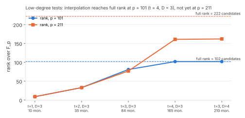

# Desk steps for two ECDLP leads (2026-11-04)

This report records reading and derivation work, plus one exact derivation check (`lowdeg_rank_check.py`, which runs in seconds).
It contains no measurements and makes no cost claims. Each note marks every statement as proved, cited or heuristic.

## LEAD-EXO-low-degree-query-lower-bound, step (a)

Full note: `low-degree-desk.md`, written by an Opus agent and read and checked here.

* **H1 is false as stated if a rank condition holds.** A degree-D test on encodings [b_i]Q
  pulls back to a function of degree Delta = Σ(2d_x + 3d_y)·b_i² on E. Delta, not D, bounds
  how many k a single test can single out, and large b_i cost only O(log N) group operations.
  If the degree-≤D monomials in the coordinates of t such points have full rank N on E(F_p),
  interpolation in free local work makes each test answer "k ∈ S?" for any set S. Binary search
  then finds k with O(t log N) + log2 N queries.
* **The rank condition, checked exactly** (`lowdeg_rank_check.json`). It holds at p = 101 with t = 4 and D = 3:
  rank 102 of 102 candidates. It does not hold at p = 211 for the same t and D (161 of 222): the rank
  falls short of the monomial count by one curve relation per point, plus extra dependencies not
  explained here. Full rank on elliptic curves therefore stays heuristic in general. It is proved
  for the F_p^* analogue.
* **H1′ is proved:** Pr[success] ≤ (C(T_g+2, 2) + Σ_j(Delta_j + t_j) + 1)/N. This bound is meaningful only for small
  multipliers. The single-test lemma follows from Bezout on E and is tight to about a factor of 2.
* **Kohel–Shparlinski is verified** (ANTS-IV, LNCS 1838, Springer 2000, pp. 395–404). It bounds sums over E or
  a subgroup by 2 deg(f) q^(1/2), so it covers only single-point tests.
* **What the row now asks for.** The planned bias check cannot refute H1 at t = 2. The row's step (b) is now the
  exact rank computation for p from 2^8 to 2^14, with controls.
* **No practical attack follows.** The attack spends about N^ω local field operations. Like the x-oracle in the holant
  step (a) note, it shows that a query bound in this model must charge Delta or restrict local work.

## LEAD-ICP-elliptic-code-list-decoding

Full note: `elliptic-code-desk.md`, written by a Sonnet agent and read here.

* **H1 holds against the Guruswami–Sudan bound.** GS list decoding needs agreement t > sqrt(n·deg G), and a
  minimum-weight codeword agrees with the zero word in exactly deg G = k coordinates. Guessing
  j zero positions never reaches the radius either, because agreement then equals the reduced degree.
* **Zhang–Liu.** The paper also appeared at ProvSec 2019 (LNCS 11821, pp. 222–244). The author's 2019 talk
  slide says the method "is not efficient currently, and it is even not of square-root time".
  The full text was **not read**: eprint.iacr.org returns a bot check to this session, and no
  workaround was used. The discriminator (enumeration in disguise or not) stays open until someone
  reads the received-word construction.
* **The Cheng citation is corrected in the row.** The paper is Q. Cheng, "Hard Problems of Algebraic Geometry Codes",
  arXiv cs/0507026, IEEE Trans. Inf. Theory 2008. It proves the subset-sum correspondence for the
  two-point divisor Q + (k−1)O and only sketches the one-point case.

## Reproduce

    python3 lowdeg_rank_check.py > lowdeg_rank_check.json
    python3 figures.py; ./build_pdf.sh
