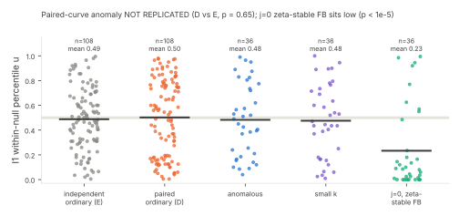

# Paired-curve anomaly: preregistered replication

This study follows up `../weakclass-i1-20261104`. There, the 27 ordinary curves selected by the weak-class pairing procedure (class D) had mean I1 percentile
u = 0.28, against 0.53 for independently picked ordinary curves (class E). The KS p was 1.4e-4, the effect was robust to fresh null seeds and it was not a prime effect.
That anomaly was post hoc and unexplained, and it put the weak-class pairing baseline in doubt.
Protocol `protocol.json`, PAIRED-ANOMALY-20261104, was frozen before data (sha256 `f9b54734b3c8…`, commit 0e99eb1b).

**Verdict (frozen rule): NOT REPLICATED, with valid controls.** On fresh seeds, 108 paired curves average u = 0.502 against 0.488 for 108 independent
curves (Mann–Whitney z = 0.45, p = 0.65). The earlier low sitting was chance, so **the weak-class pairing baseline stands**. That outcome fits the code:
both procedures draw a and b uniformly in [1, p) under the same acceptance conditions.

## Design

* **Curves.** Per size L ∈ {10, 12, 14}, the frozen `pick()` is run under 4 fresh seeds (`<sha>:k`). That gives 12 curves per weak class and 36 paired curves per size.
  36 independently picked ordinary curves per size are added (the `extra_ordinary` procedure of WEAKCLASS-I1).
* **Statistic and null.** These are unchanged: I1 against 200 negation-closed null draws per curve (byte-copied `weakclass.py`, `weak_curves.py` and `weakclass_i1.py`).
  Each curve also records its trace, p mod 3 and 4, and whether a and b are squares, for mechanism hunting had the effect replicated.
* **Rule.** REPLICATED iff a two-sided Mann–Whitney test gives p < 0.01 with D lower. NOT_REPLICATED iff p ≥ 0.05.
  The secondary analysis compares each weak class with E (Bonferroni ×3).

## Results

* **Controls.** The positive control has u ≥ 0.95 on 100% of curves, and the stream means agree within 3% on 97.5%.
* **Primary.** D 0.502 against E 0.488, p = 0.65. **NOT_REPLICATED.** By KS both sets are consistent with uniform: D p = 0.13, E p = 0.32.
* **Secondary, against E (Bonferroni ×3), with 36 curves per class instead of 3:**
  * anomalous (A): mean u 0.483, p = 0.86, **no detection**;
  * small embedding degree (B): mean u 0.476, p = 0.82, **no detection**;
  * j = 0 with a ζ-stable factor base (C): mean u 0.233, z = -4.79, Bonferroni p < 1e-5. **Detected, low at every size** (0.13, 0.27, 0.31).

## What this changes

1. The paired-curve anomaly is closed as chance. The weak-class cell comparisons can be read against their paired baselines.
2. **I1 does not see the cryptographically weak classes.** With 36 curves per class there is no detected shift for anomalous or small-embedding-degree curves (minimum detectable shift about 0.13 in u at 50% power).
   It **does** see the ζ-stable factor base of the j = 0 class. That reflects how the factor base is built: a log set closed under multiplication by the
   eigenvalue λ has fewer independent frequencies, so its character-sum maximum is lower, as the round-2 memo predicted. It says nothing about how easy the DLP is.
   The 3-curve cell rule of WEAKCLASS-20261104 and WEAKCLASS-I1-20261104 was underpowered to show this.
3. The scope note for rows resting on I1 is therefore "no detected shift for Smart- or MOV-weak curves (36 per class, p ≤ 2^14); sensitive to factor-base symmetry (ζ-stable sets sit low)".

## Deviations

* No S3 checkpoint (no upload token). With the owner's approval, the pushed branch is the resume record.
* The study ran on 1 core alongside the QUADPHASE 2^16 settle run. Values are exact. Environment: Python 3.13.18 and NumPy 2.5.3.
* **Stale protocol fields.** Some fields were inherited from the WEAKCLASS-I1 template (for example, the null population's `n` reads 40 while 200 draws were run).
  The frozen script and the `decision_rule` text are what ran. Independent validation (`VALIDATION.md`) replayed all 324 rows bit-exact and recomputed
  the primary and secondary statistics, so the verdict is unaffected.

## Reproduce

    python3 paired_replication.py --protocol-sha f9b54734b3c84511e436332b4edb37ca4e265a476d6408ee8ce8be8ac827c554 --out rows.jsonl
    python3 analyze_paired.py rows.jsonl verdict.json
    python3 figures.py; ./build_pdf.sh
