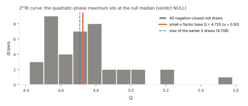

# Quadratic-phase test: settling the 2^16 curve

This study follows up `../quadphase-20261104`. That study's single descriptive 2^16 curve (p = 65521, a = 48322, b = 6694, n = 65167) had Q_EC = 4.7249,
above all 5 of its null draws (max 4.708), which happens 1 time in 6 by chance. Protocol `protocol.json`, QUADPHASE-2P16-20261104, was frozen before data
(sha256 `d7250cca5e90…`, commit 82dd7979). `quadphase.py` is a byte copy of the frozen QUADPHASE script.

**Verdict (frozen rule): NULL, with valid controls.** Against 40 fresh negation-closed null draws, Q_EC sits at the median: u = 0.50, null mean
4.750, sd 0.229, max 5.581. The earlier exceedance came from a 5-draw null that happened to fall low.

* **Controls.**
  * The EC replay reproduces the recorded Q_EC exactly.
  * The planted control is 4.1× the null maximum, at α₀.
  * The A/A even/odd difference is 1.2%.
* **Consequence.** The quadratic-phase NULL now covers N ≈ 2^12–2^14 (9 curves, decisive) and one curve at 2^16. It carries the same scope as before:
  coherent single-phase leakage of about 0.3 of the set or more, and uncalibrated against weak curve classes.

## Deviations

* No S3 checkpoint (no upload token). With the owner's approval, the pushed branch is the resume record.
* No separate independent validation. The study is one curve with a bit-exact replay of a value the QUADPHASE validation had already recomputed independently,
  and the verdict is a single rank comparison that `verdict.json` reproduces from `rows.jsonl.xz`.

## Reproduce

    python3 rerun_2p16.py --protocol-sha d7250cca5e90d25c8ea0ef17e750bfee09d8c47a28ae6a910fcc9056fccbd1b9 --out rows.jsonl --workers 3   # about 75 min on 3 cores
    python3 analyze_2p16.py rows.jsonl verdict.json
    python3 figures.py; ./build_pdf.sh
