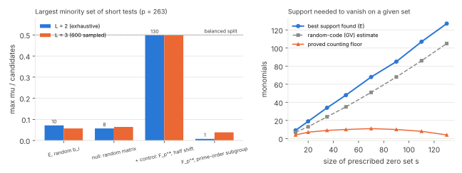

# Round 5 desk work: CHW body, a description-length bound for low-degree tests, literature (2026-11-05)

This report records reading and derivation work, plus one exact toy check (`h1pp_check.py`, `h1pp_scaling.py`, [pcc:unverified]
about 30 s on one core). It contains no timing measurements and makes no cost claims. Every statement is tagged as
read, proved, cited or heuristic in the two linked notes.

## 1. KN-LIT-7606 (structured generic-group model): body read

The full note is `chw-reading.md`. The PDF is the author copy, sha256 `82b40c27…6af66f`.

- **There is no elliptic-curve theorem in the body.** The abstract mentions "elliptic-curve points", but §5.3 lists
  elliptic-curve special-case algorithms as not yet modelled. The paper's applications are to smooth and small
  integers and to smooth polynomials only.
- **What the bound covers.** Theorem 3.2 gives DLAdv ≤ δn(3T+2)/q + (3T+1)²/q + 1/n, where δ is the fraction of labels that
  occur in a ⋆ relation. The proof fixes the labelling on that δ-fraction, which the adversary may know in full, and randomises
  everything else.
- **What follows for coordinates.** By a reading of the proof that the authors do not state ([pcc:unverified]):
  - Coordinate access confined to a fixed set, such as a coordinate-defined factor base of B ≤ √q points, gives no advantage
    over the generic bound.
  - Index calculus reads coordinates of instance-derived points. There δ = 1 and the bound is vacuous. The authors say the
    same for integers (§7).
  - So there is no query-model closure for full coordinate access. `LEAD-EXO-coordinate-revealing-oracles` step (2) is settled.
- **Correction to the corpus.** KN-LIT-7606 earlier said that CHW "already covers elliptic-curve point structure" and is
  "direct prior art" closing the KN-FIND-002 oracles. Both statements are withdrawn in the record. This is input to review
  round BATCH-9f090a (joint J2). It changes no finding's status here.

## 2. LEAD-EXO-low-degree-query-lower-bound, step (c): charging the description length

The full note is `h1pp-note.md`. It was written by an Opus agent and checked here. Both JSON outputs were reproduced byte for byte by a rerun.

- **H1″ (proved).** Pr[success] ≤ (C(T_g+2,2) + 1 + Σ_j(μ_j + t_j))/N, where μ_j is the smaller side of test j's [pcc:unverified]
  split of the candidates. The simulator answers each test with its majority answer. H1′ (the Delta bound) is the special case μ ≤ Delta.
- **Floor (proved).** An L-monomial test can vanish on any L − 1 chosen candidates, so no description-charged
  bound can do better than Σ L_j.
- **Counting (proved).** Cutting out a prescribed generic balanced set needs Ω(N / log N) monomials, or straight-line-program
  size Ω(N / log pN). This is the rigorous form of HD2c. It gives no worst-case bound, because the solver chooses its own sets.
- **Conjecture H1″-strong (heuristic).** On a prime-order curve, every L-monomial test has μ ≤ L·N^o(1). That would
  force T_g ≳ √N or Σ L_j ≳ N^(1−o(1)). It is open even for L = 2: Weil and Kohel–Shparlinski scale with Delta and are vacuous
  for large multipliers.
- **Prime order matters (proved).** Over F_p^*, the binomial x₁ − x₂ with b₂ = b₁ + (p−1)/2 splits the candidates in half.

| arm (p = 263, N = 281, t = 9, D = 3) | candidates | rank | max μ, L = 2 (exhaustive) | max μ, L = 3 (600 sampled) |
|:--|--:|--:|--:|--:|
| E, random multipliers | 140 | 140 | 10 | 8 |
| null: uniform random matrix | 140 | 140 | 8 | 9 |
| positive control: F_263^*, b₂ = b₁ + 131 | 261 | 157 | 130 | 130 |
| F_263^*, prime-order subgroup (q = 131) | 130 | 104 | 1 | 5 |

At toy size the curve behaves like the null: no short balanced test exists. This is consistent with H1″-strong and is not
evidence for its asymptotics. The row stays `open_next_step`. Its next step is a desk bound on the largest fiber of
∏ x([b_i]R)^(e_i) for t = 2.

## 3. Literature

- **Kiltz–Winterhof** (Bull. Austral. Math. Soc. 69 (2004) 305–315; open Cambridge PDF): read in full.
  - It is about the Diffie–Hellman map, not the discrete log.
  - Its elliptic theorems (5–6) need agreement on more than half of the square, or on a near-full product set.
  - It does not decide A(d) for `LEAD-EXO-invertible-hint-subset`.
- **Lange–Winterhof** (COCOON 2002; AAECC 2003): not reachable by an open route (Springer paywall, author pages without PDFs).
- **Zhang–Liu** (ePrint 2018/795): the PDF returned 403 to automated clients. Only the first author's CAB Forum 2019 slides were read.
  They say the method is "not even of square-root time". The row records this as consistent with enumeration in disguise,
  not as a proof of it.
- No access control was bypassed, and TLS verification stayed on throughout.

## Reproduce

    python3 h1pp_check.py; python3 h1pp_scaling.py     # writes h1pp_check.json, h1pp_scaling.json (~30 s)
    python3 figures.py; ./build_pdf.sh

`h1pp_check.py`'s docstring says p = 251, but the script runs p = 263, as the JSON shows. The scripts are kept unchanged
so that their hashes match the note.
