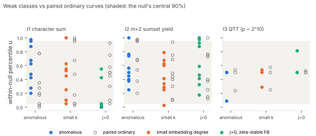

# Weak-class calibration of the numeric structure instruments

Lead: `LEAD-EXO-weak-class-instrument-calibration`. Protocol `protocol.json`, WEAKCLASS-20261104, was frozen before data
(sha256 `472123ace16b…`, commit 3d36b1a3). Scripts are pinned by hash.

**Question.** Do the instruments this program uses to rule out structure see curves whose DLP is *known* to be easy?
A NULL from a blind instrument excludes only structure of that statistic's own type.

## Design

* **Classes.** All curves have prime order n.
  * A, anomalous: n = p, solved in polynomial time by Smart's attack.
  * B, small embedding degree: ord_n(p) = 3–6, so MOV gives a subexponential attack.
  * C, j = 0 (a = 0, p ≡ 1 mod 3), with a factor base made of whole ζ-orbits.
  * D, ordinary: one curve **paired with each weak curve over the same p**, excluding j = 0, j = 1728, small k, anomalous orders and orders already used at that p.
* **Sizes.** p ∈ [2^(L−1), 2^L) for L = 10, 12, 14, with 3 weak curves per class per size, giving 54 curves in all.
* **Instruments.** Each is scored as the percentile u of the curve's statistic within its own 40-draw null.
  * I1, character-sum maximum of the factor base's log set. The null is negation-closed random log sets (round-2 lesson D1).
  * I2, m = 2 yield |F + F|/n in log space, with the same null.
  * I3, QTT parameter count of the transfer matrix M (holant step b), at L = 10 only. The null is random relabellings.

  The low-degree rank instrument is omitted, because at full rank it does not depend on the curve (LOWDEG-RANK-20261104).
* **Positive controls.** A negation-closed log-AP set for I1 and I2, and the discrete-log labelling for I3.
* **Rule.** A cell is DETECTS iff all 3 class curves fall beyond the null's 5–95% band in the same direction, at ≥ 2 sizes (QTT: at L = 10),
  while the paired ordinary curves do not. Otherwise it is BLIND. An instrument whose controls fail is INVALID.

## Results (frozen rule)

| instrument | anomalous (A) | small k (B) | j = 0, ζ-stable FB (C) |
|:--|:--|:--|:--|
| I1 character sum | INVALID (mean u 0.61) | INVALID (mean u 0.41) | INVALID (mean u 0.12) |
| I2 m=2 sumset yield | BLIND (mean u 0.56) | BLIND (mean u 0.44) | BLIND (mean u 0.64) |
| I3 QTT, p ~ 2^10 | BLIND (mean u 0.36) | BLIND (mean u 0.44) | BLIND (mean u 0.60) |

* **I2 and I3 are BLIND to all three weak classes.** Their positive controls sit at u = 0.00 on every curve, so the instruments
  work. They simply do not see Smart- or MOV-weak curves, or ζ-stability. Every NULL from these instruments should carry the
  scope note "blind to anomalous and small-embedding-degree curves".
* **I1 is INVALID under the frozen rule.** The fault lies in my A/A gate, not in the instrument. Its positive control is perfect (u = 1.00 everywhere).
  But the gate required the even and odd null-draw means to agree within 5% on every curve, while with 20 + 20 draws the sampling
  error alone is about 2%. 5 of 54 curves exceed 5% (median 2.3%, 95th percentile 6.6%), which is consistent with chance. The gate was miscalibrated.

## Descriptive observations (not decisions)

1. **I1 versus j = 0.** The ζ-stable class lies at u = 0.00, 0.00, 0.00 at L = 10 and 0.00, 0.05, 0.03 at L = 14, below its paired
   ordinary curves. This is the "small downward shift" the memo predicted from fewer independent frequencies, because a ζ-stable log set is
   closed under multiplication by λ. It is the only class-specific pattern seen. It reflects how the factor base was built, not the DLP's ease.
2. **I1 versus anomalous and small k.** There is no consistent pattern (u from 0.05 to 1.00 in both classes).
3. **I1 is overdispersed on ordinary curves.** About 10 of 27 paired ordinary curves fall at or beyond the 5%/95% marks, against about 12% expected
   if the small-x log set behaved like a random negation-closed set. So at these small sizes (n ≤ 2^14, |F| ≈ 2√n),
   the character-sum maximum of the small-x set is more variable than the matched null's. The small-x factor base is exactly
   negation-closed here (n odd, so no 2-torsion), so this is not a construction artifact. It deserves its own check before I1 nulls are read at small n.
   See also the H-PSEUDO re-read in this round.

## Consequences

* I2 and I3: scope notes (blind to Smart- and MOV-weak classes).
* I1: rerun with a calibrated A/A gate. The overdispersion should be measured directly with many draws per curve.
* Not a cost claim. BLIND does not mean a class is not weak.

## Deviations

* No S3 checkpoint, because there is no upload token. With the owner's approval (session 2026-11-04), the pushed branch is the resume record.
* The run shared the container's 4 cores with two other runs. The values are exact, so this affects only wall time.

## Reproduce

    python3 weakclass.py --protocol-sha 472123ace16b54bf0cc2f3fa4dd855ca326805b4aac6a560a69046e491436665 --out rows.jsonl
    python3 analyze_weakclass.py rows.jsonl verdict.json
    python3 figures.py; ./build_pdf.sh
