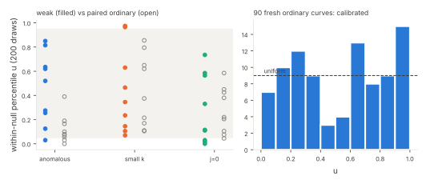

# Instrument I1 rerun with a calibrated A/A gate

This report follows up `../weakclass-20261104`, where I1 (the character-sum maximum of the factor base's log set) came out **INVALID**.
That run's preregistered A/A gate demanded that even and odd null means agree within 5% on every curve, which was too strict for 20 + 20 draws.
Protocol `protocol.json`, WEAKCLASS-I1-20261104, was frozen before data (sha256 `dd55966290eb…`, commit ddf4a12a).

## Changes from the first run

* **Calibrated A/A gate.** Each curve gets 200 null draws in two streams of 100, compared with a two-sample KS test. The gate passes iff the number
  of curves with p < 0.05 is within the 99th percentile of Binomial(#curves, 0.05). The KS routine was checked on synthetic data before the freeze:
  6.0% false rejections, and 87% power against a 0.5 SD shift.
* **Fresh curves.** Picks are seeded by this protocol's hash. Only 4 of the 54 weak or paired curves coincide with the first run.
* **Out-of-sample overdispersion test.** 30 extra ordinary prime-order curves per size (90 in total) test the first run's descriptive
  observation that ordinary curves sat in the null's tails too often.
* The curve picking, factor bases, statistic and null law are all unchanged (`weakclass.py` is a byte copy of the frozen first-run script).

## Results (frozen rule)

* **Controls valid.** 7 curves rejected A/A at p < 0.05, against an allowance of 14. The positive control (planted log-AP) has u ≥ 0.95 on 100% of curves.
* **Weak classes: all BLIND.** The mean u is 0.46 for anomalous, 0.44 for small embedding degree and
  0.28 for j = 0 with a ζ-stable factor base. No class is consistently beyond the 5–95% band at any size.
  The j = 0 class sits somewhat low (two curves at u ≤ 0.015 at L = 12, one at 0.03 at L = 14), but not consistently.
  The first run's "j = 0 extreme low at two sizes" did not replicate on fresh curves.
* **Overdispersion: CALIBRATED.** 11 of 90 fresh ordinary curves are beyond 5%/95% (2 low, 9 high), against 9 expected,
  with a binomial tail of p = 0.29. The first run's apparent overdispersion (about 10 of 27 curves) came from its coarse 40-draw percentiles and chance.

## Consequence for the weak-class table

With I1 now valid, **all three instruments (I1 character sum, I2 m = 2 sumset yield, I3 QTT) are BLIND** to anomalous,
small-embedding-degree and j = 0 curves at p ≤ 2^14. A NULL from any of them excludes only structure of that statistic's own type. It says
nothing about whether a curve's DLP is easy. The I1 null of negation-closed random sets is calibrated for small-x log sets at n ≤ 2^14.

## Deviations

* No S3 checkpoint (no upload token). With the owner's approval, the pushed branch is the resume record.
* **Storage.** The full rows (585 KB) exceed the 64 KiB in-Git limit even under xz, and this session cannot write to the artifact store.
  `rows-r3.jsonl.xz` keeps every field, with the null draws rounded to 3 decimals. `analyze_i1.py` on it gives a `verdict.json` identical to the
  full-precision one. The full file's hash is in `data.sha256`, and a rerun from the frozen seeds reproduces it exactly.

## Reproduce

    python3 weakclass_i1.py --protocol-sha dd55966290eb11bd7a516640e3438e2f05c7936dd0a07c785f350c720e0b325c --out rows.jsonl
    python3 analyze_i1.py rows.jsonl verdict.json      # or: xz -dc rows-r3.jsonl.xz > rows-r3.jsonl; same verdict
    python3 figures.py; ./build_pdf.sh
