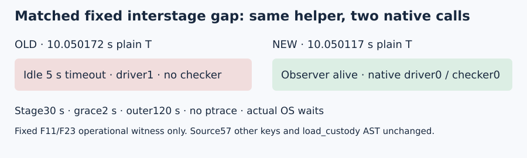

# Accept scoped bounded interstage observer component

DEC-20261105-c4c30c accepts only the operational interstage receive component at source964579a78b488fcfe8040837f5af138b5cd0be3c. The matched fixed OLD/NEW witness used identical helperdb927... and two native calls: OLD plain-T10.050172389s, actual5s idle timeout/native infrastructure_error driver1/checker absent; NEW plain-T10.050116758s, observer alive, native output_validated driver0/checker0, closures and actual OS waits. Stage30/grace2/outer120 and one nonEC instrumentation probe; no retry/science.

Static law: NEW uses the validated finite quiet_timeout for closed-arm receive, instead of OLD5s; fixture allowance30+2+5=37s. _message retains one absolute monotonic frame deadline,1MiB cap and no per-byte resets. Source changes only observer.py986cda118dc688460bc6490a58db7b496e8541530461ef38f447622a630f231a and manifest32b047ce243568f47c64e36c19366bfc5dac28c30b111370650f5c2438af357c; other57keys and load_custody AST3ef529dfc7d6469a8d3bd6b9d6afb448a0132f0a28f0e39cf1c60b643c13815c remain exact. The existing accepted open-stage/framing components are inherited at their original scope, without rerunning their controls.

Each review uses its own literal plan: first8540e006444... INCONCLUSIVE, newfb54da6b02... holds with finalactual attestation and root native independence0. No old result is relabeled. fb whole458.468168510s<600 and pair271.507730738s<420. Implementation355.074s<600/zero controls. Source38archive776.926>600, design875.159>600 and firstreport363.623>360 remain UNMET/unwaived; wrongfirst38receipt retained and correctdeclaredR1a9dc01a/R22dfa8dbf/native20bindings remain authoritative.

The first full48 attempt remains infrastructure_error and carries no paired candidate/BGS measurement. Original max1/no-retry history remains preserved. This technical acceptance establishes no mathematical, novelty, asymptotic, performance or hypothesis/goal-status promotion. Knowledge promotion is not applicable. All PCC results remain UNVERIFIED. Canonical scientific graphs remain unchanged for that reason. Next is a prospective same-EXP/same-public-cohort recovery amendment under native admission and original05:53UTC cap; no scientific launch is approved here.
