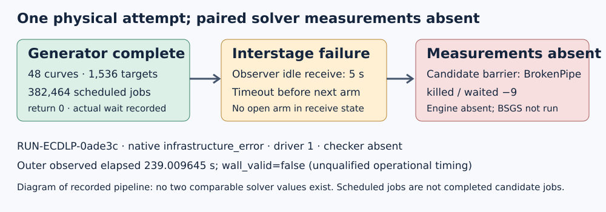

# Full48 generation completed; paired solver measurements absent

EXP-ECDLP-356403 · H-ECDLP-6674c9 · GOAL-ECDLP-e70832 · TASK-20261105-6c94f6

One physical attempt, `RUN-ECDLP-0ade3c`, ended in native `infrastructure_error`: driver 1, checker absent, outer wait returned 3. The generator completed 48 curves,1,536 targets and382,464 scheduled jobs, with return 0 and an actual wait. Candidate observation hit BrokenPipe before engine output; the candidate was killed and waited at −9. The baseline process/measurement is absent. These missing measurements are not zero recoveries.

## Recorded values and missing data

| Item | Recorded observation |
|---|---|
| Requested / output-validated / infrastructure-failed native trials |1 /0 /1|
| Outer observed elapsed |239.00964503300202 seconds; wall_valid=false|
| Benchmark command wall |238.921 seconds; separate recorded command scope, INVALID|
| CPU time / solver timing / counters / aggregate RSS |Not recorded or not qualified|
| Generated public cohort |48 curve entries,1,536 target entries,382,464 scheduled jobs|
| Retained logical raw inventory |31 files;324,636,014 bytes|
| Candidate engine / working BSGS measurements |Absent / not executed|
| Native paired typed export / final checker |Absent / not run|

The observer trace records TimeoutError in the receive loop after the generator closed. With no outstanding arm, the original source selected a5-second receive timeout while adapter postprocessing continued. The subsequent candidate barrier failed. This report describes that operational sequence; it assigns no attack-cost, asymptotic, population or mathematical conclusion.

## Frozen execution provenance

Source publication: `af8a54211bcd6f0503c3d58d159289bff6a023ce`; launch context: `10b03d5572ab8894c323d7ca5f0cd409981da5e7`, recorded clean. Original plan SHA:`e9129522a58411f52177b0a36b13dd9921822291c92ad7aa7ff952767dbe0042`. Original approval DEC-20261105-219419, one-attempt contract retained unchanged.

Native driver command: `["python3", "-B", "harness/classical_ecdlp_controlled_followup_v5/driver.py", "production", "--repo-root", "/workspace/classical-ecdlp-validation-ready", "--out", "/workspace/classical-ecdlp-validation-ready/experiments/EXP-ECDLP-356403/runs/RUN-ECDLP-0ade3c", "--trial-plan", "experiments/EXP-ECDLP-356403/trial-plan.json", "--trial-id", "full48", "--config", "experiments/EXP-ECDLP-356403/production-config.json"]`

Outer command: `/workspace/classical-ecdlp-endpoint-reuse/runtime-20261028/bin/python -B tools/experiment_execution.py run --plan experiments/EXP-ECDLP-356403/trial-plan.json --owner executor-fresh48-356403 --epoch 1`

Original public nonce:`1adc3007efb46362d78934ca534cca91d3ea32043b4cdaa194e8f9d67bf96d1c`; literal266 exclusions and sampler remain in `experiments/EXP-ECDLP-356403/production-config.json`. Stage 3600s/grace 2, child 6 GiB/native 12 GiB and other original limits are provenance, not fit assurance. Host recorded `INTEL(R) XEON(R) PLATINUM 8573C`,5 online CPUs; declared CPU cap4.

Original full schedule:216 setups,345,600 singles,36,864 intents/traces,73,728 cells,8 calibration arms,all6 confirmation cells,64 targets×8 blindings per confirmation curve,1,536 working-BSGS solves. These are planned workload counts, not completed candidate/BSGS work. Existing fixed software controls were inherited; no new A/A, planted or null physical arm ran. No certificate or attack claim was established.

## Custody and interpretation

The original observation sidecar remains byte-exact (`641d91c89c764a4da923e28e0c60c112ea12dc60a09a393d812ad726ee4a58e3`). Raw31 payload identities and native receipt were published before this report in commit `a66d1035b7fa9b8a4b1678e7efaef8dcfde9bed3`; large payload identities use committed storage pointers and root full-GET receipts. PCC-20261105-9149bd remains unverified.

Benchmark records `20261105T0155Z-classical-fresh48-356403` and additive correction `20261105T0212Z-classical-fresh48-356403` describe the SAME physical RUN. Both are INVALID; the correction supplies raw inventory, explicitly measurement_reexecuted=false, physical_attempt_count_across_both_records=1. They do not count as two attempts.

Public cohort SHA:`76c329506086cd8572534b49080f33b7c0725e3245215c0236b503faa2a4b0bc`; canonical job-plan SHA:`91a1730463e6cd8bec8453d6417a384709b240949085a04d0e941612defd5a3a`. A prospective recovery must retain these identities and charge regeneration separately. This report approves no retry, recovery or source change and changes no hypothesis/goal status. The scoped operational next step is separately recorded interstage receive repair/control work; its outcomes are outside this first-attempt report.
