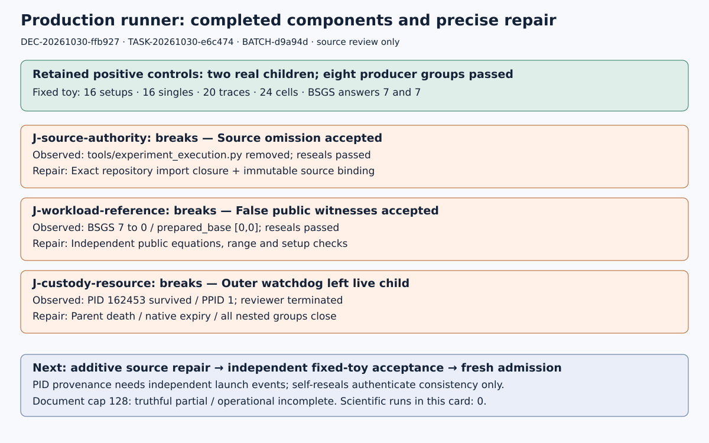

# Production runner: scoped readiness composition

DEC-20261030-ffb927 · 4 November 2026 · TASK-20261030-3621f5 epoch 2  
GOAL-ECDLP-e70832 · H-ECDLP-6674c9 · EXP-ECDLP-787704 · BATCH-d9a94d

The fixed fixture executes two real processes and all eight producer test groups passed. Independent review identifies three concrete production-integrity blockers. The Coordinator decision is **revise**: carry these completed components into a narrow additive production-runner repair. Evidence strength is preliminary, with toy controls and static source analysis; the decision concerns software readiness.

## Observation

Independent reviewer TASK-20261030-e6c474 observed 16 setups, 16 singles, 20 intents, 20 traces and 24 cells on the disclosed F11/F23 fixed input. Both BSGS answers were 7. All eight producer groups replayed successfully. Native complete_manifest rejected approval, task, trial, input-plan hash and environment-source contradictions after same-path untouched positives passed. Missing/cloned arms, duplicate/missing jobs, unknown arms, false typed completion and a false public-equation flag were rejected. The candidate uses the pinned engine without host/reference imports; baseline solving uses public inputs before diagnostic oracle construction. These are real completed software checks.

Five mathematical source hashes match the frozen statement in current composition captures. This composition executes no fixture, scientific cohort, entropy draw or VM. Its current native independence check passed with the actual final read-attestation and frozen review plan. Root's earlier native independence check also passed. This establishes review architecture compliance, independently of whether the reviewed source is ready.

Diagram: retained same-path controls and outer native watchdog observation, not new trials. Evidence: TASK-20261030-e6c474 report.md, source-review.json and checks.json. This is a source-only decision; the visual maps the exact obstruction rather than graphing a new scientific measurement.

## Comparison

| Joint | Retained observation | Required repair |
| --- | --- | --- |
| J-source-authority: breaks | Removing tools/experiment_execution.py from both process source captures and resealing still passed. | Independently reconstruct exact repository import closure; enforce key-set equality and every file byte/hash against immutable native/publication/archive bindings. |
| J-workload-reference: breaks | BSGS scalar 7→0 with true equation flag, and prepared_base→[0,0] with resealed bytes, still passed. | Recompute public curve/subgroup/base/target membership, scalar range/equation and required setup values from independently bound public inputs. |
| J-custody-resource: breaks | Native outer watchdog killed the helper but left new-session candidate PID162453 alive with PPID1/PGID162453. | Close all nested groups on parent death, native expiry, outer watchdog and exceptional exit; preserve independent launch events, closure acknowledgments and partial records. |

Each accepted known-false mutation started from an unmutated positive at the same paths and updated the dependent byte seals. This challenges checker binding; it does not claim that the unmodified child produced false data. The PID-consistent invented-metadata case locates a **trust boundary**: self-consistent integers and reseals authenticate consistency only. An independently retained supervisor/root launch event, immutable archive binding and PID/start/parent/argv/input/source relation are required to support a historical process-identity claim.

The watchdog defect is a direct runtime observation. The reviewer sent SIGTERM to the surviving actual toy child; later ps showed a zombie under PID1. The launch observer missed the child and there is no adopted waitpid acknowledgment. Root's later second ps match was its observer's own shell, not a second proven live child. Preserve these limits.

With document_bytes128, a real fixed candidate completed but the parent document writer failed. Prefix/raw/log bytes remained and no seal/registry/export falsely claimed completion. This is **operational incompleteness**, not automatically a checker defect. A successor must enumerate/archive this partial path without turning it into a mathematical negative.

The inherited EV-ECDLP-78ed38 exact variable-ledger IDs are graded separately: **C-completeness: isolated**, for complete finite mathematical coverage; **C-reference: not_isolated**, for the independently reproduced analytical reference with unresolved original arm/instance representation. The additive same-ID comparison-ids-v2 schema correction adds these exact ID assessments; it does not resolve the seven original export findings. The fixed-fixture **typed-contract: not_isolated** retains the source/public/custody defects above.

## Inference

Freeze a narrow additive production-runner repair preserving all five mathematical pins and original/v2/v3/v4 history. Reject the retained source-omission and resealed public-witness counterexamples after identical-path positives. Include sparse_checkout, artifact_store, fast_yaml and transitive repository imports actually used by native authority/export in an independently reconstructed exact closure. Bind source publication separately from allocated launch context. Preserve all failures, undefined/zero/capped outcomes, raw streams, source before/after and partial framing records.

Exercise deterministic disclosed tiny controls for normal completion, nonzero exit, TERM refusal/escalation, parent exception/death, native expiry and outer watchdog; require complete nested closure evidence and no hidden retry. Archive exact source and every attempt, obtain independent technical acceptance and compose the scoped readiness outcome. This card writes no repair, new task or new admission protocol.

After repair and independent source acceptance, separately freeze and actually admit **three distinct fresh 48-curve solver cohorts**. Preserve original sampling and the exclusion union of 218 earlier identities, all 48 current identities and every earlier new-batch identity. Keep fixed primary circuit2.a1, all six cells, paired original/incremental traces, genuinely separate candidate and BSGS processes, matched public inputs and all complete/partial outcomes. Actual preapproval, approval/archive, ready selection and a current checkpoint precede each draw. The finite packet outline is embedded in observations.json.

Full-cost/counter, qualified clocks and RSS evidence remain separately scoped. Descriptive solver outcomes do not require a performance claim. Any later governed advantage claim requires its matched complete baseline evidence and progress-fidelity record. Keep Goal active and H specified; knowledge_promotion is empty.

## Static counts and resource boundary

The pinned original schedule derives 216 setups, 345,600 singles, 36,864 traces/intents and 73,728 cells; no full-cohort execution is asserted here. Formula arithmetic uses the original cohort.plan's 1,800 singles and 128 calibration traces, omitted from the statement. This is not a new statement-only blinded mathematical derivation.

493,272 logical row slots × 67,108,864-byte reader ceiling = 33,102,923,563,008 conditional logical bytes. The source does not prove that ceiling bounds every emitted row. Configured default physical hard sum excluding observed pipe capacity is 8,611,168,256 bytes. Neither proves current-machine fit. Per-process RLIMIT_AS is not aggregate RSS; ten-millisecond polling is not a filesystem quota. Account for generation, raw streams, source, logs, partials, native supervision and archive/readback copies; assume no compression ratio. A truthful resource stop remains incomplete/unknown.

## Limitations and provenance

The native admitted production-positive route remains unexecuted. Root verified all seven source-review files, 436 embedded tar members, the historical 93-path before/after comparison, all seven editable reviewer sources and both final reviewer-PDF pages at the October 30 snapshot. Review checks are 60,227,672 bytes, SHA256 `93160c692a7e2225aa4707c33901d8fd65795e73a37a714f11bf4a9fe7d8832a`; root's uncached full GET verified them. Review PDF is 58,739 bytes, SHA256 `0ea45bd82022edd410b204df90885f05ed759b6028aa4412f0331034a64b100a`. This composition reads those actual local bytes and verifies the checks SHA; it performs no remote readback.

Source4 publication48b73e0756/releasef233e25c44 is supported by archive R1 `4a7f2fb3858ef9b6b698e22dd35ac797182da004` and direct-child R2 `1757c3634058f4311d1548167bdbd971819c6480`, all 44 bindings and no skips. Review publication245456e1ce/release507b798260 is historical. Current input capture binds merged HEAD `018cd7c1e758e020f3e41339311d525dcfacd28d`; native/docs/registry changes after main merged are not silently assigned historical review coverage. The new endpoint-reuse repair on another path does not fix v4 supervision/source/public guards.

Root's current merge hygiene passed. Full ledger validation reports four named errors in EXP-ECDLP-8dc19d transfer_obligations, EXP-ECDLP-ef7323 transfer_obligations, EXP-ECDLP-f50061 prediction_provenance and RUN-BINSTD-f7ca97 manifest top-level run key. These actual current root checks are captured in observations.json and remain separate from the scoped source verdict.

Earlier reviewer import-path, inherited-limit and cleanup assertion failures remain retained in review checks. Its first helper revisions lacked contemporaneous prelaunch hashes; its orientation reads included truncated displays without persisted live timestamps. This composition also preserves its own corrected missing-file reads and truncated orientation displays without backdated read claims. Full-byte capture establishes source bytes, not semantic reading of every compressed raw payload.

Canonical scientific graphs were checked and left unchanged: EXP-ECDLP-787704 reports/composition/diagram.svg; run-20261030T1722Z study-map.svg, plot-data.json and report.typ; and knowledge/frontiers/ecdlp/README.md. This software-readiness decision changes no scientific quantity or relationship. Their exact current hashes and full captured source bytes are embedded in observations.json. Existing historical reports remain immutable.

Internal primary sources checked: frozen handoff, statement/review plan/input inventory; current v4 driver/check/export/candidate/baseline/cohort adapter/interfaces/resource envelope; all seven reviewer artifacts; source/publication/native-independence/PDF/lifecycle proofs; historical EV/DEC/protocol and exact comparison-ID schema correction; goal, hypothesis and linked production-route problem record. No external novelty or literature claim is introduced; these repository primary sources determine the repair scope.

Requested policy is coordinator-orchestration-code/high, serving model unverified/null. Epoch1 ended at usage limit before scratch files and was abandoned; this is epoch2. Final TASK-20261030-f1dfba archive remains prospective and root-only. The proposed DEC/goal update is reviewable but becomes official only after that exact isolated archive verifies. PR2590 must remain open/unmerged with auto-merge disabled.

## Editable material

[observations.json](../../../../coordination/goals/GOAL-ECDLP-e70832/batches/BATCH-d9a94d/composition/observations.json) embeds complete editable Typst, graph generator and composition scripts with SHA/bytes and extraction instructions; current full-source capsule; source before/after; commands, stdout/stderr, live events; all failures and limits. The large immutable prior source delivery and reviewer raw archive are bound by exact SHA/bytes and existing publication proofs rather than duplicated. The rendered [PDF](report.pdf) contains this scoped decision and the diagram; visual-inspection.json records actual inspection of every final page. Root must also inspect every page before final archive.
