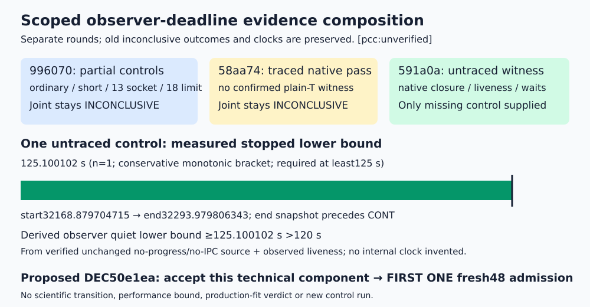

# Observer deadline component accepted within software scope [pcc:unverified]

Proposed DEC-20261104-50e1ea accepts the observer deadline component on source af8a54211bcd6f0503c3d58d159289bff6a023ce. Original independent partial checks plus the fresh untraced long witness meet this technical scope. Root must archive the proposed DEC/goal before the transition becomes official. Goal ACTIVE and hypothesis specified remain unchanged. [pcc:unverified]

## Observation

| Evidence task | Actual result | Own control clock / cap | Owned joint |
|---|---|---|---|
| 996070 | ordinary validated; truthful short expiry;13 socket cases;18 limit checks; long helper failed before STOP |147.382623 /420 s;3 calls | INCONCLUSIVE, unchanged |
| 58aa74 | native output_validated, driver/checker0 and actual waits; ptrace prevented confirmed plain T |256.133724 /300 s;1 call | INCONCLUSIVE, unchanged |
| 591a0a | untraced baseline plain T; observer alive; native validated/checker0; four actual waits0 |228.900092 /420 s;1 call | J-untraced-longquiet holds |

These are separate clocks and unequal control sets. No old review is relabeled as having passed all controls. [pcc:unverified]

591 baseline PID84378/start3216806/parent84372 remained plain T; observer PID84374/start3216487 retained identity/liveness. The65 retained samples and ancestor/control TracerPid0 facts were read from existing raw stat/status/cmdline records. Conservative start32168.879704715 and end32293.979806343 yield125.10010162799881 monotonic seconds. End evidence was taken while still stopped before CONT. Candidate84375, baseline84378, observer84374 and native supervisor84371 were actually waited, return0; native driver/checker0 and output_validated remain scoped software observations. [pcc:unverified]

## Comparison and inference

The measured plain-T lower bound exceeds the required125 s. Observer quiet>120 s is derived from that bound plus the reviewed unchanged sequential no-progress/no-observer-traffic source path and observed liveness; it is not a direct observer-internal clock. The marker proves neither sleep entry nor duration. The stopped baseline cannot finish; driver cannot send closed before its actual wait, and finish follows sequential execution. [pcc:unverified]

The original996070 ordinary/short/framing/limit observations and this new missing long witness jointly support technical component acceptance. Only observer.py and its source-manifest entry changed; current exact59, other57 and accepted load_custody AST are held fixed. Native independence was executed separately against each round's literal078d/ea07/02b881 plan and its own final attestation, all return0; that procedural result alone is not a substantive joint pass. [pcc:unverified]

## Limitation and preserved history

Old996070 helper failure/reparenting and missing helper wait, and58 ptrace/absent plain-T witness remain retained, inconclusive and unwaived. Prior producer198.681973 s exceeded its180 s ceiling; current producer155.92460663300153 s/420 s is separate. 591 whole-task conservative upper bound743.178773 s/1200 s uses earlier root claim UTC because exact dispatch monotonic was not recorded; its control clock is separately228.900092 s/420 s. Sparse samples are not continuous tracing. No aggregate-RSS/hostile-same-UID isolation, performance, production-fit, mathematical, novelty or cost verdict follows. All empirical claims remain PCCunverified. [pcc:unverified]

## Next technical action

After root archives the scoped acceptance, freeze/admit FIRST ONE fresh48 in this genuine session: original48/216 setups/345600 singles/36864 traces/73728 cells/8 arms/all6 cells/64 targets x8 blindings; literal266 exclusions; separately paid generator plus working BSGS and two physical rows. Follow actual native preapproval approvable:true, standing approval archive, ready selector, claim/checkpoint and /run with OUTER benchrec. Other two cohorts remain unfiled for genuine later sessions. No new fit, production-positive or backend prerequisite. This composition created zero EXP/IDEA/draw/nonce and ran zero controls or science. [pcc:unverified]

Canonical scientific graph applicability was checked: docs/reports/classical-ecdlp-endpoint-reuse-20261026/mechanism.svg, non-generic-next/proof-map.svg and knowledge/frontiers/ecdlp/MAP.md remain unchanged because this software-component decision changes no mechanism, mathematical proposition or frontier bound. Their mathematical contents were not revalidated here.

Evidence: BATCH-da4dc5 implementation/report.md; reviews/TASK-20261104-996070, TASK-20261104-58aa74 and TASK-20261105-591a0a source-review.json/checks.json/read-attestation.yaml. Exact hashes, own native commands, parsed raw reading and source snapshots are in composition/observations.json. PCC7c8f32 remains unverified; literal ledger and root-reported standing are qualification, not acceptance proof.

