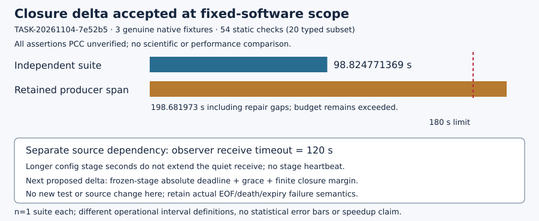

# Finalized closure delta composition — unverified

## Finalized closure delta: scoped acceptance

DEC-20261104-70da18 · TASK-20261104-a6394b · BATCH-27c9d5 · 4 November 2026

All result assertions are PCC unverified; no signed standing. The new finalized-closure checks close the retained false-completion seam within the declared fixed-software boundary. [pcc:unverified]

### Observation

Fresh independent reviewer TASK-20261104-7e52b5 reports J-finalized-closure-reconciliation holds. Three genuine unchanged-native fixtures cover complete, genuine both-nonzero incomplete, and fixed_generator=True with three closures/two physical solver export rows. [pcc:unverified]

All 54 static checks matched expected outcomes, including 20 synthetic typed controls. Original both-failed-to-complete resealing with genuine identical-public raw and held-fixed custody refuses at finalized baseline process SHA; isolated candidate, baseline and generator reseals each refuse at their own closure. Exact same-path positive bytes are restored and accepted. No stale-source/public mismatch is credited. Native genuine failure remains infrastructure_error. [pcc:unverified]

### Comparison

The two-file delta reconciles current process SHA and strictly typed process/current-ack/finalized-wait returncodes plus true observer absence acknowledgment before launch verification and downstream completion. Only observer.py and its manifest entry changed; all other 57 capture members, native/check argv and mathematical pins remain unchanged. [pcc:unverified]

Figure: operational records, seconds, one suite each. Independent single shared absolute 180s suite:98.824771369s; producer elapsed span:198.681973s including gaps. Different interval definitions are shown, not a performance comparison. All quantities and static120s source fact remain unverified. [pcc:unverified]

Producer93.814976s helper execution sum does not repair its continuous180s failure. Both producer helper failures and later byte-reconstruction provenance remain retained. Independent compliance is new evidence, not a retrospective waiver. [pcc:unverified]

## Decision and precise next step

Accept only the finalized-closure delta at F11/F23, r≤29, zero-nonce software scope. Overall production admission is not declared ready. Goal remains ACTIVE; H-ECDLP-6674c9 remains specified. No scientific transition or knowledge promotion. [pcc:unverified]

### Remaining source dependency

Committed observer.py:102 still calls _message(sock,timeout=120) between events, without a heartbeat during stage computation. A longer frozen child seconds limit does not extend that receive. PCC-20261104-b87ced pins this static source fact. No basis supports promising the full original workload within90s or shrinking it to avoid the dependency. [pcc:unverified]

Prospectively change only observer.py plus source-manifest.json: derive an absolute receive/framing deadline from actual frozen stage seconds + termination grace + finite closure margin; keep bounded coordination, EOF/native-parent death fail-closed behavior and current native/source/custody semantics. No unbounded wait or per-byte deadline resets. [pcc:unverified]

A meaningful future control can use existing fixed hang60 plus an outside PID/start-bound SIGSTOP≈65s then SIGCONT, creating a genuine quiet stage beyond120s within a newly sufficient stage/suite budget. Include deadline expiry/peer death and bounded framing refusal. No candidate/native/math edits, old180s reset, new implementation or control run occurs here. [pcc:unverified]

### Scientific continuation

After accepted deadline correction, freeze/admit ONE fresh48 descriptive solver cohort with original sampler, literal266exclusions, all8calibration arms/3job kinds/all6cells, paired original/incremental and64targets×8blindings. Require actual preapproval, approval archive, ready selector, claim/checkpoint and /run via OUTER benchrec. Reserve its native minute-record prefix/progress scope, close/gate before push, register actual metadata before unclaimed result archive. Other two cohorts stay unfiled for genuine later sessions. No cost/clock/backend gate is added. [pcc:unverified]

### Qualification and evidence

Root-custody FILE/source-pinned supervisor/kernel facts are explicit trust boundary; no arbitrary-root authentication, sameUID sandbox or historical PID cryptography. Fixed generator does not establish real production generation-state propagation. Sampled RSS/tree observations do not establish full48fit. [pcc:unverified]

Reviewer pre-suite redirection/FileExistsError and producer two failures are retained. Independence metadata “1 via -B interpreter flag” is descriptive, not a literal environment assignment; argv-B is authoritative. Composition initial combined displays truncated; current recorded byte reads are actual, with no semantic/archive-read or timestamp backdating. Root GET/physical/PDF proofs are supplied identified inputs, not worker remote observations. [pcc:unverified]

Source e74e8e5e245166aa4e077898a574393eda0484d9; review89b57aa2d35d1b319b7378e07f02745c75ecf0a4. Literal planff31ba0533af0a55ba09d84c01dde6da9c58a34a15e236a4d6539d35f146d6e5 plus final attestationef9a0ea… yield actual native independence0. Exact seven hashes and current59sources checked; checks38,943,374B SHAa24eeeb5… is immutably bound, not duplicated. Full exact refs and own scripts/editables/commands are in observations. [pcc:unverified]

Canonical study-map, earlier composition diagram, DEC-d59957 diagram and available frontier SVGs were checked unchanged: software scope only. DEC/goal remain proposals for root finald47063; root handles actual PCC/storage/shared-ledger fullsnapshot registration, publication and isolated archive. No duplicate ledger owner or completed64 edit. PR2590 stays open/unmerged/autooff. [pcc:unverified]
