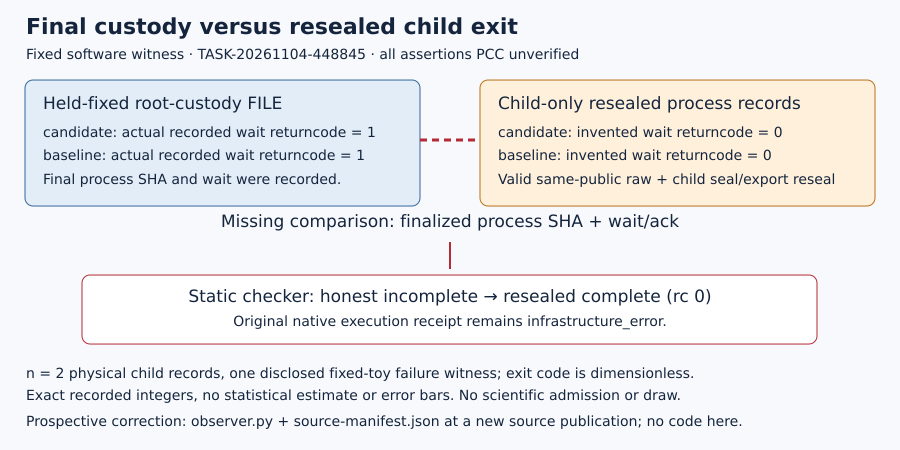

# V5 readiness composition — unverified

DEC-20261104-d59957 · TASK-20261104-b846bb · BATCH-e9f035 · 4 November 2026

The published v5 source/public controls and tested nested cleanup provide completed software components; one retained static-custody counterexample requires a two-file correction before fresh admission. [pcc:unverified]

## Observation

The NEW independent review TASK-20261104-448845 reports J-source-authority holds, J-public-workload holds, and J-custody-lifecycle breaks at final exit reconciliation; cleanup itself holds within tested controls. Its final seven files match their root materialization hashes; literal external plan pin `7603d65f28b31d42fa6f4d249c62542d7e786f2ce61f750f11445f6369df4ed7` and final attestation pass the unchanged native independence check. [pcc:unverified]

The fixed F11/F23 r<=29 positive has 16 setups, 16 singles, 20 traces/intents and 24 cells, two BSGS answers 7 for two targets, and all six cells. Independent static48 counting retains 216 setups, 345,600 singles, 36,864 traces/intents and 73,728 cells. These are source/fixed-software observations, not new scientific cohort results. [pcc:unverified]

29 same-path mutations were refused, including source omission/addition/change, scalar 7→0/8, prepared base invalid [0,0]/valid 2G and forged launch facts. Seven structural controls and seven bounded-child controls retain malformed/partial/nonzero evidence; truthful incomplete output remains accepted. Independent18lifecycle controls report six active watchdog/expiry cases with12 adopted service+selected-worker waits and12 helperfailure/race cases with12 actual worker waits. Earlier six2-second producer failures remain failures, distinct from corrected coverage. [pcc:unverified]

## Comparison

Finalized root custody records candidate and baseline returncodes1 and exact process hashes. The unchanged static checker accepts the honest same-path incomplete record. Holding root custody fixed, child returncodes/acks are resealed to0 and valid raw from the identical public input transplanted: checker rc0 reports complete. `load_custody` checks launch facts but omits comparison with finalized `process_sha256`, `driver_reported_wait` and absence acknowledgment. The original native receipt remains `infrastructure_error`; the witness concerns static replay, not failed-science admission. [pcc:unverified]

Figure: one fixed-toy failure witness, n=2 physical child records; dimensionless exit codes1 versus resealed0, no uncertainty estimate. Root-custody SHA `efb11414c453134309d42e601e032bb0460746da5674f29ff90865e9cefc3f5c`; counterexample SHA `d21c475c40b19e46872b0130fb317f921a3a13719e658056af4b74f5b4260375`. [pcc:unverified]

## Inference and next action

Decision: **revise software readiness**, with no scientific status transition. Preserve goal ACTIVE and H-ECDLP-6674c9 specified; knowledge promotion is not warranted. The exact next repair is prospective observer.py plus refreshed source-manifest.json at a NEW source publication, comparing each expected arm's current process SHA/wait/ack against held-fixed finalized custody. Accept actual nonzero incomplete records. Keep other14core files, exact59keyset, native/check argv, mathematical pins and public sampling unchanged. Preserve old commit/DEL and archive only a separate small new-evidence capsule; no v6 or historical raw duplication. [pcc:unverified]

A host wrapper is not a smaller compatible route: adding its source to the native map violates unchanged observer's exact native/config/59source equality; subprocess delegation also fails actual checker argv equality. No subset/argv workaround is authorized. Existing paths may receive a new prospective source revision; immutable publication/results/receipts retain old bytes. Queue artifact ownership must be separately lawful; no successor card is allocated here. [pcc:unverified]

Rebuild the exact attack under the NEW pinned source/native fixture, first accepting the honest same-path incomplete output, then obtaining genuine valid raw for the same public input and applying the child reseal with custody held fixed. Require rejection at closure processSHA/wait reconciliation. Running a new checker directly on old-source retained evidence would only test source-pin mismatch and is insufficient. [pcc:unverified]

After accepted delta/source archive and independent focused review, freeze and actually admit the first fresh48 descriptive solver cohort under unchanged sampling/all6cells, excluding218prior+48current=266 identities and any earlier new cohorts. Two further desired48cohorts stay unfiled for genuine later bounded sessions under1newEXP/session. Actual preapproval, approval/archive, ready selector, benchrec and checkpoint remain required before /run. Cost/counter/clock qualification is separate from descriptive outcomes. [pcc:unverified]

## Limitations and retained provenance

Composition runs0science/fixtures/draws/newIDEA/EXP/cloud and implements no repair. Actual allocated production admission, full48RSS/disk fit, isolated clocks and counter-advantage remain unestablished. Trusted root/source-pinned observer, kernel facts and held-fixed finalized FILE are the trust boundary; arbitrary replacement of the entire boundary, hostile sameUID isolation and cryptographic history authentication are outside scope. [pcc:unverified]

The review retains the initial sys.path error, exploratory decoding/path errors, queue-diff assertion, first Typst syntax error, producer failed controls and all partials. Root metadata-shape guard failure remains separately retained. Initial composition shell displays lacked instrumented per-read times and some were truncated; later full-byte capture events are actual, and no semantic read or missing timestamp is backdated. Root-supplied fullGET/sourcearchive/physical/PDF receipts are read as identified evidence; this worker makes no remote readback claim. [pcc:unverified]

Source remains774-based; newer fetched main waits for the batch boundary. Five math pins and original host verifier match. Canonical study-map.svg, earlier composition/diagram.svg, prior DECffb927 diagram and available knowledge/frontiers/ecdlp vector sources were checked and remain unchanged: this decision changes software readiness only. No variable-ledger comparison is regraded here; no new mathematical derivation, overall lead verdict or signed PCC standing is asserted. [pcc:unverified]

## Exact inputs and archival boundary

Source publication `cfb10b89cdef32257e681cf915b9b80c5c7b1cc7`; review publication `1fc83815e4ca4ed80935bcbe9a386673774d5c6a`; final review checks165,439,384B SHA `aa4daa1a93e866b3de1215d0bdbbbdc62c14ead1865c1a348d75f45e1c9c992c`; original delivery431,983,729B SHA `d2c10e4ed32740d4173bbc00dd87e4ef9a4b97291e8d8f77cc94703d0965950d`. Root checks all1332review capsule members and current59source bindings; our full-source byte acquisition, sevenhash check and native independence are recorded separately. The large immutable capsules are hash-bound, not duplicated. [pcc:unverified]

Principal records: BATCH-e9f035/reviews/TASK-20261104-448845/{report.md,source-review.json,checks.json,read-attestation.yaml}; archives/TASK-20261104-fcd2f6/receipt.json; composition/observations.json; exact read-only route memo SHA49d2c770aee3695c4aeb1cecc8db4b88ba2f1d5101c28b0c124b8a4cb8771863. Full editable Typst/vector generator and executed helper/commands/logs/failures are losslessly embedded in observations with extraction instructions. [pcc:unverified]

DEC and goal are proposals only inside proposed-ledger.json. Root registers four actual review metadata and any actual composition selections before still-unclaimed finalarchive TASK-20261104-abea09, which runs alone and binds root retirement/journal/reversal/operations proofs. No finalarchive completion is asserted. PR2590 remains open/unmerged/autooff. [pcc:unverified]
