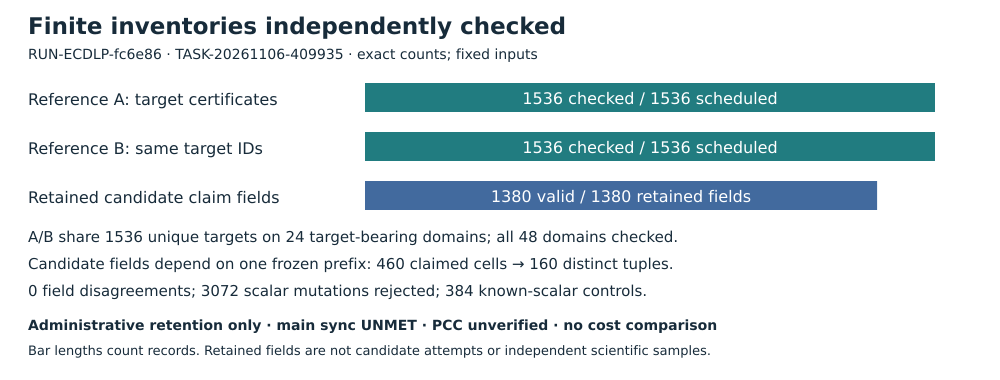

# Finite correctness results retained

DEC-20261106-f6c4b2 · EXP-ECDLP-ca93ac · RUN-ECDLP-fc6e86 · GOAL-ECDLP-e70832

Decision: **administrative synthesis**. The completed finite public-reference certificates and independent J1 result review are retained. No official evidence strength or EV/KN record is assigned; hypothesis and goal status remain unchanged. Current-main synchronization is UNMET, trusted PCC standing is unverified, and official scientific promotion is withheld.

## Observation

One native parent completed `output_validated`. Both fresh A/B processes produced1536 identical canonical certificates on the same1536 targets. All48 domains were checked;24 contain64 targets each. Independent arithmetic checked3072 original equations,3072 mutation rejections and384 known-scalar controls. The producer's23 registered enum positives and54 negatives passed; the independent review checked recorded controls and assessed the source trace-shape cases.

The entire frozen prefix contains36782 traces,73236 cells and3042690 words. Every one of1380 retained RECOVERED claim fields was independently checked as valid, reducing to160 distinct curve/target/scalar tuples across460 claimed cells. There were0 field disagreements. Exact raw SHA, per-record context, status census and wire/logical custody matched.

## Comparison



The graph compares counts with the frozen inventories. It is a finite census conditional on these exact inputs, without a statistical interval. A/B are repeated checks of the same target IDs. The1380 fields are dependent word/scalar/array views; neither these nor160 tuples supplies a candidate recovery-rate denominator. No matched isolated performance measurement was admitted.

## Inference

Independent result review TASK-20261106-409935 J1 holds within the finite scope. Its own affine arithmetic and Montgomery ladder import no producer arithmetic and perform no discrete-log search or backend replay. Native independence returned0 and unified experiment.review check had0 findings. All six final artifacts were published at33bdc4522afe66f1b75e65965d0bfa391eef5691; both Reviewer PDF pages were actually viewed.

Reviewer corrections were disclosed: its first own-checker attempt stopped after the witness/raw loops at a file-vs-canonical protocol hash assertion. It corrected that definition and an explicit-null transform sentinel, then completed the second own-checker pass without changing producer data. Both attempts stayed within the original600s cap; final accounting565.856797s. Memory instrumentation covers the recompute process only.

## Limitation and next action

Root reports remote main311a5de2c0158bf66db2edfb467e1a54dcc29ebf, but two read-only fetches failed with40 then14 unresolved deltas. No main merge occurred. This required promotion gate is UNMET. Trusted PCC standing and independent proof of hard physical resource enforcement/isolation remain unverified. The native output_validated receipt is preserved without widening its meaning.

The old candidate workload remains incomplete. This is an openly post hoc audit of the same fixed cohort and R52 prefix, with no population, recovery-rate, cost, clock, speedup, p^(1/3), exponent, novelty or security conclusion. All original EXP356403 exhausted attempts, format failure and cap deviations remain unchanged. Complete090 exact custody and final checkpoint, then repair repository integrity/synchronize main before official evidence promotion. Any matched isolated cost comparison requires its own prospective packet. PR2590 remains open/unmerged with auto-merge off.

Canonical graph checks: `knowledge/frontiers/ecdlp/README.md` known-results map rules inspected; no bound/frontier/knowledge promotion. The published [run diagram](../run-RUN-ECDLP-fc6e86/diagram.svg) and [independent review diagram](../../reviews/TASK-20261106-409935/diagram.svg) remain unchanged sealed records. No existing scientific graph changes. Earlier [run report](../run-RUN-ECDLP-fc6e86/report.pdf); [independent review](../../reviews/TASK-20261106-409935/report.pdf). Exact file identities are retained in DEC-20261106-f6c4b2.

## Exact editable Typst source

```typst
#set page(paper: "a4", margin: 15mm)
#set text(font: "DejaVu Sans", size: 9pt)
#set par(leading: .45em)
#text(size: 16pt, weight: "bold")[Finite correctness results retained]
#linebreak()
DEC-20261106-f6c4b2 · EXP-ECDLP-ca93ac · RUN-ECDLP-fc6e86
#image("diagram.svg", width: 100%)
*Decision: administrative synthesis.* Retain the completed fixed-input certificates and independent J1 review. No EV/KN record or hypothesis/goal status transition is made. Official promotion remains withheld: current-main synchronization is UNMET and trusted PCC standing is unverified.

*Observation.* The sole native parent is output_validated. Fresh A/B processes each produced1536 identical canonical certificates. Independent affine/Montgomery-ladder arithmetic checked3072 equations,3072 scalar mutations and384 known-scalar controls. Full frozen coverage:36782 traces,73236 cells and3042690 words. All1380 retained fields are valid, representing160 distinct curve/target/scalar tuples in460 claimed cells, with0 field disagreements. The producer's23 positive and54 negative status controls passed; independent review checked the recorded controls and assessed source shape cases.

*Comparison.* A/B repeat the same1536 target IDs; they are not3072 independent instances. Counts compare exact inventories with frozen required inventories. The1380 fields are dependent word/scalar/array views. Neither160 tuples nor retained fields define a candidate recovery-rate denominator. No isolated clock/counter or candidate/reference cost comparison was admitted.

*Inference.* Independent result review TASK-20261106-409935 holds only for complete finite reference correctness and exact R52 retained-prefix classification. Native independence returned0; unified review had0 findings. Reviewer used no producer arithmetic and no solver/backend replay. Its disclosed checker corrections and both attempts were charged to the original600s cap; final accounting565.86s. Only recompute-process memory was measured.

*Limitation and next action.* Two read-only main fetches failed with unresolved deltas; no main merge occurred. Source fe720d01 and all frozen results remain unchanged. Old EXP356403 attempts, format failure and cap deviations are preserved. No performance, exponent, novelty, security, population or PCC promotion follows. Finish native090 custody; repair fetch/integrity and synchronize main before official evidence promotion. Any matched isolated cost comparison requires a separate prospective protocol. PR2590 stays open/unmerged, auto-merge off.

Sources: run report; export check0findings; TASK409 report/checks/review; snapshot TASKff6301. Reviewer publication33bdc452. No EV allocated. Exact identities and scope are in DEC/report.md. Earlier run report: ../run-RUN-ECDLP-fc6e86/report.pdf. Canonical frontier map and sealed run/review diagrams checked and unchanged: no new scientific frontier claim. [pcc:unverified]
```

The SVG is editable source and carries all plotted data as exact labels and proportional record-count bars. PDF rendering and actual page-view attestation are separate root actions before090 archive completion; this text does not assert that they already occurred. [pcc:unverified]
