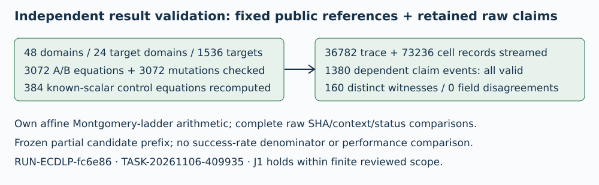

# Independent result review — J1 holds

TASK-20261106-409935 · RUN-ECDLP-fc6e86 · 2026-11-06

Own arithmetic validates the complete1536 publictarget certificates in both fresh passes and every1380 retained dependent candidate claim event. The result is finite correctness evidence for this fixed cohort and raw prefix. No DLP solver, backend/candidate replay, new nonce or cohort was run.

# Independently recomputed observations

48 valid prime-field/subgroup domains;24 target-bearing domains with64 targets each. Both certificate files have identical canonical bytes. All3072 A/B public equations hold; all3072 scalar-plus-one mutations fail. The384 known-scalar controls across both passes were recomputed, including identity cases. Base and target order checks use unreduced scalars.

The complete frozen raw members contain36782 traces and73236 cells. All line offsets, byte lengths, hashes, identity joins and status censuses match the candidate audit. Every explicit RECOVERED word, nonnull scalar (including zero) and recovered_scalars element was separately checked. The1380 actual events are all valid, represent160 distinct curve/target/scalar tuples across460 claimedcells, and yield0 field disagreements. These counts were recomputed from records, not set as success targets.

# Method, controls and custody

The reviewer wrote affine SEC1 addition and a Montgomery ladder using Python modular inversion. It imports no producer arithmetic and performs no discrete-log search. For transformed claims it independently verifies both equations and x=a*k/b modr with canonical nonzero a,b, then compares to independently validated reference scalar.

Actual known-false controls reject F17 k=1 for Q=2G, r+2 aliases, offcurve/noncanonical points, identity base, omitted/duplicate/misjoined certificates and modified scalars. Added null-prime/noncanonical-a/wrong-normalization/null-scalar/zero/omitted-context cases were classified appropriately. Complete script and control outcomes are embedded in checks.json.

25 archivebindings and native receipt artifact hashes were checked. Native candidate audit gzip wire bytes8744025/SHA3a202bee... and decompressed logical bytes155763638/SHA4a62c16f... match exact receipt entries. Source/input/native seals, sequential A/B PIDs/waits, returncodes, protocol canonicalhash and two actual exportrows agree. Published Git identities were supplied, without a Git query; archive fullGET proof is provenance rather than a new reviewer network fetch.

# Limits and reviewer corrections

J1 holds for complete fixed publicreference and exact retained partial R52 claim classification. Two A/B passes share the same1536 targets. Claim fields are dependent, and160 distinct witnesses is not a candidate success-rate denominator. Old candidate workload coverage remains incomplete. PCC standing stays unverified. No timing/counter/native-original-format, algorithmic exponent/performance/novelty/security or official status conclusion follows. Native recorded resources were checked, but hard enforcement, physical memory and isolation are not independently proved by receipts.

The first reviewer checker pass completed its witness/raw loops and then stopped because it incorrectly compared protocol file SHA to canonical protocol hash. The reviewer corrected the hash definition (exclude freeze), and tightened an optional transform sentinel for explicit null values. The second own-checker pass completed. No producer artifact or source was changed. Both attempts are charged to the same original review budget; this was not a backend/solver replay.

# Provenance and review budget

Externally pinned whole producerhandoff SHA256 independently matches:
0c68f9492c054a9a1968e99c0623499b89d55bd9a18d44cbedfa680ece4e089d
Result source supplied:1c1e4fda63dea52ca077cbdbb3eec2dc9f2453b9e; snapshot supplied:57da119e352ae4285e74984488eb105095b6ac49. Full source, input, wire/logical digests and read accounting are in checks.json. Primary arithmetic reference: SEC1v2 §2.2.1, local primary text442-494, retrieved/read and verified by this session before implementation. Same prior source reviewer, independent of result producer, explicitly posthoc; no sibling review read and no model-diversity claim.

Actual claim acquired17:49:09Z (1793987349), fixed stop17:59:09Z (1793987949),600s including recomputation/artifacts/render/view. No extension/reset or scientific run. Final checker used11335 equation calls plus7 added control calls; conservative combined two-pass bound22677 is below500000. Recompute process was capped at4GiB addressspace and recorded peakRSS786320KiB; no aggregate model/tool-host memory claim. Actual final accounting and render/view logs are in checks.json/report.md. experiment.review/v1 replay=false because these are witness checks, not a backend replay. Canonical scientific graphs remain unchanged.



## Exact editable Typst source

```typst
#set page(paper: "a4", margin: 16mm)
#set text(font: "DejaVu Sans", size: 9pt)
#set par(leading: 0.6em)

#text(size: 13pt, weight: "bold", "Independent result review — J1 holds")

#text("TASK-20261106-409935 · RUN-ECDLP-fc6e86 · 2026-11-06\n\nOwn arithmetic validates the complete1536 publictarget certificates in both fresh passes and every1380 retained dependent candidate claim event. The result is finite correctness evidence for this fixed cohort and raw prefix. No DLP solver, backend/candidate replay, new nonce or cohort was run.")

#image("/tmp/independent-reference-result-review-20261106/diagram.svg",width:100%)


#text(size: 13pt, weight: "bold", "Independently recomputed observations")

#text("48 valid prime-field/subgroup domains;24 target-bearing domains with64 targets each. Both certificate files have identical canonical bytes. All3072 A/B public equations hold; all3072 scalar-plus-one mutations fail. The384 known-scalar controls across both passes were recomputed, including identity cases. Base and target order checks use unreduced scalars.\n\nThe complete frozen raw members contain36782 traces and73236 cells. All line offsets, byte lengths, hashes, identity joins and status censuses match the candidate audit. Every explicit RECOVERED word, nonnull scalar (including zero) and recovered_scalars element was separately checked. The1380 actual events are all valid, represent160 distinct curve/target/scalar tuples across460 claimedcells, and yield0 field disagreements. These counts were recomputed from records, not set as success targets.")


#text(size: 13pt, weight: "bold", "Method, controls and custody")

#text("The reviewer wrote affine SEC1 addition and a Montgomery ladder using Python modular inversion. It imports no producer arithmetic and performs no discrete-log search. For transformed claims it independently verifies both equations and x=a*k/b modr with canonical nonzero a,b, then compares to independently validated reference scalar.\n\nActual known-false controls reject F17 k=1 for Q=2G, r+2 aliases, offcurve/noncanonical points, identity base, omitted/duplicate/misjoined certificates and modified scalars. Added null-prime/noncanonical-a/wrong-normalization/null-scalar/zero/omitted-context cases were classified appropriately. Complete script and control outcomes are embedded in checks.json.\n\n25 archivebindings and native receipt artifact hashes were checked. Native candidate audit gzip wire bytes8744025/SHA3a202bee... and decompressed logical bytes155763638/SHA4a62c16f... match exact receipt entries. Source/input/native seals, sequential A/B PIDs/waits, returncodes, protocol canonicalhash and two actual exportrows agree. Published Git identities were supplied, without a Git query; archive fullGET proof is provenance rather than a new reviewer network fetch.")


#pagebreak()

#text(size: 13pt, weight: "bold", "Limits and reviewer corrections")

#text("J1 holds for complete fixed publicreference and exact retained partial R52 claim classification. Two A/B passes share the same1536 targets. Claim fields are dependent, and160 distinct witnesses is not a candidate success-rate denominator. Old candidate workload coverage remains incomplete. PCC standing stays unverified. No timing/counter/native-original-format, algorithmic exponent/performance/novelty/security or official status conclusion follows. Native recorded resources were checked, but hard enforcement, physical memory and isolation are not independently proved by receipts.\n\nThe first reviewer checker pass completed its witness/raw loops and then stopped because it incorrectly compared protocol file SHA to canonical protocol hash. The reviewer corrected the hash definition (exclude freeze), and tightened an optional transform sentinel for explicit null values. The second own-checker pass completed. No producer artifact or source was changed. Both attempts are charged to the same original review budget; this was not a backend/solver replay.")


#text(size: 13pt, weight: "bold", "Provenance and review budget")

#text("Externally pinned whole producerhandoff SHA256 independently matches:\n0c68f9492c054a9a1968e99c0623499b89d55bd9a18d44cbedfa680ece4e089d\nResult source supplied:1c1e4fda63dea52ca077cbdbb3eec2dc9f2453b9e; snapshot supplied:57da119e352ae4285e74984488eb105095b6ac49. Full source, input, wire/logical digests and read accounting are in checks.json. Primary arithmetic reference: SEC1v2 §2.2.1, local primary text442-494, retrieved/read and verified by this session before implementation. Same prior source reviewer, independent of result producer, explicitly posthoc; no sibling review read and no model-diversity claim.\n\nActual claim acquired17:49:09Z (1793987349), fixed stop17:59:09Z (1793987949),600s including recomputation/artifacts/render/view. No extension/reset or scientific run. Final checker used11335 equation calls plus7 added control calls; conservative combined two-pass bound22677 is below500000. Recompute process was capped at4GiB addressspace and recorded peakRSS786320KiB; no aggregate model/tool-host memory claim. Actual final accounting and render/view logs are in checks.json/report.md. experiment.review/v1 replay=false because these are witness checks, not a backend replay. Canonical scientific graphs remain unchanged.")


```

## Actual rendering, controls and final accounting

The single Typst compile succeeded and both PDF pages were rasterized and actually viewed. Diagram, findings, citations and pins are legible with no observed clipping. Standalone experiment.review/v1 JSON schema validation passed. Additional own domain controls rejected composite order, composite field and singular curve; inverse and y=0 branches passed. Native status-control records include23 independently matched positive enum cases,42 matched enum negatives and12 trace-shape records whose complete source cases were assessed in static review. No backend/solver/candidate replay occurred.

```json
{
  "render": {
    "compile_command": "/workspace/classical-ecdlp-endpoint-reuse/runtime-20261028/bin/python -c \"import typst; typst.compile('/tmp/independent-reference-result-review-work-20261106/report.typ',output='/tmp/independent-reference-result-review-20261106/report.pdf',root='/'); print('Typst compile succeeded')\"",
    "compile_attempts": 1,
    "compile_exit_code": 0,
    "compile_stdout": "Typst compile succeeded",
    "pdfinfo_command": "pdfinfo /tmp/independent-reference-result-review-20261106/report.pdf",
    "pdfinfo_result": "Typst0.15.0; PDF1.7; A4;2pages;44193bytes; unencrypted",
    "raster_command": "pdftoppm -r 80 -png /tmp/independent-reference-result-review-20261106/report.pdf /tmp/independent-reference-result-review-work-20261106/page",
    "raster_exit_code": 0,
    "view_tool": "tools.view_image via functions.exec",
    "pages_actually_viewed": [
      1,
      2
    ]
  },
  "budget": {
    "claim_acquired_epoch_seconds": 1793987349,
    "fixed_stop_epoch_seconds": 1793987949,
    "maximum_wall_seconds": 600,
    "maximum_memory_gib": 4,
    "maximum_public_equation_checks": 500000,
    "completed_checker_equation_calls": 11335,
    "additional_control_equation_calls": 7,
    "combined_equation_call_bound_including_first_attempt": 22677,
    "combined_equation_bound_explanation": "First attempt reached the same witness loops before failing the export digest assertion; second passed. Twice the final loop count plus7 conservatively accounts for both own-checker attempts.",
    "extensions": 0,
    "resets": 0,
    "scientific_runs": 0,
    "DLP_or_candidate_replays": 0,
    "new_nonces_or_cohorts": 0,
    "recompute_memory_address_space_capped_bytes": 4294967296,
    "recompute_peak_rss_kib": 786320,
    "whole_review_memory_measurement": "Only recompute process peak measured; no aggregate model/tool-host memory claim.",
    "final_artifact_accounting_epoch_seconds": 1793987914.8567972,
    "elapsed_seconds_at_final_accounting": 565.8567972183228,
    "whole_wall_cap_met": true
  }
}
```
