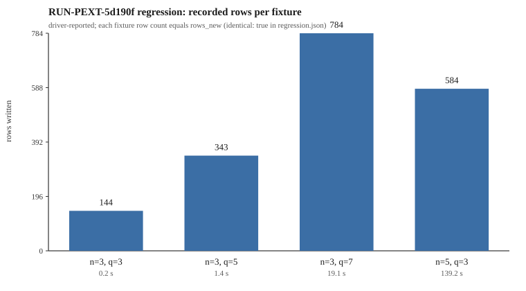

# EXP-PEXT-212d5c run report, 2026-11-06T19:40Z

Executor task `TASK-20261024-672126` (lane `BATCH-21339c`, claim epoch 4, owner
`run-pext-20261106`), dispatched under `DEC-20261106-4f6860`. Frozen trial plan
`experiments/EXP-PEXT-212d5c/trial-plan.json`
(plan sha256 `81b885ae…f233489f`). Launched with:

    python3 tools/experiment_execution.py run --plan experiments/EXP-PEXT-212d5c/trial-plan.json \
      --owner run-pext-20261106 --epoch 4

Host: macOS 27.2 arm64, 14 processors, 48 GB RAM, CPython 3.12.8, rustc 1.93.1,
Lean/elan present. Seed 20261012 (plan defaults), 4 threads.

## What ran

- **regression, `RUN-PEXT-5d190f`**: 19:36:07Z to 19:38:51Z, driver exit 0.
  Supervisor status `invalid_output`, `published: false`. `check.py` was not run.
- construct, char2, census, lean, analyze: **not launched** (they depend on the
  regression trial, or the supervisor stopped at the first refusal).

## Why the supervisor refused the record

    driver manifest run.hypothesis_id='H-PEXT-d536a1' has no source:
    the frozen plan names no hypothesis

`tools/experiment_execution.py` `_check_driver_facts` accepts a driver-written
`hypothesis_id` only when the frozen plan itself carries one
(`SHF-20261106-a114e7` G6). This plan's top-level keys are `approved_by`,
`defaults`, `experiment_id`, `frozen`, `input_sha256`, `queue`, `schema`,
`source_sha256`, `specification`, `specification_sha256`, `task_id`, `trials` —
no `hypothesis_id`, although the specification names `H-PEXT-d536a1`. The trial
itself completed; the envelope was refused after completion.

This is a contract/supervisor mismatch, not a `check.py` result and not a
scientific outcome.

## Driver-reported values (not validated)

From `regression.json` and `raw-result.json`, written by the driver before the
refusal — therefore **not** supervisor-validated and **not** evidence about
`H-PEXT-d536a1`:

- fixture checks: 4 of 4 `identical: true`
  (n=3 q=3, 144 rows, 0.2 s; n=3 q=5, 343 rows, 1.4 s; n=3 q=7, 784 rows,
  19.1 s; n=5 q=3, 584 rows, 139.2 s)
- spectrum checks: 6 of 6 `identical: true`
- driver `pass`: true

## Files

`R-n3-q5.jsonl` (138,537 B), `R-n3-q7.jsonl` (355,662 B) and `R-n5-q3.jsonl`
(265,629 B) exceed the 64 KiB in-git data limit and were moved to the artifact
store `s3://setec-astronomy-artifacts/store`; `.artifacts.json` records:

    R-n3-q5.jsonl  ff6c1d18859714cd7ab8e282f2aca94e1572c831bcb6f077aecaf689f8ae4ee1
    R-n3-q7.jsonl  76318633cb6a291a06914cb6d4ac55814609dfcd3896be18f354956d3823dea7
    R-n5-q3.jsonl  a016741c4789ab8e455af06a52c52d6c75c200fffc469bd92c3dd00910da7ab8

(`R-n3-q3.jsonl`, 41,170 B, is committed with the run directory.)

## Records

Run-record commit `38780928e7` on branch `coord/portfolio-20261106`; claim
`coordination/goals/GOAL-PEXT-4a1d6b/batches/BATCH-21339c/claims/TASK-20261024-672126.4.claim.json`.
The run id `RUN-PEXT-5d190f` is now consumed by this refused directory and the
plan is frozen, so running again needs a versioned amendment (see below).

## Outstanding

Running `EXP-PEXT-212d5c` again needs the frozen plan to carry
`hypothesis_id: H-PEXT-d536a1` (with the resulting plan-hash rebinding) through
a protocol amendment and Coordinator approval, and fresh run ids. The same
defect is present in `EXP-PEXT-0b2c75` and `EXP-SEMBIN-24ec56`; the newer plans
(`EXP-ICPERF-127dbd`, `EXP-SEMBIN-cb5e25`) do carry `hypothesis_id`.

Nothing here is evidence about `H-PEXT-d536a1`; a refused envelope is not a
mathematical result.
