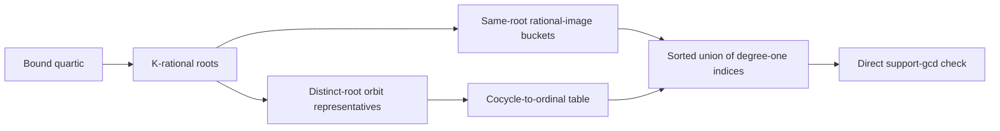

# EXP-PEXT-bf8f96: exact rational-root exceptional indices

The native arithmetic now constructs the **complete degree-one branch-root contribution** to exceptional structure indices for a bound squarefree quotient quartic. It handles simple infinity, shared roots with the same source branch point, and collisions between distinct K-rational branch points. It preserves the repository's left `PGL2(F_q)` coset order and returns sorted, deduplicated structure ordinals. The other branch-root degrees remain a separate generator obligation before the generic complement can be certified.

Two once-per-field indices make the construction reusable across every curve and T block. The cocycle table maps each normalized `N^(-1) sigma^k(N)` to its exact structure ordinal; it checks that all `S=(Q^3-Q)/(q^3-q)` entries are unique. The rational-image table lists every ordinal for which `N(alpha)` lies in `P1(F_q)`, for each `alpha in P1(K)`. Its complete bucket count is `S(q+1)/(Q+1)`. For a distinct ordered pair `(alpha,gamma)`, the generator normalizes the shared nonrational image to a cached `PGL2(F_q)` orbit representative, varies the third projective image over the `Q-1` allowed values, and looks up the resulting `k`-cocycle ordinal. It checks that the resulting count is exactly `(#nonrational orbits)(Q-1)` with no duplicate.

The full fixed F27 join has 819 structures for each of two T blocks. An independent polynomial-basis checker reconstructed the rational branch roots, applied every joined projective matrix, and compared the exact candidate sets. It accepted 273 indices for the block with two K-rational branch roots and zero for the block with none. All 273 are among the full fixture's exceptional support positions. The remaining exceptional positions are six in the first block and one in the second, requiring roots of degree greater than one over K. The checker rejects a deleted or inserted candidate index. Native tests also check full F27 direct-scan equality for same-root buckets, ordered distinct-root pairs, and actual/synthetic quartics. For `q=3,n=5`, the complete `k=2` cocycle table has 597,861 entries, the rational-image table has 2,391,444 entries, each rational-root bucket has 9,801 ordinals, and a distinct-root pair has 2,420 before union. These are software controls, not P1–P4 cohort results.

For the largest geometric field `q=11,n=3`, the design allocates one 1,786,323-entry cocycle table and one 21,435,876-entry rational-image table **per field**, reused across all T blocks. The ordinal payload of the latter is 171,487,008 bytes before vector and hash-table overhead. A measured peak and total CPU cost are still required under the proposed 4 GB and 24 CPU-hour ceilings. The degree-two through degree-four symbolic extension generator, independent completeness replay for all factor patterns, coefficient-aware descent, Type2 controls and prospective execution packet remain open. EXP-PEXT-bf8f96 stays `review_required`; no scientific trial was launched.
