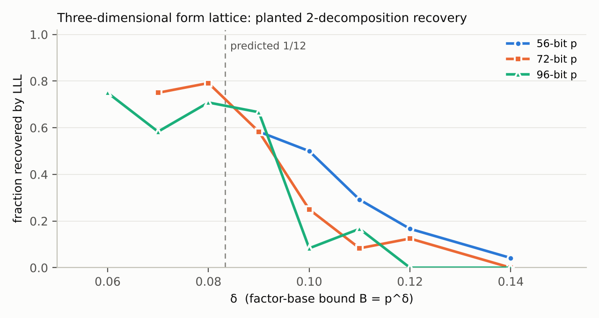

# Alternatives to Semaev summation polynomials for prime-field ECDLP index calculus

**A research map, 18 candidate directions, and a falsifiable experiment program**

Prepared 2026-11-04 for the isogeny-labs ECDLP program. Prior art: the `crypto`, `cryptanalysis` and `crypto-autoresearcher` repositories (lead atlas reviewed 2026-10-30, 170 leads) and a fresh literature sweep (seven delegated sweeps; every citation in the bibliography is tagged verified or unverified).

No attack is claimed. No deployed curve is weakened by anything in this document. Every statement about a speed-up is a prediction with a stated falsifier.

## 0. Executive summary

**The question.** Semaev's summation polynomials S_m turn "R = P_1 + ... + P_m with every P_i in a factor base" into a polynomial system. Over F_{2^n} and F_{q^n} that system becomes low degree after Weil restriction, which is why index calculus works there. Over F_p there is no subfield, every size-B subset of F_p has membership degree B, and the only non-generic handle is that coordinates are integers with a notion of smallness. The user's suspicion is that some formulation other than S_m might open F_p. This document answers that suspicion as sharply as the evidence allows.

**The direct answer.** Five formulations of point decomposition exist in the literature besides plain S_m: the Riemann-Roch / function-space presentation (Diem 2013, Nagao 2010, Joux-Vitse 2012), re-parametrised S_m (chained S_3, homogeneous S_phi, torsion-symmetrised), other curve models (Edwards, Jacobi, Hessian, Montgomery), plane-curve intersection (Diem 2012), and lifting to characteristic 0 or Q_p. Every one of them inherits the same obstruction over F_p: the fibre of "m points sum to R" is a variety of dimension m-1 whose only computable linear structure is the discrete logarithm itself. In this document that obstruction is named the **elliptic Cornacchia problem**: find a point of an elliptic curve E(F_p) inside a box of side p^{1/2}, in time o(p^{1/2}). For conics this is Cornacchia's algorithm and is polynomial time. For genus 1 nothing below exhaustive search is known, and Coppersmith-type lattices reach only side p^{1/6}.

**Two structural observations made here that are not in the repositories or, as far as the sweeps found, in the literature.**

1. In Vieta coordinates (e_1, e_2) = (x_1 + x_2, x_1 x_2) the 2-decomposition polynomial S_3(x_1, x_2, x_R) is a **conic** (total degree 2; verified symbolically in this session: monomials e_1^2, e_1 e_2, e_1, e_2^2, e_2, 1). The genus-1 obstruction reappears only through the integrality constraint e_1^2 - 4 e_2 = (x_1 - x_2)^2 must be a perfect square. So the decomposition problem is exactly "a conic over F_p plus one integer-square condition". This is the cleanest statement of where the hardness sits.
2. A 2-decomposition of R is the same thing as an integral binary quadratic form g(T) = S_3(x_1, x_2, T) in Z[T], of discriminant 16 f(x_1) f(x_2) (verified symbolically), that has x_R as a root modulo p. Decompositions are therefore vectors of a known 3-dimensional lattice L_R (all forms with root x_R mod p) whose leading coefficient is a perfect square and whose discriminant lies in a structured set. This turns point decomposition into a representation problem for binary quadratic forms under Gamma_0(p), a well-developed theory that has never been pointed at ECDLP.

Neither observation is a speed-up. Both are new handles, and both come with a decisive experiment.

**What this document delivers.**

- Section 2: a consolidated closure map (what is closed, by which number, and where) merged from the three repositories and the literature, so no proposal below repeats a closed lead.
- Section 3: the structural diagnosis, the exact target an exponent-changing method must hit (an S_5 small-root oracle at delta ≈ 1/5, or any decomposition oracle with exponent e < m/2 - 1 at arity m ≥ 3), and five "closed on paper in this session" calculations.
- Section 4: eighteen candidate directions, each with mechanism, why it is not already closed, prediction, a frozen experiment, and a success/failure criterion that is a theorem, a certified bound, or a measured exponent with a pre-registered threshold.
- Section 5: an execution plan with model tiers, budgets, ordering, and the shared instruments every experiment must use.
- Section 6: calibration computations run in this session.
- Section 7: bibliography with verification tags.

**Honest forecast.** Of the eighteen directions, the ones most likely to change an exponent are the two theory programs (certified lattice ceiling via capacity theory; a lower bound in the algebraic-coordinate model), because a theorem closes the field for everyone. The ones most likely to produce a *measured* positive result are the solver-technology items (automated Coppersmith with certified bounds, the Gamma_0(p) census), because they settle open questions cheaply. The genuinely exotic items (height-closed Kummer ladders on small-coefficient curves, Heegner/Euler-system free relations, Vieta-conic sieving) are expected to fail at a specific, named step; the experiments are built to show exactly which step.

## 1. Scope, sources and method

**Scope.** Classical algorithms for the discrete logarithm in a prime-order subgroup of E(F_p), p a large prime, E ordinary with generic j (plus the special cases j = 0 and small-coefficient models such as secp256k1 and Curve25519 where a direction is specific to them). Quantum algorithms, pairing-friendly curves, anomalous curves and extension fields F_{p^n} are out of scope except as calibration.

**Sources read in this session.**

- `crypto`: `RESEARCH_PRIME_FIELD_BREAKTHROUGH_PROGRAM.md` (the §1–§4 map, Probes A–C), `RESEARCH_SEMAEV_ROOTFIND_VS_GROEBNER.md`, `RESEARCH_PRIME_FAST_ECDLP.md`, `RESEARCH_FREE_RELATIONS_CENSUS_20261012.md`, `RESEARCH_IC_LEADS_AND_CONNECTIONS_20261010.md`, and a delegated inventory of the ~50 `research/prime_*` directories, the lever-2 reports, the lattice route notes, the prime SAT/SMT program and the boundary ledger.
- `crypto-autoresearcher`: the ECDLP lead atlas (`knowledge/leads/ecdlp/`, 170 leads: 97 open with a next step, 17 blocked, 8 unexamined, 21 closed-obstructed, 15 closed-known, 6 dominated, 6 exhausted at scale), with every ic-prime, exotic, transfer and structure lead tabulated by a delegated agent.
- `cryptanalysis`: a delegated inventory of the prime-field IC rows, the Nagao/Riemann–Roch prototype, the xedni Lean formalisations, the m = 3 CDCL(T) protocol and the known-label thin-coordinate construction.
- Literature: four delegated sweeps (decomposition formulations; lattice/small-root/HNP; structural transfers; algebraic solvers), each returning an annotated bibliography with per-item verification tags. Section 7 keeps those tags.

**Method.** (1) Build the closure map (Section 2) and refuse any proposal that matches a closed lead; every candidate phrase was run through `tools/lead_atlas.py --match`. (2) State the exact arithmetic target an exponent change must meet (Section 3). (3) Generate candidates by varying, one at a time, the four ingredients of index calculus: the *presentation* of the decomposition system, the *notion of smallness* that defines the factor base, the *relation source*, and the *solver*; plus two theory programs whose success is a theorem. (4) For each candidate, write the experiment so that both outcomes are informative and the kill criterion is a number fixed before the run.

**Conventions.** N = #E(F_p) ≈ p, prime. Factor base F of size B = p^delta. Arity m means R is written as a sum of m base points. S_m has degree 2^{m-2} in each variable (Semaev), so S_3 is bidegree (2,2) and S_5 is degree 8 in each of 4 small unknowns. Matched rho means rho with the negation map, charged as in AGENTS.md §5a. "Generic" means any algorithm using only group operations plus membership tests; Shoup/Nechaev give T ≥ √N and Corrigan-Gibbs–Kogan give S·T² ≥ Ω̃(N) with advice S.

## 2. The closure map: what is already settled, and by which number

The table merges the three repositories and the literature. "Deciding number" is the single quantity that would have to move for the row to reopen. Lead ids are from `knowledge/leads/ecdlp/`.

| Direction | Status | Deciding number / reason | Where |
|---|---|---|---|
| Any decomposition oracle that enumerates, subtracts, or looks up (pair tables, k-sum tables, MITM, root-find-then-lookup) | Closed (generic) | S·T² ≥ N; measured S_IC/S_rho 5.5× at 12 bits rising to 13.5× at 23 bits; k = 5 sum tables fit exponent 0.547 vs rho 0.5 | LEAD-ICP-generic-table-decomposition; crypto `prime_ksum_*` |
| "Retained setup / online IC beats rho 13.9×–18.5×" | Dominated | compared against empty-table rho; Bernstein–Lange preprocessing rho with equal advice wins | LEAD-ICP-retained-setup-online |
| Coppersmith / Jochemsz–May on S_3, S_4, S_5 with small-x bases (any convex shift set, extended shifts, symmetric rewriting) | Closed for single-polynomial convex lattices | reach delta* = 1/6, 1/24, 1/80 vs needed 1/2, 1/3 (1/4 to tie), 1/5 (first arity that could beat rho); Probe B/C measured the 1/6 ceiling; strategy-independent bound 1/21.8 (S_4), 1/70.8 (S_5) | crypto §2.2–§3.3; `smallroot_optimal_reach_20261026`; LEAD-ICP-coppersmith-smallroot-semaev |
| Arithmetic of arity with linear algebra included | Calculation | m = 2 never beats √p even with a free oracle; m = 3 ties only with O(1) oracle; m = 4 needs oracle cost ≪ p^{1/4} at B = p^{1/5} | crypto §2.4 |
| Factor base with sub-B algebraic membership (subgroup coset, AP, interval, cubic/Dickson image) | Closed as a count; open only as solving degree | exact census 5,760 instances: 0/1,800 structured bases differ from random; mean closure count is identically C(B+m-1,m)/N | `lever2_exact_count_20261101`; LEAD-ICP-algebraic-membership-factor-base |
| PKM tower / composition-of-low-degree-maps bases (Petit–Kosters–Messeng 2016) | Blocked on compute | F4 solving degree grows with N on every family; d_F ≈ 4 + ⌊(t-2)/4⌋; m = 3, N = 21 died at 99.6 GiB | `RESEARCH_PKM_TOWER_ORACLE.md`; LEAD-ICP-pkm-tower-algebraic-oracle |
| Digit (base-2) presentation of S_m over F_p (Weil-descent analogue) | Closed at measured scale | last fall degree 4 + ⌊s/2⌋ on 106/106 draws is reproduced by a curve-free null on 44/44 | `prime_digit_presentation_20261029` |
| Naive Semaev + Gröbner with base {x < B} | Closed (theorem under statistical assumptions) | Gröbner computation behaves as an extended Euclidean algorithm; cannot beat generic (Yokoyama–Yasuda–Takahashi–Kogure 2020) | KR-IC-401ebf |
| Elliptic nets / EDS as decomposition | Closed (equivalence) | nets ⇔ S_m (Saito et al. 2011); EDS problems subexponential iff ECDLP (Lauter–Stange 2008) | `RESEARCH_EDS_RESIDUE.md`; LEAD-EXO-elliptic-net-eds |
| Curve models (Edwards, Hessian, Montgomery, Kummer, x-only) | Closed as constants | degree-2 coordinates are Möbius frames; only rational 2-torsion descends (×2, ×6 at j = 0); P-256/secp256k1 have none | `RESEARCH_EXOTIC_COORDINATES.md`; LEAD-EXO-curve-model-representation |
| Xedni / global lifting / Mordell–Weil / function-field sections | Closed (conditional theorem + measurement) | JKSST C0/p obstruction; Huang–Kueh–Tan rank barrier; function-field lift density exactly (1-2/p+p^{-3})/(2p^3) | LEAD-TRF-global-lift-small-height; LEAD-ICP-xedni-function-field-sections |
| p-adic / canonical sections / Z/p^k for non-anomalous curves | Closed (theorem) | Hom(E(F_p), F_p^+) = 0 when p ∤ N; the only homomorphic section is the prime-to-p torsion section, killed by the formal log | LEAD-TRF-padic-canonical-section |
| Covers, GHS, Weil descent, genus-g embedding over F_p | Closed | no subfield; Jac(C) index calculus costs Õ(p^{2-2/g}) ≥ p > √p; split-Jacobian gluing inflates the group to p^2 | LEAD-TRF-same-field-genus-g-embedding; LEAD-EXO-split-jacobian-projection |
| Isogeny transfer to a weak neighbour; isogeny-transported bases | Closed (Tate + theorem 4.2) | #E, trace, embedding degree are class invariants; decomposing on E_2 then lifting equals decomposing on E_1 with base φ^{-1}(F_2); crater/floor ratio 0.9998 | LEAD-TRF-prime-field-isogeny-to-weak; `RESEARCH_ISOGENY_FIBERS_ECDLP.md` |
| CM / endomorphism relations beyond √#Aut | Closed | End(G) = Z/N on a prime-order group; 103/103 CM relations are scalars | LEAD-STR-endo-scalar-action-generic; LEAD-STR-p192-class-cm-relations |
| Self-pairings, second torsion direction, MOV | Closed (theorem) | bilinear maps on a cyclic prime-order group are scalar multiples of one map; N ∣ p^k − 1 only at the embedding degree | LEAD-ICP-self-pairing-prime-order; LEAD-TRF-second-torsion-direction |
| Augmented coordinate oracles (x, y, halving, endomorphism image, incidence, net) | Closed (GGM-simulable) | each oracle simulable in O(1)–O(m); x-oracle yield identical to baseline | LEAD-EXO-augmented-oracle-ggm |
| Additive-combinatorial structure of small-x bases | Closed (null) | additive-energy ratio 0.993–1.013 with no growth in log p; coincidence slope CI within ±0.008 | leads C4; `prime_coincidence_harvest_20261029` |
| Free relations by pair-root self-collision | Exhausted | relations exist but homogeneous rank 49/599 at n = 61; rank grows ≈ K^4 | `RESEARCH_FREE_RELATIONS_CENSUS_20261012.md` |
| Extension-field embedding E(F_p) ⊂ E(F_{p^n}) with the subfield base | Open-but-priced | Gaudry costs Õ(p^{2-2/n}) ≥ p | LEAD-ICP-extension-field-embedding |
| Plain SAT/SMT (cvc5 QF_BV, QF_FF) on 20-bit S_3 | Closed for plain encodings | `unknown` at 120 s; native lookup finds the witness in 146 probes; free-quotient carry removes low-bit propagation; LQ-CDCL ≡ Coppersmith | `prime_field_smt_20261005`; `sat_smt_prime_ic_design_20261030` |
| Hashed factor base + Boolean tensor contraction (Akshima et al.) | Open, conditional | 2^{O(b/(log b)^{1/4})} claimed, conditional on a contraction theorem; unaudited | LEAD-EXO-hashed-factor-base-tensor-ecdl |
| Minors / guess-and-determine (Mahalanobis line, arXiv 2607.09814) | Practically closed | authors' own success probability exponentially small; crypto PR #1713 logged it negative vs rho with negation | LEAD-EXO-minors-guess-and-determine |
| ML / RL / transformers | Negative so far | learned WDSat policy worse than default; gradient methods provably fail on DL parity (arXiv 2310.01611) | LEAD-EXO-ml-learned-models |

**What the literature adds that the atlas does not record.** (a) Diem 2013 (Compositio part II) is the Riemann–Roch presentation for elliptic curves and explicitly drops summation polynomials; it still needs F_q-linear subspaces. (b) Yokoyama et al. 2020 is the closest thing to a theorem that naive prime-field Semaev cannot beat generic methods. (c) Kosters–Yeo: deciding whether S_r vanishes on a given input set is NP-complete under an assumption, for any field. (d) Diem 2012 on plane curves: for cubics, lines through two base points are just the group law, so Cayley–Bacharach-style relation collection for genus 1 reduces to Riemann–Roch with small m. (e) The 2023–2026 automated-Coppersmith tools (Meers–Nowakowski 2023; Ryan 2025 `cuso`; Feng et al. CRYPTO 2025 provable asymptotic bounds via sumsets; ePrint 2026/244 Ehrhart correction; ePrint 2026/1027 LP bounds) exist and have not been applied to S_m; the repository's ePrint 2026/1027 retrieval failed (HTTP 403). (f) Chinburg–Hemenway-Falk–Heninger–Scherr 2021 (capacity theory) and Baird–Kerr–Shparlinski 2023 are the only routes to *rigorous* multivariate Coppersmith statements. (g) EC-HNP (Shani 2017; Xu–Sarkar–Wang–Hu 2022) solves the S_3 relation with one shared hidden full-size unknown and many samples, i.e. the opposite regime from decomposition; this is why "many-sample" lattice tricks do not transfer (Section 3.4).

## 3. Structural diagnosis: where a non-Semaev method would have to act

### 3.1 The four ingredients and the one that is stuck

Index calculus on E(F_p) has four ingredients: a factor base F (size B = p^delta), a relation source (random targets R = aP + bQ, or anything else that yields identities among base points), a decomposition oracle (decide and find R = ΣP_i), and linear algebra. Everything measured in the repositories says the oracle is the stuck ingredient: with any generic oracle the whole algorithm is generic (S·T² ≥ N), and with the only known algebraic oracle (small roots of S_{m+1} by lattices) the reach is 1/(m(m+1)2^{m-2}) in the exponent against a need of about 1/m.

The target is arithmetic and exact (crypto §2.4): write the total cost as (m!/2^m)·p·T_dec/B^{m-1} + m·B². Then m = 2 never beats √p; m = 3 ties at best; m = 4 beats rho iff T_dec ≪ p^{1/4} at B ≈ p^{1/5}; m = 5 iff T_dec ≪ p^{1/2} at B ≈ p^{1/6}. In the lead-review cost bridge the same thing reads: oracle exponent e < m/2 − 1 and amortised exponent a < m/2. **Any proposal in Section 4 is judged by whether it can plausibly produce an oracle with e < 1 at m = 4 (or e < 0.5 at m = 3 as the tie milestone), and by nothing else.**

### 3.2 Why every algebraic alternative to S_m inherits the same wall

Fix R and consider the variety V_R = {(P_1,...,P_m) : ΣP_i = R} ≅ E^{m-1}. Every presentation (S_{m+1} in x-coordinates; Riemann–Roch functions in L((m+1)O − (−R)); chained S_3 with auxiliary points; Vieta coordinates; Edwards or Montgomery coordinates; elliptic nets) is a different set of coordinates on V_R or on a finite quotient of it. The factor-base condition "x(P_i) ∈ F" is non-algebraic for F = [1,B] and of degree B for any other F ⊂ F_p. So the oracle must find a point of V_R(F_p) inside a product of boxes. For m = 2, V_R is a genus-1 curve and the box has side p^{1/2}.

**Elliptic Cornacchia problem.** Given E/F_p and a box [1,B]² with B ≈ p^{1/2}, find (x_1, x_2) on the curve C_R : S_3(x_1, x_2, x_R) = 0 in time o(B). For a conic the analogous problem is solved by Cornacchia/Gauss reduction, because a conic has a computable rational parametrisation and the box condition becomes a linear congruence in two small unknowns. For genus 1 the only "linear parametrisation" is i ↦ [i]G, i.e. the discrete logarithm. This is the precise sense in which all algebraic presentations are equivalent: they differ by birational maps that preserve the genus of the fibres, and genus is what blocks the lattice.

Two facts sharpen this, both verified symbolically in this session (Section 6):

- **The Vieta quotient is a conic.** With e_1 = x_1 + x_2, e_2 = x_1 x_2: S_3 = x_R²(e_1² − 4e_2) − 2x_R(e_1 e_2 + a e_1 + 2b) + e_2² − 2a e_2 + a² − 4b e_1. Total degree 2. The swap involution of C_R has four fixed points, so Riemann–Hurwitz forces the quotient to be P^1, consistent. The box becomes (2B, B²) and the lost information is exactly the integer condition e_1² − 4e_2 = u², u = x_1 − x_2 ∈ Z. So: **2-decomposition = conic point in a (√p, p)-box with square discriminant.** Among the ≈ √p conic points with small e_1 only a 1/B fraction have an integer-square discriminant, which is why the genus returns.
- **The binary-quadratic-form picture.** g_{x_1,x_2}(T) := S_3(x_1, x_2, T) ∈ Z[T] has roots x(P_1 + P_2), x(P_1 − P_2) mod p, integer coefficients of size ≈ B^4 (for small a, b), leading coefficient (x_1 − x_2)² and discriminant 16 f(x_1) f(x_2). The lattice L_R = {(c_0, c_1, c_2) : c_0 + c_1 x_R + c_2 x_R² ≡ 0 mod p} has determinant p; its reduced vectors have size p^{1/3}. A decomposition is a vector of L_R of size B^4 with c_2 a perfect square and discriminant in the structured set S = {16 f(x_1) f(x_2)}. LLL finds it when B^4 < p^{1/3}, i.e. delta < 1/12 ≈ 0.083. Section 6 measures recovery falling below one half between delta = 0.09 and 0.10 on 72- and 96-bit primes. Coppersmith's shifts raise this to 1/6 and no convex shift set goes further.

### 3.3 The no-wrap lemma for small-coefficient curves

For curves with small integer coefficients (secp256k1: a = 0, b = 7), S_3(x_1,x_2,x_3) has small integer coefficients. If x_1, x_2, x_3 ≤ B and 4B^4·max(1,|a|,|b|)² < p then S_3 ≡ 0 (mod p) forces S_3 = 0 in Z, which by Semaev's theorem over Q̄ means the three points lie on the global curve y² = x³ + ax + b over Q̄ with ±P_1 ± P_2 ± P_3 = O. Such triples are global relations and are exponentially rare (Northcott plus Mordell–Weil). Consequences: (i) a target with x_R < √p/B has no decomposition over [1,B] except global ones; (ii) all relations index calculus uses are "wrapped", with carry c = S_3/p of size ≈ B²·p (measured 45–62 bits on a 41-bit prime, Section 6), which is why integer-programming or bit-level approaches cannot exploit locality; (iii) the small-x factor base is literally the set of reductions of points of E(Q(√(x³+ax+b))) of small height, so every "small-x" method is a global-lifting method in disguise, and the xedni obstruction is not a separate issue but the same one.

### 3.4 Closed on paper in this session (so they do not reappear as proposals)

1. **Extension-field embedding with a small-x base.** Work in E(F_{p^k}) with base {x ∈ F_p, x ≤ B}. Weil restriction gives k equations over F_p in m small unknowns; solutions exist when B^m ≈ p^k. Cost ≈ p^{2k/m} (linear algebra) must beat p^{1/2}, so m > 4k: k = 2 needs m ≥ 9, and S_{10} has degree 256 per variable. Worse than k = 1 in every cell.
2. **Trace-of-F_{p²} implicit membership.** For T ∈ E(F_p), "T = Tr(S) with x(S) = u + vθ, u, v ≤ B" is a zero-dimensional system over F_p and is decided in O(1). This is a storage-free membership oracle for an implicit set of size B², but it is a membership oracle for a set with no group structure, hence GGM-simulable (LEAD-EXO-augmented-oracle-ggm) and generic: it buys memory, not time.
3. **Many-target lattices with a shared small unknown.** EC-HNP-style systems need every sample to satisfy the equation. "Find P_1 that decomposes targets R_1,...,R_L simultaneously" has a solution with probability (B/p)^L, so the lattice would be solving for a root that does not exist. Many-sample Coppersmith does not transfer to search problems with no hidden input.
4. **Approximate relations with a small-log error term.** "R − ΣP_i = [e]G, e ≤ L" is a membership test in a generic set of size L; with lattice decoding of the error-laden linear system one needs ≥ 2B relations and e ≪ √N, which forces B ≥ √N. Generic.
5. **Hash-to-curve implicit bases.** F = {H(t) : t ≤ p^{1/d}} for a degree-d encoding H has polynomial-time membership by univariate Coppersmith, but decomposition becomes small roots of S_{m+1}(r(t_1),...) with degree multiplied by d, strictly worse (crypto §4.2). Membership alone is generic.

### 3.5 What is left

Only three kinds of thing can change the exponent: (a) a small-root algorithm for genus-1 (and higher) fibres that is not a convex-shift Coppersmith lattice; (b) a relation source that does not go through decomposition of random targets at all, combined with a descent that is itself non-generic; (c) a non-algebraic solver whose measured exponent on the m = 3 or m = 4 oracle problem is below the cost-bridge gate. In Section 4, ideas 1–6 and 18 attack (a) directly. Ideas 5, 9 and 10 attack (b). Ideas 7, 11, 12 and 17 attack (c) or calibrate the solvers. Ideas 8, 13 and 14 aim to prove that (a) is impossible for a stated class, which would be a result in its own right. Ideas 15 and 16 are shared instruments.

## 4. Eighteen candidate directions

Format for each: **Mechanism** · **Why it is not already closed** · **Prediction** · **Experiment** (frozen before the run) · **Criterion** (what counts as success, what kills it) · **Cost and tier** (which model tier runs it under the owner's tiering rule: frontier reasons, Sonnet writes the card, Haiku executes).

The grouping is given at the end of Section 3.5. The summary table follows Idea 18.

### Idea 1. Certified lattice ceilings for every presentation (automated Coppersmith audit)

**Mechanism.** Use the 2023–2026 automated-Coppersmith stack to compute, for each presentation of the decomposition system, the *provable asymptotic* small-root bound of the optimal shift set: `cuso` (Ryan, EUROCRYPT 2025) for Gröbner-based shift selection, the sumset calculator of Feng–Luo–Chen–Pan–Nitaj (CRYPTO 2025) for a provable asymptotic bound, the Ehrhart quasi-polynomial check (ePrint 2026/244) to catch wrong interpolations, and the LP formulation (ePrint 2026/1027) as an independent cross-check. Presentations: (i) S_{m+1} in x-coordinates; (ii) Vieta coordinates with graded box (2B, B², ..., B^m); (iii) the Riemann–Roch "norm" system {coeff_k(N(f)) − e_k ≡ 0} with m−1 full-size α's eliminated inside the lattice and graded small e_k; (iv) chained S_3 with m−2 auxiliary unknowns; (v) 2-torsion-symmetrised S_m on a toy curve with rational 2-torsion; (vi) the integer lift S_3 − c·p = 0 with c as a fourth bounded unknown (Coron integer method).

**Not closed because** the repository's bound (`smallroot_optimal_reach_20261026`) covers x-variable (p,S)^t lattices only; presentations (iii)–(vi) have never been given to an optimal-shift solver, and the repository's own LP is "not a reproduction" of ePrint 2026/1027.

**Prediction.** All six presentations certify to the same asymptotic reach (1/6, 1/24, 1/80 at m = 2, 3, 4), because elimination of full-size unknowns inside a lattice is a resultant and resultants do not shrink Newton polytopes in the relevant direction (Aono et al. optimality).

**Experiment.** For m = 2, 3, 4 and each presentation, run the three bound calculators; then plant instances at 64, 96, 128 bits and run `cuso` + `flatter` at delta = certified bound ± 0.01 to confirm the heuristic matches the certificate (≥ 20 trials per cell, success = recovery of the planted root). Record dimension, wall time, and whether the Ehrhart check flags the interpolation.

**Criterion.** Success: any presentation with certified reach ≥ 1/4 at m = 3 (tie milestone) or ≥ 1/5 at m = 4, confirmed by planted recovery. Kill: all certified bounds within 0.005 of the single-polynomial values. Either way the output is a *certificate*, which promotes LEAD-ICP-coppersmith-smallroot-semaev from "measured" to "proved for the automated-shift class".

**Cost and tier.** 2–4 CPU-days; Sonnet writes the card, Haiku runs; a frontier model reads only the certificates.

### Idea 2. Vieta-conic sieve with the integer-square constraint

**Mechanism.** Section 3.2: 2-decompositions of R are points (e_1, e_2) on the conic Q_R(e_1, e_2) = 0 with e_1 ≤ 2B and e_1² − 4e_2 = u² ∈ Z. Parametrise the conic rationally over F_p (t ↦ (r(t), s(t)), degree 2 each) after a projective change of variables that keeps e_1 as a coordinate. Enumerating conic points with small e_1 is a lattice problem only when the conic is degenerate; in general it costs B. The new element is to sieve the *square condition first*: for each candidate u ≤ 2B (so e_2 = (e_1² − u²)/4), the constraint becomes a univariate quadratic in e_1 modulo p with the small root e_1 ≤ 2B, which univariate Coppersmith solves rigorously for e_1 ≤ p^{1/2}. That is still B lattice calls; the question is whether the B univariate problems share structure (they are translates of one quadratic by u²) so that a *batch* small-root method (May–Ritzenhofen style, or a single lattice over Z[u] treating u as a second small variable) recovers the (e_1, u) pair below B calls.

**Not closed because** no repository or literature item treats the symmetric quotient as a conic or isolates the square condition; the repository's Sym{m} probe only changed the monomial set of the same bivariate lattice.

**Prediction.** The batch lattice over (e_1, u) is a bivariate (2,2)-type problem again (genus 1 returns), so the certified reach will be 1/6 in e_1, i.e. no gain; the sieve-by-u variant will measure exponent 1.0 in B.

**Experiment.** (a) Certify the (e_1, u) bivariate bound with the Idea 1 stack. (b) Implement the u-sieve on 40–64-bit curves with planted decompositions, measure wall time to recovery as a function of B over at least 5 doublings, fit the exponent with a bootstrap CI.

**Criterion.** Success: certified reach > 1/6 in (a), or fitted exponent < 0.9 with CI excluding 1.0 in (b). Kill: both fail. A kill converts the conic observation into a lemma ("the symmetric quotient does not lower the lattice reach") for the lead file.

**Cost and tier.** 1 CPU-day; Sonnet/Haiku.

### Idea 3. Decomposition as a Γ_0(p) representation problem for binary quadratic forms

**Mechanism.** From 3.2: decompositions of R are forms g ∈ L_R (root x_R mod p), with leading coefficient c_2 = (x_1 − x_2)² a square and discriminant D(g) = 16 f(x_1) f(x_2). Forms with a given root mod p and given discriminant Δ form finitely many orbits under the stabiliser of x_R in SL_2(Z), a conjugate of Γ_0(p). "Small" (coefficients ≤ B^4) forms in an orbit are its Γ_0(p)-reduced representatives. So decomposition is: among the Γ_0(p)-reduced forms of discriminants in the structured set S_B = {16 f(x_1) f(x_2) : x_i ≤ B}, find one whose leading coefficient is a square and whose root is x_R. This connects to three computable theories that have never been used here: reduction theory for Γ_0(p) (fundamental domain of width p), representation numbers of the indefinite ternary form D(c) = c_1² − 4c_0c_2 restricted to the lattice L_R, and, for Δ > 0, closed geodesics on X_0(p) (for Δ < 0, Heegner points).

**Not closed because** no lead mentions binary quadratic forms, Γ_0(p) or representation numbers; the lead-atlas match returned only cover and SAT leads.

**Prediction.** The census will show that structured forms are a p^{-o(1)} fraction of the small forms in L_R with square leading coefficient, and that no representation-theoretic enumeration lists them faster than B, because the discriminant set S_B has B² elements with no multiplicative coherence (f(x_1) f(x_2) factor independently).

**Experiment.** Toy primes 2^20–2^32, secp256k1 model y² = x³ + 7. (a) Exact census: for 200 random targets, enumerate all vectors of L_R with |c_i| ≤ B^4, count those with c_2 = □, with D ∈ S_B, with both; compare to the decomposition count. (b) Attempt the enumeration by discriminant: for each Δ ∈ S_B compute the Γ_0(p)-reduced forms with root x_R (2-D lattice reduction per Δ) and count the work; measure whether sieving Δ by a small prime q (D(c) ≡ 16 f(x_1) f(x_2) mod q restricts (x_1, x_2) mod q) reduces the candidate set faster than it costs. (c) Fit the exponent of the best variant in B.

**Criterion.** Success: an enumeration with measured exponent < 1 in B (CI excluding 1) or a representation-count identity that isolates structured forms. Kill: census ratio structured/small-forms-with-square-leading-coefficient decreasing like B^{-c} with c ≥ 1 and no sub-B enumeration. Either way, file the Γ_0(p) correspondence as a known result.

**Cost and tier.** 2 CPU-days; a frontier model designs (b) once because the Γ_0(p) reduction step is subtle; Haiku executes.

### Idea 4. Riemann–Roch norm presentation with graded smallness (Diem II over F_p)

**Mechanism.** For f = g_m + Σ α_j g_j ∈ L((m+1)O − (−R)), the norm N(f)(X) = (X − x_R)·Π(X − x_i) has coefficients quadratic in the α_j. Requiring the x_i small is the same as requiring the elementary symmetric values e_k ≤ C(m,k)B^k. The unknowns are m−1 full-size α's and m graded-small e's, with m equations quadratic in α and linear in e. This is the natural F_p analogue of Diem's part-II presentation, where the "subspace" condition is replaced by graded smallness. The hope is that the graded bounds (B, B², ..., B^m) and the quadratic (not 2^{m-2}-degree) dependence on α give a better Newton polytope to the lattice than the eliminated S_{m+1}.

**Not closed because** the only Riemann–Roch work in the repositories is the binary Nagao prototype (no cost claim) and `prime_one_shot_20261029` (unproved complexity lemma); nothing has fed this system to a lattice.

**Prediction.** Same certified reach as S_{m+1} (Idea 1 prediction), because eliminating α is a resultant; but the *solving degree* of the un-eliminated system under F4/msolve may be lower than that of the digit or tower presentations, which is a separate, cheaper question worth one number.

**Experiment.** (a) Certified lattice bound of the norm system for m = 2, 3, 4 (Idea 1 stack). (b) msolve on the norm system plus the vanishing polynomials of a size-B base for B = 8..64 at m = 2, 3; record the maximal degree reached and compare with the digit presentation's 4 + ⌊s/2⌋ and the PKM tower's d_F.

**Criterion.** Success: certified reach above the single-polynomial value, or a solving degree bounded in B at m = 3. Kill: equal reach and degree growing with B.

**Cost and tier.** 1–2 CPU-days; Sonnet/Haiku.

### Idea 5. Height-closed Kummer ladders on small-coefficient curves

**Mechanism.** Montgomery/Kummer differential addition is curve-independent as a product: x_{P+Q}·x_{P−Q}·(x_P − x_Q)² = (x_P x_Q − 1)² on Montgomery models (and the analogous identity with S_3's constant term on Weierstrass models). On curves with small coefficients (secp256k1, Curve25519) the *sum* x_{P+Q} + x_{P−Q} is also a small-height rational function of x_P, x_Q. Hence if x_P, x_Q, x_{P−Q} are small-height rationals (height h) then x_{P+Q} ∈ F_p has a rational representative of height ≤ h^5, and rational reconstruction returns it exactly as long as h^5 < √p. So the set of small-height abscissae is closed under the ladder step inside a band of log-heights H < L/10. By 3.3 this is the statement that P, Q are reductions of global points over quadratic fields and P + Q is the reduction of their global sum; but the *ladder* form gives something xedni never had: an explicit, factoring-flavoured decomposition criterion. For a target R with x_R = u_R/v_R (rational reconstruction, height √p), "R = P + Q with P, Q, P − Q all of height ≤ h" forces x_R·x_{P−Q} = s² exactly over Q, i.e. u_R and v_R must be, up to cofactors of height h, perfect squares times small-height factors. Divisibility and square-ness of u_R, v_R are checkable by factoring (subexponential) and have a computable density.

**Not closed because** the closest leads (global-lift-small-height, char0-lifting-xedni-smoothness, curve-model-representation) do not use the ladder identity, do not use rational reconstruction of the target, and do not contain the square-divisibility criterion.

**Prediction.** The density of targets whose (u_R, v_R) satisfy the square-divisibility condition for height-h bases is ≈ h^c/√p with c ≤ 3, which is no better than the generic rate (B/p)·B for 3-in-base relations; i.e. the structure is real but the yield is generic. The decisive quantity is the exponent of the yield in h at fixed p.

**Experiment.** Curve y² = x³ + 7 mod p, p ∈ {2^40, 2^48, 2^56}. (a) Verify closure numerically (done in Section 6 for the product identity; extend to the sum and to 2-step chains). (b) For 10^5 random targets per p, rational-reconstruct x_R, factor u_R and v_R (trial division to 2^20 plus ECM), count how many admit (s, x_D) with heights ≤ h for h = p^{0.05..0.25}; then verify each candidate by halving (P = [1/2](R + D), Q = [1/2](R − D)) and record the true 3-in-base relation count. (c) Fit yield exponent in h and in p.

**Criterion.** Success: measured yield per target exceeding the generic 3-in-base rate B³/p² by a factor that grows with p (CI excluding constant). Kill: ratio to generic within [0.8, 1.25] at every p. A kill also closes "ladder-closed bases" for every small-coefficient curve with a stated reason (global points over quadratic fields are independent).

**Cost and tier.** 1 CPU-day; Sonnet/Haiku; a frontier model writes the divisibility lemma.

### Idea 6. Torsion-symmetrised and special-j presentations fed to certified lattices

**Mechanism.** FHJRV 2014 2-torsion symmetrisation and the j = 0 / j = 1728 degenerations (S_3 support 9 or 10 monomials instead of 13) shrink the Newton polytope. The repository has treated these as constants for Gröbner solvers; nobody has computed what they do to the *lattice* reach, which depends on the polytope, not on the monomial count alone.

**Not closed because** LEAD-STR-special-j-ic-semaev and LEAD-ICP-xline-symmetry-special-j are open/unexamined and concern Macaulay ranks, not lattice bounds.

**Prediction.** Polytope shrinkage raises the certified reach by at most a constant factor in the exponent's denominator (e.g. 1/6 → 1/5 at m = 2 for j = 0), never to 1/2; at m = 4 from 1/80 to perhaps 1/60.

**Experiment.** Idea 1 stack on: S_3, S_4, S_5 at j = 0 (a = 0), j = 1728 (b = 0), generic j; and the 2-torsion-symmetrised S_4, S_5 on a curve with rational 2-torsion. Report certified reach per cell.

**Criterion.** Success: any cell with reach ≥ 1/5 at m = 4. Kill: all cells below 1/40 at m = 4. This is the cheapest way to decide whether secp256k1's j = 0 is a lattice-relevant specialness.

**Cost and tier.** < 1 CPU-day; Haiku.

### Idea 7. Mixed Z / F_p systems: the carry as a bounded unknown with branch-and-bound over lattice bases

**Mechanism.** Write S_3(x_1, x_2, x_R) − c·p = 0 over Z with 1 ≤ x_i ≤ B and |c| ≤ C (C ≈ B²p by 3.3). This is a 3-variable integer polynomial feasibility problem. Aardal–Hurkens–Lenstra reformulation (LLL on the kernel lattice, then branch-and-bound in the reduced coordinates) solves bounded *linear* Diophantine systems far below exhaustive search in practice; for quadratics there is no theorem, but modern MINLP solvers (SCIP) with lattice-reduced variable substitutions might show a measured exponent below 1 at toy scale. The repository's SAT design note argues that bit-blasting loses the carry; here the carry is a first-class bounded integer and the solver branches on reduced coordinates, not bits.

**Not closed because** the prime SAT/SMT program never used an integer-programming formulation (lead-atlas match: no hits).

**Prediction.** Exponent 1.0 ± 0.05 in B, because after LLL the reduced coordinates are the Coppersmith coordinates and the branch-and-bound tree size is the number of lattice points in the box.

**Experiment.** SCIP (open source) on planted m = 2 and m = 3 instances, p ∈ {2^28, 2^32, 2^36, 2^40}, B over 5 doublings; three formulations (raw; after LLL on the kernel lattice of the linearised monomials; after Vieta substitution). Fit exponent of node count and wall time in B.

**Criterion.** Success: exponent < 0.85 with CI excluding 1 in any formulation at m = 3. Kill: all exponents ≥ 0.95.

**Cost and tier.** 1 CPU-day; Haiku.

### Idea 8. Capacity-theoretic certification of the lattice ceiling (negative result as deliverable)

**Mechanism.** Chinburg–Hemenway-Falk–Heninger–Scherr (2021) use capacity theory to bound the number of small solutions of two-variable congruences and show when Coppersmith provably fails. Apply it to S_3(x_1, x_2, x_R) ≡ 0 with the box [1,B]²: compute the capacity of the box relative to the curve C_R and derive the largest delta for which *any* method that outputs an auxiliary polynomial vanishing on all box solutions can succeed. This is a statement about every lattice method, convex or not, and would convert the repository's "closed for convex lattices" into "closed for all auxiliary-polynomial methods".

**Not closed because** the repository lists "a capacity/LP converse for the lattice ceiling" as an un-done follow-up.

**Prediction.** The capacity bound equals 1/6 at m = 2 (matching Coppersmith), confirming that the lattice reach is tight for auxiliary-polynomial methods, and extends to 1/24, 1/80.

**Experiment.** A theory task with a numerical check: compute the sectional capacity for the relevant adelic set (archimedean box, p-adic condition on C_R) for m = 2; verify against planted experiments that the predicted threshold matches 0.14–0.16 (heuristic criterion) at 40–56 bits.

**Criterion.** Success: a proved threshold for the class of auxiliary-polynomial methods. There is no "kill"; failure to prove is a null.

**Cost and tier.** Frontier model (Mythos/Fable) for the proof; one week of thinking; negligible compute.

### Idea 9. Heegner points and Euler-system norm relations as a free-relation source (small-conductor models)

**Mechanism.** secp256k1's global model y² = x³ + 7 has conductor supported on {2, 3, 7}, so it is modular with a small modular parametrisation X_0(N_E) → E. Heegner points y_n ∈ E(K[n]) (K imaginary quadratic satisfying the Heegner condition, K[n] the ring class field of conductor n) are computable from CM points on X_0(N_E) in time polynomial in n·h(K)·precision. Kolyvagin's norm relations Tr_{K[nℓ]/K[n]} y_{nℓ} = a_ℓ·y_n (ℓ ∤ nN_E inert in K) are identities in E(K[n]). If p splits completely in K[nℓ], reducing modulo a prime above p turns each norm relation into an exact linear relation in E(F_p) among the ℓ+1 reductions of the conjugates of y_{nℓ} and the reduction of y_n. These are free relations among explicitly constructible points, available only because the curve has a tiny conductor; P-256 (random b) has no such structure.

**Why it is not already closed.** LEAD-STR-level-structure-torsor concerns (E, P) on X_1(N) with N the group order; LEAD-TRF-miller-cocycle concerns Miller functions. Neither uses modularity of E/Q or Heegner points. The literature sweeps found no ECDLP use of Euler systems.

**Prediction.** Three obstructions, in order of appearance: (i) p must split completely in K[nℓ], a condition of probability about 1/(2nℓh(K)) per field, so usable fields are rare; (ii) the relation graph is a tree (conductor n connects only to nℓ), so the homogeneous rank of the relation module is ≤ (number of relations) ≪ (number of points), exactly the failure mode of the free-relation census; (iii) the target descent is generic. Expected verdict: a genuine but rank-deficient free-relation source that cannot replace the relation phase.

**Experiment.** Toy curve y² = x³ + 1 (conductor 36) or y² = x³ + 7 over primes p ≈ 2^20 chosen to split completely in K[n] for small n; compute Heegner points for n ≤ 30 and ℓ ≤ 7 with PARI, reduce, verify each norm relation in E(F_p) exactly, and report (relations, distinct points, homogeneous rank) as in `RESEARCH_FREE_RELATIONS_CENSUS_20261012.md`.

**Criterion.** Success: rank/points ≥ 1/2 and growing with the conductor bound. Kill: rank/points → 0 or no admissible p below 2^28. The verification of even one nontrivial reduced norm relation is a publishable curiosity regardless.

**Cost and tier.** 2 CPU-days with PARI; a frontier model specifies the Heegner computation; Haiku runs it.

### Idea 10. Global-relation harvesting through squarefree-part collisions

**Mechanism.** By 3.3, a small-x base point P with x ≤ B is the reduction of a global point on E/Q̄ defined over K_x = Q(√(x³ + ax + b)). Two base points with the same field (squarefree parts of f(x_1), f(x_2) equal) lie in one Mordell–Weil group E(K) of small rank; if that rank is 1 they are both multiples of one generator and satisfy a global relation [c_1]P̃_1 = [c_2]P̃_2 with small c_i, which reduces to a free relation in E(F_p). The relation is found by 2-descent over K, which is polynomial per field, and it is valid modulo every prime, so it can be harvested once per global curve and reused.

**Why it is not already closed.** The xedni leads lift the curve through chosen points; this harvests relations among the points that already define the factor base and never lifts anything to large height. The lead-atlas match returned no squarefree or Mordell–Weil-collision item.

**Prediction.** The number of pairs x_1 < x_2 ≤ B with equal squarefree part of f(x) is B^{1/2+o(1)} (heuristic: f(x) behaves like a random integer of size B³ whose squarefree part is a random divisor), so the harvest is B^{1/2} relations against the B needed, and it vanishes relative to the relation phase.

**Experiment.** Count collisions of sqf(x³ + 7) for x ≤ B, B = 2^8 … 2^20 (sieve the squarefree part with a factor base of primes ≤ B^{3/2}); fit the exponent. For 20 colliding pairs at B = 2^12, compute E(K) with PARI's `ellrank`, confirm rank 1 and recover (c_1, c_2); reduce mod a 40-bit p and verify the relation in E(F_p).

**Criterion.** Success: collision exponent ≥ 0.9 and verified relations. Kill: exponent ≤ 0.6. Either outcome gives a theorem-grade count to attach to the xedni lead family.

**Cost and tier.** < 1 CPU-day; Haiku.

### Idea 11. Replica/cavity prediction of solving-degree transitions for digit and tower presentations

**Mechanism.** The digit presentation of a prime-field Semaev system (x_i = Σ d_ij 2^j, d_ij² = d_ij) and the PKM/Kummer towers are random-looking constraint satisfaction problems with a tunable constraint density. For random CSPs the cavity method predicts clustering and condensation thresholds that govern when local algorithms and, empirically, Gröbner-type solvers blow up. The repository has measured last fall degrees 4 + ⌊s/2⌋ (digits) and d_F ≈ 4 + ⌊(t−2)/4⌋ (towers) and asks whether the degree stays bounded in N (KN-OPEN-020). A cavity calculation gives a *prediction* for the degree-growth slope from the constraint-to-variable ratio alone, which can then be tested in the three unrun cells (t = 14 cap 6; m = 4, N = 20; m = 3, N = 21) and, more cheaply, in a null family with matched density.

**Why it is not already closed.** The lead atlas has no statistical-physics item; the digit lead was closed by a curve-free null (which is exactly what a cavity prediction formalises) but no one has turned that into a predictor for the unrun tower cells.

**Prediction.** The cavity threshold reproduces the measured slope 1/2 in s for digits and predicts a slope ≥ 1/4 in t for towers, i.e. unbounded degree, closing KN-OPEN-020 without the 112 GiB runs.

**Experiment.** (a) Write the digit system as a factor graph; compute the replica-symmetric and 1RSB thresholds as a function of (m, s); (b) compare with the 106 measured draws; (c) predict d_F for the three unrun cells and for a matched random-CSP null; (d) run the null (cheap) and one of the tower cells if the budget allows.

**Criterion.** Success: prediction within ±1 of the measured degree on ≥ 90% of existing cells and a slope prediction for towers with a stated error. Kill: the predictor is no better than "degree equals the null's degree".

**Cost and tier.** Frontier model for the cavity derivation; Sonnet for the implementation; one CPU-day for the null.

### Idea 12. Learned shift selection and selection strategies with a certified reward

**Mechanism.** Peifer–Stillman–Halpern-Leistner (ICML 2020) learn S-pair selection; Kera et al. (NeurIPS 2024) and HATSolver (ICLR 2026) learn Gröbner bases; Ryan 2025 proves optimal shift selection within the convex framework. Train a policy whose reward is the *certified* asymptotic reach (Idea 1 calculator) of a candidate shift set for S_3/S_4, including non-convex and non-monomial shift families that the LP framework does not search (products with the curve equations, shifts by discriminant factors). The learned search is only a way to explore the non-convex space; the certificate makes any find trustworthy.

**Why it is not already closed.** LEAD-EXO-ml-learned-models covers WDSat branching and dlog-bit learnability, not lattice design.

**Prediction.** No shift family beats the LP optimum (Aono et al. optimality), so the measured best reward equals the Idea 1 certificate within 0.005.

**Experiment.** 2,000 episodes of policy search over shift families for S_3 at delta ∈ [0.14, 0.20] on 48-bit instances with the certificate as reward; report the best certified reach and whether any non-convex family exceeds 1/6.

**Criterion.** Success: certified reach > 1/6 + 0.01. Kill: ≤ 1/6.

**Cost and tier.** 1 GPU-day; Sonnet.

### Idea 13. A lower bound in the lattice-query model (theory program)

**Mechanism.** The repository's open theorem program (LEAD-EXO-low-degree-query-lower-bound) augments the generic group model with degree-D polynomial tests on coordinates. Section 3 says the actual non-generic primitive used by every prime-field attempt is "LLL on a lattice built from coordinates of the queried points". Define the *lattice-query model*: a generic algorithm that may also submit any lattice whose basis entries are polynomials of degree ≤ D in coordinates of points it holds, and receives a reduced basis. Conjecture: with B = p^delta and arity m, such an algorithm finds decompositions at rate no better than the Coppersmith reach, hence T ≥ p^{1/2−o(1)} for every m. A proof would be the first non-generic lower bound that covers every lattice method in the literature; the natural tool is capacity theory (Idea 8) combined with the simulation argument of LEAD-EXO-augmented-oracle-ggm.

**Why it is not already closed.** The existing lead stops at degree-D *tests*; lattice reduction is not a test and is not simulable by a few tests.

**Prediction.** The theorem is provable for D-bounded lattices of dimension polylog(p), with the bound matching Jochemsz–May asymptotically.

**Experiment.** None at first; the deliverable is a written proof or a counterexample. A counterexample would itself be an attack.

**Criterion.** A theorem reviewed by two models and one human, or a counterexample that is a working oracle.

**Cost and tier.** Frontier model; two to four weeks of intermittent work.

### Idea 14. Extending the Yokoyama–Yasuda–Takahashi–Kogure theorem to compositional bases (theory program)

**Mechanism.** Yokoyama et al. (2020) prove, under statistical assumptions on S_m, that Gröbner computation for the naive base {x < B} behaves as an extended Euclidean algorithm and cannot beat generic methods. PKM bases replace the degree-B vanishing polynomial by a composition of low-degree maps; the repository's d_F ≈ 4 + ⌊(t−2)/4⌋ fit suggests the solving degree grows linearly in the tower length. Program: prove that for any factor base cut out by a composition L_t ∘ … ∘ L_1 of maps of degree ≤ q the solving degree of {S_{m+1}, chain equations} grows at least like c·t with c > 0, which (by the repository's slope bar (m−1)/2 in `RESEARCH_ALGEBRAIC_IC_LOWER_BOUND.md`) decides whether towers can ever beat rho.

**Why it is not already closed.** `RESEARCH_ALGEBRAIC_IC_LOWER_BOUND.md` leaves gap A4/H_T (tower solving-degree slope) open; the Yokoyama technique has not been applied to compositions.

**Prediction.** c = 1/4 for Kummer towers (matching the fit) and c ≥ 1/4 for every family, closing LEAD-ICP-pkm-tower-algebraic-oracle without the blocked compute.

**Experiment.** Proof plus a check against the 11 measured medians.

**Criterion.** Theorem with explicit c, or a family with bounded degree (which would be a breakthrough candidate).

**Cost and tier.** Frontier model; negligible compute.

### Idea 15. The m = 4 box problem as the canonical open primitive, with fine-grained relatives

**Mechanism.** Section 3.1 shows m = 2 and m = 3 cannot beat rho regardless of the oracle, so research effort on S_3 small roots cannot change the exponent. The primitive that matters is: *find a point of the 3-fold V_R = {P_1 + P_2 + P_3 + P_4 = R} ⊂ E^3 in a box of side p^{1/5}, in time o(p^{1/4})*. State it in three equivalent forms (x-coordinates with S_5 of degree 8; Riemann–Roch with 3 full-size α's and 4 graded small e's; Vieta with box (4B, 6B², 4B³, B⁴)), prove the equivalences, and connect it to its fine-grained relatives: 4-SUM on a pseudorandom implicit set (LEAD-EXO-ksum-conjecture-s5-oracle) and the points-in-boxes bounds of Chang et al. 2014. The deliverable is a problem statement precise enough that any claimed oracle can be scored on it and any lower bound can be stated against it.

**Why it is not already closed.** The repository names the target ("S_5 oracle at delta ≈ 1/5") but has no written equivalence between presentations and no benchmark instance set.

**Prediction.** Writing the equivalences will show that the Riemann–Roch form has exactly one more full-size unknown than the Vieta form has small ones, which is the reason all lattice reaches coincide.

**Experiment.** Publish a frozen instance set (p ∈ {2^40, 2^56, 2^72, 2^96}, 100 planted instances each, B = p^{1/5}) and the matched-rho reference, so that every Idea 1–8 run reports on the same instances.

**Criterion.** Adoption: every later oracle result cites the instance set. No kill.

**Cost and tier.** Sonnet; one day.

### Idea 16. Positive-control calibration of every oracle solver on degenerate (Cornacchia-solvable) fibres

**Mechanism.** The repository's instrument-calibration rule (natural weak classes as positive controls) has no analogue for the oracle problem. Construct planted families where the box problem *is* solvable in polynomial time, so that a solver pipeline that fails to show a sub-B exponent on them is known to be miscalibrated: (i) the degenerate conic case (Q_R reducible, i.e. the swap-quotient splits), (ii) targets R = [2]P_1 (x_1 = x_2, where the fibre degenerates to the doubling map and univariate Coppersmith applies), (iii) anomalous-curve toy instances where Smart's lift gives logs and hence decompositions for free. Run every solver of Ideas 1, 2, 7, 12 on these controls before any production run.

**Why it is not already closed.** LEAD-EXO-weak-class-instrument-calibration calibrates DLP solvers, not decomposition oracles.

**Prediction.** All solvers show exponent ≤ 0.5 on the controls; any solver that does not is excluded from production comparisons.

**Experiment and criterion.** Exponent on controls must be below 0.6 with CI excluding 1; otherwise the solver's production numbers are flagged "uncalibrated".

**Cost and tier.** Haiku; half a day.

### Idea 17. Function-field mirror: run the whole program where the answer is known

**Mechanism.** The F_p small-x base is the number-field twin of the F_{q^n} low-degree base: F_{q^n} ≅ F_q[t]/(π) with deg π = n, and "x has degree < n/m" is the exact analogue of "x < p^{1/m}". In the function-field twin, decomposition is known to be easy (Gaudry/Diem/FPPR), polynomial lattices reduce exactly (Mulders–Storjohann; no rounding loss), and "small" is an F_q-linear subspace because the degree norm is ultrametric (no carries). Running Ideas 1, 2, 4 and 7 on both twins with matched parameters isolates the single quantity the archimedean case loses. The hypothesis is that it is the carry: in the function field the Coppersmith-type reach for S_{m+1} is exactly 1/m (the existence threshold), and in F_p it is 1/(m(m+1)2^{m-2}).

**Why it is not already closed.** No item in the repositories or the literature runs the same lattice and solver pipeline on both twins. The binary work is all Weil descent plus Gröbner, never polynomial-lattice small roots.

**Prediction.** Function-field reach equals the existence threshold at m = 2, 3, 4. F_p reach equals the Jochemsz–May value. The difference factors through a single "carry loss" term that can be computed from the Newton polytope.

**Experiment.** F_q[t]/(π) with q = 2, 3, 5 and n = 40..96, against F_p with p of the same bit size. Plant m = 2, 3 decompositions with bound n/m in degree (function field) or p^{1/m} (prime field). Run polynomial-lattice reduction (weak Popov form) against integer LLL on the same shift sets. Record the success threshold per cell.

**Criterion.** Success means a quantitative carry-loss law that predicts the F_p threshold from the function-field one within 0.01 in delta. That law tells any future proposal exactly which term it must remove. The run is killed if the function-field reach is also below 1/m, because then the lattice method is not the right lens even where decomposition is easy. That result alone would redirect the program toward Weil-descent-like linear structure and away from lattices.

**Cost and tier.** 2 CPU-days; Sonnet writes the polynomial-lattice code; Haiku runs.

### Idea 18. Determinant-method oracle (Bombieri–Pila / Heath-Brown, p-adic version)

**Mechanism.** The determinant method is the main auxiliary-polynomial technique outside lattice reduction. All points of a curve of degree d inside a box of side B lie on a small number of auxiliary curves of bounded degree. The auxiliary polynomials come from vanishing determinants of monomial evaluations, and the p-adic variant (Heath-Brown; Chang–Cilleruelo–Garaev–Hernández–Shparlinski–Zumalacárregui for small boxes mod p) handles congruences. Applied to C_R : S_3(x_1, x_2, x_R) ≡ 0, it produces auxiliary curves through every box point. Intersecting them with C_R yields candidates without enumerating the box. Its guarantees are counting bounds, not LLL heuristics. So it either reaches past 1/6 with a proof, or shows that the 1/6 wall is common to all auxiliary-polynomial methods (and confirms Idea 8 numerically).

**Why it is not already closed.** The repositories cite the box bounds only as counts of points. Nobody has used the determinant method as an algorithm for decomposition.

**Prediction.** It is nontrivial only for B ≪ p^{1/(2d)} or so, at or below the Coppersmith reach, because its auxiliary curves are found by the same kind of linear algebra over monomials.

**Experiment.** Implement the p-adic determinant step for S_3 at 40–64 bits. Find all box points for planted instances at delta = 0.05..0.20 and record the threshold and the number of auxiliary curves. Compare with the Probe B/C table.

**Criterion.** Success means a provable threshold above 1/6. The run is killed if the threshold is at or below 1/6. The kill becomes the empirical companion of Idea 8.

**Cost and tier.** 1 CPU-day plus a frontier-model derivation of the auxiliary-polynomial degree choice.

### 4.1 Summary table

| # | Direction | Attacks | Expected outcome | Decisive number | Cost |
|---|---|---|---|---|---|
| 1 | Certified lattice ceilings, six presentations | oracle | same reach everywhere | certified delta* per presentation | 2–4 CPU-d |
| 2 | Vieta-conic sieve + square condition | oracle | exponent 1.0 | exponent in B | 1 CPU-d |
| 3 | Γ_0(p) forms / representation numbers | oracle | structured forms not enumerable sub-B | census ratio, exponent | 2 CPU-d |
| 4 | Riemann–Roch norm presentation | oracle | same reach; maybe lower solving degree | reach; max degree vs B | 1–2 CPU-d |
| 5 | Height-closed Kummer ladders | oracle / relations | generic yield | yield ratio vs B³/p² | 1 CPU-d |
| 6 | Torsion-symmetrised / special-j lattices | oracle | constant gain only | reach at m = 4 | < 1 CPU-d |
| 7 | Mixed Z/F_p integer programming | solver | exponent 1.0 | node-count exponent | 1 CPU-d |
| 8 | Capacity-theory certificate | theory | theorem at 1/6, 1/24, 1/80 | proof | frontier, 1 wk |
| 9 | Heegner / Euler-system free relations | relations | rank-deficient | rank/points | 2 CPU-d |
| 10 | Squarefree-part global relations | relations | B^{1/2} harvest | collision exponent | < 1 CPU-d |
| 11 | Replica/cavity degree prediction | solver / theory | slope ≥ 1/4 for towers | predicted vs measured d_F | frontier + 1 CPU-d |
| 12 | Learned shift families, certified reward | solver | equals LP optimum | best certified reach | 1 GPU-d |
| 13 | Lattice-query lower bound | theory | theorem | proof | frontier, weeks |
| 14 | Yokoyama theorem for compositional bases | theory | slope c ≥ 1/4 | proof | frontier |
| 15 | m = 4 box problem instance set | method | adopted | — | 1 d |
| 16 | Positive-control calibration | method | solvers pass | control exponent | 0.5 d |
| 17 | Function-field mirror | calibration | carry-loss law | delta gap between twins | 2 CPU-d |
| 18 | Determinant-method oracle | oracle | threshold ≤ 1/6 | provable threshold | 1 CPU-d |

Five further directions were examined and closed on paper in Section 3.4 (extension-field small-x embedding; trace-of-F_{p²} implicit membership; shared-unknown many-target lattices; approximate relations with small-log error; hash-to-curve implicit bases).

## 5. Execution plan

### 5.1 Ordering

The order puts cheap, decisive runs first and spends frontier-model time only where a proof is the deliverable.

1. **Week 1: shared instruments.** Freeze the Idea 15 instance set and its matched-rho references. Run the Idea 16 positive controls. Install `cuso`, `flatter`, msolve and SCIP in one pinned image. Nothing in the production runs starts until every solver passes the controls.
2. **Week 1–2: lattice audit.** Run Idea 1 (six presentations), Idea 6 (special j and torsion) and Idea 4 (Riemann–Roch norm system). Together they settle whether any presentation moves the certified reach. One batch of Sonnet-written cards, executed by Haiku.
3. **Week 2: the two new handles.** Run Idea 2 (Vieta-conic sieve) and Idea 3 (Γ_0(p) census). They are the only directions that exist because of this document's observations, so they get their decisive numbers early.
4. **Week 2–3: relation sources.** Run Idea 10 (squarefree collisions, cheap), then Idea 5 (Kummer ladders) and Idea 9 (Heegner relations, only if Idea 10 shows any global-relation yield worth chasing).
5. **Week 3: solvers.** Run Idea 7 (integer programming), Idea 17 (function-field mirror) and Idea 18 (determinant method). Idea 12 (learned shifts) runs only if Idea 1 shows any gap between presentations for a learner to exploit.
6. **Continuous: theory.** Ideas 8, 13, 14 and the cavity half of Idea 11 run on frontier models in parallel. Each produces a written argument that a second model and a human review before it enters the lead atlas.

### 5.2 Rules every run follows

These are the owner's repository rules, restated as they apply here.

- Each idea maps to an existing lead or gets a new lead file in `knowledge/leads/ecdlp/` in the README schema. Ideas 2, 3, 5, 9, 10, 11, 13, 17 and 18 need new files. The others advance the `next_action` of the lead named in their text.
- Predictions and kill thresholds are frozen in a pre-registration file before the run. Section 4's criteria are the starting text.
- Every timed comparison prices unpriced work at 0, 0.1 and 1 GAE per operation and ranks arms only where the order holds across the band (AGENTS.md §5a).
- Every result is cited by its proof-carrying-claim id and standing. A run that cannot produce a replay certificate is reported as unvalidated.
- Each run leaves a report, a graph and a PDF (research-visuals skill). Benchmarks also leave a `bench.record/v1` record.

### 5.3 Budget

| Tier | Work | Estimate |
|---|---|---|
| Haiku executors | Ideas 1, 2, 4, 6, 7, 10, 15, 16 runs | about 10 CPU-days |
| Sonnet directors | cards for every run; Idea 12 and 17 code | about 20 cards |
| Frontier (Opus/Fable/Mythos) | Ideas 3 and 5 design; Ideas 8, 11, 13, 14 proofs; final assessment | 4 theory tracks |
| GPU | Idea 12 only | 1 GPU-day |

### 5.4 What a "win" looks like, stated once

An exponent change requires either a certified lattice or auxiliary-polynomial reach of at least 1/5 at m = 4, or a measured oracle exponent e < 1 at m = 4 (e < 0.5 at m = 3 for a tie). It must be confirmed on the frozen instance set against matched rho. Anything short of that is a constant-factor result. Constant-factor results still count under the owner's iterative-improvement rule, but they are not the breakthrough the question asks about. A proved negative from Ideas 8, 13 or 14 is the other kind of win: it closes a class of methods for everyone.

## 6. Calibration computed in this session

All scripts are small Python programs (sympy and fpylll). They ran in this session and sit next to this report. These are sanity checks for the statements in Section 3, not results for the lead atlas. They carry no replay certificate and should be read as unverified assertions until re-run under the repository's validation gate.

### 6.1 Symbolic identities

- **S_3 in Vieta coordinates is a conic.** Write x_2 = e_1 − x_1 and reduce S_3 modulo x_1² − e_1 x_1 + e_2. The remainder has degree 0 in x_1, as it must for a symmetric polynomial. It equals x_R²(e_1² − 4e_2) − 2x_R(e_1 e_2 + a e_1 + 2b) + e_2² − 2a e_2 + a² − 4b e_1, with total degree 2 in (e_1, e_2) and monomials e_1², e_1e_2, e_1, e_2², e_2, 1 (script `sym2.py`).
- **The discriminant in the third variable is 16 f(x_1) f(x_2),** with f(t) = t³ + at + b (script `calib.py`, sympy `discriminant`).

### 6.2 Size of the integer carry for small-coefficient curves

The curve is y² = x³ + 7 over the 41-bit prime nextprime(2^40). The table plants R = P_1 + P_2 with x_1, x_2 ≤ B. For each case it checks that both x(P_1 ± P_2) are roots of S_3(x_1, x_2, T) mod p and that the Vieta product matches. It also records the bit length of the integer carry S_3(x_1, x_2, x_R)/p and of the largest coefficient of S_3(x_1, x_2, T). The carry is about B²·p, the size Section 3.3 predicts, so locality-based integer methods have no small carry to work with.

| B | x₁ | x₂ | carry bits | coefficient bits | roots check | Vieta check |
|---|---|---|---|---|---|---|
| 16 | 3 | 14 | 45 | 11 | pass | pass |
| 64 | 49 | 5 | 51 | 16 | pass | pass |
| 256 | 66 | 31 | 46 | 22 | pass | pass |
| 1024 | 780 | 461 | 56 | 37 | pass | pass |
| 4096 | 1935 | 1555 | 56 | 44 | pass | pass |
| 16384 | 12923 | 3440 | 62 | 51 | pass | pass |

### 6.3 The three-dimensional form lattice L_R

For each planted 2-decomposition the script builds the lattice of integer quadratics c_0 + c_1 T + c_2 T² that vanish at x_R mod p (determinant p) and runs LLL. Success means one reduced basis vector equals ± the coefficient vector of S_3(x_1, x_2, T). Section 3.2 predicts recovery while B⁴ < p^{1/3}, that is δ < 1/12 ≈ 0.083. The measured threshold, where recovery falls below one half, lies between δ = 0.09 and 0.10 at 72 and 96 bits. That matches the prediction up to the usual LLL slack. Below threshold, recovery is not 100% because LLL sometimes returns a shorter combination of the target with another vector of the same size. The repository's level-1 Coppersmith lattice (Probe B, dimension 9) reaches about δ = 0.12 by adding shifts, and level 3 reaches about 0.14. So the 3-dimensional lattice is the bottom rung of the same ladder, consistent with Section 3.2.

| p bits | δ | B | recovered |
|---|---|---|---|
| 40 | 0.14 | 48 | 5/24 |
| 56 | 0.09 | 32 | 14/24 |
| 56 | 0.10 | 48 | 12/24 |
| 56 | 0.11 | 71 | 7/24 |
| 56 | 0.12 | 105 | 4/24 |
| 56 | 0.14 | 229 | 1/24 |
| 72 | 0.07 | 32 | 18/24 |
| 72 | 0.08 | 54 | 19/24 |
| 72 | 0.09 | 89 | 14/24 |
| 72 | 0.10 | 147 | 6/24 |
| 72 | 0.11 | 242 | 2/24 |
| 72 | 0.12 | 398 | 3/24 |
| 72 | 0.14 | 1082 | 0/24 |
| 96 | 0.06 | 54 | 18/24 |
| 96 | 0.07 | 105 | 14/24 |
| 96 | 0.08 | 205 | 17/24 |
| 96 | 0.09 | 398 | 16/24 |
| 96 | 0.10 | 776 | 2/24 |
| 96 | 0.11 | 1509 | 4/24 |
| 96 | 0.12 | 2936 | 0/24 |
| 96 | 0.14 | 11113 | 0/24 |

Rows with B < 32 were skipped. That is why the 40-bit prime appears only at δ = 0.14.

## 7. Bibliography

**Tags.** [V] means a literature sweep in this session checked the item against an ePrint, arXiv, publisher or dblp record, or the full text. [U] means it is cited from memory or only partly checked, and needs checking before external use. Repository paths are relative to the named repository.

### 7.1 Decomposition formulations

- I. Semaev. Summation polynomials and the discrete logarithm problem on elliptic curves. ePrint 2004/031. [V]
- P. Gaudry. Index calculus for abelian varieties of small dimension and the ECDLP. J. Symbolic Comput. 44 (2009). ePrint 2004/073. [V]
- C. Diem. On the discrete logarithm problem in elliptic curves. Compositio Math. 147 (2011) 75–104. [V, full text]
- C. Diem. On the discrete logarithm problem in elliptic curves II. Algebra & Number Theory 7 (2013) 1281–1323. Riemann–Roch presentation without summation polynomials. [V, full text]
- C. Diem. On the discrete logarithm problem for plane curves. J. Théor. Nombres Bordeaux 24 (2012). [V]
- K. Nagao. Decomposition attack for the Jacobian of a hyperelliptic curve over an extension field. ANTS-IX, LNCS 6197 (2010). [V]
- A. Joux, V. Vitse. Cover and decomposition index calculus on elliptic curves made practical. EUROCRYPT 2012. [V, full text]
- A. Joux, V. Vitse. Elliptic curve discrete logarithm problem over small degree extension fields. J. Cryptology 26 (2013). [V, full text]
- J.-C. Faugère, P. Gaudry, L. Huot, G. Renault. Using symmetries in the index calculus for elliptic curves discrete logarithm. J. Cryptology 27 (2014). ePrint 2012/199. [V]
- J.-C. Faugère, L. Huot, A. Joux, G. Renault, V. Vitse. Symmetrized summation polynomials. EUROCRYPT 2014. [V]
- S. Galbraith, S. Gebregiyorgis. Summation polynomial algorithms for elliptic curves in characteristic two. INDOCRYPT 2014. ePrint 2014/806. [V; venue U]
- C.-M. Cheng, K. Kodera, A. Miyaji. Differences among summation polynomials over various forms of elliptic curves. IEICE Trans. E102-A (2019). [V]
- T. Saito, S. Yokoyama, T. Kobayashi, G. Yamamoto. Some relations between Semaev's summation polynomials and Stange's elliptic nets. J. Math-for-Industry 3 (2011). [V]
- K. Lauter, K. Stange. The ECDLP and equivalent hard problems for elliptic divisibility sequences. SAC 2008. [V]

### 7.2 Prime-field index calculus

- C. Petit, M. Kosters, A. Messeng. Algebraic approaches for the ECDLP over prime fields. PKC 2016. [V, full text]
- A. Amadori, F. Pintore, M. Sala. On the discrete logarithm problem for prime-field elliptic curves. Finite Fields Appl. 51 (2018). ePrint 2017/609. [V]
- M. Kudo, Y. Yokota, Y. Takahashi, M. Yasuda. Acceleration of index calculus for solving ECDLP over prime fields and its limitation. CANS 2018. [V; contents U]
- K. Yokoyama, M. Yasuda, Y. Takahashi, J. Kogure. Complexity bounds on Semaev's naive index calculus method for ECDLP. J. Math. Cryptol. 14 (2020). [V; field setting U]
- G. McGuire, D. Mueller. A new index calculus algorithm for the ECDLP and summation polynomial evaluation. ePrint 2017/1262. [V]
- I. Semaev. New algorithm for the discrete logarithm problem on elliptic curves. ePrint 2015/310, arXiv:1504.01175. Binary fields; says the large-prime case is unclear. [V, full text]
- M. Kosters, S. L. Yeo. Notes on summation polynomials. arXiv:1503.08001. [V]
- M.-D. Huang, M. Kosters, S. L. Yeo. Last fall degree, HFE, and Weil descent attacks on ECDLP. CRYPTO 2015. [V]
- S. Galbraith, P. Gaudry. Recent progress on the elliptic curve discrete logarithm problem. Des. Codes Cryptogr. 78 (2016). [V metadata]

### 7.3 Lattices and small roots

- D. Coppersmith. Small solutions to polynomial equations, and low exponent RSA vulnerabilities. J. Cryptology 10 (1997). [U]
- E. Jochemsz, A. May. A strategy for finding roots of multivariate polynomials with new applications in attacking RSA variants. ASIACRYPT 2006. [V]
- A. Bauer, A. Joux. Toward a rigorous variation of Coppersmith's algorithm on three variables. EUROCRYPT 2007. [V]
- Y. Aono, M. Agrawal, T. Satoh, O. Watanabe. On the optimality of lattices for the Coppersmith technique. ACISP 2012; AAECC 2018. [V]
- T. Chinburg, B. Hemenway Falk, N. Heninger, Z. Scherr. Two variable polynomial congruences and capacity theory. arXiv:2111.14180. [V]
- T. Baird, B. Kerr, I. Shparlinski. Bohr sets generated by polynomials and Coppersmith's method in many variables. arXiv:2310.20342. [V]
- K. Ryan, N. Heninger. Fast practical lattice reduction through iterated compression (flatter). CRYPTO 2023. [V]
- J. Meers, J. Nowakowski. Solving the hidden number problem for CSIDH and CSURF via automated Coppersmith. ASIACRYPT 2023. [V]
- K. Ryan. Solving multivariate Coppersmith problems with known moduli (cuso). EUROCRYPT 2025. ePrint 2024/1577. [V]
- Y. Feng, et al. Computing asymptotic bounds for small roots in Coppersmith's method via sumset theory. CRYPTO 2025. ePrint 2024/1330. [V]
- Feng, Gao, Hu, Nitaj, Pan, Zheng. Revisit unravelled linearization with Ehrhart (quasi-)polynomial. ePrint 2026/244. [V abstract]
- Ding, Dai, Wu, Zhang, Zhang. Computing asymptotic bounds for the automated Coppersmith method via linear programming. ePrint 2026/1027. [V abstract]
- B. Shani. On the bit security of elliptic curve Diffie–Hellman. PKC 2017. [V, full thesis]
- J. Xu, S. Sarkar, H. Wang, L. Hu. Improving bounds on elliptic curve hidden number problem for ECDH key exchange. ASIACRYPT 2022. [V abstract]
- D. Boneh, S. Halevi, N. Howgrave-Graham. The modular inversion hidden number problem. ASIACRYPT 2001. [V]

### 7.4 Points in boxes, character sums, additive structure

- D. Kohel, I. Shparlinski. On exponential sums and group generators for elliptic curves over finite fields. ANTS-IV (2000). [V]
- M.-C. Chang, J. Cilleruelo, M. Garaev, J. Hernández, I. Shparlinski, A. Zumalacárregui. Points on curves in small boxes and applications. Michigan Math. J. 63 (2014). arXiv:1111.1543. [V]
- E. Bombieri, J. Pila. The number of integral points on arcs and ovals. Duke Math. J. 59 (1989). [U]
- D. R. Heath-Brown. The density of rational points on curves and surfaces. Ann. of Math. 155 (2002). [U]
- I. Shparlinski. On the elliptic curve analogue of the sum-product problem. Finite Fields Appl. 14 (2008). [V]
- S. Choi. Additive rigidity for x-coordinates of rational points on elliptic curves. arXiv:2510.03828. [V]

### 7.5 Lifting, p-adic, transfers, generic bounds

- J. Silverman. The xedni calculus and the elliptic curve discrete logarithm problem. Des. Codes Cryptogr. 20 (2000). [U]
- M. Jacobson, N. Koblitz, J. Silverman, A. Stein, E. Teske. Analysis of the xedni calculus attack. Des. Codes Cryptogr. 20 (2000). [V]
- J. Silverman, J. Suzuki. Elliptic curve discrete logarithms and the index calculus. ASIACRYPT 1998. [V]
- M.-D. Huang, K. L. Kueh, K.-S. Tan. Lifting elliptic curves and solving the ECDLP. ANTS-IV (2000). [V]
- Q. Cheng, M.-D. Huang. Partial lifting and the elliptic curve discrete logarithm problem. Algorithmica 46 (2006). [V]
- J. Silverman. Lifting and elliptic curve discrete logarithms. SAC 2008. [V]
- N. Smart; T. Satoh, K. Araki; I. Semaev (1998–1999). Anomalous-curve attacks. [U]
- D. Jao, S. D. Miller, R. Venkatesan. Do all elliptic curves of the same order have the same difficulty of discrete log? ASIACRYPT 2005. [V]
- P. Gaudry, E. Thomé, N. Thériault, C. Diem. A double large prime variation for small genus hyperelliptic index calculus. Math. Comp. 76 (2007). [V]
- V. Shoup. Lower bounds for discrete logarithms and related problems. EUROCRYPT 1997. [U]
- H. Corrigan-Gibbs, D. Kogan. The discrete-logarithm problem with preprocessing. EUROCRYPT 2018. [V]
- D. Boneh, R. Lipton. Algorithms for black-box fields and their application to cryptography. CRYPTO 1996. [U]

### 7.6 Solvers and learning

- J. Berthomieu, C. Eder, M. Safey El Din. msolve. ISSAC 2021. [V]
- J.-C. Faugère, J. Svartz. Gröbner bases of ideals invariant under a commutative group. ISSAC 2013. [V]
- M. Trimoska, S. Ionica, G. Dequen. A SAT-based approach for index calculus on binary elliptic curves. AFRICACRYPT 2020. [V]
- D. Peifer, M. Stillman, D. Halpern-Leistner. Learning selection strategies in Buchberger's algorithm. ICML 2020. [V]
- H. Kera, et al. Learning to compute Gröbner bases. NeurIPS 2024. [V]
- K. Aardal, C. Hurkens, A. Lenstra. Solving a system of linear Diophantine equations with lower and upper bounds on the variables. Math. Oper. Res. 25 (2000). [U]
- B. Gross, D. Zagier. Heegner points and derivatives of L-series. Invent. Math. 84 (1986); V. Kolyvagin, Euler systems (1990). Background for Idea 9. [U]

### 7.7 Repository sources

- crypto: `RESEARCH_PRIME_FIELD_BREAKTHROUGH_PROGRAM.md`; `RESEARCH_SEMAEV_ROOTFIND_VS_GROEBNER.md`; `RESEARCH_FREE_RELATIONS_CENSUS_20261012.md`; `RESEARCH_IC_LEADS_AND_CONNECTIONS_20261010.md`; `research/lever2_closure_20261031/`; `research/lever2_exact_count_20261101/`; `research/prime_digit_presentation_20261029/`; `research/notes/index-calculus/RESEARCH_PKM_TOWER_ORACLE.md`; `research/notes/ecdlp-general/RESEARCH_ALGEBRAIC_IC_LOWER_BOUND.md`; `research/notes/ecdlp-general/RESEARCH_LATTICE_ECDLP_ROUTES.md`; `research/sat_smt_prime_ic_design_20261030/`; `research/prime_ic_lead_review_20261031/`.
- crypto-autoresearcher: `knowledge/leads/ecdlp/` (lead atlas) and `tools/lead_atlas.py`.
- cryptanalysis: `suite/docs/ECDLP_ATTACK_MATRIX.md`; `experiments/prime-field-m3-cdclt-20261031/`; `experiments/xedni-lattice-obstruction-20261028/`; `ecc2k130/runner/codegen/nagaodecomp.py`; `research/handbook-ff-ic-ideas-20261103/`.
