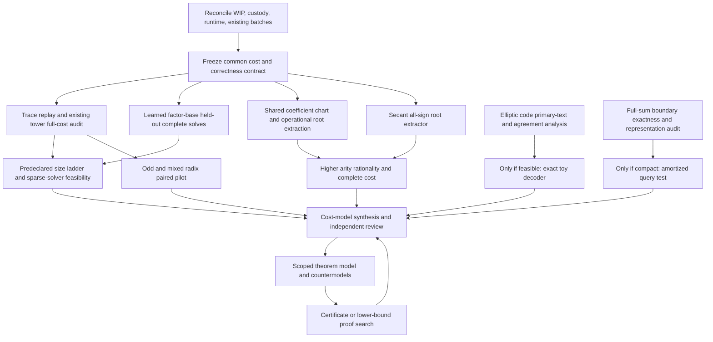

# A decision program for the outstanding index-calculus leads

Prepared 2026-11-05 from `crypto-autoresearcher` commit `5440a26b36693841b89fc803baf73d4061df4826`, the current lead atlas, and the source reports cited below. **This is a coordinator proposal, not an admitted DEC, TASK, experiment, or scientific result. No science was launched, no official status was changed, and none of these claims has new PCC standing.** Source claims without independently checked custody remain [pcc:unverified].

The useful question is whether a lead changes the complete cost of solving the discrete logarithm, and then whether that improvement survives growth. A smaller polynomial, fewer F4 operations, a lower first-fall degree, or an easier verification problem is evidence about a component. Each becomes index-calculus evidence only after relation discovery, usable rank, and the rest of the solve have been charged. Failure of one formulation does not establish impossibility for summation polynomials.

## What to do first

Use the existing program rather than opening ten new experiments. The existing goals are active: `GOAL-ICPERF-e6b6a4` (complete performance boundary; `RQ-ICPERF-94c86e`), `GOAL-PFDR-fd09e0` (degree versus yield on the same factor base; `RQ-PFDR-ae2fba`), `GOAL-SDEG-001` (certificate-backed solving-degree scaling; `RQ-SDEG-001`), and `GOAL-ICEX-001` (charged index-calculus cost versus rho; `RQ-ICEX-001`). Reuse these bindings. The proposal does not create another goal or redefine their official state.

The first two critical experimental slots, once validly admitted, should answer:

1. **Can an existing apparent improvement survive an honest complete-cost comparison?** Finish the existing prime-field trace-replay/graded-tower study, with cold and amortized costs, saved roots, signs and group verification, and a matched rho arm. This is the shortest route from a reported component gain to a decision. Keep radix changes separate from trace changes in a factorial comparison.
2. **Does learning a factor base improve held-out complete solves?** Freeze the existing selector and its training cost, then compare on new seeds/curves and a short size ladder. Include the strongest current published binary PDP reference. This is the cleanest existing candidate for a measurable practical gain.

Only after one of these slots resolves should a new shared-coefficient/secant solver occupy a critical experiment slot. In parallel, desk/proof preparation can resolve the elliptic-code received-word question and define a rigorous restricted obstruction theorem. Those activities do not authorize extra experimental launches. The coordinator contract defaults to two active critical experiments, three only with a documented reason; the current session's design-record limit permits at most one new ECC experiment. Existing queued work and open batches must be reconciled before assigning either slot.

This ranking values decision speed and existing evidence, not novelty alone. **The most structurally distinctive unresolved computational lead is the shared-coefficient/higher-arity function-first route, followed by an operational secant root extractor and an exact reusable full-sum boundary representation.** They change what gets solved. Odd/mixed radix changes the presentation of an existing route; it deserves a bounded test but presently has less evidence of a new exponent mechanism. Elliptic-code decoding has a cheap, important mathematical feasibility gate before it merits computation.

## Admission and custody gates

Current known blockers are the excess autoresearcher WIP (eight open auto PRs against cap two in the parent assessment), absent checkpoint-upload credentials, and absent dollar/resource headroom for new remote work. Re-run the actual WIP checker before any expansion; this proposal does not establish the final current count. Reviewing, correcting, archiving, and merging already admitted work are the immediate permitted means of clearing the queue. Do not manufacture a WIP exception or alter scientific statuses to clear it.

Before a scientific launch, the coordinator must resolve the actual runtime/model and record honest provenance, inspect existing goal/batch ownership, admit an exact bounded task contract, reserve independent review, establish artifact/checkpoint custody, and demonstrate resources within the current policy. Adapter resolution is not evidence that the selected backend ran: the parent reports a coordinator resolution to `anthropic:claude-opus-5-5` with unverified model standing, while this proposal was prepared by an inherited collaboration agent. No authority or verified model identity is asserted here.

The older proposed m=4, N=20 F4 cells require approximately 240–380 GB; some m=3 cells need about 130 GB. These exceed current isolated limits and cannot simply be submitted because an old protocol mentions them. A sparse engine, externally reviewed revised design, or lawful resource allocation is necessary. A reduced cell may supply a pilot, but cannot be reported as completion of the frozen larger cell. Missing raw runs on an owner's machine must be recovered or rerun with custody, not copied as measured facts from prose.

## One common measurement contract

Every prospective arm uses the same curve, subgroup, factor-base cardinality, target distribution, seed plan, stopping rule, and success definition as its comparison. Field size and subgroup order are separate fields. Record the exact factor-base rule, point signs, exceptional charts, multiplicities, and membership certificates. Include SAT and UNSAT targets in the frozen distribution and report them separately as well as pooled.

Charge `setup + training + construction/rejections + compilation/trace learning + all target queries + root extraction + rational lifts/sign handling + deduplication + relation verification + rank/repair + linear algebra + individual descent/reconstruction`. Record wall time, peak memory, operation counts under a stated model, and total cloud cost. Show single-target cold cost and, when meaningful, a declared multi-target amortization schedule including reusable storage. Rejected graphs, unlucky traces, restarts, and unsuccessful relation attempts count.

Primary outcome: cost to a verified discrete logarithm, or a rigorously labeled lower bound if the complete solve does not finish. Secondary outcomes: verified independent relations per unit work; rank growth versus raw relation count; query solve/root cost; degree/matrix dimensions; base construction and memory. A saved witness that is cheap to check is not an operational root finder. An observed relation is not automatically an independent usable row.

Freeze the primary metric and comparison before collecting confirmatory rows. For a paired gain, use held-out matched seeds and uncertainty over independent curves/instances, not over internal solver counters. Keep development and confirmatory sets distinct. Expansion requires a predeclared meaningful gain or a slope-relevant signal; choose the threshold and precision from an actual pilot's variance before admission, not after seeing favorable rows. A fitted exponent on a short ladder is a finite-range estimate with uncertainty and model sensitivity, not an asymptotic theorem.

At each gate report **positive / negative / inconclusive**. Negative ends the tested continuation and states its exact scope. Inconclusive records why (censoring, missing custody, insufficient power, resource failure); it neither closes a mathematical lead nor silently becomes positive. Stop resources at the task cap. All gates require a reproducible bundle and an independent claim-tier review before scope expansion.

## Dependency graph

These are dependencies, not permission to activate all leaves simultaneously. The cost/proof definitions can be drafted now; experiments wait for admission.

## Concrete track contracts

### COST/TRACE — existing trace replay, complete cost, then scale

**Bindings:** `GOAL-ICPERF-e6b6a4`, `GOAL-SDEG-001`, then `GOAL-ICEX-001`; existing prime trace study `crypto/research/curve25519_ic_atlas_20261104/REPORT.md`. Related engine lead `LEAD-ICE-boolean-f4-f5-f6-engines` is already closed/dominated on its binary scope and must not be casually reopened by a different prime toy component result.

**Existing signal:** reported F4 trace replay counted cost ratio 0.4742 at one weighting, wall ratio about 0.95, with the best complete arm still roughly 1.83e4 times rho. A corrected k=16..24 fit near 1.0315 is a finite-ladder observation. This supports an engineering question, not an index-calculus exponent claim.

**Next exact scope:** reproduce the checked existing cell and same-target cold/replay roots; learn a trace on development targets, freeze it, and apply to unseen targets. Log trace validity, pivot/cancellation changes, fallbacks and all relearning. Pair native cold F4, replay F4, same-base external strongest viable solver, and matched rho. Separate trace reuse from weighted grading/radix. Charge field operations consistently across architectures; past XOR charging errors changed rankings.

**Gate:** complete group-valid outputs must agree, including UNSAT/exception handling, before comparison. If replay retains a complete-cost gain on held-out targets, scale the existing arm at three or more predeclared increasing sizes with unchanged scientific semantics and instrument density, fill-in, degree, memory and rank. If gains disappear once setup/fallbacks count, retain the scoped engine result and stop that continuation. If the large cell exceeds resources, report censoring and propose a sparse engine task with an explicit equivalence test; no guessed completed timing.

### LEARN — factor-base learning and complete-cost gains

**Bindings:** `GOAL-ICPERF-e6b6a4`, `GOAL-ICEX-001`; reuse existing learned-factor-base and P8d coset-selection records rather than inventing an unbound ML idea. The current published comparator is `ml-cryptanalysis/experiments/published-ic-reference-arm/README.md`: the November 2 m=3,l=4 WDSat run is reported about 70–75x faster than the lab MXL arm. Old statements that no published reference exists are stale.

**Existing signal:** some l=3 complete-cost gains and P8d mid-band gains, but the ordinary binary l=4/n=19 complete-DLP comparison does not establish a clear gain: the reported log2(hand/ridge) interval includes zero. A positive relation-stage label can coexist with a worse complete solve.

**Next exact scope:** freeze the existing selector and all hyperparameters before held-out curves/seeds. Train against usable rank gained per total solve work, with any proxy justified; report training/search separately and amortized only under a declared deployment count. Compare learned, hand/legacy, uniform same-size, and current strongest published solver under paired instances. Ensure base labels/logs cost the same way. Do not train on held-out rho outcomes or select among many arms after inspection.

**Gate:** gain with a useful confidence bound in complete work plus stable rank accumulation permits the next l/n rung. A relation-yield gain without complete gain triggers one identified bottleneck repair, not an exponent claim. No held-out gain ends that selector's continuation; a noisy result requires bounded additional sampling justified by precision, not a new selector until the first decision is resolved.

### SHARED/HIGHER ARITY — function-first shared coefficients

**Bindings:** `GOAL-PFDR-fd09e0`, `LEAD-ICP-shared-coefficient-membership`, existing `IDEA-20261029-3d0e71`, `IDEA-20261030-a62c58`, `DEC-20261031-b51282`, `DEC-20261101-26f1fa`. Existing development oracle: `cryptanalysis/experiments/prime-field-m3-cdclt-20261031/PROTOCOL.md`; the hardened m3 screen is described as unrun. Do not inherit an unadmitted one-hot s=15..27 continuation.

**Next exact scope:** certify the correspondence for `A²−B²f=(X−r)U` including every chart, then an operational natural solver/root extractor. At arity three and four compare shared quotient/Graeffe, per-root PKM and symmetric encodings on the same base. Require enough distinct usable x-values for the intended census (at least five for the cited k=3/4 charts); include empty squarefree k=2, repeated-root and chart-boundary controls separately. At higher arity enforce rational roots and actual signed subgroup points; geometric factorization alone is insufficient.

**Gate:** on toy cells independently enumerate the exact relation set and compare with discovered outputs. Then charge natural solving rather than supplying roots. With the *specific* balanced model p≈2^(m s), setup≈2^(a s) and Θ(2^s) queries costing≈2^(e s) each, necessary strict subrho gates are `a < m/2` and `e < m/2−1`; for m=3 these are a<1.5 and e<0.5. These gates are conditional on the model, yield and linear algebra and do not prove success. m=2 cannot improve the exponent under this model. Failed chart equivalence ends the representation as stated; operational failure or growth above the gate ends the tested solver continuation, not every shared-coefficient algorithm.

### SECANT — second representations, graph bases and all-sign extraction

**Bindings:** `GOAL-PFDR-fd09e0`, `LEAD-ICP-split-graph-secant-presentation`; source `crypto/research/prime_factor_base_degree_20261031/SECANT_GRAPH.md`, its parallel results/handoff, and `pencil_search_20261101/README.md`.

**Existing gap:** a first-vanishing degree d+1 versus 2d+1 does not price root discovery. The reported 26 F127/d5 extraction caps remain censored even after saved roots were verified. A candidate has fewer rows than a nongraph control but more than its own dense representation.

**Next exact scope:** implement exact triangular factorization/FGLM root extraction from saved bases, then integrated cold discovery, sharing elimination across all four sign branches. Exclude coordinate-cube assignment enumeration from the claimed new extractor; if used as oracle/control, charge and label it. Compare same-base dense and equal-size nongraph, low-x and hash-x controls. Charge graph search/rejections, all branches, deduplication, verification and rank.

**Gate:** operational complete discovery agrees with exhaustive toy sets; only then use at least three increasing field/degree cells. A second representation must improve total solve cost over its own dense arm before comparison with an easier unrelated base is meaningful. If only witness verification improves, close the extractor claim at that scope and preserve the representation question.

### RADIX — odd and mixed-radix Kummer towers

**Bindings:** `GOAL-PFDR-fd09e0`, `GOAL-SDEG-001`; `LEAD-ICP-pkm-tower-algebraic-oracle`, `LEAD-ICP-digit-presentation-solving-degree`. Binary/dyadic radix 2/4/8/16 weighted studies already exist; radix three was not implemented at the reviewed source boundary. Reconcile November 4/5 rows before calling any arm untried.

**Next exact scope:** first prove/verify the split-fibre conditions for an odd radix on chosen prime fields (divisibility and rational root availability), exact cardinality and squarefreeness. Construct a small radix-3 arm and a predeclared mixed 2×3 schedule, comparing equal total base size and arity against dyadic and dense same-set controls. Match curve family/field size where possible; otherwise state the confounding factor. A changed base requires separately matched yield, not a claim that only the encoding changed. Freeze monomial order/weights or charge their search. Count auxiliary variables, equation degrees, actual solving degree, fill-in, roots and complete cost.

**Gate:** exact membership equality and natural query discovery first; then extend tower depth only if a pilot distinguishes the mechanism. Flat first-fall degree alone is insufficient: existing PKM rows have growing solving degree despite low first-fall degree. If odd radix merely trades fewer levels for higher local degree and no complete benefit, stop that schedule. No theorem about all radices follows. Do not run the old huge-memory cells outside current policy.

### CODE — elliptic-code list decoding

**Bindings:** `GOAL-PFDR-fd09e0`, `LEAD-ICP-elliptic-code-list-decoding` (also check the exotic duplicate); `knowledge/literature/KN-LIT-643.md`, Zhang–Liu ePrint 2018/795 / ProvSec 2019; current desk report `docs/reports/ecdlp-leads-desk-20261104/elliptic-code-desk.md`.

**First gate is literature and a reduction:** obtain the actual full text and write down its received words, divisor, decoding algorithm, guarantees/heuristics, and complete complexity. The reviewed full text was still unread because automated access was blocked; do not pretend the abstract/talk settled the algorithm. For length B and divisor degree k, the simple zero-word approach has only k agreements while a GS-style guarantee requires agreement above approximately sqrt(Bk). For B>k this misses the guarantee. Guessing zeros reduces both the useful agreement and divisor degree and does not supply a free radius improvement. This is a scoped obstruction to that construction, not all decoding.

**Next scope only if an actual mechanism survives:** exact toy code/decomposition correspondence with shifted target divisor, multiplicities and genus-one exceptions; then the published procedure on a bounded p≈2^16, B≈2^8, k=2..6 pilot if feasible. Compare verified relations per counted total work against subset enumeration on the same points. An exhaustive toy decoder is a correctness oracle, not evidence of an efficient decoding method. If received-word construction itself enumerates subsets, derive its charged cost and stop that variant. If it supplies unexplained extra agreements, identify and price the information source before testing a ladder.

### BOUNDARY — exact reusable full-sum messages

**Bindings:** `GOAL-PFDR-fd09e0`; existing question `KN-OPEN-08ba7e`. Reuse the C1–C3 local-membership/count-guided witness reference.

**Next exact scope:** write the complete interface for a reusable representation of constrained full point sum: build(FB,arity), specialize(target), obtain signed rational subgroup witness, and verify. Include all exception charts, zero/infinity cases, multiplicities and no-solution behavior. State representation size, precision if numeric, construction work, specialization work, witness extraction work and number of reusable targets.

**Gate:** the old reference retains the full point sum inside the query; it is not evidence of cheap full-sum specialization. A proposed representation must avoid hiding an all-target table or all-tuple enumeration in setup, and pass exhaustive toy equivalence. Then compare cold and amortized costs. Rank invariance under invertible bond changes is not a compression theorem. The November 4 Holant/QTT tests already address parts of this idea; do not reopen a failed coordinate-oracle argument under a new name. A rank/table-size obstruction closes only the stated exact representation class.

## What a useful impossibility theorem would require

“Summation polynomials will never work” is too broad to be a rigorous conclusion from the present work. Semaev equations are an exact encoding of point sums; an arbitrary algorithm can invoke one redundantly. Even a theorem on a specific Gröbner procedure does not lower-bound SAT, specialized elimination, preprocessing or a future representation. Generic-group lower bounds do not automatically cover coordinate algorithms. Extension-field or special-curve successes are necessary controls against statements that accidentally prove too much.

Start with a named restricted theorem, for example **No subrho complete solve for a specified fixed-arity, explicit-membership, natural-query solver class with bounded preprocessing and declared target amortization.** This name is a proposed objective, not a proved theorem or official design record. Before proof search consult the repository proof-search map `KN-TECH-080` and existing exact fall-degree results; do not duplicate them.

The theorem specification must fix:

* Curve and prime-order subgroup family, field size versus group order, ordinary/special exclusions, arity fixed or growing, and uniformity of the factor-base construction.
* Randomness and quantifier order: which bases/preprocessing are selected before targets; average or worst case over which curves and targets; bounded error/success probability; uniform versus nonuniform algorithms.
* Allowed representation, operations, storage/advice, adaptive queries, preprocessing, reuse count, and computational model. Specify that the oracle actually discovers roots and signs; verification-only interfaces are different.
* Exact rationality, subgroup, multiplicity and exceptional-chart constraints. State the relation distribution and required usable rank, not merely an expected count of solutions.
* Complete resource accounting and the rho comparison in the same model. Include sparse linear algebra and reconstruction/descent, with a correct reduction from the claimed solver lower bound to the complete pipeline.

Three realistic proof projects have different conclusions:

1. **Encoding-specific algebraic obstruction.** Prove a lower bound for an identified algebraic degree, matrix rank, separator width or representation size on a growing family. Supply explicit certificates and independent checking. A linear lower bound on solving degree only becomes an algorithmic cost lower bound if the fixed solver must actually generate sufficiently large relevant spaces; it does not imply every solver enumerates all monomials. Existing dense-membership degree bounds and exact first/last-fall pairs must retain their hypotheses. Low first-fall degree does not imply bounded solving cost.
2. **Restricted query/representation lower bound.** Define exactly what information a local message, low-degree query, tensor boundary or factor-base oracle can reveal, then prove it cannot identify enough useful decompositions below a cost threshold. Degree pulled through high multipliers and the work of interpolation must be charged; the earlier low-degree-query claim was withdrawn precisely because these could escape the bound. Include a countermodel showing why a stronger unrestricted claim is false or currently out of reach.
3. **Complete-cost assembly theorem.** Prove, under explicit per-query work and relation-supply/rank hypotheses, that `setup + K*C_query + C_rank/LA + C_descent` is at least rho-scale. Derive the exponent conditions symbolically and show which are theorems versus heuristics. For balanced B≈r^(1/m) and K≈B, the m/2−1 query gate is useful; it does not apply when supply, arity, preprocessing or amortization differs. A theorem with empirically fitted hypotheses is conditional, not an unconditional ECDLP lower bound.

For each candidate write a quantified statement, identify the exact unproved lemma, search for small counterexamples and special-curve controls, and only then formalize a correct statement in `crypto-lean`. A Lean certificate proves the encoded statement under its explicit hypotheses; it does not certify the intended complexity interpretation automatically. Independent review must audit that interpretation. Mathematical failure of an overbroad claim is useful: narrow the model rather than hiding the counterexample.

## Deliverables and decision cadence

Each admitted task produces a frozen protocol, machine-readable run manifest with commit/environment/instance and artifact hashes, raw results including failures, an independent checker, phase-decomposed cost/rank tables, and a report separating measured/derived/heuristic claims. Keep exact seed lists and immutable old rows; corrections append provenance instead of silently rewriting history. Summaries link to existing goal, lead, experiment and source report paths. Results need a readable report/PDF and method diagram under the established repository convention, with no scientific result promoted on the strength of this proposal.

The coordinator's next review compares the two active critical questions, chooses expand/repair/stop with explicit evidence, and queues the next dependency-ready track. Every stopped track records a reopening trigger: new solver slope, new received-word mechanism, an exact compact boundary representation, a natural all-sign root extractor, a different complete-cost regime, or a theorem counterexample. This makes the untried frontier visible without treating every new encoding as a fresh discovery.

**Immediate completion criteria for the parent bundle:** all user-listed tracks represented; existing bindings and stale-source corrections explicit; first two critical experiments identified but not launched; common metric and exactness gates machine-checkable where practical; proof scope and unattained lemmas explicit; WIP/custody/resource blockers accurately reported; no claimed authority, admitted task, theorem, or run invented.
